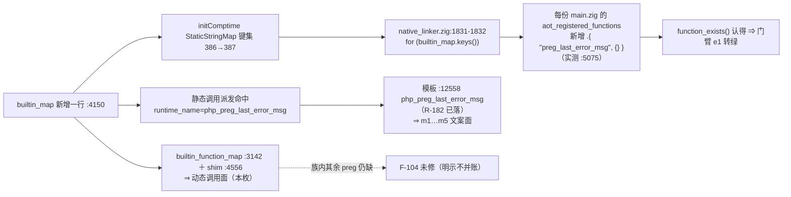
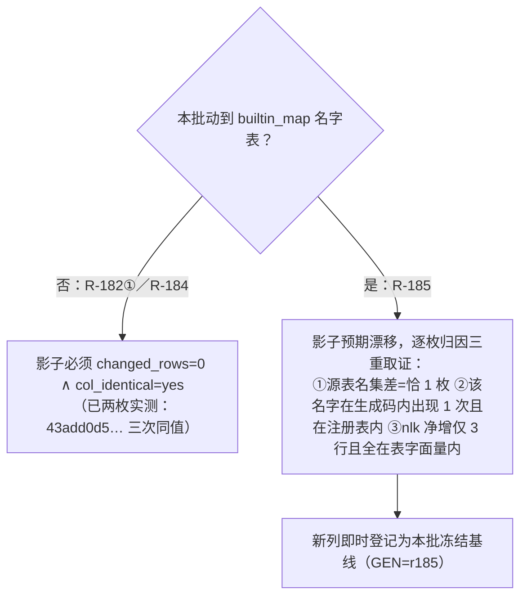

# AOT-CODEGEN-012 ｜ F-91 阶段②：`preg_last_error_msg` 进派发（R-185）｜ 2026-10-19 ｜ 基线 `a5f0de5`

## 1. 高层摘要（TL;DR）

R-182 阶段①已把 PCRE 错误码记对，但 `preg_last_error_msg()` **在 AOT 侧仍是"未定义函数"**：门臂 `e1` 读回 `#HAS_MSG#false`，`m1…m5` 的文案位打出来是 `MSG##0 {main}`（未定义函数 fatal 外溢）。本批把它接进派发——**这是本 epoch 第一批动到发射器输入表（`builtin_map`）**，因此影子的判据与前两批**正好相反**（前两批＝纯模板⇒必须中性；本批＝加名字⇒必然漂移）。

落地只有三处表项＋一枚 shim；实测 `function_exists` 与文案两侧**逐字合 PHP**。验收四腿读数见 §7（链跑动中，`c140`）。

## 2. 影响范围

| 维度 | 内容 | 状态 |
|---|---|---|
| 语义面 | `preg_last_error_msg()`：未定义 ⇒ 可按静态调用与 `function_exists` 观测，文案按 R-182 已落的实测串（`No error`／`Backtrack limit exhausted`／`Malformed UTF-8 characters, possibly incorrectly encoded`／兜底 `Internal error`） | 已实测（§88.2 探针两侧逐字同） |
| 动态面 | 模板 `builtin_function_map` 补本枚条目（`call_user_func('preg_last_error_msg')`） | 已落；★**整个 preg 族在该表内仍是零条目＝F-104 未修**，注释已明说不代表它 |
| 发射面 | ★`aot_registered_functions` 名单（`native_linker.zig:1831-1832` 由 `builtin_map.keys()` 生成）多一枚名字 ⇒ **每份 `main.zig` 文本都变** | 判据换档（§88.3） |
| 编译器 | 需重建（`bin e21ba239…`→`8b953cb2…`），`nlk`/`tpl` 同步换代 | 已实测（构建 71 s） |
| 模式面 | **AOT-only**：`parser`/`irg`/`opt` 三枚共享层**逐字未变**（链头断言）⇒ 不触宪法 §五 | 已实测 |
| 未做 | PCRE 自述 4 枚常量（`e4`，需新 `extern pcre2_config_8`）＝阶段①剩支 | #116 / §86.5-1 |

## 3. 核心变更

| # | 站点 | 变更 | 形制依据 |
|---|---|---|---|
| 1 | `native_linker.zig:4148-4150` | `builtin_map` 加 `.{ "preg_last_error_msg", bi(.{ .runtime_name = "php_preg_last_error_msg", .needs_allocator = true, .may_raise = false }) }` | 成对先例 `json_last_error`／`json_last_error_msg`（`:4073`／`:4074`） |
| 2 | `runtime_lib_template.zig:3142`（注释 `:3139-3141`） | `builtin_function_map` 加 `.{ "preg_last_error_msg", wrapBuiltin_preg_last_error_msg }` | 同表 `json_last_error_msg`（`:3138`） |
| 3 | `runtime_lib_template.zig:4556-4560` | 新增 `wrapBuiltin_preg_last_error_msg`：`_ = ctx; if (args.len != 0) return error.InvalidArgumentCount; return php_preg_last_error_msg(allocator);` | 逐字照 `:4543-4547`；arity 措辞沿用本仓约定（PHP 真值形属 **F-47**，不并账） |

## 4. 可视化概览

### 4.1 一名之加如何走到每份生成码

### 4.2 判据换档（前两批与本批禁互套）

## 5. 详细分析

### 5.1 涉及文件

| 文件 | 变更 | 代次 md5 |
|---|---|---|
| `src/aot/native_linker.zig` | 3 插入（1 行表项＋2 行注释），无删除 | `45a11243b37a7f844e5c715510ac3a3d`（上代 `322409ce…`） |
| `src/aot/runtime_lib_template.zig` | 表项 1 行＋shim 1 枚＋注释 | `2a4245821e8ba77d296d1738f9f7415e`（上代 `06d94a1e…`） |
| `zig-out/bin/php-interpreter` | 重建（`zig build rc=0 wall=71s`） | `8b953cb21ed34e96b3245a1b6df7151d`（上代 `e21ba239…`） |
| 门与工具 | `c093_perr_prefix_R185_snapshot_tmp.tsv`（修前基线 `236ab669…`）、`c140_accept_r185_tmp.sh`（四腿串行，判据换档版）、探针 `/tmp/c139_msg_probe_tmp.php` | — |
| 文档 | 工单 §88（§88.3 含 ⑤a 降级与失误登记）＋本文件 | — |

### 5.2 取证细节（全部实测，含两条自我否证）

1. **源表名集差＝恰 1 枚**：`git show HEAD:src/aot/native_linker.zig` 与现文件按形制 `^\s*\.\{ "name", bi\(` 抽取 ⇒ `old=386 new=387`、`only_new=[preg_last_error_msg]`、`only_old=[]`。
   ★首抽用 `sed '/^const builtin_map/,/^);/'` 得 **0/0**＝静默空抽取（定义实际包在 `@as(… &.{ … })` 里，`:4031`），靠"计数先验非零"抓回。
2. **生成码内只出现一次**：`f040` 的 `main.zig` 中 `grep -c '"preg_last_error_msg"'` ＝ **1**，在 `:5075`，相邻 `:5025` 为 `.{ "preg_last_error", {} },`。
3. **★一条流程失误如实登记**：本批开工前**没备份旧二进制**，`zig build` 覆写后 `e21ba239…` 不可再现 ⇒ §82 ⑤a 原形的"新旧两代 `main.zig` 逐枚 diff"**永久不可测**，只能降级为上面三重取证。新纪律：**动发射器输入表的批次，构建前先 `cp zig-out/bin/php-interpreter /tmp/bin_<上代锚>`**。
4. **一条想当然被实测否证**：曾以为注册表行数＝`builtin_map` 条目数（387），实测该形制行＝**498** ⇒ 名单另有来源，等式不许凭直觉写。

## 6. 影响与风险评估

- **破坏式？语义上是"补齐"而非改行为**：既有可编译脚本的调用结果不变；唯一全局可见变化是 `function_exists('preg_last_error_msg')` 由 `false` 变 `true`、`aot_registered_functions` 多一枚名字（该名单同时进每份生成码文本，属**预期漂移**）。
- **性能**：新增一枚静态表项（comptime 哈希表多一键）＋一次零参调用转发；`may_raise=false` 不引入额外清理路径 ⇒ 对既有热路径无回归面。
- **特别注意**：
  1. 影子判据本批**不许**写 `changed_rows=0`（那是纯模板批的判据）；也不许把"漂移"当免检——必须逐枚归因（§5.2 三重）。
  2. `builtin_function_map` 里 preg 族仍**零条目**（F-104）；本批只补自己那枚，勿读成"动态面已通"。
  3. msg 码 **3/5/6 的文案仍未取证**（本机不可触发，落兜底 `Internal error`，模板 `:12553-12558` 注释已明说）。
- **复测路径**：`php /tmp/c139_msg_probe_tmp.php` 与同名 AOT 产物对读（须一形一进程）；`TSV_OUT=… bash c093_preg_error_gate_tmp.sh` 看 `e1`／`m1…m5`；`bash c140_accept_r185_tmp.sh` 四腿。

## 7. 遗留问题

| 项 | 内容 | 记账 |
|---|---|---|
| 本批验收读数 | ★**已收口**（`c140_accept_r185_tmp.log`，23:19，四腿同代次）：门 PERR `arms=32 same=31 diff=1 compile_fail=0 bad_probe=0`（上档 `same=25`），逐臂 `DIFF→SAME=6`、`DIFF→DIFF=1`、**`SAME→DIFF=0`**；主回归 `rc=0 wall=801s` `68/67/1` 无 Fail；影子 **`changed_rows=68 col_identical=no`，新列 `477d50dee3a195f2fa111e900ec35a8e` 即本批冻结基线**（上列 `43add0d5…`） | ✅ 判据全达，**F-91 整枚关闭** |
| ★预登记值被实测否证一处 | §82 ⑤b 曾预估本批 `changed_rows == 67`（理由"f004 仍 Skip"）⇒ 实测 **68**。根因＝把"回归套件对 f004 的运行级 Skip"当成"该语料不产 `main.zig`"：影子按生成码文本取 md5，f004 照样产出并被比 ⇒ **注册表类漂移的分母＝语料全数，不是可运行数** | 已订正，禁后人沿用 67 |
| 残余红面 | **仅 `e4`**＝PCRE 自述 4 枚常量（本批范围外）；不再挂 F-91 名下 | #116／§86.5-1 |
| ⑤a 不可复原 | 旧二进制已被覆写，两代 `main.zig` 文本对读永久不可测；已降级为三重取证并写进新纪律 | §5.2-3 |
| F-91 剩支 | PCRE 自述 4 枚常量（需 `extern pcre2_config_8`）＝阶段①剩支 | #116／§86.5-1 |
| F-104 | preg 族动态调用面整族缺失（本批未扩面） | 已登记，待排 |
| 提交状态 | R-182①／R-184／R-185 三批改动**均未提交**（`native_linker.zig`＋`runtime_lib_template.zig`＋文档） | 提交需老铁明示 |

## 8. 后续开发／优化建议

| 优先级 | 建议 | 影响面 | 落地成本 |
|---|---|---|---|
| P0 | 阶段③：42 腿母链全量跑＋回填 `c116` 三锚（新 `bin/nlk/tpl`），邻居档（SUPA/LVAL/UNDEF/INL/ERRH…）不回退证明 | 全量 | 低（换锚＋开链 ≈1 h） |
| P0 | PCRE 自述 4 枚常量（`e4`）：新 `extern pcre2_config_8`（单行先例 `:11343/:11357`），版本串动态取、禁硬编码 | 门 PERR `e4`；★若再进名字表需同批按本批判据换档 | 低-中 |
| P1 | **F-104 收面**：把 preg 族整体补进 `builtin_function_map`（一次成族，别再一枚一枚漏）＋先取动态面修前基线 | `call_user_func('preg_*')` 全族；影子再漂一次（同本批档） | 中 |
| P1 | 给影子链加一条**"构建前自动备份上一代二进制"**的前置步（把 §5.2-3 的教训变成工具约束） | 让 ⑤a 类判据未来可复原 | 极低 |
| P2 | msg 码 3/5/6 文案取证：找可触发面（如调低 `pcre.backtrack_limit`/`recursion_limit` 已测得 2，offset 越界测得 1）或明确长期标记为"不可测" | 文档可信度 | 低 |
