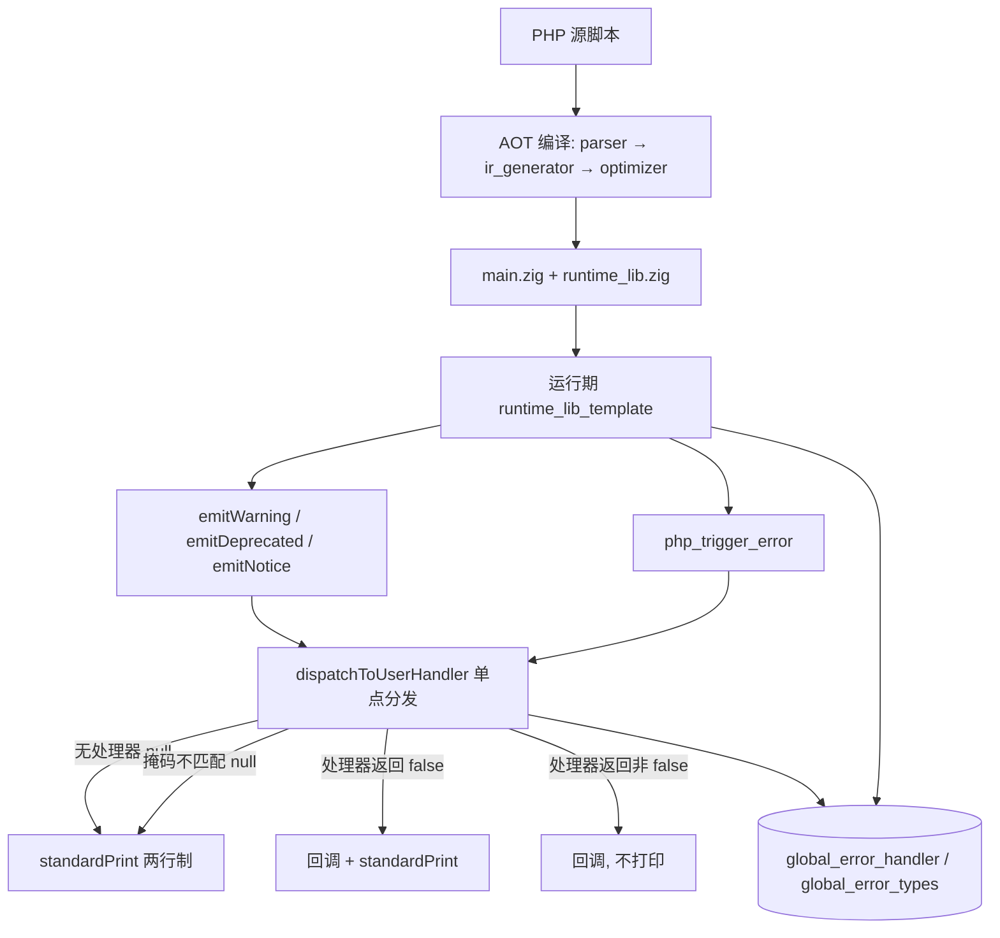
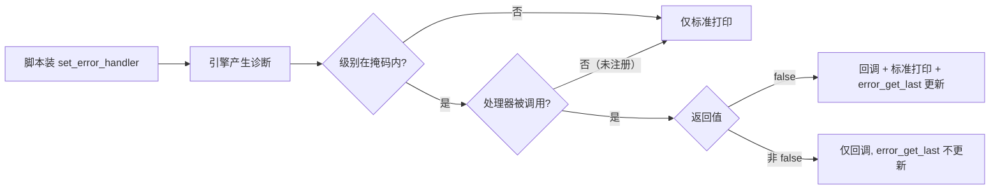
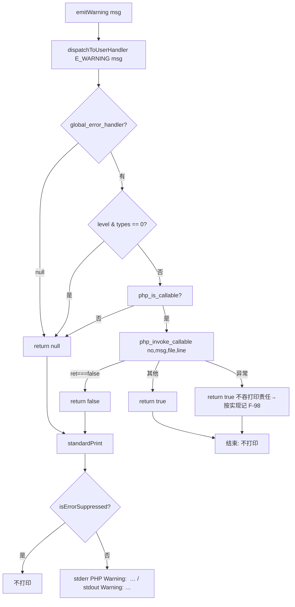
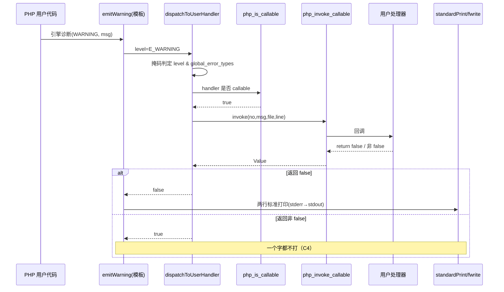

# AOT-CODEGEN-012 · F-92 用户错误处理器路由落地（R-180，2026-10-19，代次锚 `4160f577`）

## 1. 高层摘要（TL;DR）

- AOT 的引擎诊断（`emitWarning`／`emitDeprecated`／`emitNotice`）此前**只打印、不路由**：`set_error_handler` 装了也收不到回调（＝**F-92**）。本批在运行期模板内新增单点分发器 `dispatchToUserHandler`，把三条 `emit*` 与 `php_trigger_error` 统一接到 PHP 的七条契约（C1–C7）上，**标准打印文案逐字未改**。
- 关键发现：旧路由其实**是死代码**——它用 `handler.isFunction()` 判可否调用，而字符串名／闭包／`[$obj,'m']` 这些合法 callable 永远不是 `isFunction()` ⇒ 分支永不进入。本批改用 `php_is_callable` ＋ `php_invoke_callable`（并显式拆句避免 `!…catch…` 优先级陷阱）。
- 门 **ERRH** 15 臂档：修前 `same=4 diff=10 compile_fail=1` ⇒ 修后 `same=11 diff=3 compile_fail=1`，且逐臂位型与聚合互校一致；新加的三枚 F-100 语境臂首跑即把 **F-107**（`@$x = …` 整脚本编译失败）带了出来。
- 验收：链 `c111` ⇒ `R180_CHAIN_DONE`（`ELAPSED=9198s`）；主回归 **68/67/1/0**；影子 **`changed_rows=0` 且 `col_identical=yes`**（列 md5 与 R-178b/R-179 逐字节同一）；机械逐腿对账 **39 腿＝38 SAME ＋ 1 DIFF（PERR 的 `h1`，按构造归因为本批设计效果）**。
- 提交状态：代码已随 **`ca99151`** 入库（工作区 `src/` 干净，模板 md5 仍 `4160f577…`）。

## 2. 影响范围

| 维度 | 影响 | 实测证据 |
|---|---|---|
| 修改文件 | 仅 `src/aot/runtime_lib_template.zig`（运行期模板，编译期读盘） | 链头/链尾 `tpl_md5=4160f577dc2f01f2d1fc030e8650c7ee` |
| 编译器二进制 | **未换代**（模板不进二进制） | 链头与链尾 `bin_md5=793a9837…` 同值 |
| 生成码 `main.zig` | **零漂移**（模板不进生成码文本） | `SHADOWCOL_DONE rows=68 changed_rows=0 col_identical=yes` |
| 行为面 | 装了 `set_error_handler` 的脚本：诊断开始进处理器；未装处理器的脚本：打印逐字不变 | ERRH 15 臂 4/10/1 → 11/3/1；`h4/g1/g2/g3` 保持 SAME |
| 邻门面 | 除 PERR 外全部逐字同值 ⇒ 无外溢 | `c084_r179_vs_r180_final_tmp.txt`（38 SAME/1 DIFF/0 缺项） |
| 跨模式 | **未触碰**（解释/字节码/JIT 不改，符合宪法 §五） | 本批零 `src/compiler/`、`src/vm*` 改动 |

## 3. 核心变更

| # | 变更 | 落点（模板内） | 说明 |
|---|---|---|---|
| 1 | 新增分发器 `dispatchToUserHandler(level, msg) ?bool` | `emitWarning` 之前 | 三态返回：`null`＝无处理器（走标准打印）；`true`＝已被吞（不再打印）；`false`＝处理器返回 false（追加标准打印）。逐条落 C3/C4/C5 |
| 2 | 掩码前置判定 `(level & global_error_types) == 0` | 分发器首段 | C5：掩码不匹配 ⇒ 不调处理器**但仍照打**（不是静默） |
| 3 | 可调用性判定改 `php_is_callable`，调用改 `php_invoke_callable` | 分发器 | ★替换掉永不命中的 `handler.isFunction()`；`@` 抑制位仍由 `isErrorSuppressed()` 只管"打印"这一侧（C2） |
| 4 | 新增 `standardPrint(err_label, out_label, msg)` | 分发器之后 | 保留"先 stderr `PHP Warning:  `（两个空格）再 stdout `Warning: `"的两行制与文案逐字不变；`Deprecated` 的 stdout 无前置换行这一差异也保留 |
| 5 | `emitWarning`／`emitDeprecated`／`emitNotice` 改为"先分发、后标准打印" | 三条函数 | 修前 `emitNotice` 完全不进分发 ⇒ 本批统一 |
| 6 | `php_trigger_error` 走同一分发器 ＋ 按级别标准打印 | `php_trigger_error` | 未实测的级别组合保留原 `else` 文案（禁凭推测改文案） |
| 7 | 处理器异常按"不吞诊断"处理 | 分发器 `catch` | 记为 F-98 面：调用用户处理器失败时仍走标准打印，避免诊断消失 |

## 4. 可视化概览（Code & Logic Map）

### 4.1 分层架构

### 4.2 业务流程（用户可见口径）

### 4.3 执行流程（单条 `emitWarning`）

### 4.4 时序图（上层 → 底层）

## 5. 详细变更分析

| 层 | 文件/资产 | 变更点 |
|---|---|---|
| 运行期 | `src/aot/runtime_lib_template.zig` | 新增 `dispatchToUserHandler`／`standardPrint`；`emitWarning`／`emitDeprecated`／`emitNotice`／`php_trigger_error` 改走分发器 |
| 主门 | `fuzzy_scripts_720/tmp/c108_errh_gate_tmp.sh`（ERRH） | 15 → 18 臂（新增 `h12/h13/h14` F-100 语境），并升级为 **v2**：`SAME` 需文本相同 **且** `prc==arc`，逐臂落 `rc=`，DONE 落 `rc_mismatch=`，支持 `TSV_OUT` 覆写；现 md5 `4898730b8c19b107d7ddb1d11fc95fef` |
| 快照 | `c108_errh_prefix15_R180_snapshot_tmp.tsv`／`…_postfix11_…`／`c108_errh_18arm_R180_snapshot_tmp.tsv`（`be60a0f1…`） | 修前/修后/18 臂档三份，逐臂可回溯 |
| 真值 | `c102_f91_f92_truth_tmp.tsv`（115 行） | C1–C7 契约文案与级别来源 |
| 验收链 | `c111_r180_acceptance_chain_tmp.sh` ＋ `.log` | 37 条 gate 腿 ＋ 回归 ＋ 影子；`R180_CHAIN_DONE`，`ELAPSED=9198s` |
| 补跑 | `c118_r180_supplement_tmp.sh` ＋ `.log` | ERRH＋INL 两腿链外补跑（六枚代次锚断言 ＋ 并发护栏 ＋ 门 md5 留痕），合计 `193s` |
| 对账 | `c084_chain_leg_compare_tmp.sh`（修复版 `0c041a53…`）＋ `c084_r179_vs_r180_final_tmp.txt` | 机械逐腿：39 腿 38 SAME/1 DIFF |
| 工单 | `docs/known-issues/AOT-CODEGEN-012-….md` §73/§79/§80/§81/§82 | 落地记录、事前注册、F-100 取证、F-91 判据重写 |

## 6. 影响与风险评估

- **是否破坏式**：否。生成码零漂移（`changed_rows=0 ∧ col_identical=yes`）；主回归 `68/67/1/0` 不变；未注册处理器的脚本输出逐字不变（守卫臂 `h4/g1/g2/g3` 全 SAME）。
- **范围**：仅运行期模板。风险集中在"处理器被真正调用"后暴露的下游面——本批把过去**沉默**的诊断路径激活，因此把三枚相邻缺陷一次性显性化：`h6/h12`→F-100、`h10`→F-105、`h11`→F-106（**`rc=php/255 vs aot/0`** 实测）。
- **需特别注意**：① `handler.isFunction()` 类"看起来对其实永不命中"的判定是历史陷阱，凡"能否调用"一律走 `php_is_callable`；② `!x catch e` 的优先级在 Zig 里会静默改语义，必须拆句；③ `@` 与处理器是**两条独立轴**（C2）：`@` 只压打印，不压回调。
- **复测路径**（仓库根、全部带超时）：
  1. `timeout 900 bash fuzzy_scripts_720/tmp/c108_errh_gate_tmp.sh` ⇒ 认 `arms=18 same=12 diff=4 compile_fail=2 bad_probe=0 rc_mismatch=1`（其中 4 红全部具名：F-100×2、F-105×1、F-105＋F-106×1；2 枚编译失败＝F-75/F-47 与 F-107）。
  2. `timeout 300 bash fuzzy_scripts_720/tmp/c118_r180_supplement_tmp.sh`（须链未跑）⇒ 认 `GEN_ASSERT_OK` ＋ `SUPPLEMENT_DONE`。
  3. `timeout 120 bash fuzzy_scripts_720/tmp/c084_chain_leg_compare_tmp.sh <旧log> <新log>` ⇒ 先跑"同一份 log 对比自己＝0 DIFF"的自检，再看逐腿表。
  4. 体验面：任一带 `set_error_handler` 的脚本，回调应收到 `errno/文案/文件/行`，且 `return false` 时仍追加两行标准打印。

## 7. 遗留 / 潜在问题

| 编号 | 面 | 状态 |
|---|---|---|
| F-99 | 用户代码 `fwrite(STDERR,…)` 无声 | 待排（观测通道受限，门内一律用 stdout） |
| F-100 | 不发 `Undefined array key` 等四套措辞 | 已定价（纯模板一处）＋门 UNDEF 32 臂已建成入链 |
| F-105 | `trigger_error(E_USER_ERROR)` 缺 `E_DEPRECATED(8192)` 一句 | 新立，待排 |
| F-106 | 无处理器时 E_USER_ERROR fatal **不终止**（`aot rc=0` vs PHP 255） | 新立，rc 已实测 |
| F-107 | `@$x = …`（`@` 直接包赋值目标）**整脚本编译失败**，站点 `ir_generator.zig:4283` | 新立 **P0**，待排 |
| F-108 | 同一形制在解释模式返回空值（PHP 给 `2`） | 只登记，跨模式需裁决 |
| F-95／F-96 | `error_reporting()`／`register_shutdown_function()` 未实现 | 待排（门臂头因此禁用这两句） |
| F-91／F-90 | preg 错误码 API ＋ 主题坏 UTF-8 契约 | R-181 排期中，判据已按 §82 重写 |
| F-101／F-102／F-103 | 版本常量自述／`builtin_map` 重复键／模板内不可达 `preg_replace` 桩 | 待老铁裁决 |

## 8. 后续开发 / 优化建议

| 优先级 | 建议 | 影响面 | 落地成本 |
|---|---|---|---|
| P0 | 落 **F-107**（`ir_generator.zig:4283` 前剥抑制节点）——`@$x = …` 是常见惯用形，现"出现即整脚本不可编译" | 默认档、编译期硬失败 | 低-中：一处剥包装 ＋ 先建 6 形状永久门再落；`ir_generator` 改动 ⇒ 二进制换代 |
| P0 | 建 F-100 永久门后落"缺失键四套措辞"（`c115` 真值 93 行、UNDEF 门 32 臂已就绪） | 默认档用户面 | 低：`php_array_get` 两支；按引用读必须保持静默（已实测） |
| P1 | 把 **F-105＋F-106** 并批（同在 `php_trigger_error` 的 E_USER_ERROR 支），并给 ERRH 补 `rc` 判据后的新臂 | 默认档 fatal 语义 | 低-中 |
| P1 | 治理项：所有门给 COMPILE_FAIL 行落**编译日志列**；所有逐臂门基线**同批落快照**（本轮 PERR 因只有聚合数而无法回溯的教训） | 验收可信度 | 低（每门几行） |
| P2 | 内联器（F-93＝CODEGEN-007）路线需先裁决：完整重绑 ~85 个 op tag vs "不能完整重绑就不内联"的能力门（后者属放弃内联收益，宪法 §六-7） | 非默认档 | 中-高 |
