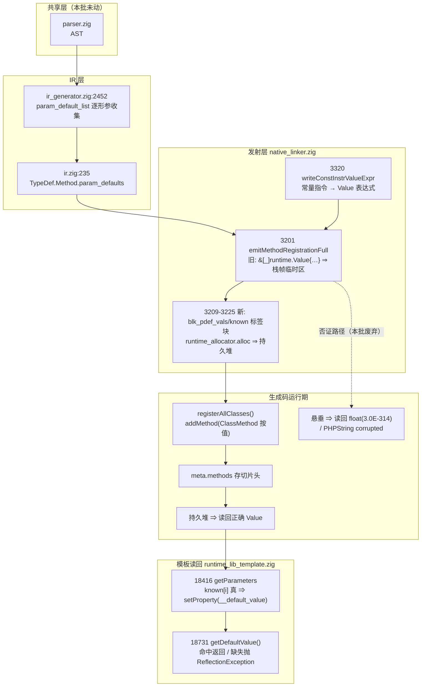
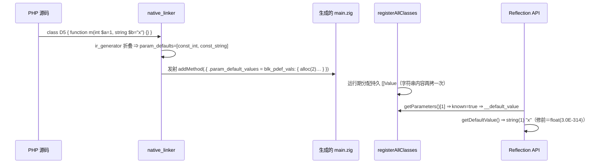

# AOT-CODEGEN-012 F-118 形参默认值（悬垂切片内存安全修）落地 R-191b

- 工单：`docs/known-issues/AOT-CODEGEN-012-class-name-case-insensitive-lookup.md` §100
- 轮次：R-191b（继 R-191a 尝试回退之后的第二轮）
- 代次锚（源码 md5，**不**用 bin md5）：`nlk=0d598ff839d3a7712aeb8b9c3a2f5a44`／`tpl=7632c7c5e9ec37e058f8b9791986a48e`／`ir=1fb6b01f9b0bdff318de496538e7620e`／`irg=a57519607f10ba6140c27df535cd90dd`；共享层未动 `parser=70e80f18a2c6ef6787b4c5d817c31773`／`opt=36f354f49be053bb8c70b29f7fa7538a`；`bin=c085edb4fae003d601b628eda6adda88`（仅登记）
- 批型：**IR＋发射器**（三枚源同动）⇒ 判据走「影子必然漂移」档

## 1. 高层摘要（TL;DR）

`ReflectionParameter::getDefaultValue()` 的值面（F-118）落地并关闭，同时把 R-191a 那枚"静默错值"的**真根因**定性为**内存安全缺陷**：发射期生成的 `&[_]runtime.Value{…}` 数组字面量含运行期元素（`try PHPString.init(…)`），Zig 只能把它建在 `registerAllClasses` 的**栈帧临时区**，而 `addMethod` 是按值拷贝 `ClassMethod` 结构体、只把**切片头**存进方法表 ⇒ 帧一销毁，方法表里那些切片头全部悬垂。修法＝改为在 `runtime_allocator` 上分配**持久**数组，用带标签块内联在结构体字段里。

四腿全绿：门 P 88 臂 `same→diff=0`、`diff→same=2`（`d5`＋`v2`，同属 F-118）；主回归 `68/67/0/1` 且表自检 OK；影子 `changed_rows=68`＝预期漂移并**逐枚归因到语句级**（结构折叠 diff：行数与 `addMethod` 语句条数完全不变、UNEXPECTED=0）；三枚邻门（PD2/PRC/M）**零转移**。

## 2. 影响范围

| 面 | 影响 | 强度 |
|---|---|---|
| 类方法元数据发射 | 每条**带形参**的 `addMethod` 语句由 1 行展开为 9 行，新增两个运行期分配块 | 全语料 68/68 枚文件的 main.zig 变（普查证实每枚都含带形参方法） |
| 运行期内存 | 每枚带形参方法多 2 次 `alloc`（Value 数组＋bool 数组），发生在启动注册期，与方法表同寿 | 一次性、不随调用增长 |
| 反射语义 | `getDefaultValue()` 从"整族缺失（Fatal）"变为"折叠得出则给值、否则按 PHP 抛 ReflectionException" | 关掉 F-118 主面＋`v2` 面 |
| 未受影响 | 全局函数注册路径、属性默认值路径、`param_names/types/nullable` 三个**全字面量**数组（元素皆常量 ⇒ 被 Zig 提到静态段，本就无此问题） | — |
| 非 AOT 模式 | **未触碰**（无 tree/bytecode/fast 侧改动，符合宪法五） | — |

## 3. 核心变更

| # | 文件:行 | 变更 |
|---|---|---|
| 1 | [src/aot/native_linker.zig:3201-3226](file:///Users/wangjianjun/products/parser/src/aot/native_linker.zig#L3201-L3226) | `emitMethodRegistrationFull` 的 `param_default_values`／`param_default_known` 由数组字面量改为 `blk_pdef_vals:`／`blk_pdef_known:` 标签块内 `runtime_allocator.alloc` ＋逐元素赋值 |
| 2 | [src/aot/native_linker.zig:3320-3331](file:///Users/wangjianjun/products/parser/src/aot/native_linker.zig#L3320-L3331) | `writeConstInstrValueExpr` 的"形状纪律"注释改写：把"禁用 `?Value` 数组"更正为"禁塞数组字面量，必须逐个赋值进运行期切片"（旧断言已被实测否证） |
| 3 | [src/aot/ir.zig:235](file:///Users/wangjianjun/products/parser/src/aot/ir.zig#L235)、[src/aot/ir.zig:440](file:///Users/wangjianjun/products/parser/src/aot/ir.zig#L440) | `TypeDef.Method.param_defaults: []const ?*Instruction`／`Parameter.default_value`（R-191 同批遗留、本批沿用） |
| 4 | [src/aot/ir_generator.zig:2452-2508](file:///Users/wangjianjun/products/parser/src/aot/ir_generator.zig#L2452-L2508) | 逐形参收集 `param_default_list`（折叠得出则存指令、否则 null），随 TypeDef.Method 落 `param_defaults` |
| 5 | [src/aot/runtime_lib_template.zig:18416-18420](file:///Users/wangjianjun/products/parser/src/aot/runtime_lib_template.zig#L18416-L18420)、[:18731-18746](file:///Users/wangjianjun/products/parser/src/aot/runtime_lib_template.zig#L18731-L18746) | `getParameters` 仅在 `param_default_known[i]` 为真时装 `__default_value`；新增 `getDefaultValue()` 方法，不可知时按 PHP 8.5.8 措辞抛 `ReflectionException` |
| 6 | `fuzzy_scripts_720/tmp/c012_reflection_gate_tmp.sh` | 门 P 85→**88 臂**（新增 `d8`/`d9`/`d10`），头部判读改为 R-191b 定档：现红恰 6 枚 `i1 i2 f12 f34 d6 d9` |

## 4. 可视化概览【mermaid：Code & Logic Map】

## 5. 详细变更分析

### 5.1 端／层／文件清单

| 层 | 文件 | 变更点 |
|---|---|---|
| IR 数据 | `src/aot/ir.zig` | `TypeDef.Method.param_defaults`、`Parameter.default_value` 两枚载荷字段（带默认值 ⇒ hook 无需改） |
| IR 构建 | `src/aot/ir_generator.zig` | 形参默认值经 `tryMakeConstInstruction` 折叠后入列；折叠不出＝null 占位（不猜） |
| 发射 | `src/aot/native_linker.zig` | 唯一站点 `emitMethodRegistrationFull`；`writeConstInstrValueExpr` 映射表与属性默认值发射处逐项同序 |
| 运行期模板 | `src/aot/runtime_lib_template.zig` | `ClassMethod` 两枚平行数组字段＋`getParameters` 装填＋`getDefaultValue()` 注册 |
| 验收工具 | `c174`（五变体矩阵）／`c175`（修前 d 族）／`c176`／`c177`（87 臂）／`c178`（四腿链）／`c179`（awk join）／`c180`（d10 单臂）／`c181`（分母普查＋按行归因）／`c184`（结构折叠归因）／`c186`（88 臂冻结基准） | 新建 |

### 5.2 读数账本

| 腿 | 修前 | 修后 | 判据 | 结果 |
|---|---|---|---|---|
| 门 P（d 族 9 臂） | `same=6 diff=3`（`d5 d6 d9*`） | `same=7 diff=2` | `d5` 转绿 | ✅ |
| 门 P 全域 | 85 臂基准 `4a08ce80…` | 87 臂 `same=81 diff=6` | `same→diff=0` | ✅ `diff→same=2`＝`d5`＋`v2` |
| 门 P 冻结 | — | 88 臂 `same=82 diff=6`（`4169d559…`） | 88∩87 零转移 ∧ `d10=SAME` | ✅ |
| 内存安全矩阵 v1–v5 | v1/v2/v5 DIFF（含 `PHPString corrupted`） | 5/5 SAME | 全绿 | ✅ |
| 主回归 | 68/67/1 | 68/67/1，三种 Fail 全 0，`SELF_CHECK_OK rows=68 uniq=68` | 逐字相同 | ✅ @795 s |
| 影子 | 中性列 `477d50de…` | 新列 `7f4b2c8a…`，`changed_rows=68` | 本批须漂移 | ✅ @1056 s |
| 漂移归因 | — | 普查 68/68 含带形参方法；f067 `lines=6840→6840 stmts=4→4 UNEXPECTED=0`；f110（最大枚）`lines=84285→84285 stmts=21→21 UNEXPECTED=0` | 仅 `addMethod`＋`param_default` 行变 | ✅ |
| 邻门 PD2 | 19 臂红 `p12 p13`（副本 `1a656a23…`） | 19 臂红 `p12 p13` | 零转移 | ✅ @85 s |
| 邻门 PRC | `same=56 diff=1`（`7514b021…`） | `same=56 diff=1`，红名同为 `P|100` | 零转移 | ✅ @25 s |
| 邻门 M | 19 形零红（副本 `fa566810…`） | 19 形零红 | 零转移 | ✅ @81 s |
| 邻门 TERN（链外补跑 `c187`） | 冻结基线 `01c7cc7b…` `same=4 diff=8` | `same=4 diff=8`，红名 `a3…a10` 同名同序 | `inter=12 same→diff=0 diff→same=0` | ✅ @86 s |
| 邻门 VAR（链外补跑 `c187`） | 修后全绿档 `cc742dfc…` 9/9 | 9/9 全绿 | `inter=9` 零转移 | ✅ @63 s |
| 邻门 UNDEF（链外补跑 `c187`） | `c8c4aa6c…` `same=14 diff=18` | `same=14 diff=18` | `inter=32` 零转移 | ✅ @136 s |
⇒ 本批共 **6 枚邻门面**（PD2/PRC/M/TERN/VAR/UNDEF）逐臂零转移，加门 P 全域 88 臂零回退。
★补跑过程中 joiner 自己被抓两次（都是"空读数伪装成零转移"）：`set -- $pair` 在 zsh 下不分词 ⇒ `PRE rows=0`；键正则限死 `[A-Za-z0-9_]` 而 UNDEF 的臂名是 `miss_str/raw` ⇒ 同样 0 行。两处均已改（`c179_pjoin_tmp.awk` 取首列整列为键），并靠"两侧行数＋交集数"断言显形。

## 6. 影响与风险评估

- **是否破坏式变更**：否。语义面只**新增**（此前是响亮 Fatal「Call to undefined method」），未删除任何既有行为；`__has_default` 仍按位置规则 `i >= required_params` 计算，未被 `param_default_known` 覆盖（PHP 对 `new` 默认值也报 `avail=true`，改了会把 `d9` 的 avail 弄错）。
- **内存安全**：修的是**本批自己引入**的悬垂（`&[_]runtime.Value{` 在 `native_linker.zig` 共 21 处，另 20 处皆为调用实参、在同一次调用内消费 ⇒ 普查否证"既存同病"，无需另立缺陷）。分配的数组与方法表同寿、不释放，和既有 `PHPString.init(runtime_allocator)`／`blk_arr_*` 口径一致；`alloc` 失败经 `try` 上抛 ⇒ 不静默降级。
- **性能**：新增分配只在启动注册期，每条带形参方法 2 次；运行期读取路径开销不变。发射行由 1 行变 9 行 ⇒ 生成码体积微增（f110 枚实测 `addMethod` 语句 16 条受影响），编译时间未测出可辨变化（影子腿总时长与常态同量级）。
- **需特别注意**：①**"回归没红"不等于没弄坏**——语料 68 枚不含 `ReflectionParameter::getDefaultValue()` 调用，主回归对 F-118 完全失明，正确性只能由门 P 的 d 族证明；②非确定性缺陷的守卫臂必须**先制造分配再重复读**（`d10`），直接读一次的臂有概率"看着对"。
- **复测路径**：`ONLY="d5 d8 d10" OUT=… timeout 300 bash fuzzy_scripts_720/tmp/c012_reflection_gate_tmp.sh`（三臂 SAME）⇒ 全 88 臂冻结比对 `4169d559…` ⇒ `c174_f118_matrix_tmp.sh` 五变体须 5/5 SAME。

## 7. 遗留问题／潜在问题

- **F-118b（#139，`d9`）**：`new` in initializer 一类折叠不出的默认值，PHP 返回对象、AOT 现按 PHP 措辞抛异常 ⇒ 仍是语义红。修法须保留非折叠支（成本＝中偏高），**禁止**为转绿而发 `initNull`（静默错值比抛异常更坏）。
- **F-119（#135，`d6`）**：AOT 多注册了 PHP 不存在的 `ReflectionParameter::hasDefaultValue()`；删码须老铁明示（宪法六-3）。
- **本批五枚源未提交**（`nlk`/`tpl`/`ir`/`irg` 加 `native_linker` 已 add 未 commit），HEAD 仍 `a5f0de5`。
- 发射器里"按值存结构体 ⇒ 只拷切片头"这一模式对**任何**新增长命元数据字段都成立；本次普查只覆盖 `runtime.Value` 一种元素类型，其余元素类型（`[]const u8`／`bool`）若将来掺入运行期表达式，同样会落栈帧 ⇒ `writeConstInstrValueExpr` 的注释已把这条纪律钉在站点上。

## 8. 后续开发／优化建议

| 优先级 | 建议 | 影响面 | 落地成本 |
|---|---|---|---|
| P1 | 让验收链把"代次相符的第二基线"做成**必填参数**（#136）：本轮若再用错代基准，`v2` 的 `DIFF→SAME` 会被误读成"上一批弄坏了什么" | 所有链 | 低（链头一行断言） |
| P1 | 给"元数据切片"建**通用发射 helper**：凡按值存进长命注册表的切片字段一律走 `runtime_allocator.alloc`＋标签块，禁在调用点手写数组字面量；并把该不变式做成 comptime 断言或门 | 发射器 | 中 |
| P2 | 门 P 的 `d10` 形状可再扩：同一形参跨 **10 次**读取、并在读取之间插入 `str_repeat` 类分配，专门放大"栈帧复用"窗口（当前 5 变体已够显形，边际收益小） | 测试面 | 低 |
| P2 | 排 F-118b（#139）前先测 `new`/`array` 两类非折叠默认值在 PHP 里的**求值次数**语义（每次调用新建 vs 共享），否则实现方向会错 | 反射族 | 取证＝低，实现＝中 |
