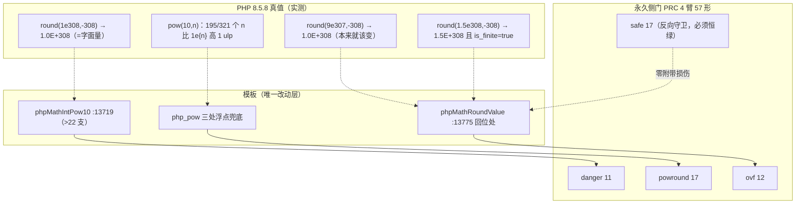
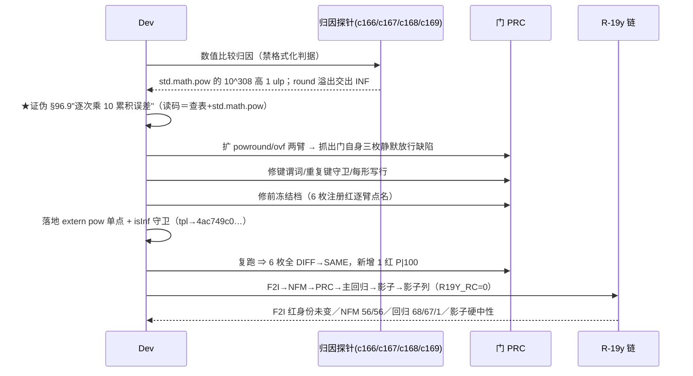

# AOT-CODEGEN-012 ｜ F-120＋F-121 数值精度末位与溢出面落地（R-19y）

- 日期：2026-10-20
- 轮次：R-19y｜关闭：**F-120**（`round(1e308,-308)` 末位值错）、**F-121**（`round` 回位溢出交出 INF）｜新立：**F-122**（用户层 `pow()` 的 ulp 口径，待老铁裁决）
- 代次锚（`md5 -q` 实测）：`tpl=4ac749c0b1bdd74b8ddf72d7731aabb9`｜`nlk=45a11243b37a7f844e5c715510ac3a3d`（未变）｜`bin=8b953cb21ed34e96b3245a1b6df7151d`（未变）｜`parser/irg/opt` 未变｜HEAD=`a5f0de5`（未提交）
- 批次定性：**纯模板**（`phpMathIntPow10`／`phpMathRoundValue`／`php_pow` 三个函数）⇒ 判据＝影子**硬中性**
- 工单：[docs/known-issues/AOT-CODEGEN-012-class-name-case-insensitive-lookup.md](file:///Users/wangjianjun/products/parser/docs/known-issues/AOT-CODEGEN-012-class-name-case-insensitive-lookup.md) §97（§97.1–§97.7）

## 1. 高层摘要（TL;DR）

`round()` 在大精度／大负精度上有两枚互相独立的值错：**①**`phpMathIntPow10` 的 `>22` 支用 `std.math.pow`，实测它对 `10^308` **比正确舍入值高 1 ulp**，于是 `round(1.0e308,-308)` 得 `1.0000000000000006E+308`；**②**缺"回位溢出"守卫，PHP 实测在 `round(1.5e308,-308)` 上**保留原值且仍 finite**，AOT 却交出 `INF`（`value/INF=0` 之后 `0*INF`）。两枚都在模板内解决：①改走 `extern fn pow` 单点 helper，②加一条只认"原值有限 ∧ 回位 INF"的守卫。
门 PRC 从 2 臂扩到 **4 臂 57 形**，修前注册红 **6 枚逐臂点名**、修后 **6 枚全部 `DIFF→SAME`**；四腿全绿（F2I 红身份未变、NFM 56/56、主回归 `68/67/1`、影子 `changed_rows=0 ∧ col_identical=yes`）。
★反直觉收获：新立的 **F-122** 显示 **PHP 自己的 `pow(10,n)` 在 195/321 个指数上比字面量高 1 ulp**，而 AOT 改走 `extern pow` 后 0 枚偏差 ⇒ 在这一面"AOT 更准"恰恰等于"AOT 不合预言机"，要不要逐 ulp 复刻 PHP 属价值判断，已交老铁定调（甲／乙／丙三案）。

## 2. 影响范围

| 维度 | 影响 | 证据 |
|---|---|---|
| 生产码 | 模板内 3 处：`phpMathIntPow10`、`phpMathRoundValue` 回位处、`php_pow` 三个浮点兜底支 | 其余五枚源码锚未变 |
| 用户面 | 凡传**大正／大负精度**（金融取整、科学计数、`pow(10,n)`、`**`）的默认档脚本 | 门 PRC 57 形、门 F2I 51 臂、门 NFM 56 臂 |
| 不受影响（守卫精度） | 本来就该变的形仍照变：`round(9.0e307,-308)→1e308`、`round(1.4e308,-308)→1e308` 实测仍等 | `ovf` 臂 12/12 |
| 发射面 | 零 | `changed_rows=0 ∧ col_identical=yes`（列 `477d50de…`，第 7 枚中性样本） |
| 测试工具 | 门 PRC 修掉三枚**静默放行**缺陷（详见 §6） | 自证＋全量复跑 |
| 新增红 | 1 枚 `P|100`（用户层 `pow()` ulp 口径，未定调） | 门 PRC `shape_diff=1` |

## 3. 核心变更

| # | 站点（模板内） | 变更 | 依据 |
|---|---|---|---|
| 1 | `phpMathIntPow10`（`>22` 支） | `std.math.pow` → `libmPow10`（单点 `libmPow`，内部复用，DRY） | `c166` 探针：`pow(10,308)==1.0e308` PHP true／AOT false 且 `>` true；且 `round(1e308,-308)==pow(10,308)` ⇒ 错值**完全来自幂构造** |
| 2 | `phpMathRoundValue` 回位处 | 新增 `if (std.math.isInf(unscaled) and !std.math.isInf(value)) return value;` | PHP 实测 `round(±1.5e308,-308)`／`round(1.7e308,-308)` ＝原值且 `is_finite` 为真 |
| 3 | `php_pow` 三处浮点兜底（负指数／整型溢出／泛浮点） | 统一走 `libmPow` | 与 ①同一函数族，避免两套幂口径；★其用户层后果即 **F-122**，已交裁决 |
| 4 | 门 PRC | 扩 `powround`／`ovf` 两臂；键谓词泛化；加 `BAD_PROBE_ZERO_SHAPES` 与 `BAD_PROBE_DUP_KEY` 两道停链守卫；改为**每形写一行** | §97.4 |

```zig
// src/aot/runtime_lib_template.zig（节选）
extern fn pow(x: f64, y: f64) f64;
fn libmPow(base: f64, exp_val: f64) f64 { return pow(base, exp_val); }
fn libmPow10(n: f64) f64 { return libmPow(10.0, n); }
// phpMathRoundValue 末段
const unscaled = if (places_positive) rounded / exponent else rounded * exponent;
if (std.math.isInf(unscaled) and !std.math.isInf(value)) return value; // ★F-121
return unscaled;
```

## 4. 可视化概览





## 5. 详细变更分析

| 层 | 变更点 | 备注 |
|---|---|---|
| 运行期模板（算术） | 幂构造单点化＋回位溢出守卫 | 不碰发射器／IR／解析器 |
| 验收件 | 门 PRC 扩 2 臂并加两道停链守卫；探针 4 份（`c166`–`c169`）＋ PHP/AOT 读数各留档 | `c169` 321 指数扫描**不入永久门**（口径未定） |
| 链件 | `c165_accept_r19x_tmp.sh` 复用为新锚 R-19y 链（日志 `c170_accept_r19y_tmp.log`） | 头含 `nlk/bin` 批次类型断言 |
| 读数 | F2I `51 臂 same=46 diff=4 cf=1`（红＝`b5 b6 b7 b8`+`b3`，与 R-19x 同身份，四对账全 0）；NFM `56/56`；PRC `same=56 diff=1`；REG `rc=0 wall=844s`＋`SELF_CHECK_OK rows=68 uniq=68`＋`Total 68/Pass 67/Fail 0·0·0/Skip 1`；SHADOW `rc=0 wall=1119s`＋`changed_rows=0 ∧ col_identical=yes`；`residue=0` | 链跑期间**零改源**，各腿共享同一 `tpl` |

## 6. 影响与风险评估

- **破坏式？** 否。影子 68 份 `main.zig` 零变化；F2I／NFM 红身份逐臂未变 ⇒ 未把已对的面改坏。
- **精度语义**：`extern pow` 的实际符号解析**很可能不是** PHP 所用的 libSystem `pow`（AOT 在 321 指数上 0 偏差、PHP 有 195 偏差即为旁证）⇒ 用户层 `pow()` 的逐 ulp 一致性**未达成**，此即 F-122；内部 `pow10` 支的目标（与字面量一致）已达成。★不把"更准"偷偷当成"已合 PHP"。
- **溢出守卫的边界**：只认"原值有限 ∧ 回位 INF"，故 `INF` 输入、`NAN` 输入、本来就该变的形都不受扰动（`ovf` 12/12 为机器证据）。
- **性能**：冷路径函数内一次 `isInf` 判定＋把 `std.math.pow` 换成 C `pow`；★未做基准（非热路径，按宪法三-2 不设基准要求，**不报估算值**）。
- **门自身的三枚静默放行缺陷（本轮最重要的工具收获，已全修）**：① 键谓词写死 `[AB]` ⇒ 新两臂解析成 `PHP_SHAPES=0` 而整轮仍报全绿；② 形名键不唯一 ⇒ 同值不同精度的 6 行并成 1 键、后写覆盖前写，把 3 枚真红报成 8 枚；③ 旧门只把红行写进 TSV ⇒ SAME 无逐形证据，跨表 join 会大面积报"修前无此行"。现改为每形一行，并对"零形"与"重复键"**直接判 bad_probe 停链**。
- **复测路径**：
  1. `timeout 600 bash fuzzy_scripts_720/tmp/c164_prc_gate_tmp.sh` ⇒ 期望 `arms=4 shape_same=56 shape_diff=1`（唯一红 `P|100`）；
  2. `timeout 300 env AOT_BIN=/bin/false TSV_OUT=/tmp/st.tsv bash fuzzy_scripts_720/tmp/c164_prc_gate_tmp.sh` ⇒ 期望 4 臂 `COMPILE_FAIL_shapes_in_arm` 全 >0；
  3. `timeout 4200 bash fuzzy_scripts_720/tmp/c165_accept_r19x_tmp.sh` ⇒ 四腿判据同上；
  4. 手测：`php` 与 AOT 各跑 `fuzzy_scripts_720/tmp/c168_f121_overflow_family_tmp.php` 逐字相等。

## 7. 遗留问题 / 潜在问题

1. **F-122（待裁）**：用户层 `pow()` 的 ulp 口径——甲维持／乙回退用户层三站点／丙真绑 libSystem（唯一可能逐 ulp 全等，需动 `build.zig` 链接配置）。
2. **门 PRC 的 `powround` 臂覆盖面窄**：只 6 个指数；`c169` 的 321 指数扫描因口径未定而**未入门** ⇒ 定调后应把选定口径的那批做成常驻臂。
3. **母版链缺 `VAR` 腿**：链内已按 `NOT_IN_MASTER_OR_MISSING` 跳过并登记 ⇒ 需把 `run_gate VAR` 补进 c070（同 #136 的"第二基线"一并处理）。
4. `phpMathIntPow10` 的 `0..22` 查表与 `>22` 外部幂**两套口径并存**：若 F-122 选丙，应合并为单一路径以免将来再分叉。
5. 五批改动（R-187~R-190＋R-19y）**全部未提交**，HEAD 仍 `a5f0de5`。

## 8. 后续开发 / 优化建议

| 优先级 | 建议 | 影响面 | 落地成本 |
|---|---|---|---|
| P0 | 老铁定调 F-122（丙案先做 5 分钟可行性实测：改 helper 走 `@cInclude("math.h")` 的 `pow`，重跑 `c169` 看是否复现 195 枚 GT） | 所有浮点幂 | 低（可行性）／中（含 `build.zig`） |
| P1 | **R-191＝F-118**（`IR.Parameter` 加"值＋常量名"双载荷，两处发射站点，`#134` 规格齐）——默认档内省用户面最大的一块 | 反射族 | 中偏高（影子必漂移） |
| P1 | 定调后把 `c169` 扫描按选定口径收进永久门（新增第 5 臂），并合并查表／外部幂两套口径 | 数值族 | 低 |
| P2 | 母版 c070 补 `run_gate VAR` 腿，并把"代次相符的第二基线"做成每门必填项（#136） | 验收链 | 低 |
