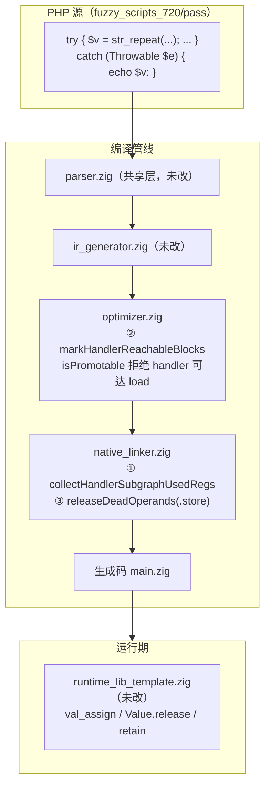
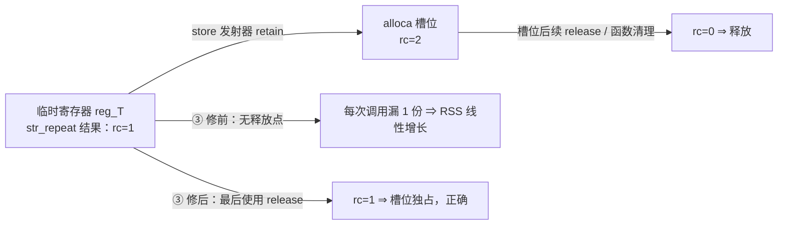

# AOT-CODEGEN-012 · F-132 异常边值绑定双缺陷 ＋ store 引用泄漏 R-197 · 2026-10-20 · 基线 `05c9318`

## 1. 高层摘要（TL;DR）
- F-132 最终拆成**三枚独立缺陷**：① 异常边 cleanup 把 handler 子图仍要读的堆值 `release/null`；② mem2reg 把 catch 可达的 load 绑到 try 体中途的临时寄存器；③ ①②让堆变量落回 alloca 后暴露的 **store value 引用泄漏**（≈48 B／调用，1M 次调用 51 MB）。
- ①② 已由老铁提交为 `05c9318`（nlk `bcaf4e3b…`／opt `50c5fa36…`）；③ 为本批新增，**仅改 `native_linker.zig`（+13/−2，未提交）**，新代次 nlk `9fba50b9…`。
- 门 CTB 14 臂：修前快照 5 SAME／9 DIFF ⇒ ①② 后 14/14 SAME；③ 后新代次重跑读数见 §6.4。
- 泄漏探针 c241／c236：postfix 在 N=1M 时 RSS 51,101,696／51,118,080，leakfix2 **3,047,424／3,063,808（与零泄漏的 prefix 逐字节相同）**，输出逐字不变。
- 所有权守卫 c243 六径（ref 形参赋值／`make_ref`／闭包按引用捕获／`foreach` 按引用／store 后值仍活／原 F-132 面）与 PHP 8.5.8 **逐字相同**。
- 性能实测（N=2M，三代交错各 3 次，同空闲时段取中位）：prefix 2.67 s／postfix 2.94 s／leakfix2 **2.96 s**（①② 的 alloca 化代价约 +10.1%，③ 在其上 **+0.7%**；九次输出逐字相同，见 §6.3）。

## 2. 影响范围
| 维度 | 描述 |
|---|---|
| 语义行为 | try 体内已写过的堆类型变量在 catch／finally 中可再次读到正确值（①＋②）；本批不改语义 |
| 内存行为 | 每次 store 漏一份临时引用（③）⇒ 长循环／高调用量进程 RSS 线性增长；修后平坦 |
| 编译产物 | 仅 AOT；`--no-debug-info` 与主回归同档；`--optimize=release-fast` 未测（F-93 禁混） |
| 语料暴露 | `pass/` 68 枚中 7 枚含 `catch`；本批影子列 10 枚漂移（7 枚＝①② 语义绑定、3 枚＝③ 纯 release 行），见 §6.2 |
| 反向守卫 | c243 六径 A–F 全对；门 CTB 守卫臂（g*）与十邻门零 `SAME→DIFF`（§6.4） |
| 其它模式 | 未触碰（修改全在 AOT 发射器／AOT 优化器） |

## 3. 核心变更
| # | 站点 | 修前 | 修后 | 证据 |
|---|---|---|---|---|
| ① | `native_linker.zig:752` 新增 `collectHandlerSubgraphUsedRegs`；预计算点 `:18163` | 异常边只按派发块判断死值 ⇒ handler 子图要读的堆值被 release/null | 沿 handler 子图收集 used regs，整子图豁免 | c220-B／c227–c232 转绿；门 CTB 9 枚 DIFF→SAME |
| ② | `optimizer.zig:2267` 新增 `markHandlerReachableBlocks`；`isPromotable`（`:2291`）在 `.load`（`:2313`）拒绝 handler 可达块 | catch 的 load 被换成 try 体中途临时寄存器（不被 catch 支配） | handler 可达块上的 load 一律不提升，变量保留 alloca | c220-B 转绿（单独修 ① 不够）；支配子树版被 c226-c7 否证后改可达性 |
| ③ | `native_linker.zig:19749-19761`（`releaseDeadOperands` 的 `.store` 分支） | `.store => {}`：槽位 `retain` 后临时引用的那份引用无人释放 | 非 `through_ref` 且 ptr 不被目标槽托管时，把 `op.value.id` 纳入最后使用释放 | c241／c236 RSS 平坦（§6.3）；c243 六径守卫全对 |

## 4. 可视化概览
### 4.1 Code & Logic Map（业务模块／分层）


### 4.2 业务流程（缺陷 ③ 的引用流）


### 4.3 执行流程（异常边值绑定 ①＋②）
```mermaid
sequenceDiagram
  participant P as PHP 代码
  participant G as 生成码
  participant R as runtime
  P->>G: try 体内 $v = "…"（alloca 槽位）
  G->>R: slot.release(); _ = src.retain(); val_assign(slot, src)
  P->>G: intdiv(8, 0) 抛出
  G->>G: 异常边 cleanup：① 只清 handler 子图未用寄存器
  G->>G: handler 块：② load $v 走 alloca（不再绑 try 体临时寄存器）
  G->>P: catch 读到正确值
```

## 5. 详细变更分析
### 5.1 涉及文件
| 文件 | 本批状态 | 变更 |
|---|---|---|
| `src/aot/native_linker.zig` | **本批修改（未提交）** | ③ `releaseDeadOperands` 的 `.store` 分支：守卫式释放 value（+13/−2） |
| `src/aot/optimizer.zig` | 已提交 `05c9318` | ② handler 可达块判定与 load 拒绝提升 |
| `src/aot/native_linker.zig` | 已提交 `05c9318` | ① handler 子图 used regs 收集与豁免 |
| `src/aot/runtime_lib_template.zig` | 未改（`fda7f3ee…`） | —（③ 的 `val_assign` 语义见 `:3013-3024`） |
| `docs/known-issues/AOT-CODEGEN-012-…md` | 本批更新 | §106.5 代次、§106.6 第三缺陷、§106.7 验收链、§106.8 残余 |

### 5.2 缺陷 ③ 的所有权模型（读码结论）
- 普通 store（mem2reg 提升或 alloca 路径）对槽位**额外 retain**：`native_linker.zig:20315-20325`（提升路径）／`:20385-20392`（alloca 路径）⇒ 槽位拥有独立引用，临时寄存器自身那份必须另行释放。
- 临时引用的最后使用释放点：`releaseDeadOperands`（`:19712`；`generateInstructionSimple` 在每条指令后调用，`:25240-25247`）。
- 修前 `.store => {}` 把 value 连带跳过；块尾／出口清理只覆盖 alloca 槽位，且单块出口对 `stored_to_alloca` 有豁免（`:6314`/`:6364`/`:6470`/`:6517`）⇒ value 无释放点。
- ②之前变量被提升为寄存器 ⇒ value 不标 `stored_to_alloca`、由块尾 cleanup 释放；②落回 alloca 后该豁免生效而 store 只是 retain，泄漏才显形（这就是"第三缺陷由①②诱发"的机制）。
- 守卫四路（`ref_param_alloca_map`／`current_make_ref_allocas`／`current_ref_capture_allocas`／`current_foreach_ref_allocas`）与 `through_ref` 一律不释放：这些路径的 retain 在 `val_assign`／槽位内部，外部未 retain，按普通赋值释放可能 UAF。

## 6. 影响与风险评估
### 6.1 是否破坏式变更
- 非破坏式：语义面只增不减（①②已提交）；③只增加释放，答案逐字不变（c243／c241／c236 输出 SAME）。
- ★性能：③ 在每条 store 的 last-use 增加一次 `if (!isNull()) release`，实测见 §6.3；①②的 alloca 化代价包含在内。

### 6.2 生成码漂移（影子列，68 形）
| 侧 | 列 md5 | 对 prefix 漂移 | 说明 |
|---|---|---|---|
| prefix（R-196） | `7f4b2c8a…` | — | 修前 |
| postfix（①②） | `ce08db67…` | 7 | 语义绑定：f006 f009 f031 f034 f048 f067 f090（R-197 旧读数） |
| leakfix2（①②③） | `ea9a85bb…` | 10 | 同上 7 枚＋ f057 f095 f163；后三枚 prefix==postfix（两列 md5 相同）⇒ 纯 ③ 的 release 行 |

★对 postfix 的逐文件文本 diff（`/tmp/f132_nb2/*.diff`）10 枚全部 `add>0 / del=0 / non_release_lines=0` ⇒ ③ 在生成码上**只增加** `release(runtime.runtime_allocator)` 行，无结构改写。代表样本（f031，`/tmp/f132_nb2/f031_builder_fluent_immutable.diff`）：
```zig
     _ = reg_54.retain();
     runtime.val_assign(reg_55, reg_54);
     __def_55 = true;
+    if (!reg_54.isNull()) { reg_54.release(runtime.runtime_allocator); reg_54 = runtime.Value.initNull(); }
         // ... f031_builder_fluent_immutable.php:88
```

### 6.3 泄漏与性能实测
| 指标 | prefix | postfix | leakfix2 |
|---|---|---|---|
| c241 RSS N=250k／1M（B） | 3,047,424／3,047,424 | 15,089,664／51,101,696 | 3,047,424／3,047,424 |
| c236 RSS N=250k／1M（B） | 3,063,808／3,063,808 | 15,106,048／51,118,080 | 3,063,808／3,063,808 |
| c236 耗时 N=2M ×3（s） | 3.13／2.67／2.66（中位 **2.67**） | 3.24／2.93／2.94（中位 **2.94**） | 3.31／2.96／2.96（中位 **2.96**） |
| 输出 | `n=2000000 sum=22000000` | 同 | 同 |

### 6.4 验收链读数（R-197 收口链）
| 腿 | 读数 | 判据 |
|---|---|---|
| 影子列（68 形单侧） | `SHADOW_LF2_DONE rows=68 invalid=0 col_md5=ea9a85bb…`；`COLJOIN_PRE drift=10`／`COLJOIN_POST drift=10`；10 份 diff 全 `add>0 del=0 non_release_lines=0` | 漂移集合＝预登记 7 枚＋纯 ③ 的 3 枚（§6.2） |
| CTB（14 臂） | `pre=14 post=14 inter=14 chg=9 diff_to_same=9 same_to_diff=0`（`c1…c7 g5 g6`） | 诊断面 **0 枚 SAME→DIFF** |
| 十邻门（逐臂 join） | `c164 40`／`c073 19`／`c154 9`／`c146 12`／`c117 32`／`c067 56`／`c062 51`／`c093 32`／`c012 88`／`c047 209`（`pre=post=inter` 全部零差）；十门均 `verdict_chg=0 diff_to_same=0 same_to_diff=0 missing_pre=0 missing_post=0` | 邻门零转移 |
| 主回归 | `rc=0 wall=808s`；`SELF_CHECK_OK rows=68 uniq=68 total=68`；报告表 **Total 68 / Pass 67 / Skip 1 / Fail 0**（skip＝f004 的既有基线；横幅 `PASS=68` 把 Skip 计入） | 无回归 |
| 代次 | 链头/尾各一次 `GEN_OK`（六枚源码 md5） | 跑动中源码未变 |
| 链 | `CHAIN_DONE_CONT wall=3246s`（首轮 `c244` 在 CTB 后因脚本 `local g="$1" tsv="${g}_…"` 在 `set -u` 下 unbound 而中断；CTB TSV 有效沿用，c245 续跑其余腿） | — |

## 7. 遗留问题／潜在问题
- **F-133（新立）**：抛出路径（c234，每次调用都抛）在 prefix／postfix／leakfix2 三代 RSS 均为 667 MB@1M（667,025,408／666,992,640／667,025,408）⇒ **既存、与 F-132 无关**，未在本批修。
- **typed 形参泄漏（c242 观测）**：参数不在 cleanup 集合，约 104 B／调用（prefix 即存在）⇒ 既存，未修。
- **through_ref 保守豁免**：`val_assign` 内部对 Ref 目标会 retain（`runtime_lib_template.zig:3015-3024`），该路径的临时引用本轮**不释放**，是否泄漏未测（口径保守，待定价）。
- 本批仅 `--no-debug-info` 档；`--optimize=release-fast` 的 F-93 未测。

## 8. 后续开发／优化建议
| 优先级 | 建议 | 影响面 | 落地成本 |
|---|---|---|---|
| P0 | 把 c241／c236 两枚泄漏探针固化为常驻门（含 250k/1M 两档 RSS 断言），防回归 | 内存安全面 | 低（脚本化 `time /usr/bin/time -l`） |
| P1 | F-133 归因：抛出路径泄漏（三代同值 ⇒ 与 F-132 解耦），先定位是 exception 对象还是 catch 变量 | 内存安全／长驻进程 | 中（生成码＋RSS 矩阵） |
| P2 | c242 typed 形参所有权（≈104 B／call）与 through_ref 临时引用一并定价 | 内存正确性 | 中（需先证明 retain 语义） |
