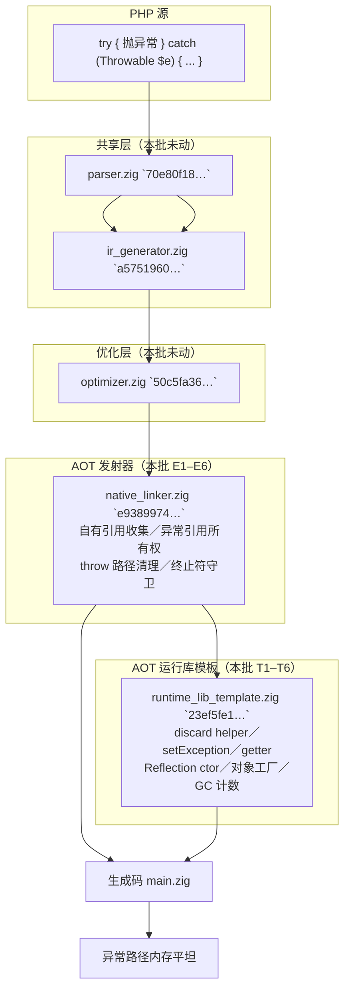
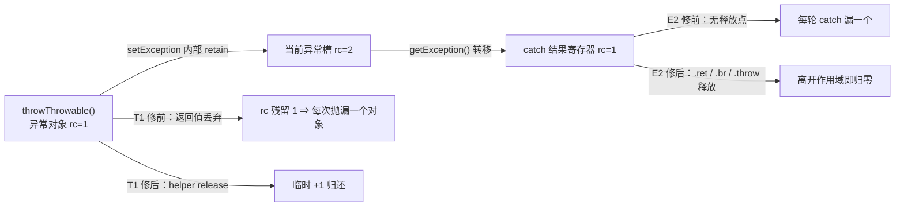
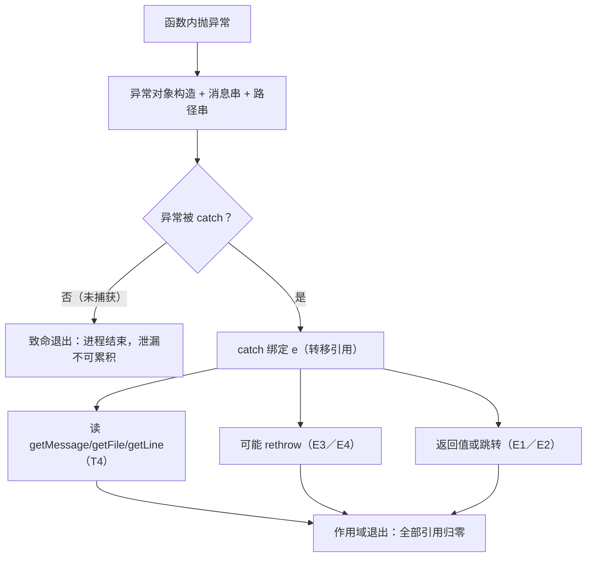

# AOT-CODEGEN-012 · F-133 异常路径每调用泄漏 R-198 · 2026-10-20 · 基线 `8f53834`

## 1. 高层摘要（TL;DR）

- F-133 由 R-197 §106.8 登记：**每次抛异常都泄漏**（c234 N=1M RSS 667,025,408 B，三代同量级 ⇒ 与 F-132 解耦）。R-198 把它拆成**模板侧 6 类 ＋ 发射器侧 6 类**自有引用未回收，同批落地。
- 模板侧（`runtime_lib_template.zig`，锚 `23ef5fe1…`）：① 32 个丢弃面站点改走两个不丢返回值的 helper；② `setException` 的源文件路径串（≈84 B/throw）；③ `gcDestroyObject` 对象计数器；④ 异常读取器二次 retain（5 个 getter）；⑤ `ReflectionClass::__construct` 两条串；⑥ 对象工厂失败路径的 `obj_val`。
- 发射器侧（`native_linker.zig`，锚 `e9389974…`）：E1 调用类结果寄存器在 `.ret` 的释放；E2 `catch_`/`get_exception` 转移来的异常引用（`.ret` 全量／`.br` 死亡集）；E3 `.throw` 异常对象自身引用；E4 抛出路径的局部槽与死亡 catch 引用清理；E5 `cond_br`/`switch` 操作数排除守卫；E6 `method_call` receiver 的最后使用释放。（E7 store value 属 R-197，不在本批。）
- 泄漏门 **c249（12 臂）** 全修后：`arms=12 flat=10 leak=0 diff=0 sense_ok=1 route_gap=1 compile_fail=0 parse_fail=0 runtime_fail=0 stats_missing=0 repo_build_residue=0 ELAPSED=101s`；三条 LEAK 臂（a5/a6/a7）实测泄漏斜率 **≈100.0／121.0／73.3 B/次**，修后全部 FLAT。
- 验收：十邻门逐臂 join **pre=post=inter 且零转移**；主回归 **68/67/1/0**（rc=0，wall≈810 s）；`zig build test` **326/326**；影子 68 份中 **drift=25**，全部为**只增释放行**（+836 行＝826 `release` ＋ 10 条注释，删除 0 行）；性能实测 **+0.40%**（N=2M 中位 2.723→2.734 s，输出逐字相同）。
- 提交态：老铁已于 **2026-10-20 19:40** 提交 `8f53834`（`git show --numstat`：nlk **+210/−4**、tpl **+98/−43**），工作区两枚源与 HEAD 逐字相同。
- 新登记 **F-134**：`(string)$closure` 的异常仍未被 try/catch 路由（a8 两代均 `ROUTE_GAP`／rc=255），本批只消除了它的泄漏，未修路由。

## 2. 影响范围

| 维度 | 描述 |
|---|---|
| 语义行为 | **不变**。本批只增加释放与异常引用归还，不改写值语义；c249 全部可执行臂 stdout 与 PHP 8.5.8 逐字相同 |
| 内存行为 | 异常路径由「每次调用线性增长」转为**平坦**：a5/a6/a7 修前 ≈100.0／121.0／73.3 B/次 ⇒ 修后 `lb` 与 `la` 两跑完全相等，`php_object_live_objects=0` |
| 编译产物 | 仅 AOT。c249 固定 `--optimize=release-fast`；主回归与十邻门为默认档 `--compile --no-debug-info`。两档禁互相引用（F-93 口径） |
| 语料暴露 | 影子 68 份中 25 份生成码漂移（相对 leakfix2 基线），全部为**只增释放行**；主回归语料 68 枚照旧 68/67/1/0 |
| 反向守卫 | c249 g1（不抛）／g2（try 不进 catch）必须 FLAT；s1 敏感度臂必须 SENSE_OK；十邻门零 `SAME→DIFF` |
| 其它模式 | **未触碰**。修改全在 AOT 模板（AOT 编译期嵌入）与 AOT 发射器，解释器／字节码／JIT 路径零改动 |

## 3. 核心变更

| # | 站点 | 修前 | 修后 | 证据 |
|---|---|---|---|---|
| T1 | 模板新增 `throwThrowableDiscard`／`throwThrowableDiscardCatch`（`:23393-23415`），替换 **32 站点**（8＋24） | `_ = try throwThrowable(...)`／`_ = throwThrowable(...) catch {}` 丢掉返回值 +1，`setException` 另持一份 ⇒ 每抛漏一个异常对象 | helper 在 `throwThrowable` 成功后立即 `ex.release(allocator)`；Catch 版保留「分配失败静默」的既有口径 | c248 `%0` 修前 ≈594 B/次；c249 全臂 obj=0 |
| T2 | `setException`（`:700-718`） | `PHPString.init(src_file)` 交 `setProperty`（内部 retain）后未归还；`getProperty("file"/"line")` 仅作存在性判断也漏 +1 | 探测引用逐一 release，`file_val` 用 `defer release` | 每次抛异常固定 ≈84 B/throw |
| T3 | `gcDestroyObject`（`:1452`） | 绕过 `PHPObject.deinit` ⇒ `php_object_live_objects` 只增不减 | 计数器同步递减 | c249 两跑 `obj=0` |
| T4 | 5 个异常读取器（`:16103/:16120/:16136/:16153/:16170`） | `getProperty` 已 +1 后再次 retain | 直接返回 `val`（注释：勿再 retain） | a5 从 ≈100.0 B/次转 FLAT |
| T5 | `ReflectionClass::__construct`（`:17285-17302`） | `args[0].toString()` 的 +1 未归还；`__class_name` 的 `PHPString.init` 交 `setProperty` 后未归还 | `name_owned` 用 `defer release`；`cls_str` 在 setProperty 后释放 | a7 从 ≈73.3 B/次转 FLAT |
| T6 | 对象工厂（`:22227-22235`） | 构造器 Zig error 返回、或单块发射器「置异常后正常返回」时，工厂持有的 `obj_val` rc=1 未归还 | 两条失败路径均 `obj_val.release(allocator)`（后者返回 `error.RuntimeError`） | 失败的 new 不再漏对象 |
| E1 | nlk 字段 `:231`；收集 `:6330-6348`；释放 `:19601-19612` | `.ret` 只清 alloca ⇒ `call/method_call/static_method_call/new_object` 及非 `no_deref` `.load` 的结果（发射时 +1）在成功返回路径泄漏 | 收集自有 +1 寄存器，`.ret` 按 liveness 释放死亡项（返回值除外） | c249 a4（`throw new`）等路径 FLAT |
| E2 | nlk 字段 `:292`；收集 `:18074-18107`；统一释放器 `:19545-19573`；`.ret :19616-19618`；`.br :19637-19638` | `catch_`/`get_exception` 持有 `getException()` **转移**来的引用，无释放点 | 仅登记整个函数 **唯一一次定义**（`def_counts==1`）的寄存器；`.ret` 全量释放（返回值除外），`.br` 释放死亡集 | a5/a6 转 FLAT |
| E3 | nlk 状态机 `:926-941`；单块镜像 `:6501-6520` | `.throw` 的异常对象寄存器自身引用未归还（`setException` 已 retain 一份） | 清理局部后释放 `ex_reg` | a4/a6 FLAT |
| E4 | nlk `:19822-19839`（非 alloca 抛出值）／`:19841-19843`（死亡 catch 集）／`:19848-19867`（逃逸 throw 清局部槽） | 抛出点之后无人回收这三类值 | 逐类释放，并新增 `// Cleanup locals before escaping throw` | 影子新增 10 条该注释 |
| E5 | nlk `:19702-19705`／`:19720-19722` | `cond_br`/`switch` 条件寄存器是终止符操作数、不在 `live_out` | 释放前显式排除，防「冲写」 | 十邻门与主回归零回归 |
| E6 | nlk `:19993-19997`（`releaseDeadOperands`） | `method_call` 的 receiver 不由 `php_object_call` 消费，`$this` 返回路径还会 retain | receiver 死亡后释放临时引用 | 十邻门零转移 |

## 4. 可视化概览

### 4.1 Code & Logic Map（业务模块／分层架构）



### 4.2 业务流程（异常对象引用链）



### 4.3 执行流程（三类可测泄漏面的生命周期）



### 4.4 时序图（a5：`% 0` + catch 读 getMessage，修前 ≈100 B/次）

```mermaid
sequenceDiagram
  participant PHP as PHP 源
  participant GEN as 生成码
  participant TPL as 运行库模板
  PHP->>GEN: $z=0; 1 % $z
  GEN->>TPL: setException(DivisionByZeroError, 路径, 行)
  TPL->>TPL: T2 归还 file/line 探测引用与路径串
  GEN->>TPL: getException() → catch 结果寄存器（转移 +1）
  GEN->>TPL: $e->getMessage()
  TPL->>TPL: T4 直接返回 val（不再二次 retain）
  GEN->>GEN: .ret：E1 释放调用结果、E2 释放 catch 引用
  Note over GEN,TPL: 修前该链路每次调用残留 ≈100 B；修后两跑 lb/la 完全相等
```

## 5. 详细变更分析

### 5.1 涉及文件

| 文件 | 本批状态 | 代次 md5 | 变更 |
|---|---|---|---|
| `src/aot/runtime_lib_template.zig` | 已提交 `8f53834` | `23ef5fe1d5048d67e87793a13f5434e0` | +98/−43：T1–T6 |
| `src/aot/native_linker.zig` | 已提交 `8f53834` | `e93899747e9552ccfa8e912bca51d362` | +210/−4：E1–E6 |
| `src/aot/optimizer.zig` | 未改（沿用 R-197） | `50c5fa36eac9ebfd96eee18afa3aa1ad` | — |
| `src/aot/ir_generator.zig` | 未改 | `a57519607f10ba6140c27df535cd90dd` | — |
| `src/aot/ir.zig` | 未改 | `1fb6b01f9b0bdff318de496538e7620e` | — |
| `src/compiler/parser.zig` | 未改（共享层） | `70e80f18a2c6ef6787b4c5d817c31773` | — |
| `docs/known-issues/AOT-CODEGEN-012-…md` | 本批更新 | — | §107（根因、门读数、验收链、残余与 F-134 登记） |
| `fuzzy_scripts_720/tmp/c249_f133_leak_gate_tmp.sh` | 新增门 | — | 12 臂泄漏门（`TSV_OUT` 输出） |
| `fuzzy_scripts_720/tmp/c250_r198_neighbours_tmp.sh` | 新增链工具 | — | 十邻门单侧跑＋fold join（生成相符 join） |
| `fuzzy_scripts_720/tmp/c251_r198_shadow_tmp.sh` | 新增链工具 | — | 68 形 NEW 侧 main.zig 落盘与列 md5 |
| `fuzzy_scripts_720/tmp/c252_r198_perf_tmp.sh` | 新增链工具 | — | OLD/NEW 交错 3 轮中位 |

### 5.2 模板侧（T1–T6）读码结论

- **T1 两种 helper 不可合并**：`throwThrowableDiscard` 返回 `!void`，供有错误通道的 `may_raise` 站点 `try`；`throwThrowableDiscardCatch` 为 `void`，保留这些站点「分配失败静默吞掉」的既有行为（它们没有错误返回通道）。`grep` 现测调用点共 **32**：`throwThrowableDiscard(` 9 次出现 − 1 定义 = 8；`throwThrowableDiscardCatch(` 25 次出现 − 1 定义 = 24。
- **T2 的所有权**：`setProperty` 内部 retain，调用方那份必须归还；`getProperty` 本身返回 +1，仅作 `!= null` 判断的探测引用也必须 release。两处叠加即「每次抛异常固定 ≈84 B」。
- **T3 与 `PHPObject.deinit` 的差异**：`gcDestroyObject` 走的是 GC 销毁路径，绕过了 `deinit` 的计数器递减 ⇒ `php_object_live_objects` 失去观测意义。修在销毁函数内部，不改 `deinit`（避免双递减）。
- **T4 的「转移」语义**：`getProperty` 已返回 +1；旧代码再 `retain` 是误解为借用。改为直接返回 `val` 后，调用方仍需按原契约消费（a5 的 `strlen($e->getMessage())` 路径由 E2 统一回收 catch 引用）。
- **T5**：Reflection 构造的两条串分别是「参数转换产物」与「内部属性初始化产物」，生命周期都只到构造结束，使用 `defer` 最稳。
- **T6**：对象工厂在构造器抛错时必须归还工厂引用；★单块发射器的 `throw` 只 `setException` 后**正常返回**（不走 Zig error），因此还要补 `hasException()` 判定，否则该形态仍漏。

### 5.3 发射器侧（E1–E6）读码结论

- **E1 的登记范围**：只在发射时**明确 +1** 的结果上登记——`call`／`method_call`／`static_method_call`／`new_object`，以及非 `no_deref` 的 `.load`（deref 路径 retain）。不登记用户变量槽的裸寄存器，避免把借用当自有。
- **E2 的 `def_counts==1`**：SSA 寄存器可能被复用；若同一 `r.id` 在多处定义，无法判定当前持有的是不是「转移来的异常引用」⇒ 只登记全函数唯一一次定义者，宁可漏收也不误放。释放只在 liveness 判定为死亡时执行；`.ret` 的返回值寄存器除外。
- **E3／E4 的次序**：`setException` 已 retain 一份 ⇒ 异常对象寄存器自身那份必须在 `setException` **之后**归还；逃逸 throw 还要先清局部 alloca 槽，避免槽里的值把异常对象引用又续命。
- **E5 的冲写**：`cond_br`/`switch` 的条件在终止符里使用、但不进 `live_out`；若不排除，会在跳转前释放仍在用的寄存器（R-197 同族已有三起冲写事故）。
- **E6 的 receiver**：`php_object_call` 不消费 receiver 的 +1；`$this` 返回路径会在 `.ret` 再 retain ⇒ 临时 receiver 死亡后可安全释放。
- **E7 边界**：store 的 value 释放属 R-197 ③（`:19941-19953`），本批未改，避免两批混账。

### 5.4 泄漏门读数（c249，`--optimize=release-fast`）

| 臂 | pre（模板已修、发射器未修） | post／final（全修） | pre 斜率 |
|---|---|---|---|
| a5 `% 0` + 读 `getMessage` | LEAK `lb=85177→285165`／`la=1116→3118` | **FLAT** `lb=42593→42593`／`la=115→115` | **≈100.0 B/次** |
| a6 跨函数 rethrow | LEAK `lb=106097→348085`／`la=1115→3117` | **FLAT** `lb=42513→42513`／`la=114→114` | **≈121.0 B/次** |
| a7 `ReflectionException` | LEAK `lb=144441→291085`／`la=1116→3117` | **FLAT** `lb=42513→42513`／`la=114→114` | **≈73.3 B/次** |
| a1–a4／a9 | FLAT | FLAT | 0 |
| g1／g2 | FLAT（量具守卫） | FLAT | 0 |
| s1 | SENSE_OK | SENSE_OK | 量具能看见泄漏 |
| a8 `Closure→string` | ROUTE_GAP rc=255 | ROUTE_GAP rc=255（转 F-134） | — |

★**分段读数的纪律**：c249 的 pre 列是「模板已修、发射器未修」的半修基线（tpl mtime 19:00:03 早于 pre 跑 19:00:47）。因此 a2 在 pre 列 FLAT **不代表丢弃面没有缺陷**——它的 ≈594 B/次是 c248 的模板修前读数。pre 列只承担发射器面 A/B 的证明。

## 6. 影响与风险评估

### 6.1 是否破坏式变更

- **非破坏式**：只新增释放与异常引用归还；影子 25 份 diff 全部 `add>0 / del=0`（+836 行＝826 `release` ＋ 10 条注释），无语义改写。
- 但**所有权错误属于高危**：多放一次即 UAF／double-free。本批的四道守卫：E2 的 `def_counts==1`、释放仅在 liveness 死亡时、E5 的终止符操作数排除、T1 两 helper 对「有无错误通道」的分档。

### 6.2 影响范围及明细

| 面 | 明细 | 实测 |
|---|---|---|
| 异常对象 | 丢弃面 32 站点、`throw new`、rethrow、Reflection | c249 a1–a7 FLAT，`obj=0` |
| 异常读取 | `getMessage/getCode/getFile/getLine/getPrevious` | a5 FLAT（≈100 B/次归零） |
| 宿主对象 | 失败的 `new`、Reflection 构造、GC 计数 | a7 FLAT；`php_object_live_objects=0` |
| 正常路径 | 不抛控制臂、try 不进 catch | g1／g2 两跑 lb/la 逐字节相等 |
| 生成码规模 | 25/68 份 main.zig 增加释放行 | 最大 f048 +151 行；无删除 |

### 6.3 需要特别注意的点

1. **模板是编译期嵌入**（符号链接）⇒「旧二进制 + 新模板」是合法代次组合；但 nlk 改动必须 `zig build`。本批两半都已提交，不存在混代。
2. **catch 引用是「转移」不是「借用」**：任何新增释放点都必须确认没有第二条路径再读同一寄存器，否则 UAF 表现为「值逐次变化」（R-191b 的定性法：最小变体矩阵＋先分配再重复读的守卫臂）。
3. **未捕获异常的致命退出路径**：进程结束时泄漏不可累积，但仍要按 E4 清理局部槽（避免 destructor 观察到半销毁状态）。
4. **c249 与主回归不同档**：泄漏结论只在 release-fast 档成立；默认档的泄漏硬闸尚未建（遗留 §7）。
5. **a8 不是「漏修一处释放」**：它是路由缺口（异常没进 catch），不能拿本批的 release 口径去覆盖。

### 6.4 复测路径（全部带超时）

```bash
# 1) 泄漏门（12 臂，约 101 s；须在仓库根、无并发）
timeout 900 env AOT_BIN=zig-out/bin/php-interpreter TSV_OUT=/tmp/c249_r198_check.tsv \
  bash fuzzy_scripts_720/tmp/c249_f133_leak_gate_tmp.sh
# 期望：C249F133_DONE arms=12 flat=10 leak=0 ... route_gap=1 repo_build_residue=0

# 2) 十邻门（逐臂 join；pre 基线须代次相符）
timeout 3600 env NB_OUTDIR=/tmp/r198_nb_check bash fuzzy_scripts_720/tmp/c250_r198_neighbours_tmp.sh
# 期望：每门 pre=post=inter 且 verdict_chg=0 same_to_diff=0

# 3) 主回归（默认档）
timeout 1800 bash fuzzy_scripts_720/run_regression.sh
# 期望：SELF_CHECK_OK rows=68 uniq=68；报告表 68/67/1/0

# 4) 构建自测
timeout 600 zig build test
```

## 7. 遗留问题／潜在问题

| 项 | 现场 | 实测 | 处置 |
|---|---|---|---|
| **F-134**（新立） | `(string)$closure` 在 try/catch 内仍 rc=255 致命退出 | c249 a8 两代 `ROUTE_GAP`；AOT 文本 `Fatal error: Uncaught Exception: Object of class Closure could not be converted to string` | tpl:2930 已不再泄漏，但转换调用点不检查 `hasException()`；同族 `throwException` 调用点共 17 枚，需逐枚判定返回值是否被消费/检查 |
| typed 形参所有权 | `function f(string $s)` 传入 `str_repeat(...)` | ≈104 B/调用（prefix 即存在） | 既存，未扩大范围 |
| `through_ref` 写穿豁免 | `.store` 写穿路径仍不释放临时引用 | 未测 | 保守口径，待专门定价 |
| c249 档位缺口 | 泄漏门 release-fast；主回归/邻门默认档 | — | 若纳入默认档硬闸，需另建默认档臂 |
| a8 记账 | 不计入 flat | `flat=10 + sense=1 + route_gap=1 = 12` | 门自身记账自洽 |

## 8. 后续开发／优化建议

| 优先级 | 建议 | 影响面 | 落地成本 |
|---|---|---|---|
| P0 | **F-134**：为 17 枚 `throwException` 站点建「路由判定表」（返回值被消费／被丢弃／被 return），先修 `(string)$closure` 的转换调用点，再按表逐枚补 `hasException()` 检查 | 异常语义面；当前 a8 是不可 catch 的致命退出 | 中（逐站点读码＋8–12 臂门） |
| P1 | typed 形参所有权（≈104 B/调用）：把形参纳入块尾 cleanup 集合，先审 `ref`/`by-ref` 形参的写穿路径 | 全局函数调用面；内存线性增长 | 中高（所有权普查＋守卫探针） |
| P1 | c249 增默认档复跑臂（或整门切默认档并另存 pre 基线），消除档位缺口 | 证据一致性 | 低（改一行＋重取 pre） |
| P2 | 扩 c249：`getPrevious/getFile/getLine`、构造器置异常但正常返回、Reflection 字符串构造、跨函数 rethrow 两跳 | 覆盖 T4/T5/T6 其余分支 | 低（复制现有臂模板） |
| P2 | `through_ref` 写穿路径释放定价：用 ref 形参／`make_ref`／闭包捕获／`foreach` ref 四径守卫实测「槽是否已消费临时引用」 | 可能再收一部分泄漏，但 UAF 风险高 | 中高 |
