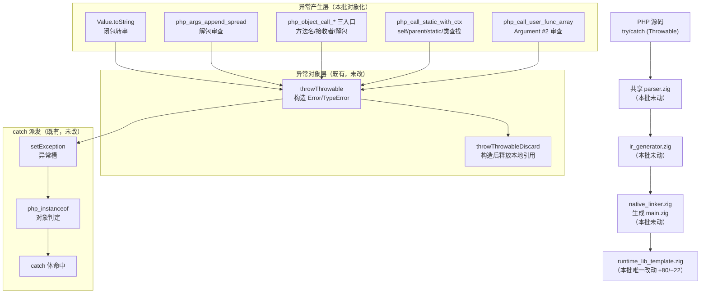
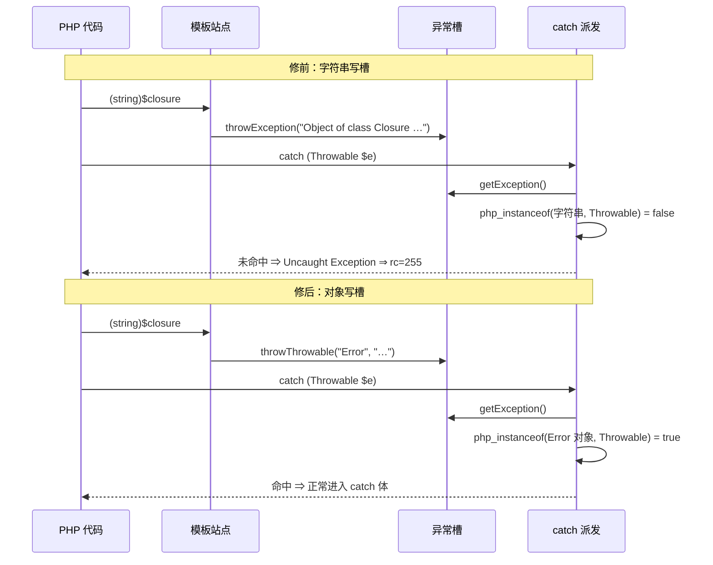

# AOT-CODEGEN-012 · F-134 异常路由对象化 R-199 · 2026-10-20 · 模板锚 `df9cf8e1`

## 1. 高层摘要（TL;DR）

- F-134 由 R-198 §107.6 登记：`(string)$closure` 在 `try/catch (Throwable)` 内仍以 **rc=255 未捕获致命**退出。R-198 按「调用点缺 `hasException()` 检查」立项，**R-199 用生成码证伪了该叙述**：检查本就在（`/tmp/f134attr/closure_throw_main.zig:54/:118/:158` 等），真根因是 `throwException` 把**字符串**写进异常槽，catch 派发 `php_instanceof` 对非对象恒 false ⇒ 一切 `catch (Throwable)` 都不命中。
- 修法改为**异常对象化**：`throwException` 家族 **17 枚调用点**全量改走既有 `throwThrowable`／`throwThrowableDiscard`（构造真 `Error`/`TypeError` 对象）。只动模板，`+80/−22`，不动发射器、不动共享 parser/IR。
- 同批修掉一处**静默吞参**：`f(...5)` 旧实现走 `php_array_iter_init`，只发一句 foreach 口径告警后把实参整段丢掉（等价 `f()`）；现按 PHP 8.5.8 抛 `TypeError: Only arrays and Traversables can be unpacked, int given`，并补齐 `call_user_func_array` 的 `Argument #2 ($args)` 前置审查。
- 门读数：c249 泄漏门 `flat=10 runtime_fail=1 route_gap=1`（rc=10）⇒ **13 臂 `flat=11 known_leak=1 route_gap=0`（rc=0，102 s）**；c254 异常路由门 `same=8 diff=8 unexpected=2 runtime_fail=11` ⇒ **`same=27 known_red=2 known_compile_fail=1`（rc=0，131 s）**。
- 验收：十邻门 **569 臂全 `pre=post=inter` 且零转移**；主回归 **68/67/1/0**；影子 **68 份 `drift=0`**（纯模板轮 ⇒ 硬中性，列 md5 与 R-198 相同）；`zig build`／`zig build test` 均 rc=0。
- 新登记：**F-134b**（方法解析 vs 实参解包的顺序）、**F-135**（`?->$m()` 共享 parser 缺口）、**F-136**（未调用捕获闭包 UAF/段错误）、**F-137**（异常展开路径闭包对象每轮 ≈167 B）。死符号 `throwException` 三枚保留待裁。

## 2. 影响范围

| 维度 | 描述 |
|---|---|
| 语义行为 | **有意的行为变更**：原先「不可 catch 的字符串异常」全部变成可 catch 的 `Error`/`TypeError` 对象，措辞逐字对齐 PHP 8.5.8；`f(...非数组)` 由「静默吞参」变为抛 `TypeError` |
| 内存行为 | 正常路径基本不变；错误路径新增异常对象构造（原本也构造，只是塞字符串）。c249 除登记泄漏 a10 外 11 臂 FLAT，`obj=0/0` |
| 编译产物 | 影子 68 份 `main.zig` 与 R-198 **逐字节相同**（列 md5 `05ec67d107da9b379b7c6e71940fea34`）⇒ 只改模板运行期，不改发射 |
| 语料暴露 | 主回归 68 枚照旧 68/67/1/0；本族主要靠常驻门 c254（30 臂）与 c249（13 臂）看守 |
| 反向守卫 | c254 g1–g6（正常调用／数组解包／nullsafe／Traversable）必须 SAME；c249 a10 必须仍是 `KNOWN_LEAK`，若转 FLAT 门主动判红 |
| 其它模式 | **未触碰**。全部改动在 AOT 模板；解释器／字节码／JIT 零改动（F-135 的 parser 缺口按宪法未动，见 §7） |

## 3. 核心变更

| # | 站点（修后锚点） | 修前 | 修后 | 证据 |
|---|---|---|---|---|
| T1 | `Value.toString` 闭包转串（`:2932`） | `throwExceptionDiscard("Object of class Closure …")` ⇒ 字符串槽 | `throwThrowableDiscard("Error", …)`，措辞不变 | c249 a8：修前 `ROUTE_GAP rc=255/255` ⇒ 修后 FLAT |
| T2 | `php_args_append_spread`（`:5443`） | 目标非数组 `throwException`；源非数组交给 foreach 迭代器**静默吞参** | 目标非数组→`Error`（内部不变量）；源非 array/Traversable→`throwUnpackTypeError` | c254 r5/r6/r16–r21 全 SAME |
| T3 | `php_invoke_callable_args_array`（`:5475`） | `throwException("Only arrays can be unpacked")` | 兜底 `throwUnpackTypeError` | r14/r15/r24 由 `call_user_func_array` 先审 |
| T4 | `php_object_call_safe_args_array`（`:5576`） | 非字符串方法名**静默 initNull**；解包非数组 `throwException` | 前者→`Error`（对象接收者口径）；后者→`TypeError` | r3/r22 SAME；空接收者仍短路 |
| T5 | `php_object_call_args_array`（`:5606`） | 方法名／接收者／解包各 `throwException` | `Error`＋`Call to a member function {m}() on {type}`（`phpArgTypeWord`）＋`TypeError` | r2/r13/r22 SAME |
| T6 | `php_object_call_named_args`（`:5642`） | 5 枚 `throwException` | 方法名／接收者／实参数组 `TypeError`／元数据缺失／`Call to undefined method {C}::{m}()` | r4/r12 SAME（r12 顺序面留红＝F-134b） |
| T7 | `php_call_static_with_ctx`（`:22791`） | 5 枚 `throwException`（self/parent×2/static/类不存在） | 全部 `Error`，带引号措辞对齐 PHP | r7–r11 SAME |
| T8 | `php_call_user_func_array`（`:33418`） | **无前置审查**，非数组直达解包 | 新增 `Argument #2 ($args) must be of type array, {type} given` | r14/r15/r24 SAME |
| T9 | 新 helper `throwUnpackTypeError`（`:23467`，抛出点 `:23475`） | — | `Only arrays and Traversables can be unpacked, {given} given`；bool→`true`/`false`，对象→类名，其余→`phpGetValueTypeName` | r5/r16–r21 六种 given 全 SAME |

★站点分布（修前 → 修后）：`toString` 1→1、`append_spread` 1→2、`invoke_callable` 1→1、`safe` 1→2（含 1 枚 initNull 转化）、`args_array` 3→3、`named_args` 5→5、`static_with_ctx` 5→5、`call_user_func_array` 0→1；**修前 17 枚 `throwException` 全部消失**（`grep -c 'throwException('` 现仅 3 处，均在三枚定义的互调体内）。

## 4. 可视化概览

### 4.1 Code & Logic Map（业务模块／分层架构）

### 4.2 异常路由时序（修前 vs 修后）

## 5. 详细变更分析

### 5.1 涉及文件

| 文件 | 变更 | 说明 |
|---|---|---|
| `src/aot/runtime_lib_template.zig` | **+80/−22**（`git diff --cached --numstat` 实测） | 17 枚 `throwException` 站点对象化 ＋ 新 helper ＋ 一处 initNull 转 Error |
| （无其它源文件） | — | 发射器／共享 parser／IR／optimizer 全部未动 |

### 5.2 分层说明

| 层 | 变更点 | 影响描述 |
|---|---|---|
| 端（用户可见） | 异常类、措辞、可捕获性 | `Error` 可被 `catch (Throwable)`/`catch (Error)` 接住；`TypeError` 可被 `catch (Throwable)`/`catch (TypeError)` 接住；文本与 PHP 8.5.8 逐字相同 |
| 模块层（模板入口） | 8 个函数的参数校验顺序与前置换算 | 普通 `->`：方法名 → 接收者 → 方法解析 → 解包；`?->`：空接收者整通短路 |
| 业务层（语义） | 解包操作数只接受 array/Traversable | 非法的 `...$x` 不再静默丢参，改为 TypeError |
| 数据层（异常对象） | 无结构变化 | 仍由 `throwThrowable` 分配、`setException` 持有；错误路径不新增常驻引用 |

### 5.3 为什么不是「补 hasException() 检查」

生成码里检查早已存在；若按原方案逐点补检查，只能让 `hasException()` 分支提前返回，但异常槽仍是字符串 ⇒ **catch 依然不命中**，最终仍是未捕获致命。对象化是唯一能让 `php_instanceof` 为真的修法。R-199 因此**推翻了自己的立项前提**，并把判据从「检查是否齐全」改为「异常是否为对象」。

## 6. 影响与风险评估

| 项 | 结论 |
|---|---|
| 是否破坏式变更 | **否**（无 API/ABI 变化）；但**可观测行为有变**：原先致命的路径现在可被 catch，原先静默吞参的路径现在抛 TypeError —— 两者都是向 PHP 靠拢 |
| 影响范围 | 8 个模板函数；AOT 全部模式共用模板，但只影响错误路径；影子证明生成码零漂移 |
| 需要特别注意 | ① 异常类不能错档（`Error` vs `TypeError`），否则 c254 与 BLT 同时红；② 解包检查的**时机**仍早于方法解析（F-134b），改动顺序会牵动 r12/g3；③ `?->` 的对象＋非字符串方法名分支在本代次**编译不可达**（F-135），只能靠读码保证 |
| 性能 | **未做基准**。读码：array 解包只多一次 `isArray()` 短路；对象解包才做 5 次 `findMethod`/`getIterator`；异常路径用栈上 `buf`，无新增分配 |
| 复测路径 | `timeout 900 bash fuzzy_scripts_720/tmp/c254_exr_gate_tmp.sh`（≈131 s，应 rc=0）→ `timeout 600 bash fuzzy_scripts_720/tmp/c249_f133_leak_gate_tmp.sh`（≈102 s，a10 必须 `KNOWN_LEAK`）→ `timeout 1800 bash fuzzy_scripts_720/run_regression.sh` → `timeout 600 zig build test` |
| 并发纪律 | 残渣检查型门（c249/c254）**不得与任何 AOT 编译并行**：本批首轮 c254 曾因影子并行读到 `repo_build_residue=1`，单独复跑为 0（逐臂表 md5 一致） |

## 7. 遗留问题／潜在问题

| 编号 | 内容 | 现场 | 处置 |
|---|---|---|---|
| F-134b | 方法解析与实参解包的顺序 | r12 `$o->nope(...5)`：PHP 报未定义方法，AOT 报解包 TypeError；g3 `null?->m(...5)`：PHP 得 NULL，AOT 报 TypeError | c254 登记红，保持原形态 |
| F-135 | `$x?->$m()` | PHP 运行期 `Error: Method name must be a string`；AOT 编译期 `Parse error … unexpected variable "$m"`（共享 parser） | 门内 `KNOWN_COMPILE_FAIL`；跨模式修改须老铁先裁 |
| F-136 | 未调用的局部捕获闭包 | v3/v5 `rc=139/139`（UAF/段错误）；v7 `rc=0/0` 但 ≈1257 B/次 | 单独立项，优先级高于 F-137 |
| F-137 | 异常展开路径的闭包对象 | v0（无捕获、抛）≈167 B/次 vs v4（无捕获、不抛）FLAT；a10 合成 ≈377 B/次 | c249 a10 常驻看守 |
| 死符号 | `throwException`／`throwExceptionDiscard`／`throwExceptionDiscardCatch` | 仅剩三枚定义互调，无外部调用点 | **删除需老铁明示**（宪法第六节），本批保留 |
| 档位缺口 | c249 固定 release-fast，c254/回归为默认档 | — | 未在本批扩大，沿用 §107.6 登记 |

## 8. 后续开发／优化建议

| 优先级 | 建议 | 影响面 | 落地成本 |
|---|---|---|---|
| P0 | F-136：用 `ZIGPHP_AOT_KEEP_TEMP=1` 对照 v3/v5/v7 的生成码，定位未调用捕获环境的释放点 | 闭包面，可致 rc=139 | 中高 |
| P1 | F-137：异常展开路径补闭包对象释放；修好后 a10 会转 FLAT，c249 将报 `KNOWN_LEAK_CLEARED` 强制摘登记 | 异常面 ≈167 B/次 | 中 |
| P1 | F-134b：把解包审查推迟到方法解析之后，并让 `?->` 空接收者先短路 | 方法调用 3 入口 | 中 |
| P2 | F-135：`?->$m()` 共享 parser 语法，须先裁跨模式口径 | 全模式 | 中 |
| P2 | 清理 `throwException` 三枚死符号，防止后来者再用字符串异常槽 | 模板内部 | 低 |
| P2 | c254 增 release-fast 复跑臂，消除档位缺口 | 证据一致性 | 低 |
