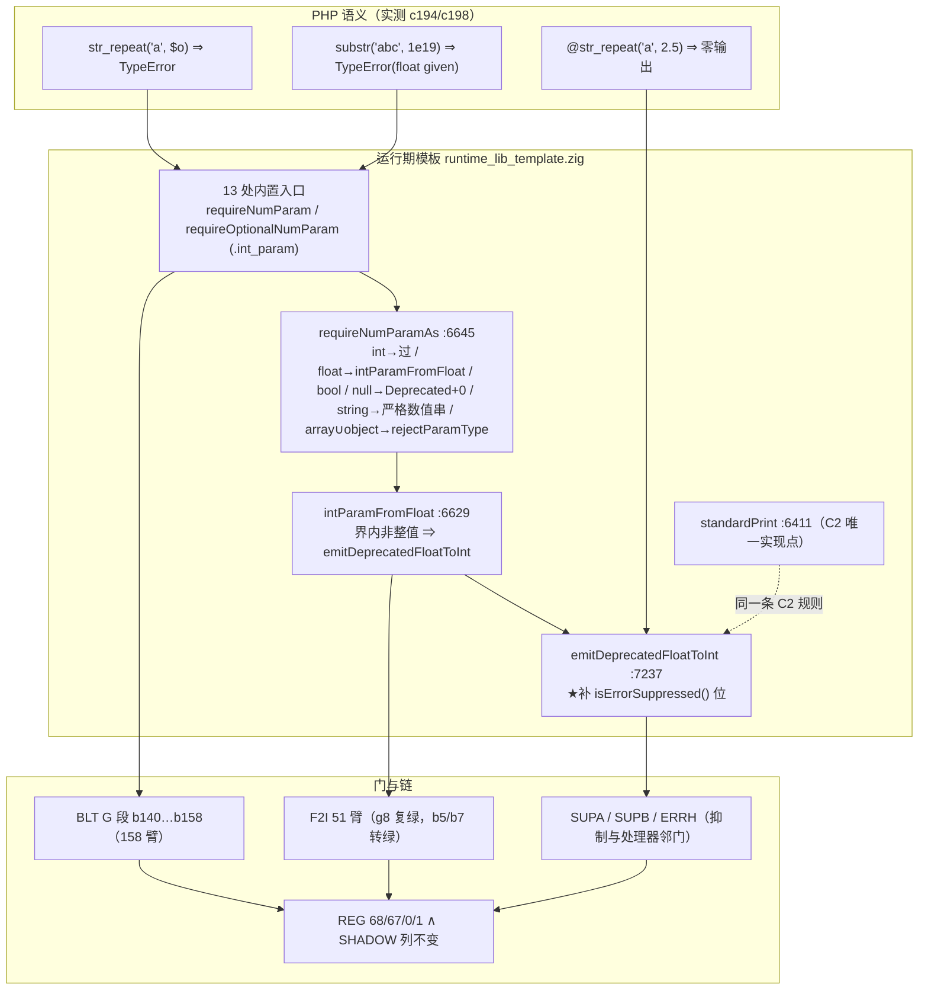

# AOT-CODEGEN-012 F-62f 接线第一批（字符串族 int 形参）＋ @ 抑制位补口 落地 R-193／R-193b

- 工单：`docs/known-issues/AOT-CODEGEN-012-class-name-case-insensitive-lookup.md` §102（接线）＋ §103（本批自造回归与抑制位根因）
- 轮次：R-193（13 枚站点接线）→ R-193b（同批自造回归的补口），**两轮合成一代交付**
- 代次锚：`tpl=e06c1208b19fd710e0bc3cd7be41de44` 唯一变更源；`nlk=0d598ff8…`／`ir=1fb6b01f…`／`irg=a5751960…`／`parser=70e80f18…`／`opt=36f354f4…` 逐字未动
- 批型＝**纯模板** ⇒ 判据＝影子**硬中性**（链尾实测 `changed_rows=0 ∧ col_identical=yes`）

## 1. 高层摘要（TL;DR）

F-62f triage 里 47 枚"需接线"站点中的第一批 13 枚（字符串族函数的 `int` 形参）。这些槽位原本是裸 `.toInt()`，对象/数组/坏串进去**静默当 0** ⇒ 返回值直接错（`substr("abc",$o)` 返回整串、`str_repeat("a",$o)` 返回空串、`strncmp("a","b",$o)` 返回 0），而 PHP 是 **TypeError**。修法＝复用 R-172 已收口的 `requireNumParam`／`requireOptionalNumParam`（**零新措辞**），不扩 helper、不动发射器。

同轮暴露并修掉一枚**既存**缺陷：`emitDeprecatedFloatToInt` 直写 fd2/fd1、绕过 `standardPrint` 里的 `@` 抑制位——接线后 `@str_repeat("a",2.5)` 开始多打两行 Deprecated（门 F2I `g8` SAME→DIFF 抓住）。补一行 `if (isErrorSuppressed()) return;` 收口。

四腿＋八枚邻门全绿：门 BLT 158 臂逐臂零回退（红集恰等 `b5 b141 b142 b149`，后三枚是**刻意留红**）、F2I 反向关闭两枚既存红、主回归 `68/67/0/1`、影子列与上一代**逐字同值**。

## 2. 影响范围

| 面 | 影响 | 强度 |
|---|---|---|
| 13 处内置函数入口 | 对象／数组／非数值串／越界 float 进 int 形参 ⇒ 由静默错值改为可捕获 TypeError | 语义修正（P0 静默错值面） |
| F2I 既存两枚红 | `str_repeat`/`substr` 的越界 float（`1e19`）此前不拒 ⇒ 本批顺带关闭 | 附带收口，已逐枚归因 |
| `@` 抑制面 | `emitDeprecatedFloatToInt` 现遵守 C2（`@` 下一行不打）；未抑制路径格式逐字不变 | 修自造回归 |
| 刻意不动 | 弱模式合法输入（`"3"`、界内非整值、null）与 fatal 类直写站点；`.int_param` 措辞维未扩 | 见 §7 |
| 生成码／发射器 | 零改动 ⇒ 影子中性（实测） | — |
| 非 AOT 模式 | 未触碰（宪法五） | — |

## 3. 核心变更

| # | 位置 | 变更 |
|---|---|---|
| 1 | [runtime_lib_template.zig:10536](file:///Users/wangjianjun/products/parser/src/aot/runtime_lib_template.zig#L10536) 等 13 处 | 入口首行插 `requireNumParam`／`requireOptionalNumParam(…, .int_param, …)`，体内改用校验后的值：`php_substr`、`php_str_repeat`、`php_str_pad`、`php_strpos`／`stripos`／`strrpos`／`strripos`、`php_explode`、`php_str_split`、`php_chunk_split`、`php_wordwrap`、`php_strncmp`、`php_strncasecmp` |
| 2 | [:7237-7248](file:///Users/wangjianjun/products/parser/src/aot/runtime_lib_template.zig#L7237-L7248) | `emitDeprecatedFloatToInt` 补抑制位（C2 同规则），措辞与两行格式**逐字不改** |
| 3 | `fuzzy_scripts_720/tmp/c047_builtin_numeric_object_gate_tmp.sh` | 门 BLT 139→**158 臂**（G 段 `b140…b158`：13 接线面＋3 留红＋3 反向守卫） |
| 4 | `c194_f62f_truth_tmp.php`／`c198_float_depr_tmp.php`／`c197_accept_r193_tmp.sh` | 真值资产与验收链（链头六枚源码 md5 断言；复跑邻门前先 `cp` 默认表） |

## 4. 可视化概览【mermaid：Code & Logic Map】

## 5. 详细变更分析

### 5.1 分层清单

| 层 | 文件 | 说明 |
|---|---|---|
| 内置函数入口 | `src/aot/runtime_lib_template.zig` 13 处 | 必填槽用 `requireNumParam`（`substr#2`／`str_repeat#2`／`str_pad#2`／`strncmp#3`／`strncasecmp#3`），可选槽用 `requireOptionalNumParam`（四个 pos 族／`explode#3`／`str_split#2`／`chunk_split#2`／`wordwrap#2`）；校验一律先于函数体其它语句 |
| 诊断出口 | 同文件 `:7237` | 只加抑制位；路由缺失另立 F-125 |
| 发射器／IR／共享层 | — | 未动（链头逐枚 md5 断言强制） |
| 门与链 | `c047…`、`c194`、`c197`、`c198` | 新臂含**反向守卫**（null／array／数值串），防接过头 |

### 5.2 读数账本
见工单 §102.4（门 BLT 158 臂与留红三枚的逐臂名）与 §103.4（合并链账本：11 条腿读数、成本、join 判据）。要点：
- BLT `154/4`，红集 `b5 b141 b142 b149`；139 共有臂 `same→diff=0`。
- F2I `48/2/cf1`，`g8` 复绿；`b5`／`b7` 两枚既存红 DIFF→SAME（身份核实＝越界 float 进 int 形参未拒）。
- OBJ／PRC／PERR／PD2／SUPA／SUPB／ERRH 七枚邻门**逐臂零转移**。
- REG `SELF_CHECK_OK rows=68 uniq=68`；SHADOW `changed_rows=0 col_identical=yes`（列仍 `7f4b2c8a…`）；`residue=0`。

## 6. 影响与风险评估

- **是否破坏式变更**：否（行为面从"静默错值"改"可捕获 TypeError"＝向 PHP 收敛）；但**弱模式边界**必须逐字不变 ⇒ 用 `b156/b157/b158` 三枚反向守卫钉住（null 只 Deprecated 不拒、array 报 `array given`、`"3"` 合法重复三次）。
- **over-fatal 风险（本族历史陷阱）**：`array_sum/array_product/max/min/比较` 那类"PHP 只给 Warning／Notice"的站点**不在本批**；§59.1 判为假阳性的 34 枚（`ctype_*`／`floatval`／`sprintf`／`settype`／扩展族／内部名泄漏）逐枚**未接**。
- **性能**：每处入口多一次类型分派（`isInt` 快路径直接返回），无可测代价；影子腿与主回归耗时与上一代同量级（REG 842 s vs 801 s，SHADOW 1170 s vs 1060 s，属机时波动而非新开销）。
- **复测路径**：`TSV_OUT=… timeout 1800 bash fuzzy_scripts_720/tmp/c047_builtin_numeric_object_gate_tmp.sh` ⇒ `arms=158 diff=4`；`timeout 900 bash fuzzy_scripts_720/tmp/c062_float_to_int_gate_tmp.sh` ⇒ `dep_over=0` 且 `g8 SAME`；`php -r 'var_dump(strlen(@str_repeat("a",2.5)));'` 对比 AOT 应零输出。

## 7. 遗留问题／潜在问题

- **F-123（#140）**：`php_substr_count` 体里 `_ = offset; _ = length;` ⇒ 两形参被完全忽略，门臂 `b149` 标红。必须先测真值矩阵（offset 越界／负数、length=0／负、空 needle）再实现，禁只加校验当收口。
- **F-124（#140）**：`?int`（`substr#3`，臂 `b141`）与 `array|int`（`substr_replace#3`，臂 `b142`）两枚**措辞维未扩**，且后者还要实现数组形；禁为转绿直接发 `int`。
- **F-125（#141）**：`emitDeprecatedStrGetcsvEscape:6436`／`emitUndefinedVariableWarning:6454` 同样绕过抑制位；三枚直写站点都**不经** `dispatchToUserHandler`。逐枚先测真值再改；其余 13 处 `fileWriteAll(2,` 是 fatal（PHP 自己也不受 `@` 抑制）⇒ 禁顺手统一。
- **F-62f 余量**：47 枚中本批接 13 枚，余 34 枚（`array_*`／`range`／`password_hash`／日期族／`rand`／`dechex` 等）待后续批次逐枚测真值接线。
- 未提交状态（实测校正，非记忆）：老铁在本会话中途提交了 `3fba09f`，其内容＝R-186…R-193 全部（模板提交态 `37612064…`，含 13 处接线，**不含**抑制位补口）。⇒ **本批只有 R-193b 那 6 行 `isErrorSuppressed()` 补口仍未提交**（工作区 `e06c1208…`）。另注：被提交的那一代次带已知缺陷（`@str_repeat("a",2.5)` 多打两行 Deprecated，门 F2I `g8` 可抓），补口后即消。

## 8. 后续开发／优化建议

| 优先级 | 建议 | 影响面 | 落地成本 |
|---|---|---|---|
| P1 | 把"接线批次"固化成一张**进度表**（47 枚 × 已接／留红／假阳性三态），每批只推进一域并同步门 BLT 段号 | F-62f 全家 | 低（表）＋中（执行） |
| P1 | 扩 `numParamExpectedText` 的类型维（`?int`／`array|int`／`string|int|null`／`string|int|float`），再回头收 `b141/b142` 与 §59.1 的 3 枚新措辞族 | 参数校验族 | 中 |
| P2 | 门 F2I/BLT 各加一枚"**汇总数与逐臂 join 双印**"断言（本轮 `47/3` 看着像改善、实为自造回归），把 §103.4 的教训钉进工具 | 测试基建 | 低 |
| P2 | 往 `pass/` 增补一枚含"对象进字符串族 int 形参"的常驻语料，使 F-62f 面从"只有门保护"升级为"回归也保护" | 测试基建 | 低 |
