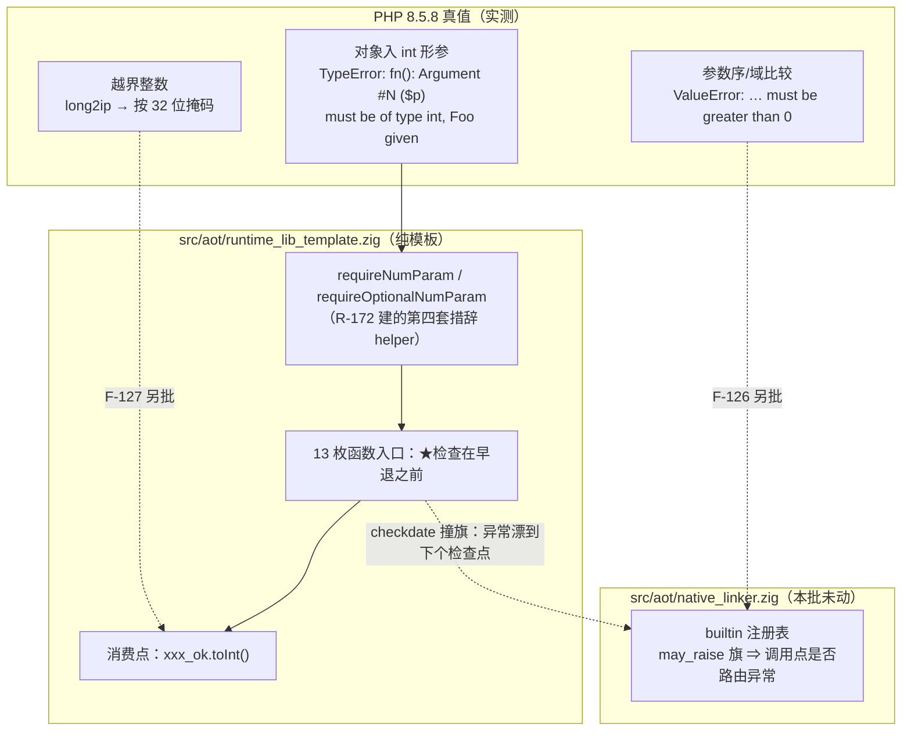
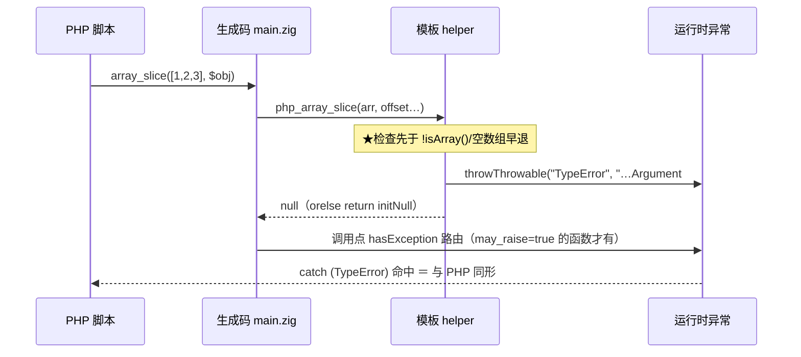

# AOT-CODEGEN-012 · F-62f 接线第二批（数组族／转换器／随机族 `int` 形参）R-194 · 2026-10-20 · 基线 `3fba09f`

## 1. 高层摘要（TL;DR）

- 本轮把 **13 枚内置函数**的 **15 枚 `int` 形参**从「对象／array／坏串被 `toInt()` 静默折成 0」接成 PHP 8.5.8 的 `TypeError: <fn>(): Argument #N ($p) must be of type int, <类名> given`。批型＝**纯模板**（只动 `src/aot/runtime_lib_template.zig`）。
- 门 BLT 178 臂 join 实测：`diff 21→7`、**`diff→same=14`、`same→diff=0`**、`zig_escape 1→0`。
- ★**主动撤回 3 枚**（`checkdate` 的 `$month/$day/$year`）：接线后消息与类名逐字正确，但因发射器注册表把 `checkdate` 标为 `.may_raise = false`（`native_linker.zig:4411`），helper 置的 pending 异常**不在调用点路由** ⇒ 表现为「先印 try 体的 `RET|`、之后才跳进 catch」。撤回态已逐臂证明与修前**逐字节相同**。另立 **F-128（#144）**。
- ★普查否证了"F-128 是系统性面"：48 枚 `.may_raise=false` 条目里，当前会置异常的**只有 1 枚**（间接路径 0 枚）⇒ 修法是两文件两处，禁全量翻新。
- 另测得并登记 3 枚**相邻但不同措辞族**的面：**F-126**（第五套措辞＝`ValueError: … must be greater than 0` 一类参数序/域比较）、**F-127**（`long2ip` 对 `>u32` 裸 `@intCast`，PHP 掩码给 `'0.0.0.0'`）、`b149`（`substr_count` 把两枚形参 `_ = offset;` 整体丢弃 ⇒ **禁只接类型拒**，会假性转绿）。

## 2. 影响范围

| 维度 | 描述 |
|---|---|
| 运行期行为 | 15 枚形参由「静默错值」变「PHP 同款 TypeError（可 try/catch）」 |
| 编译产物 | **零影响**（纯模板；`runtime_lib.zig` 是指向模板的符号链接，AOT 编译期读取） |
| 语料暴露 | ★本轮**不是**零暴露：`pass/` 内 `array_slice` 24／`array_fill` 23／`array_splice` 9／`dechex` 3／`decoct` 1／`array_chunk` 1 枚站点；`checkdate`／`rand`／`random_int`／`sleep`／`usleep`／`long2ip`／`array_pad`＝**0 枚** |
| 语料站点取值 | 逐枚读原文：全部传 int／int 表达式；两处 `dechex($f16)`、`dechex($value)` 分别在 `f066`（`fletcher16` 返回值）与 `f151`（`is_int($value)` 分支内）⇒ **恒为 int**，接线后行为不变 |
| 性能 | 每枚被接形参多一次 `requireNumParam` 调用（值类型分派，无分配）；★未做定价实测，挂 **#75** |
| 其它模式 | 未触碰（模板只进 AOT 产物；tree／bytecode／fast 解释器不受影响） |

## 3. 核心变更

| # | 站点（模板函数） | 形参 | 变更 | 门臂 |
|---|---|---|---|---|
| 1 | `php_array_slice` | #2 `$offset` | 入口加 `requireNumParam`，**置于 `!isArray()`／空数组早退之上** | b159 ✅ |
| 2 | `php_array_splice` | #2 `$offset` | 同上，早于 by-ref 解引用 | b160 ✅ |
| 3 | `php_array_chunk` | #2 `$length` | 同上；★顺带消除本批唯一 `zig_escape` | b161 ✅ |
| 4 | `php_array_pad` | #2 `$length` | 同上；负 length 的前填语义不动（b177 守卫） | b162 ✅ |
| 5 | `php_array_fill` | #1 `$start_index`、#2 `$count` | 两枚都接；`@max(0,…)` 夹取语义不动（F-126 已登记其应为 ValueError） | b163 b164 ✅ |
| 6 | `php_dechex`／`php_decoct` | #1 `$num` | 各 1 枚；★两枚函数体逐字节同形 ⇒ 用签名行做唯一锚 | b165 b166 ✅ |
| 7 | `php_long2ip` | #1 `$ip` | 1 枚；越界 `@intCast` 面另立 F-127 | b167 ✅ |
| 8 | `php_sleep`／`php_usleep` | #1 `$seconds`／`$microseconds` | 各 1 枚，**早于系统调用**（对象入参不再"睡 0 秒"静默放过） | b168 b169 ✅ |
| 9 | `php_rand` | #1 `$min`、#2 `$max` | ★走 `requireOptionalNumParam`（两枚 PHP 带默认值 ⇒ 省略形参不得替它印 Passing-null） | b173 b174 ✅ |
| 10 | `php_random_int` | #1 `$min`、#2 `$max` | 必填支路；`error.InvalidRange` 面属 F-126 | b175 ✅ |
| 11 | ~~`php_checkdate`~~ | #1 #2 #3 | ★**已撤回**，改登记 F-128 | b170 b171 b172 ⛔ |

## 4. 可视化概览

## 5. 详细变更分析

### 5.1 涉及文件

| 文件 | 变更 | 代次 md5 |
|---|---|---|
| `src/aot/runtime_lib_template.zig` | 13 枚函数入口接线（15 处 `require*NumParam` ＋ 15 处 `_ok.toInt()` 消费）；`checkdate` 撤回并留注释记录根因 | `e06c1208…`（修前，R-193b 态）→ `76b952b5…`（接线态）→ **`83679bda…`**（撤回终态＝本批交付代次） |
| `src/aot/native_linker.zig` | **未动**（`:4411` 的 `.may_raise = false` 是 F-128 的正解之一，待裁） | `0d598ff8…` 不变 |
| `fuzzy_scripts_720/tmp/c047_builtin_numeric_object_gate_tmp.sh` | 门 BLT 扩 H 段 `b159..b178`（20 臂），臂循环 `seq 29 178` | `6559448c…` |
| `fuzzy_scripts_720/tmp/c205_r194_sidefaces_tmp.php` | 新增：3 枚相邻面的系统 PHP 真值探针 | — |
| `fuzzy_scripts_720/tmp/c206_accept_r194_tmp.sh` | 新增：R-194 验收链（八腿邻门＋REG＋SHADOW＋列比对），链头断言六枚源码 md5 | — |
| `fuzzy_scripts_720/tmp/c207_may_raise_census_tmp.sh`／`c208_…_indirect_tmp.sh` | 新增：F-128 两遍范围普查（含空读数自检） | — |

### 5.2 三条"实测才能得到"的接线纪律

1. **require 的位置＝语义**：PHP 在函数体执行**之前**做参数类型检查 ⇒ 校验必须放在各函数 `!isArray()`／空数组早退**之上**；按"就近改 `.toInt()`"的直觉写，`array_slice([], $o)` 会被早退吞成 `[]`。
2. **形参名以 PHP 实测为准**：`array_chunk` 模板变量叫 `size` 而 PHP 叫 **`$length`**、`array_pad` 叫 `pad_size` 而 PHP 叫 **`$length`**、`long2ip` 叫 `long` 而 PHP 叫 **`$ip`**。照变量名会把**消息**印错，而消息正是本族判据。
3. **带默认值的形参必须用 `requireOptionalNumParam`**：`rand` 两枚有默认值，而"省略"在本调用约定里同样是 null ⇒ 用必填支路会让 `rand(10)` 替**没写的** `$max` 多印一句 `Passing null … is deprecated`。

## 6. 影响与风险评估

- **是否破坏式变更**：否。批型＝纯模板，不产生发射漂移；语料内 61 处调用站点经逐枚原文核对恒为 int。
- **变更影响范围**：仅"对象／array／非数值串进这 15 枚形参"这一条路径由静默变 TypeError。★这是**行为改向**（原先能跑完的脚本现在会抛），与 PHP 对齐；风险面＝若某处 PHP 其实不抛，即 over-fatal ⇒ 由门 BLT 的 3 枚**反向守卫**（`b176` 负 start_index／`b177` 负 pad／`b178` `dechex("255")`）＋邻门＋主回归共同兜住。
- **需要特别注意的点**：①任何后续接线在动 `.may_raise=false` 家族的函数前，必须先跑 `c207`＋`c208` 两遍普查；②`checkdate` 现为"修前静默假值"态，**不是**修好的态，勿在别处引用为已收口；③本批数字口径：臂 20 ≠ 形参 18 ≠ 净落地 15。
- **复测路径**：`ONLY="b159 b161" TSV_OUT=… bash fuzzy_scripts_720/tmp/c047_builtin_numeric_object_gate_tmp.sh`（10 s 级快检）→ 全 178 臂 → `bash fuzzy_scripts_720/tmp/c206_accept_r194_tmp.sh`。

## 7. 验收链账本（链 `c206`，终态锚 `tpl=83679bda…`）

| 腿 | 读数 | join／判据 | 结果 |
|---|---|---|---|
| 门 BLT（178 臂，`c047_blt_postfix178_R194b_tmp.tsv`） | （链后回填） | vs 修前快照 `inter=178`，预期 `diff→same=14 ∧ same→diff=0`，红集恰 `b5 b141 b142 b149 b170 b171 b172` | ⏳ |
| 邻门 F2I／OBJ／PRC／PERR／SUPA／SUPB／ERRH／PD2 | （链后回填） | 逐门 join 须 `same→diff=0` | ⏳ |
| 主回归 | （链后回填） | `rc=0 ∧ SELF_CHECK_OK rows=68 uniq=68` | ⏳ |
| 影子＋列比对 | （链后回填） | 纯模板档：`changed_rows=0 ∧ col_identical=yes`（base＝R-193 列 `7f4b2c8a…`） | ⏳ |

## 8. 遗留问题／后续建议

| 优先级 | 事项 | 影响面 | 落地成本 |
|---|---|---|---|
| P0 | **#144 F-128** `checkdate` 三枚形参（签名 `!Value` ＋ `:4411` 旗，两文件配套） | 3 枚门臂＋任何"不抛函数"将来接线的安全边界 | 低（2 处），但**改变批型**⇒ ★需老铁裁 |
| P0 | **#74** F-62f 余量：**禁沿用"余 19 枚"这个心算数**——`c209_f62f_remaining_tmp.sh` 实测余 **31 枚函数／45 枚裸读值行**，其中混有内部 helper（`php_go_join`／`php_increment`／`php_neg`，属已收口的 F-59/F-69/F-77 面）与非数值形参面（`trigger_error`＝F-112、`set_error_handler`＝回调）⇒ 下一批起手须逐枚真值探针定档，再按域接线 | 静默错值面继续收敛 | 中（逐枚测真值，禁批量） |
| P1 | **#142 F-126** 第五套措辞族 `ValueError` 参数序/域比较（3 枚真值已测死） | `array_chunk`/`array_fill`/`random_int` 的 Zig 错误外逸 | 中（需新 helper ＋ 门 I 段扩臂） |
| P1 | **#143 F-127** `long2ip`／`sleep`／`usleep` 大整数裸 `@intCast` | Debug panic／ReleaseFast UB | 低，但需先测全值域口径 |
| P1 | **#140** `?int`／`array|int` 措辞维 ＋ `substr_count` 语义（`b141 b142 b149`） | 3 枚留红 | 中（扩 `NumParamKind` ＋ 真实现 offset/length） |
| P2 | **#75** F-62 入口校验性能定价（禁报估算值） | 每枚形参一次分派调用 | 低（门 BLT 计时即可） |
