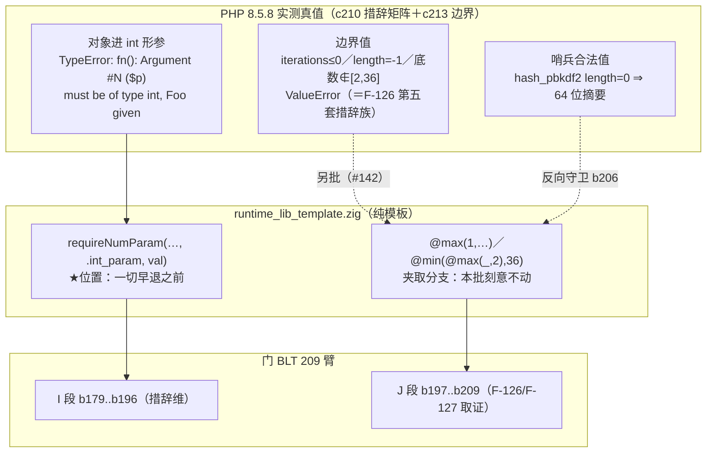
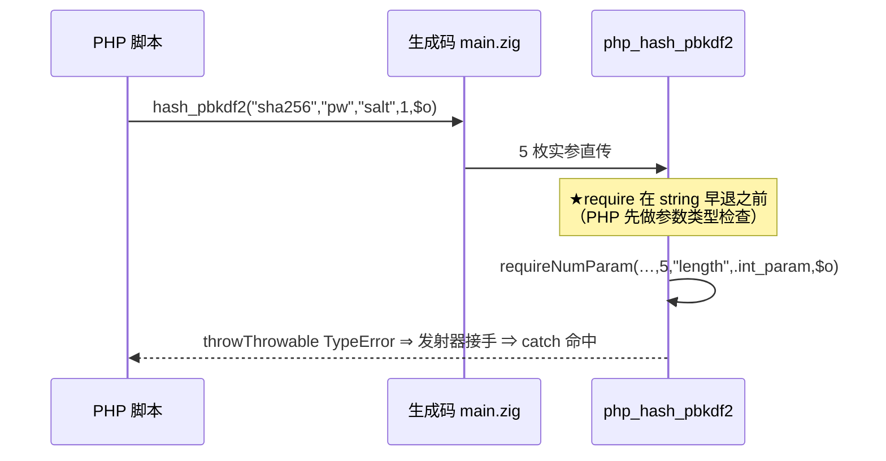

# AOT-CODEGEN-012 · F-62f 接线第四批（`hash_pbkdf2` #4/#5 ＋ `base_convert` #2/#3）R-195 · 2026-10-20 · 基线 `aa74a6a`

## 1. 高层摘要（TL;DR）
- 4 枚内置函数形参从「对象/array/坏串被 `toInt()` 静默折成 0」接成 PHP 8.5.8 的 `TypeError: <fn>(): Argument #N ($p) must be of type int, Foo given`。批型＝**纯模板**，helper 与发射器**一行未改**（措辞维＝裸 `int`）。
- 门 BLT 178→**209 臂**（I 段 18 ＋ J 段 13 为本批与下一批取证用）。逐臂 join：`inter=209 ∧ same→diff=0 ∧ diff→same=4`，且 `diff→same` 的**臂名集合恰等于**写码前预告的 `b179 b180 b181 b182`。
- ★顺带挖出一枚**新的 over-rejection 面 F-131（#149）**：`mktime` 在 AOT 被写死"恰好 6 枚实参"，而 PHP 接受 1..6 ⇒ 合法 PHP 代码**编译期即拒**；语料零暴露 ⇒ 主回归失明，只有门臂看得见。

## 2. 影响范围
| 维度 | 描述 |
|---|---|
| 运行期行为 | 4 枚形参由「静默错值」变「PHP 同款 TypeError（可 try/catch）」 |
| 编译产物 | 零影响（纯模板；`runtime_lib.zig` 是指向模板的符号链接，AOT 编译期读取） |
| 语料暴露 | ★**0 枚**（`pass/` 内 `hash_pbkdf2`／`base_convert` 均无调用）⇒ 主回归对本批**失明**，正确性只由门 BLT 证明 |
| 反向守卫 | `b194 b195 b196 b206 b207 b209` 全部保持 SAME ⇒ 无 over-fatal；J 段 13 臂零转移 ⇒ 未越界碰 ValueError／掩码 |
| 其它模式 | 未触碰（模板只进 AOT 产物） |

## 3. 核心变更
| # | 站点 | 修前 | 修后 | 门臂 |
|---|---|---|---|---|
| 1 | `php_hash_pbkdf2` `:30480` `@intCast(@max(1, iterations.toInt()))` | 对象→`iterations`＝0→夹成 1，静默算出摘要 | `hash_pbkdf2(): Argument #4 ($iterations) must be of type int, Foo given` | b180 ✅ |
| 2 | `php_hash_pbkdf2` `:30481` `@intCast(@max(0, length.toInt()))` | 对象→`length`＝0→**恰好命中哨兵**，静默给 64 位摘要 | `Argument #5 ($length) must be of type int` | b179 ✅ |
| 3 | `php_base_convert` `:14223` | `frombase` 对象→0→夹成 2 | `base_convert(): Argument #2 ($from_base) must be of type int` | b181 ✅ |
| 4 | `php_base_convert` `:14224` | 同上 | `Argument #3 ($to_base) must be of type int` | b182 ✅ |
★三处形参名与模板变量名不一致（`frombase`→`$from_base`、`tobase`→`$to_base`）⇒ 消息文本一律取**实测形参名**，禁从变量名推（§104.2 纪律②的延续）。
★`require` 全部置于各函数既有早退（`!isString()` 类）**之上**＝PHP 参数类型检查先于函数体（§104.2 纪律①）。

## 4. 可视化概览

## 5. 详细变更分析
| 层 | 文件 | 变更 |
|---|---|---|
| 运行期模板 | `src/aot/runtime_lib_template.zig` | 2 枚函数、4 枚形参接线＋注释钉住"只接类型拒、夹取属 F-126"的批界；`md5 fda7f3ee0cb0b547a3228e3cf9d650fb`（修前 `83679bda…`） |
| 发射器／IR／共享层 | `native_linker.zig`／`ir*.zig`／`parser.zig`／`optimizer.zig` | **逐字未动**（链头六枚源码 md5 断言实测通过） |
| 取证资产 | `c047_builtin_numeric_object_gate_tmp.sh`（209 臂）、`c209/c210/c213/c220/c221`、`c211` join 电池、`c217` 代次清单、`c219` 本批验收链 | 新增／扩写 |
| 基线表 | `c047_blt_prefix209_R195_snapshot_tmp.tsv`（`219f5869…`，`same=177 diff=31 cf=1 zig_escape=2` @946 s）／`c047_blt_postfix209_R195_tmp.tsv`（`same=181 diff=27 cf=1 zig_escape=2` @935 s） | 改码**前**冻结（r90） |
| 文档 | 工单 §105 | 落地读数、判据预告、F-131、提交态校正 |

## 6. 影响与风险评估
- **是否破坏式变更**：否（纯模板、零发射漂移、语料零暴露）。
- **变更影响面**：仅"对象/array/非数值串进这 4 枚形参"由静默变 TypeError。★注意 #2 的特殊性：修前对象被折成 0，而 `length=0` 在 AOT 与 PHP 语义里都是"整个摘要长度"⇒ 修前会**静默产出一枚看似合法的 64 位摘要**，是本批最像"能跑"的一条错值。
- **需特别注意**：①★**禁止**把 J 段任一枚臂在本批顺手改绿（`ValueError`/掩码属 #142/#143，且与 `sleep`/`usleep` 必须同批）；②`b183` 仍 `COMPILE_FAIL`，那是 #149 而非本批缺陷，**禁为了让它绿而改臂体**（换臂体＝跨臂形 join＝必然假 DIFF）；③链跑动期间 HEAD 可能移动 ⇒ 提交态一律现测（本轮实测 `aa74a6a` 已含 R-194）。
- **复测路径**：`ONLY="b179 b180 b181 b182" TSV_OUT=… bash fuzzy_scripts_720/tmp/c047_builtin_numeric_object_gate_tmp.sh`（18 s）→ 全 209 臂 → `GEN_TAG=R195 bash fuzzy_scripts_720/tmp/c219_accept_r195_tmp.sh`。

## 7. 遗留／潜在问题
- ★**验收链读数（链跑完后的现测，全表见工单 §105.5）**：八腿邻门 `pre=post=inter` ∧ `same→diff=0 ∧ diff→same=0`＝**零转移**；`LEG[REG] rc=0 wall=814s`＋`SELF_CHECK_OK rows=68 uniq=68`＋**`PASS=68 FAIL=0`**；`LEG[SHADOW] rc=0 wall=1074s`＋`SHADOWCOL_DONE rows=68 col_md5=7f4b2c8a… base_md5=7f4b2c8a… changed_rows=0 col_identical=yes`（★纯模板批发射中性**第 11 枚**样本）；首尾两次代次清单 ⇒ **`VERIFY_SAME_GENERATION`**；`R195_CHAIN_END residue=0`。
- ★链后补测的两条：#146 **F-129 证伪关闭**（四形 AOT＝PHP）；同一轮撞出 **F-132（#150）**＝★try 体内读过一次的**堆类型变量**，在 catch 体内再读时拿到空值（形参／局部皆中招，int 不中招，读取风格无关；普通分支与循环不受影响）。根因已由生成码定位为 **IR 侧 try 体作用域合并把"变量→寄存器"绑定改写成 try 体临时寄存器**（catch 取到非支配寄存器），**不是** #150 原先猜的"phi 未物化"（该定性已在工单 §105.6 当场更正）。★语料离触发只差一步（`f048:110` 已在 catch 内插值且分支会执行），当前 `PASS=68` 对本面零证据力。
- 其余队列：#149（arity 对表普查）、#142／#143（ValueError 与掩码，须同批）、#140（`?int` 等 5 维）、#141（F-125 两枚抑制位）、#147（F-130 换行不一致，站点已普查成"7 处 6 致"）、#144（F-128 需裁）。

## 8. 后续开发建议
| 优先级 | 事项 | 影响面 | 落地成本 |
|---|---|---|---|
| P0 | **#149** arity 对表普查（`getNumberOfRequiredParameters()` vs AOT 固定 arity），★先列清单再谈放宽 | 合法 PHP 代码编译失败的 over-rejection | 低（反射一次性对表），放宽本身属发射器⇒需裁 |
| P0 | **#148** R-196：9 枚裸 `int` 站点接线（`chr`／`count_chars`／`json_decode`／`mb_strpos`／`preg_match(_all)`／`random_bytes`／`srand#2`／`pathinfo`），★含两处 F-126 耦合须先分诊 | 静默错值面继续收敛 | 低-中（同形制，逐枚测真值） |
| P1 | **#142＋#143 同批**：ValueError 族（9 形）＋`long2ip`/`sleep` 掩码族 | 两处 Zig 错误外逸＋四处静默夹取＋一处 UB | 中（新 helper ＋ J 段已备好臂） |
| P1 | **#141** F-125 两枚直写站点补抑制位 | `@` 语义（PHP 实测双流全空） | 极低（两处各一行），禁改调 `emitDeprecated`（#147） |
| P2 | **#136** 把 join 搬进链、让跨代基准硬失败 | 防假绿 | 低，但改母版链失败语义⇒需裁 |
