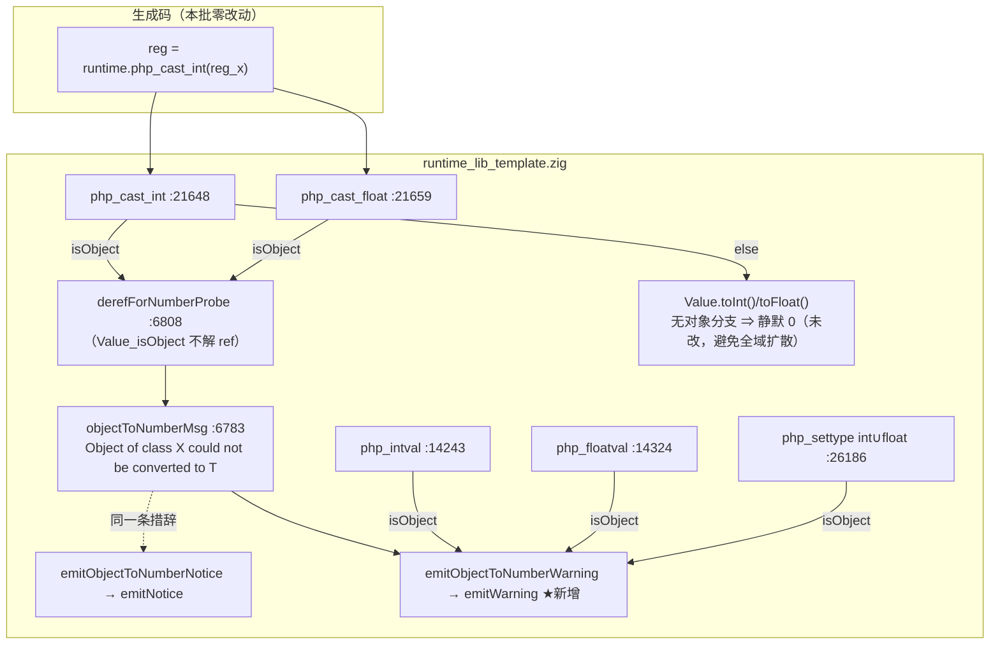
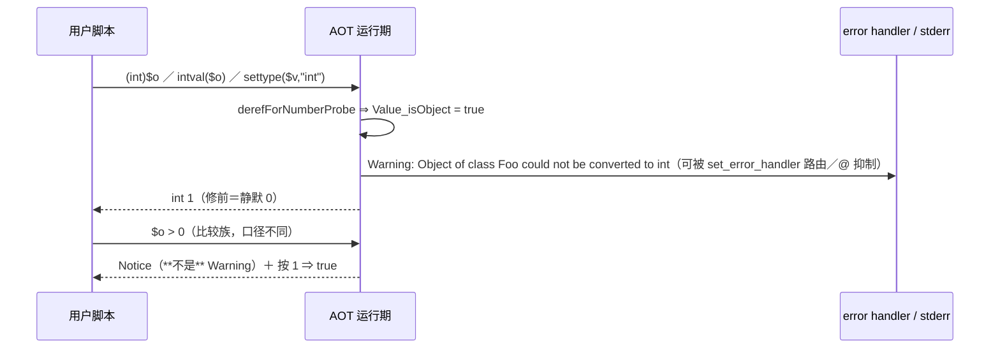

# AOT-CODEGEN-012 F-77 对象→显式数值转换族落地 R-192

- 工单：`docs/known-issues/AOT-CODEGEN-012-class-name-case-insensitive-lookup.md` §101
- 轮次：R-192（**纯模板轮**，只动 `runtime_lib_template.zig`，不需重建解释器）
- 代次锚：`tpl=50726d349f86a41aeca4a9844241e284`（唯一变更源）；`nlk=0d598ff8…`／`ir=1fb6b01f…`／`irg=a5751960…`／`parser=70e80f18…`／`opt=36f354f4…` 全部逐字未动 ⇒ 链头 `BATCH_TYPE=pure-template` 断言通过
- 判据档：影子**硬中性**（`changed_rows=0 ∧ col_identical=yes`），与 IR／发射器批的"必然漂移"档**禁互套**

## 1. 高层摘要（TL;DR）

`toInt()`／`toFloat()` 没有对象分支 ⇒ 落到末尾 `return 0`，于是 PHP 里"`(int)$obj` 给 **1** 并发 **Warning**"这一族，在 AOT 变成"**静默 0／0.0**"——**值错＋诊断缺失**双缺口。本批在五个入口各补一条对象支并复用既有措辞，七枚面孔全关。

关键取舍：不去改 `toInt()`（它是 NaN-boxing 下的全函数、被到处调用，加告警＝无差别扩散），而是只改 `php_cast_int`／`php_cast_float`／`php_intval`／`php_floatval`／`php_settype`。四腿全绿：门 BLT 139 臂 `same→138`、残余红恰只有既存 `b5`，join `same→diff=0`；F2I／OBJ／PRC／PERR 四枚邻门逐臂**零转移**；主回归 `68/67/0/1` 且表自检合格；影子列与上一代**逐字同值**。

## 2. 影响范围

| 面 | 影响 | 强度 |
|---|---|---|
| 显式转换六形 | `(int)$o`／`(float)$o`／`intval`／`floatval`／`settype(…,"int")`／`settype(…,"float")` ⇒ 由静默 `0` 变 Warning＋`1／1.0` | 语义修正 |
| 比较族（`$o > 0` 等） | **未动**，仍发 **Notice**（同一句话两个严重度，本批刻意不合并） | 守卫 b115…b129 零转移 |
| stringable 对象 | 显式转换**不**走 `__toString`（实测给 1 不是 42）⇒ b134/b135 建常驻守卫 | 防"顺手做聪明" |
| ref 包裹的对象 | `Value_isObject` 不解 ref 而 `toInt()` 解 ⇒ 新增 `derefForNumberProbe` 统一判定 | 补一面 |
| 生成码／发射器 | **零改动** ⇒ 影子列不变（实测证实） | — |
| 非 AOT 模式 | **未触碰**（宪法五） | — |

## 3. 核心变更

| # | 位置 | 变更 |
|---|---|---|
| 1 | [src/aot/runtime_lib_template.zig:6783-6812](file:///Users/wangjianjun/products/parser/src/aot/runtime_lib_template.zig#L6783-L6812) | 抽出共用措辞 `objectToNumberMsg`；`emitObjectToNumberNotice` 改为其薄封装；新增 `emitObjectToNumberWarning`；新增 `derefForNumberProbe` |
| 2 | [:21648-21668](file:///Users/wangjianjun/products/parser/src/aot/runtime_lib_template.zig#L21648-L21668) | `php_cast_int`／`php_cast_float` 补对象支（在 F-69 告警**之前**返回，避免叠加） |
| 3 | [:14243-14250](file:///Users/wangjianjun/products/parser/src/aot/runtime_lib_template.zig#L14243-L14250)、[:14324-14332](file:///Users/wangjianjun/products/parser/src/aot/runtime_lib_template.zig#L14324-L14332) | `php_intval`／`php_floatval` 补对象支 |
| 4 | [:26186 起 int∪float 两支](file:///Users/wangjianjun/products/parser/src/aot/runtime_lib_template.zig#L26186) | `php_settype` 两支点改块形并补对象支（`settype` 仍返回 true） |
| 5 | `fuzzy_scripts_720/tmp/c047_builtin_numeric_object_gate_tmp.sh` | 门 BLT 129→**139 臂**，新增 **F 段 b130…b139**（7 枚可观测＋3 枚反向守卫） |

## 4. 可视化概览【mermaid：Code & Logic Map】

## 5. 详细变更分析

| 层 | 文件 | 变更点／读数 |
|---|---|---|
| 运行期模板 | `src/aot/runtime_lib_template.zig` | 5 个入口＋3 枚 helper；`grep` 证实这五个 helper **在模板内除定义处零调用点**、`native_linker.zig` 也不引用 ⇒ 无"内部复用重复告警"风险 |
| 发射器／IR／共享层 | — | 未动（链头逐枚 md5 断言强制） |
| 门 | `c047_builtin_numeric_object_gate_tmp.sh` | F 段 10 枚；`AOT_BIN=/bin/false ONLY="b130 b139"` 自证 ⇒ `compile_fail=2` ∧ rc=2 |
| 真值资产 | `c189_f77_truth_tmp.php`、`c188_f77_truth_tmp.php` | 新建，含 stringable／空类／ref／守卫四组形 |
| 链 | `c193_accept_r192_tmp.sh` | 八腿，ANCHOR 六枚源码 md5（**不断言二进制 md5**，见 r84） |

### 5.1 读数账本

| 腿 | 修前 | 修后 | join／判据 | 结果 |
|---|---|---|---|---|
| 门 BLT | 139 臂 `same=131 diff=8`（`96bf2764…`） | `same=138 diff=1` | `inter=139 same→diff=0 diff→same=7`，残红恰 `b5`＝F-62b | ✅ |
| 邻门 F2I | 51 臂红 `b3 b5 b6 b7 b8`（副本 `86a8764b…`） | 同 | `inter=51` 零转移 | ✅ @215 s |
| 邻门 OBJ | 35 臂红 `i8 i11`（副本 `01ed863f…`） | 同 | `inter=35` 零转移 | ✅ @154 s |
| 邻门 PRC | `56/1` 红 `P\|100` | `56/1` 红 `P\|100` | 逐名相同 | ✅ @25 s |
| 邻门 PERR | `32 same=31 diff=1` 红 `e4` | 同 | 零转移 | ✅ @250 s |
| 主回归 | 68／67／1 | `rc=0` ∧ `SELF_CHECK_OK rows=68 uniq=68 total=68` | Fail 三型全 0 | ✅ @801 s |
| 影子列 | R-191b 列 `7f4b2c8a…` | **同值** ⇒ `changed_rows=0 col_identical=yes` | 纯模板档 | ✅ @1060 s |

## 6. 影响与风险评估

- **是否破坏式变更**：否。只在"对象被当数字"这一条原本**静默给错值**的路径上补诊断与正确值；非对象路径逐字不变（五枚邻门零转移即其证据）。
- **严重度不可合并**：同一条 `Object of class X could not be converted to T` 在 PHP 里有 **Notice**（比较族）与 **Warning**（显式转换族）两个严重度 ⇒ 本批保持两条出口、只共享措辞构造函数。若将来有人"统一"成一条，会同时打红 E 段与 F 段。
- **性能／内存**：对象支是一次 `bufPrint` 到栈上 `[256]u8`＋一次 `emitWarning`，仅在真正发生对象→数值转换时执行；非对象路径只多一次 `isRef()`＋`Value_isObject()` 位判定（与既有 `toInt()` 内部的同型判定等价）。
- **复测路径**：`TSV_OUT=… timeout 1800 bash fuzzy_scripts_720/tmp/c047_builtin_numeric_object_gate_tmp.sh` ⇒ `arms=139 diff=1`（仅 `b5`）；或单跑 `ONLY="b130 b131 b132 b133 b134 b135 b136 b137 b138 b139"`。

## 7. 遗留问题／潜在问题

- **F-77-b（本批刻意不收）**：数组→数字的取值与诊断（`intval([1,2])`=1 零诊断已由 b138 钉住，但 `(int)"abc"`／`(int)[1]` 的**告警叠加口径**未在本批范围内逐形复核，禁顺手动）。
- **F-78（既存局限）**：ref 包着 **float** 的键仍经 `toInt()` 自动解引用而**不发** F-69 那两条精度告警（本批只补了"对象"这一维，未扩大 ref-float 面）。
- **F-62b（`b5`）**：`bcadd(stringable)` 静默转换 vs 数值形参照样拒 ⇒ 需要 stringable 感知的拒绝，仍待排。
- **F-62f（#74）**：triage 已定 47 枚"需接线"站点，本批只消费了其中"对象→数值转换族"这一条支路，其余（`substr`／`str_pad`／`array_*`／`range`／`password_hash` 等）**未动**。
- 五枚源仍未提交（HEAD `a5f0de5`），加本批模板共**六批改动**待老铁决定是否提交。

## 8. 后续开发／优化建议

| 优先级 | 建议 | 影响面 | 落地成本 |
|---|---|---|---|
| P1 | 按 F-62f 的 47 枚清单**分批接线**（每批≤15 枚、每枚先跑系统 PHP 真值再改），判据复用门 BLT＋影子硬中性 | 内置函数族 | 中（机械但量大，须防 over-fatal） |
| P1 | 把"一条措辞多严重度"写成模板内的**约定注释**（`objectToNumberMsg` 已具形），并给门 BLT 的 E∪F 段加"严重度不得互抄"的显式断言（比较族必须印 `Notice:`、转换族必须印 `Warning:`） | 测试面 | 低 |
| P2 | F-78（ref-float 精度告警缺失）单独立项：先测 PHP 在 `$r = &$f; $a[$r]` 一形是否告警，再决定是否与 F-69 的显式/隐式两口径合并 | 数值族 | 取证低／实现中 |
| P2 | 语料对"对象→数值"零暴露 ⇒ 建议往 `pass/` 增补一枚含 `(int)$obj` 与 `intval($obj)` 的常驻语料，把这类面从"只有门保护"升级为"回归也保护" | 测试基建 | 低 |
