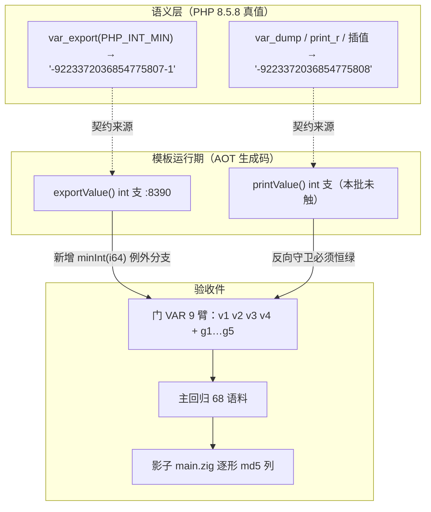
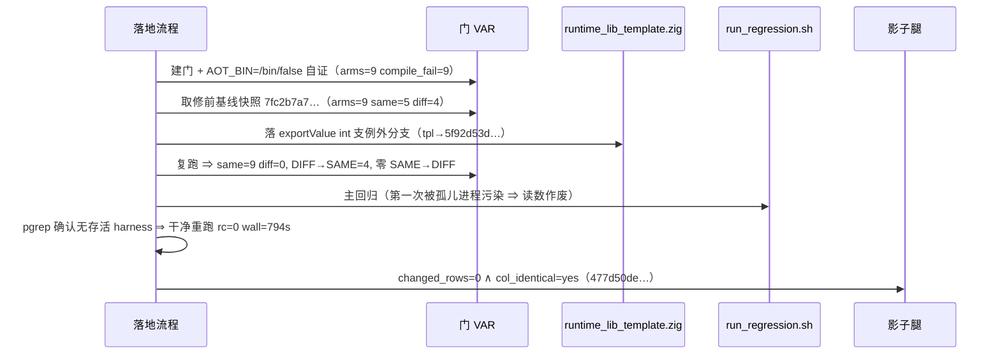

# AOT-CODEGEN-012 ｜ F-85 `var_export(PHP_INT_MIN)` 文本面落地（R-189）

- 日期：2026-10-20（收口 01:12 起、污染重跑核验至 02:0x）
- 轮次：R-189｜缺陷：F-85｜新增永久侧门：VAR（9 臂）
- 代次锚点（`md5 -q` 实测）：`tpl=5f92d53d197e92da2f04bc8d38ec6879`｜`bin=8b953cb21ed34e96b3245a1b6df7151d`｜`nlk=45a11243b37a7f844e5c715510ac3a3d`（后四枚 `parser 70e80f18… / irg 1de4fbdb… / opt 36f354f4…` 逐字未变 ⇒ **纯模板批**，编译器二进制无需重建）
- 工单：[docs/known-issues/AOT-CODEGEN-012-class-name-case-insensitive-lookup.md](file:///Users/wangjianjun/products/parser/docs/known-issues/AOT-CODEGEN-012-class-name-case-insensitive-lookup.md) §93（§93.1–§93.6）

## 1. 高层摘要（TL;DR）

AOT 的 `var_export()` 对 `PHP_INT_MIN` 输出数学正确的 `-9223372036854775808`，而 PHP 8.5.8 实测输出 `-9223372036854775807-1`（PHP 内部取不到 `-(2^63)` 的绝对值 ⇒ 拼成 `-`＋`9223372036854775807`＋`-1`）。`var_export` 的产物常被回读/存档，字面不合即为差。本批在**模板内 `exportValue` 的 int 支**补这一条例外形状，落地后门 VAR 9/9 全绿、主回归 `68/67/1` 无 Fail、影子 `changed_rows=0 ∧ col_identical=yes`。
★同批暴露并修好了测试工具面一枚真问题：我自己留下的**孤儿进程**污染了回归表（`Pass 93 > Total 68`），已给 `run_regression.sh` 加两行表自检并双向验证。

## 2. 影响范围

| 维度 | 本批影响 | 实测证据 |
|---|---|---|
| 生产码 | `src/aot/runtime_lib_template.zig` 的 `exportValue` int 支（`:8390` 区域），一处分支 | 工单 §93.3 站点行号＋其余四枚源码锚点逐字未变（本仓当前 `git status` 另含 R-185 遗留的 `native_linker.zig` 暂存改动，**不属本批**，故不用 `git diff` 作本批证据） |
| 输出面 | **仅** `var_export`；`var_dump` / `print_r` / 插值 / `(string)` 四面**未动**（走 `printValue` 另一支） | 门 VAR 反向守卫 `g1 var_dump`／`g2 print_r`／`g3 插值`／`g4 正常 int`／`g5 float` 修前修后**全绿** |
| 编译器二进制 | 无（纯模板，运行时读盘） | `bin/nlk/parser/irg/opt` 五枚锚点逐字未变 |
| 影子（发射面） | 硬中性 | 列 `md5=477d50de…` ＝ 基线，`changed_rows=0` |
| 测试工具 | `run_regression.sh` 新增表自检（`rows==TOTAL ∧ uniq==TOTAL`，否则 `exit 99`） | §93.6 四行验证表 |

## 3. 核心变更

| # | 文件 | 变更 | 说明 |
|---|---|---|---|
| 1 | [src/aot/runtime_lib_template.zig](file:///Users/wangjianjun/products/parser/src/aot/runtime_lib_template.zig) | `exportValue` int 支补 `n == minInt(i64)` 例外分支 | 按 `maxInt(i64)` **现拼** `-`＋量级＋`-1`，不把 `-9223372036854775807-1` 当字面量抄入（宪法 §四-3 禁硬编码本应计算的值） |
| 2 | [fuzzy_scripts_720/tmp/c154_var_export_gate_tmp.sh](file:///Users/wangjianjun/products/parser/fuzzy_scripts_720/tmp/c154_var_export_gate_tmp.sh) | 新立永久侧门 VAR（9 臂＝4 正形＋5 反向守卫） | 建门即用 `AOT_BIN=/bin/false` 自证，**先取修前基线再动源码** |
| 3 | [fuzzy_scripts_720/run_regression.sh](file:///Users/wangjianjun/products/parser/fuzzy_scripts_720/run_regression.sh) | 主循环后接表自检 | 防"两个写入者"污染留下 `Pass 93 > Total 68` 这类要靠人追的自相矛盾计数 |

```zig
// src/aot/runtime_lib_template.zig（exportValue 内，节选）
const n = value.asInt();
if (n == std.math.minInt(i64)) {
    var mag_buf: [32]u8 = undefined;
    const mag = std.fmt.bufPrint(&mag_buf, "{d}", .{std.math.maxInt(i64)}) catch { … };
    try writer.writeByte('-'); try writer.writeAll(mag); try writer.writeAll("-1");
    return;
}
try writer.print("{d}", .{n});
```

## 4. 可视化概览





## 5. 详细变更分析

### 5.1 真值先行（`c153_intmin_tmp.php`，PHP 8.5.8 亲验）
| 面 | PHP 实读 | 处置 |
|---|---|---|
| `var_export(PHP_INT_MIN, true)` | `-9223372036854775807-1` | 本批修 |
| `var_export([PHP_INT_MIN, PHP_INT_MAX], true)` | `0 => -9223372036854775807-1` | 同源（数组元素走同一 `exportValue`）⇒ 一并转绿 |
| `var_dump(PHP_INT_MIN)` | `int(-9223372036854775808)` | **禁改**（正常形） |
| `print_r` / `"{$v}"` / `(string)` | `-9223372036854775808` | **禁改** |
⇒ 缺陷面唯一＝`var_export`；这是"四形同测"后才敢收窄的原因（只测直调面会把 `var_dump` 一起改坏）。

### 5.2 验收读数（三腿，含一次作废与重跑）
| 腿 | 读数 | 判定 |
|---|---|---|
| 门 VAR（9 臂） | `same 5→9`、`diff 4→0`、`compile_fail=0 aot_empty=0`；转移 `DIFF→SAME=4`、`SAME→SAME=5`、零 `SAME→DIFF` | ✅ F-85 关闭，另三输出面无污染 |
| 主回归（首跑） | `rc=0`、Fail 全 0，但汇总表 `Pass=93 > Total=68` | ❌ **读数作废**（孤儿进程双写入，表被追加 26 行重复） |
| 主回归（干净重跑） | `rc=0 wall=794s`、`SELF_CHECK_OK rows=68 uniq=68 total=68`、`Total 68 / Pass 67 / Fail(Compile) 0 / Fail(Runtime) 0 / Fail(Diff) 0 / Skip 1` | ✅ |
| 影子 | `changed_rows=0 ∧ col_identical=yes`，列 `477d50de…` ＝ R-186 基线 | ✅ 纯模板批发射中性（第 4 枚样本） |

### 5.3 涉及文件清单
生产码 1（模板）＋ 验收件 5（`c153` 探针／`c154` 门＋修前修后两表／`c155` 腿脚本＋日志）＋ 工具 1（`run_regression.sh`）。

## 6. 影响与风险评估

- **是否破坏式变更**：否。新增分支只在 `n == minInt(i64)` 命中，其余整数路径字节级不变；影子 68 份 `main.zig` 零变化为旁证。
- **内存/所有权**：例外分支用栈上 `[32]u8` bufPrint，不额外分配、不涉及引用计数 ⇒ 无 GC 语义变化。
- **性能**：`var_export` 属冷路径；新增一次整数比较（`n == minInt(i64)`），不在热循环内，未做基准（本批非性能路径，按宪法三-2 仅对性能关键路径要求基准）。
- **复测路径（体验流程）**：
  1. `timeout 300 bash fuzzy_scripts_720/tmp/c154_var_export_gate_tmp.sh` ⇒ 期望 `arms=9 same=9 diff=0`；
  2. `timeout 120 php -r 'echo var_export(PHP_INT_MIN, true), "\n";'` 与 AOT 同形逐字比对；
  3. `timeout 2400 bash fuzzy_scripts_720/run_regression.sh` ⇒ 必须看到 `SELF_CHECK_OK rows=68 uniq=68 total=68`。

## 7. 遗留问题 / 潜在问题

1. **F-85 只闭了文本面一族**：`var_export` 对对象/递归/`stdClass` 属性的形状未在本门覆盖（门 VAR 9 臂只锁整数边界与五枚反向守卫）。
2. **工具面残余**：`run_regression.sh` 的自检只管"表行数/重名"，不管"同一次运行内是否被外部追加"；根治需给表加运行 ID 列（P2）。
3. **`.zigphp_aot_build_*` 残留**：本轮有 1 个属**仍在跑的进程**，按"只回收自己已死进程且内无 `.php`"规则保留未动（P2，随 #112 治理）。
4. 流程教训已入记忆（第 69 条）：终止链必须连子进程一起收，并验 `pgrep -f run_regression` 为空再开下一批。

## 8. 后续开发 / 优化建议

| 优先级 | 建议 | 影响面 | 落地成本 |
|---|---|---|---|
| P1 | 把 `exportValue`/`printValue` 的 int 支合并为**单一"PHP 十进制形状"helper**（现两处各写一套 `{d}`，F-85 只在其中一支补例外，下一枚边界缺陷仍会漏） | 模板内输出族全部 | 低（一处 helper ＋ 两站点） |
| P1 | 门 VAR 扩 `PHP_INT_MAX`／`-PHP_INT_MAX`／`0`／`-0.0` 四形，并把"回读 `var_export` 产物再 eval 一致性"作为断言 | 只影响本门 | 低 |
| P2 | 回归表加运行 ID 列 ＋ 收尾断言"所有行同一 ID"，把"两个写入者"从**事后追证**变成**当场拒绝** | 测试工具 | 低 |
| P2 | 与 #112 合并：`.zig-cache` 体积/条目数上报，并把代次断言从 `EXPECT_BIN` 彻底换成源码 md5 五元组 | 全部链 | 中 |
