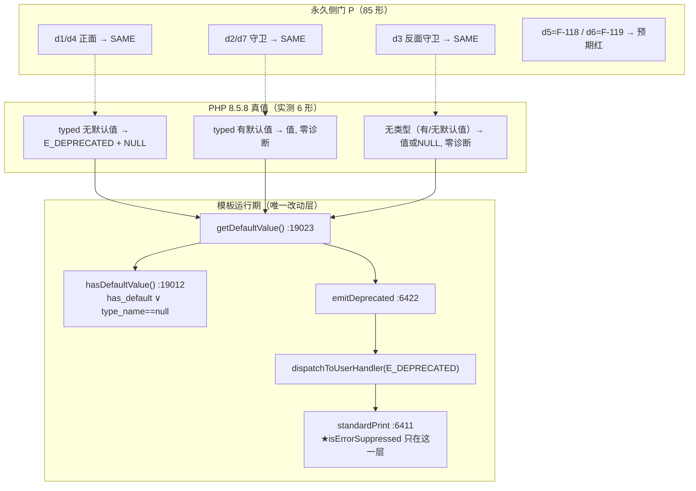
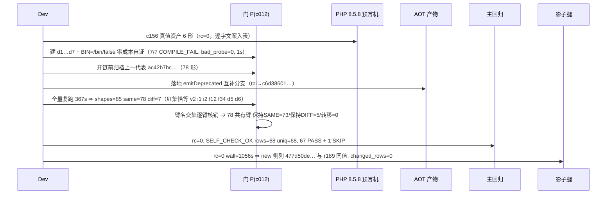

# AOT-CODEGEN-012 ｜ F-87 `ReflectionProperty::getDefaultValue()` 缺 E_DEPRECATED 落地（R-190）

- 日期：2026-10-20
- 轮次：R-190｜关闭缺陷：F-87｜新增永久守卫：门 P 的 `d1…d7`｜同轮新立：F-118／F-119（只登记，未动手）
- 代次锚点（`md5 -q` 实测）：`tpl=c6d386012e76471d9f319c83ac02d054`｜`nlk=45a11243b37a7f844e5c715510ac3a3d`（未变）｜`bin=8b953cb21ed34e96b3245a1b6df7151d`（未变）｜HEAD=`a5f0de5`
- 批次定性：**纯模板一处** ⇒ 判据＝影子**硬中性**（禁套用"名字表批次必漂移"口径）
- 工单：[docs/known-issues/AOT-CODEGEN-012-class-name-case-insensitive-lookup.md](file:///Users/wangjianjun/products/parser/docs/known-issues/AOT-CODEGEN-012-class-name-case-insensitive-lookup.md) §94（§94.1–§94.5）

## 1. 高层摘要（TL;DR）

PHP 8.5.8 对「**有类型声明且无默认值**」的属性调用 `ReflectionProperty::getDefaultValue()` 时，会先发一句 `E_DEPRECATED`（提示改用 `hasDefaultValue()`），随后仍返回 `NULL`。AOT 此前静默返回 `NULL`，诊断整条缺失。本批在模板内该方法的取默认值之前补一条**与 `hasDefaultValue()` 严格互补**的判定，落地后 6 形真值表全对齐。
同轮把该族固化为永久侧门 P 的 7 枚新臂（`d1…d7`，含一枚**反面守卫**），并顺带发现两枚新缺陷：**F-118**（`ReflectionParameter::getDefaultValue()` AOT 未实现，且元数据层根本没法实现）、**F-119**（AOT 注册了 PHP 并不存在的 `ReflectionParameter::hasDefaultValue()`＝过接受）。
三腿全绿：门 P `shapes=85 same=78 diff=7`（注册红恰等 7 枚、78 枚共有臂**零转移**）＋主回归 `68/67/1` 三张 Fail 全 0＋影子 `changed_rows=0 ∧ col_identical=yes`。

## 2. 影响范围

| 维度 | 影响 | 实测证据 |
|---|---|---|
| 生产码 | `runtime_lib_template.zig` 内 `ReflectionProperty::getDefaultValue` 一条边（:19033-19039）＋:19010 一句过时注释 | 其余 `nlk/parser/irg/opt/bin` 锚点逐字未变 |
| 用户面 | 凡内省读默认值（框架做属性装配／序列化器探测默认值）在 typed 无默认值属性上多出一句 PHP 同款 Deprecation | 真值表 P1/P5；门 P `d1`/`d4` |
| 不受影响面（关键） | 无类型属性（`public $p;`）与有默认值属性**必须零诊断** | 门 P `d3`（反面守卫）/`d2`/`d7` 全 SAME |
| 编译器二进制 | 无（模板运行时读盘） | `bin` md5 未变 |
| 影子（发射面） | 硬中性 | 列 `477d50de…` ＝ r189 列，`changed_rows=0` |
| 测试资产 | 门 P 形表 78→85；`BIN`/`OUT` 改为可覆盖（使零成本自证成为可能，且不再覆写上一代基线表） | §94.3 |

## 3. 核心变更

| # | 文件 | 变更 | 理由 |
|---|---|---|---|
| 1 | [src/aot/runtime_lib_template.zig:19033-19039](file:///Users/wangjianjun/products/parser/src/aot/runtime_lib_template.zig#L19033) | `if (!p.has_default and p.type_name != null) emitDeprecated(<逐字 PHP 文案>)` | 触发条件与 `hasDefaultValue()` 的实现 `p.has_default or p.type_name == null`（:19012）**严格互补** ⇒ 不可能两边同时报或同时不报 |
| 2 | 同文件 :19010 | 更新过时注释（原写"该告警未实现"） | 注释与实现不一致＝下一轮误判来源 |
| 3 | [fuzzy_scripts_720/tmp/c012_reflection_gate_tmp.sh](file:///Users/wangjianjun/products/parser/fuzzy_scripts_720/tmp/c012_reflection_gate_tmp.sh) | 新臂 `d1…d7`＋`BIN/OUT` 可覆盖＋门头新增"85 形／7 枚注册红"当前口径 | 门默认 TSV 会被 `: > "$OUT"` 覆写 ⇒ 旧写法下"做自证"＝"毁证" |
| 4 | [fuzzy_scripts_720/tmp/c156_f87_truth_tmp.php](file:///Users/wangjianjun/products/parser/fuzzy_scripts_720/tmp/c156_f87_truth_tmp.php) | 真值资产 6 形属性 ×（`hasDefaultValue`/`getDefaultValue`）＋ 3 形参数面 | 门与表同源：改期望必须先改取证资产 |
| 5 | [fuzzy_scripts_720/tmp/c158_accept_r190_tmp.sh](file:///Users/wangjianjun/products/parser/fuzzy_scripts_720/tmp/c158_accept_r190_tmp.sh) | R-190 三腿派生链（含批次类型硬前置） | `nlk` 变⇒拒跑；`bin` 变⇒拒跑（防判据跨型误套） |

```zig
// src/aot/runtime_lib_template.zig（ReflectionProperty::getDefaultValue 内，:19037-19039）
if (!p.has_default and p.type_name != null) {
    emitDeprecated("ReflectionProperty::getDefaultValue() for a property without a default value is deprecated, use ReflectionProperty::hasDefaultValue() to check if the default value exists");
}
```

## 4. 可视化概览





## 5. 详细变更分析

### 5.1 真值表（门期望逐字取自此表）
| 形 | 声明 | `hasDefaultValue()` | `getDefaultValue()` | 诊断条数 |
|---|---|---|---|---|
| P1 | `public int $a;` | false | NULL | 1（E_DEPRECATED） |
| P2 | `public int $a = 5;` | true | `int(5)` | 0 |
| P3 | `public $a;` | **true** | NULL | **0** |
| P4 | `public $a = 7;` | true | `int(7)` | 0 |
| P5 | `public ?string $a;` | false | NULL | 1 |
| P6 | `public ?string $a = null;` | true | NULL | 0 |

### 5.2 层级拆账
| 层 | 变更点 | 是否本批 |
|---|---|---|
| 运行期模板（内省方法体） | 一条 `if`＋一句 `emitDeprecated` | ✅ |
| 发射器 / IR / 解析器 / 优化器 | 零 | — |
| 验收件 | 门 P 扩臂、真值资产、派生链 | ✅ |
| 元数据表（`ClassMethod`） | **缺口已证**：无形参默认值格 ⇒ F-118 必须动发射器 | ✋ 待排 |

### 5.3 涉及文件清单
生产码 1（模板 2 处：:19010 注释、:19033-19039 分支）；验收件 4（`c156` 资产＋stdout/stderr 两份读数、`c012` 门、`c012` 修前归档表／修后表、`c158` 链＋日志）；工单 1（§94）。

## 6. 影响与风险评估

- **破坏式？** 否。新增只在"typed ∧ 无默认值"这一条边打诊断，返回值路径一字未动；影子 68 份 `main.zig` 零变化＋78 枚共有臂零转移为机器证据。
- **诊断路由副作用**：选 `emitDeprecated`（:6422）而非直接 `standardPrint`，因其先走 `dispatchToUserHandler(E_DEPRECATED)` ⇒ `set_error_handler` 语境与 PHP 同口径（F-92 家族），`@` 语境由 `standardPrint` 内的 `isErrorSuppressed()`（:6412）统一静默。**未**新增第三套打印路径。
- **两轨条数**：PHP 该告警在 stderr 打 `PHP Deprecated:  …`、stdout 打 `Deprecated: …`（两行），AOT 同序；门 P 用 `2>&1` 合轨比较 ⇒ 只打单轨会当场红（不会静默放行）。
- **性能**：内省冷路径，一次布尔组合判断；不在热循环，未设基准（宪法三-2 仅要求性能关键路径）。
- **需要特别注意的点**：`ReflectionParameter::hasDefaultValue`（:18680）与 `ReflectionProperty::hasDefaultValue`（:18997）**同名不同类**，后者 PHP 确有、前者 PHP 没有 ⇒ 任何后续"清理"必须按类分名处理，禁全局替换。
- **复测路径**：
  1. `timeout 300 env ONLY="d1 d2 d3 d4 d7" bash fuzzy_scripts_720/tmp/c012_reflection_gate_tmp.sh` ⇒ 期望 `shapes=5 same=5 diff=0`；
  2. `timeout 30 php fuzzy_scripts_720/tmp/c156_f87_truth_tmp.php` 与同名 AOT 产物逐字比对；
  3. `timeout 2400 bash fuzzy_scripts_720/run_regression.sh` ⇒ `SELF_CHECK_OK rows=68 uniq=68 total=68`；
  4. `timeout 2400 bash fuzzy_scripts_720/tmp/c158_accept_r190_tmp.sh`（含批次类型断言）。

## 7. 遗留问题 / 潜在问题

1. **F-87 无逐臂修前快照**（先落地后建臂）：以 §94.1 真值表＋`d3` 反面守卫＋85 形全量读数（首枚冻结基线 `c012_reflection_postR190_tmp.tsv`，md5 `936451c7…`）替代，已在 §94.3 如实登记。
2. **门 P 修前归档表代次不可考**：它只是"上一次运行的默认输出"，故零转移结论按"与上一次记录相比"表述，不冒充同代次 A/B。
3. **同族仍在红**：`d5`＝F-118（形参默认值元数据缺失，成本中、动发射器）、`d6`＝F-119（过接受，修法＝删 12 行，**涉删码待老铁裁决**）。
4. **门 P 的 7 枚注册红里 5 枚属既有面**（`v2 i1 i2 f12 f34`），本批未触碰；默认档可达性排序仍由 #132（F-117）与 #114（F-100）承担。
5. 链未跑 `zig build test`（纯模板批，编译器码未变）；全量 42 腿母版链（阶段③）仍需回填锚点后跑一次。

## 8. 后续开发 / 优化建议

| 优先级 | 建议 | 影响面 | 落地成本 |
|---|---|---|---|
| P1 | **R-191＝F-118 落地**：给 `ClassMethod` 加 `param_defaults`，两处站点（`native_linker.zig:3174`/`:3276`）随 `param_names` 一并发射，序列化**复用**属性侧 :3437-3450 的 switch（抽成单一 helper，禁复制第二套），模板写 `__default_value` ＋ 注册 `getDefaultValue()`（无默认值时抛 ReflectionException，措辞已实测） | 内省族＋默认档真实用户面（框架装配） | 中（动发射器 ⇒ 二进制重建 ⇒ 影子必漂移，需三口径归因） |
| P1 | **F-119 裁决**（甲 删 :18679-18690／乙 保留并登记为"已接受偏差"、`d6` 转永久预期红）——两案都已备好验收面 | 只有该方法面 | 低 |
| P2 | 门 P 增加"逐臂代次头注"（把 `tpl/nlk/bin` 三枚锚点写进 TSV 首行），使"归档表代次不可考"这类问题从根上消失 | 所有用门做跨代比对的轮次 | 低 |
| P2 | 与 #112 合并：把母版链 `EXPECT_BIN` 换成"源码 md5 五元组"断言（本批 `c158` 的两枚前置即是其雏形，可直接上抽） | 全链 | 中 |
