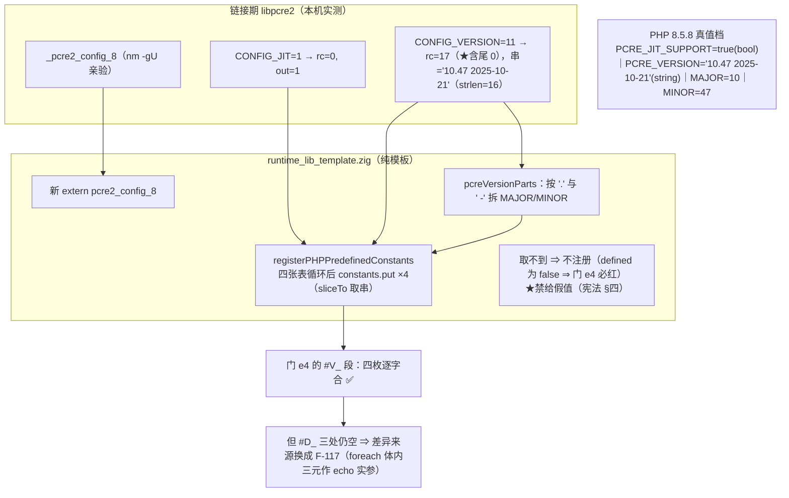

# AOT-CODEGEN-012 ｜ PCRE 自述 4 枚常量运行期取值（R-186）＋新立 F-117｜ 2026-10-20 ｜ 基线 `a5f0de5`

## 1. 高层摘要（TL;DR）

门 PERR 的最后一枚红臂 `e4` 要求 AOT 提供 PHP 的 4 枚 PCRE 自述常量（`PCRE_VERSION`／`PCRE_VERSION_MAJOR`／`PCRE_VERSION_MINOR`／`PCRE_JIT_SUPPORT`）。它们的真值属于**链接期 libpcre2**，写死即违反宪法 §四「禁止硬编码」⇒ 必须新声明 `extern pcre2_config_8` 并在运行期取值。

落地后**四枚值与型别与 PHP 逐字相同**，四腿验收全绿（影子仍中性、`SAME→DIFF=0`）。★但 `e4` 仍记 DIFF——原因**换人了**：差异只剩三处 `#D_`（`defined()` 在 `foreach` 体内被三元当 `echo` 实参时输出空串），与本批常量无关 ⇒ 独立新立 **F-117**（任务 #132）。
本批也**否证**了我先前的一条担心（"编译期常量表吃不到运行期值"）：那张表本身就是运行期 `for` 灌入的，照同一 `put` 形制补即可，**表结构一字未动**。

## 2. 影响范围

| 维度 | 内容 | 状态 |
|---|---|---|
| 语义面 | `defined('PCRE_*')` 四枚由 false⇒true；`constant()` 取值与 PHP 同（`true`/`'10.47 2025-10-21'`/`10`/`47`） | 已实测（冒烟＋门 `e4` 的 `#V_` 段） |
| 外链 | 新增一枚 extern（`pcre2_config_8`）；符号已实测存在（`nm -gU` ⇒ `_pcre2_config_8`）⇒ 链接期风险消除 | 已实测 |
| 模式面 | **AOT-only**（纯模板；`bin`/`nlk`/`parser`/`irg`/`opt` 五枚逐字未变，本批**连编译器都不必重建**） | 已实测（`SRC_ASSERT_OK`） |
| 发射面 | 纯模板批 ⇒ 判据＝影子必须中性：`changed_rows=0 ∧ col_identical=yes` | 已实测（第 3 枚样本） |
| 未做 | `e4` 的残余差异属 **F-117**（循环体内三元作 `echo` 实参）；`PCRE_SUPPORT_UNICODE_PROPERTIES` **PHP 8.5.8 不存在**，不补 | #132／§89.1-4 |

## 3. 核心变更

| # | 站点（`runtime_lib_template.zig`） | 变更 | 依据 |
|---|---|---|---|
| 1 | extern 区（单行先例旁） | `extern fn pcre2_config_8(request: c_uint, where: ?*anyopaque) c_int;` | `nm` 亲验符号存在；形制照 `pcre2_match_data_free_8` |
| 2 | PCRE2 常量区 | `PCRE2_CONFIG_JIT_REQUEST=1`／`PCRE2_CONFIG_VERSION_REQUEST=11`（带 `pcre2.h:477/:488` 行号） | 禁裸数字 |
| 3 | 同区 | `pcreVersionParts(ver) ?struct{major,minor}`：从版本串拆 MAJOR/MINOR | PHP 同源做法；禁写死 `10`/`47` |
| 4 | `registerPHPPredefinedConstants` 四张表循环之后 | 运行期取库值并 `constants.put` 四枚（string/int/int/bool 型别各按 PHP 真值） | ★表本就是运行期灌入（`:8685-8701`）⇒ 不改表形制 |

## 4. 可视化概览

## 5. 详细分析

| 层 | 内容 |
|---|---|
| 库接口层 | `pcre2_config` 无宽度后缀之外的分支；VERSION 的缓冲区要求 ≥64 code unit；返回值语义＝**长度含尾 0**（亲验，非文档推断） |
| 模板层 | 新增 1 extern＋2 请求码常量＋1 拆串函数＋1 注册段（约 25 行，全在既有函数尾部） |
| 内置函数层 | 无改动（`builtin_map` 未动 ⇒ 影子中性） |
| 涉及文件 | `src/aot/runtime_lib_template.zig`（唯一动过的生产源，`tpl=d19aa48a063aa501a16ec79e63a57037`）；`c093_perr_prefix_R186_snapshot_tmp.tsv`（修前基线 `257ea311…`）、`c141_pcreconsts_smoke_r186_tmp.php`、`c145_accept_r186_tmp.sh`（★新增 `E4_AOT_ROW` 打印）、`/tmp/pcreconf.c`（库契约亲验器）、`/tmp/c144_foreach_ternary_tmp.php`（F-117 最小复现） |
| 文档 | 工单 §89（§89.1 前提实测／§89.2 落地／§89.3 新立 F-117／§89.4b 验收终局）＋本文件 |

## 6. 影响与风险评估

- **破坏式变更：否。** 影子 68 份 `main.zig` 逐字节未变；主回归 `68/67/1`、`Fail(Compile)=0`；`SAME→DIFF=0`。
- **性能：一次性启动成本。** 两次 `pcre2_config_8` 调用＋最多 4 次 `dupe/put`，在常量注册路径上（每进程一次），不在任何热循环里。
- **特别注意**：
  1. ★**返回长度含尾 0** 是本批唯一会写错的点——按 `rc` 切片会把 `\0` 带进 PHP 字符串；已用 `std.mem.sliceTo(..., 0)` 规避并写进注释。
  2. 取不到时**不注册**而非给假值：失败会以 `e4` 变红的形式可见。
  3. `e4` 臂的写法本身（`foreach`＋三元 `echo`）踩在 **F-117** 上 ⇒ 枚数不变但账已易主；只看 `diff=1` 会误判"没修"，故链里加了 `E4_AOT_ROW`。
  4. ★别把 `PCRE_SUPPORT_UNICODE_PROPERTIES`"顺手补上"——PHP 8.5.8 没有它（实测 fatal）；`e5` 那类反向守卫是同一族纪律。
- **复测路径**：`php` 与 AOT 各跑一次 `fuzzy_scripts_720/tmp/c141_pcreconsts_smoke_r186_tmp.php` 对读四枚 `#V_`；`bash fuzzy_scripts_720/tmp/c145_accept_r186_tmp.sh` 四腿；F-117 复现 `/tmp/c144_foreach_ternary_tmp.php`。

## 7. 遗留问题

| 项 | 内容 | 记账 |
|---|---|---|
| **F-117** | `foreach` 体内三元作 `echo` 实参 ⇒ 真假两支皆空串（顶层同形正常）；`defined()` 与三元单独均已实测排除；站点方向＝循环体内三元/phi 的发射 | 任务 **#132**（先建门臂取修前基线，禁凭推测动码） |
| PERR 现状 | `arms=32 same=31 diff=1`，唯一红臂 `e4`，其差异 100% 归 F-117 ⇒ **preg 族真值档已全部落地** | 工单 §89.4b |
| 未提交 | R-182①／R-184／R-185／R-186 四批改动（`native_linker.zig`＋`runtime_lib_template.zig`）＋全部文档**均未提交** | 提交需老铁明示 |
| 其它待排 | 阶段③ 42 腿母链（含新锚 `bin 8b953cb2…`／`nlk 45a11243…`／`tpl d19aa48a…`）；F-104 preg 族动态面；F-102/F-103/F-101/F-111/F-112 等待裁项 | 见任务清单 |

## 8. 后续开发／优化建议

| 优先级 | 建议 | 影响面 | 落地成本 |
|---|---|---|---|
| P0 | **F-117 归因轮**：先在 PERR（或新门 TERN）加 3 枚臂（顶层三元／foreach 内三元／for 内三元）取修前基线，再按已有形制 grep 定位循环体内三元/phi 发射 | PERR 归零；且这是**通用表达式缺陷**，命中面可能远超 preg | 中（需读 `ir_generator`／`native_linker` 的循环体发射） |
| P0 | 阶段③：42 腿母链全量跑＋回填 `c116` 三锚为新代次 | 邻居不回退证明 | 低（换锚＋开链 ≈1 h） |
| P1 | 把 `c145` 的 `E4_AOT_ROW` 做法**推广成链脚本报表规范**：凡"预期枚数不变、只换差异来源"的批次，必须打印该臂逐字行 | 防止枚数掩盖性质变化 | 极低 |
| P1 | F-104：preg 族整体进 `builtin_function_map`（一次成族），先取动态面修前基线 | `call_user_func('preg_*')` 全族 | 中 |
| P2 | 一次性普查其余"取自链接期库"的自述面（如 `ZEND_*`/`PHP_*` 里非硬编码可得者），与 **F-101** 待裁项一并交老铁定调 | 避免同类漏项 | 低（普查）＋待裁 |
