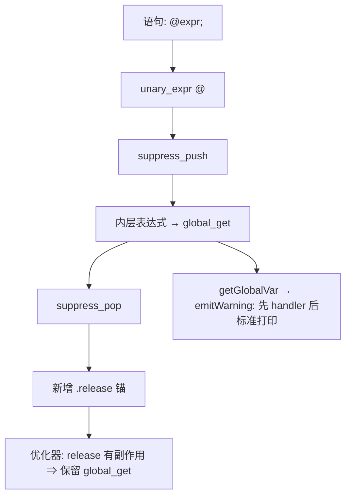

# AOT-CODEGEN-012 F-125-c：裸 `@$var;` 语句被 DCE（R-210）

- 日期：2026-10-21
- 代次：`tpl 7e182c76…`（未动）／`irg f260626e8ef50e9c249e70d488ef6c58`（本轮唯一源改动）
- 关联：工单 §119；新门 C266（字节级诊断门）

## 1. 高层摘要（TL;DR）

PHP 对**裸 `$var;`** 不告警（自身也 DCE），但对**裸 `@$var;`** 会求值并调用 `set_error_handler`（只是标准流被抑制）。AOT 侧：`@` 在 IR 展开为 `suppress_push → 内层 → pop`，而优化器把 `.global_get` 判为无副作用 ⇒ 裸语句里未使用的读取被整条 DCE，handler 收不到。修法：语句层对 `.unary_expr @` 的结果挂一条 **`.release` 副作用锚**，使内侧读取得以保留。

## 2. 影响范围

| 层面 | 影响 |
|---|---|
| IR 生成 | 仅 `.unary_expr @ ...` 作为**语句**时多一条 `.release`；其它一元语句不变 |
| 优化器 | 无改动（`.release` 本属副作用指令，天然作 DCE 锚） |
| 运行时/发射器 | 无改动（`@` 抑制与 handler 路由已在 R-208/R-209 就位） |
| 生成码 | 只对"裸 `@` 语句"新增行；语料该类语句 **0 处** ⇒ 应零漂移 |

## 3. 核心变更

| # | 位置 | 变更 |
|---|---|---|
| 1 | `ir_generator.zig::generateStatement` | 新增 `.unary_expr` 分支：生成表达式后，若 `op == .at_sign` 则 `emit(.release operand=结果)` |
| 2 | 新门 `c266_diag_bytes_gate_tmp.sh` | s1–s4／h1–h3／f1–f5 共 12 臂，**原始字节**对比 stdout/stderr（仅归一 `on line N`） |

## 4. 可视化概览（Code & Logic Map）

## 5. 详细变更分析

### 5.1 真值（PHP 8.5.8，字节级）
- 裸 `$zz;`：无输出、**不调 handler**（PHP 自身 DCE）；
- 裸 `@$zz;`：无标准输出，但 **handler 收到 `CB|2`**；
- `$x = @$zz;`：同上（两侧原本已逐字相同）。

### 5.2 涉及文件
- `src/aot/ir_generator.zig`（+14 行）
- 门：`fuzzy_scripts_720/tmp/c266_diag_bytes_gate_tmp.sh`；快照 `c266_diag_bytes_R210_snapshot_tmp.tsv`

## 6. 影响与风险评估

| 项 | 结论 |
|---|---|
| 破坏式变更 | 否：非 `@` 语句路径逐字不变；`release` 对 null/int/string 是 no-op 或常规归还 |
| 字节证据 | h3（缺 `CB|2` 的面）现 **SAME**；h5/h6/s4 保持不变；**C266 12/12 SAME** |
| 门 | SUPA 9/1＋3、SUPB 7/7、c249 12/1、c254 27/2、c262 4、c264 19/0/1、c265 7/7、F2I 49/1/1 —— 全部同基线 |
| 语料暴露面 | `^[[:space:]]*@` = **0 处**（两级正则普查）⇒ 生成码应不变 |
| 回归 | **PASS=68 FAIL=0**（`SELF_CHECK_OK rows=68 uniq=68`） |
| 影子（IR 改动） | **drift=0 / 68**，列 md5 `86b5c1d0…` 与 R-209 同 |
| 编译/测试 | **`zig build test` 21/21 steps、326/326 tests，rc=0** |
| 特别风险 | `release` lowering 仅对 array/object/function 真释放；string 结果留到函数级 cleanup（既有口径，不新增泄漏） |

**复测路径**：C266（含 `/bin/false` 自证）→ SUPA/SUPB → c249/c254/c262/c264/c265/F2I → 主回归 → 影子 → `zig build test`。

## 7. 遗留问题

1. 诊断**行号归属**（AOT 报上一条语句的 `src_line`）——两批字节门都靠 `on line N` 归一化绕过。
2. `@` 内含 try/catch 时的抑制深度精确化（F-115 遗留 P2）。
3. 其它"无副作用指令被 DCE"的语义边界未系统普查（本批只处理了 `@` 语句这一条已实测面）。

## 8. 后续建议

| 优先级 | 事项 | 影响面 | 落地成本 |
|---|---|---|---|
| P0 | 诊断行号归属修正 | 全部诊断 | 中 |
| P1 | 把 C266 挂进母版链 | 防回归 | 低 |
| P2 | DCE 语义边界普查（哪些"纯"指令其实有可观测副作用） | 优化器正确性 | 中 |
