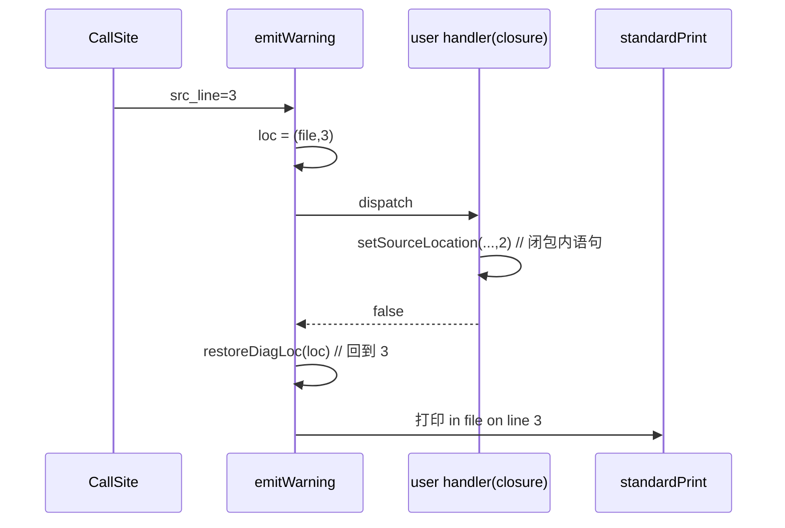

# AOT-CODEGEN-012 F-131-e：诊断行号被用户 handler 改写（R-211）

- 日期：2026-10-21
- 代次：`tpl 4b6a35ba5b53abaf6eaa9df89e42ab1b`（本轮唯一源改动；`irg/nlk` 未动）
- 关联：工单 §120；C266 由"归一化字节门"升级为**严格字节门**

## 1. 高层摘要（TL;DR）

带 `set_error_handler` 时，AOT 诊断的 `in … on line N` 指到**handler 体内**的行号（f2：PHP 3 vs AOT 2）。根因不是发射器没设行号（生成码在调用前确实 `setSourceLocation(3)`），而是：handler 是生成的闭包，执行时会把全局 `src_file/src_line` 推进到闭包内语句；标准打印发生在 dispatch **之后**，用了被改写的全局。修法：在 7 处「先 dispatch 后打印」的站点统一 **快照/恢复** 位置。

## 2. 影响范围

| 层面 | 影响 |
|---|---|
| 运行时诊断 | handler 存在时，标准打印的文件/行号恢复为**诊断发生点** |
| 发射器/IR/优化器 | 无改动 |
| 生成码 | 无（纯模板）⇒ 影子必须中性 |
| 语料 | 仅"设置 handler 且产生诊断"的程序可能变化（行号由错变对） |

## 3. 核心变更

| # | 位置（template） | 变更 |
|---|---|---|
| 1 | `standardPrint` 之后 | 新增 `DiagLoc`／`diagLoc()`／`restoreDiagLoc()` |
| 2 | `emitWarning`／`emitDeprecated`／`emitNotice` | dispatch 前快照、后恢复 |
| 3 | `php_trigger_error` | 同上（switch 打印前） |
| 4 | `emitDeprecatedStrGetcsvEscape`／`emitUndefinedVariableWarning`／`emitDeprecatedFloatToInt` | 同上（恢复后再做抑制判断与直写） |

## 4. 可视化概览（Code & Logic Map）

## 5. 详细变更分析

### 5.1 证据
- 生成码：`php_str_repeat` 前有 `setSourceLocation(..., 3)`（证明非发射缺失）。
- 修前 f2 原始字节：AOT `on line 2` vs PHP `on line 3`；修后 **stdout/stderr 完全逐字节相同（未归一化）**。
- h2（两条诊断、handler 返回 false）：行号 3/4 均对齐；stderr 仅剩 handler `echo` 的跨管位置差（内容集合一致，见 5.3）。

### 5.2 涉及文件
- `src/aot/runtime_lib_template.zig`
- 门：`fuzzy_scripts_720/tmp/c266_diag_bytes_gate_tmp.sh`（去掉 `on line N` 归一化）

### 5.3 跨流说明
handler 的 `echo` 属于 stdout；两条流分别经管道捕获时，它可能同时出现在 stderr 侧且顺序不可比。C266 对 **stdout 全量逐字比**、**stderr 剔除 `CB|` 行后逐字比**，其余（含行号）零归一化。

## 6. 影响与风险评估

| 项 | 结论 |
|---|---|
| 破坏式变更 | 否：无 handler 路径不受影响（快照=恢复原值） |
| 字节证据 | f2/h3 原始字节 SAME；h2 行号对齐；C266 **12/12（零归一化）** |
| 门 | SUPA 9/1＋3、SUPB 7/7、c249 12/1、c254 27/2、c262 4、c264 19/0/1、c265 7/7、F2I 49/1/1 —— 全部同基线 |
| 回归 | **PASS=68 FAIL=0**（`SELF_CHECK_OK rows=68 uniq=68`） |
| 影子 | **drift=0 / 68**，列 md5 `86b5c1d0…` 与 R-210 同 |
| 编译/测试 | **`zig build test` 21/21 steps、326/326 tests，rc=0** |
| 特别风险 | 仅覆盖"dispatch 会改全局位置"的诊断族；未来新增直写站点须沿用 `diagLoc` 约定 |

**复测路径**：C266（零归一化 + `/bin/false` 自证）→ SUPA/SUPB → c249/c254/c262/c264/c265/F2I → 主回归 → 影子 → `zig build test`。

## 7. 遗留问题

1. 跨流交错顺序不可作为契约（已在 C266 中显式处理）。
2. 其他未走 `dispatchToUserHandler` 的直写诊断（若有）未纳入本约定——可用 grep `fileWriteAll(2,` 复核。
3. F-115 的 `@` 深度精确化仍挂账。

## 8. 后续建议

| 优先级 | 事项 | 影响面 | 落地成本 |
|---|---|---|---|
| P0 | 把 C264/C265/C266 挂进母版链 | 防回归 | 低 |
| P1 | 复核所有 `fileWriteAll` 直写站点是否需 `diagLoc` | 诊断族 | 低 |
| P2 | 待裁：R-204 生成码体积；F-139d Ref 生命周期 | 全部 AOT 产物 | 乙案中 |
