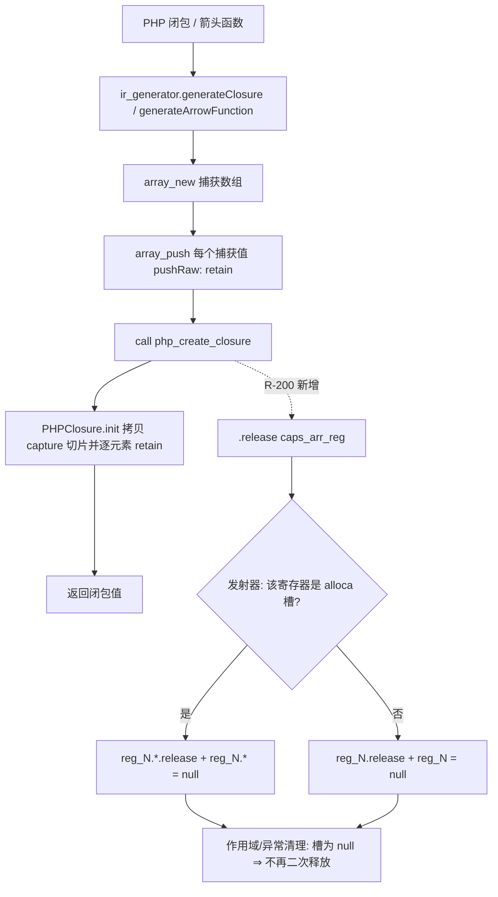
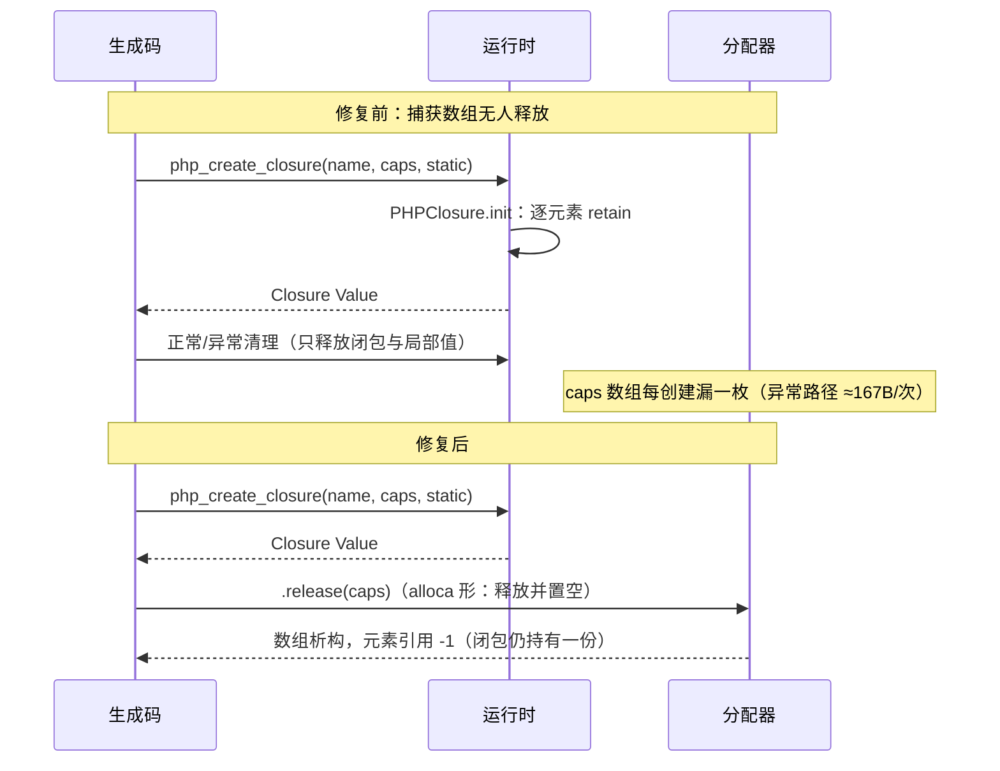

# AOT-CODEGEN-012 F-136b 闭包捕获数组泄漏修复（R-200）

- 日期：2026-10-21
- 代次锚：`nlk c08427256b8069120bd54c6e1764229f`／`irg 8bf9aad68f2a02a63833dd693617ef0e`／`tpl df9cf8e164cbeab59ec3cdefa90125fe`／`ir 1fb6b01f9b0bdff318de496538e7620e`／`opt 50c5fa36eac9ebfd96eee18afa3aa1ad`／`parser 70e80f18a2c6ef6787b4c5d817c31773`（`bin` 只登记：`449490d4d28c82d4783ccd077674e3e4`，`zig build` 非字节可复现）
- 提交态：老铁已把 R-199 与本批源码合并提交为 **`9d0c514`**（提交信息只描述了 R-199 面，未提本批闭包释放；以本文件与工单 §109 为准）
- 关联：F-136b（本批闭环）、F-137（同源闭环）、F-136a/c、F-138（新登记）

## 1. 高层摘要（TL;DR）

闭包创建点每次都会现造一枚「捕获数组」，但发射器从未释放它：`releaseDeadOperands` 对所有 `.call` 参数一律按"可能被消费"跳过，而 `php_create_closure` 并不消费该数组（`PHPClosure.init` 已逐元素 retain）。因此**每次闭包创建漏一枚 PHPArray（含元素引用）**：异常展开路径 ≈167 B/次（空数组）、带捕获时 380–1259 B/次。

修法改为**发射器侧显式释放**：`ir_generator` 在两处创建点（闭包 / 箭头函数）的调用之后发 `.release(caps_arr_reg)`；同时 `native_linker` 的 `.release` 发射补 **alloca 分支**（释放后置空），避免作用域清理二次释放。窗口内曾试过「模板取得所有权」（`tpl=9b27cc22…`），因 alloca 形二次释放导致 f034 `rc=139` 被撤销——这条否定记录了"正确语义 + 错误落点"同样会造回归。

## 2. 影响范围

| 维度 | 影响 |
|---|---|
| 语义 | 正常路径零变化；仅释放闭包创建后不再被使用的临时数组 |
| 生成码 | **43 枚**含闭包调用点的语料 `main.zig` 各新增一条 release（其中 alloca 形为置空版）；非闭包文件零变化 |
| 档位 | debug / release-small / release-safe / release-fast 全覆盖（本修复在所有档位生效） |
| 内存 | release-safe 实测：v0 171→3、v1 380→3、v2 1109→−1、v3 405→0、v4 167→0、v6 470→64、v7 1259→170 B/iter |
| 关闭/新增 | F-137 关闭；F-136b 关闭；新登记 F-136a（=F-93）、F-136c、F-136d、F-138 |

## 3. 核心变更

| # | 文件 | 位置 | 变更 |
|---|---|---|---|
| T1 | `src/aot/ir_generator.zig` | `:9359-9362` | `generateClosure`：`php_create_closure` 结果取出后发 `.release(caps_arr_reg)` 再返回闭包 |
| T2 | `src/aot/ir_generator.zig` | `:9466-9469` | `generateArrowFunction`：同上 |
| T3 | `src/aot/native_linker.zig` | `:25396-25412` | `.release` 发射：alloca 槽走 `if (!reg_N.*.isNull()) { reg_N.*.release(); reg_N.* = null; }`；普通寄存器保持原样 |
| T4 | `fuzzy_scripts_720/tmp/c249_f133_leak_gate_tmp.sh` | 头注／臂表／判定 | a10 摘除 F-136b 登记（现须 FLAT）；新增 **a11**（方法内箭头捕获数组，alloca 形守卫）登记 KNOWN_LEAK（F-136c）；断言改为 `flat=12 ∧ known_leak=1` |
| — | `src/aot/runtime_lib_template.zig` | — | **未改**（模板侧方案 9b27cc22 已撤销；工作区模板仍为 `df9cf8e1…`） |

## 4. 可视化概览

### 4.1 Code & Logic Map

### 4.2 修复前后时序（异常/正常两路）

## 5. 详细变更分析

### 5.1 为什么不能"让调用消费参数"
`native_linker.zig` 的 `releaseDeadOperands` 对 `.call` 的参数一律不释放（`php_array_iter_free` 等确实会消费参数）。把 `php_create_closure` 改成"消费捕获数组"看似更省，但：
1. 该函数在 IR 里与其余运行时函数同构，消费语义不可见；
2. 捕获数组可能被提升为 alloca 槽，函数内部无法把调用方的槽置空 ⇒ 二次释放（模板方案实测 f034 rc=139）；
3. 因此必须由**发射器**在正确的位置、用能识别 alloca 的 `.release` 释放。

### 5.2 alloca 置空为何是必需的
生成的清理代码分两类：函数级 `reg_N.*.release()`（无条件）与异常清理列表。若 `.release` 只调用 `reg_N.*.release()` 而不置空，数组的 ref_count 已为 0 被析构，随后的清理会再次 release 同一槽 ⇒ UAF/二次释放。置空后清理对 null 是 no-op。

### 5.3 覆盖面与边界
- 覆盖：`generateClosure`、`generateArrowFunction` 两个创建点（全仓仅此两处调用 `php_create_closure`）。
- 边界：`php_create_closure` 抛错（UnknownFunction/OOM）时，后置 `.release` 不执行 ⇒ 仍漏一枚数组（F-136d，罕见，未扩面）。

## 6. 影响与风险评估

| 项 | 结论 |
|---|---|
| 是否破坏式变更 | 否（无 API / 语法 / 行为变化） |
| 生成码漂移 | 有，且**必须**：43 枚闭包文件；已证明漂移集恰等于闭包调用点文件集（双向差集空） |
| 邻门 | 十门 594 臂逐门 `pre=post=inter`，`verdict_chg=0` |
| 回归 | `SELF_CHECK_OK rows=68 uniq=68`；PASS=68 FAIL=0 |
| 编译/测试 | `zig build` rc=0；`zig build test` rc=0 |
| 特别风险 | 若后续有人把 `.release` 的 alloca 分支删掉，f034 形立刻回到 rc=139（已有 a11 守卫） |

**复测路径**：`c249`（14 臂，108s）→ `c260_r200_nb_tmp.sh`（十邻门）→ 主回归 → 影子（pre 列须用代次相符编译器重编）→ `zig build test`。

## 7. 遗留问题 / 潜在问题

1. **F-136a（P0）**：内联器 `remapInstructionOp` 未重绑 `array_push`/`.release` 等 op ⇒ release-fast 下闭包捕获+不抛仍 `rc=139`；与 F-93 同族，修复须按寄存器字段穷举。
2. **F-136c（P1）**：`array_map('trim',$a)` 无闭包仍漏 ≈390 B/iter；闭包调用面残余 64/170 B/iter。a11 已登记 KNOWN_LEAK。
3. **F-138（P0）**：debug 档异常分派 `php_instanceof` 读到 0xaa（对象/class_meta 悬垂）；既存、与装载布局相关，非本批引入。
4. **F-136d（P2）**：`php_create_closure` 抛错路径漏一枚数组。
5. 影子基线纪律：历史 `c010_shadow_main_md5_tmp.tsv` 不是代次列，已把"用代次相符编译器现场重编"写入纪律。

## 8. 后续开发 / 优化建议

| 优先级 | 项 | 影响面 | 落地成本 |
|---|---|---|---|
| P0 | F-93/F-136a 内联器重绑穷举（含 `.array_push`/`.release`） | safe/fast 两档崩溃 | 中高 |
| P0 | F-138 debug 档异常对象 UAF | debug 档异常密集脚本 | 中高 |
| P1 | F-136c `php_array_map` 所有权核查 + 闭包调用面残余 | 全档位内存 | 中 |
| P2 | F-136d 异常清理表补捕获数组 | OOM/UnknownFunction | 低 |
| P2 | c249 再加「顶层箭头」「静态闭包」两臂 | 闭包面覆盖 | 低 |
