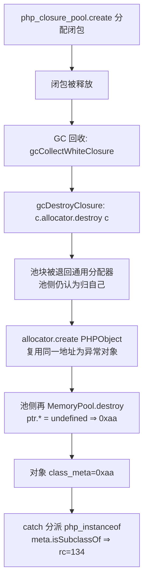
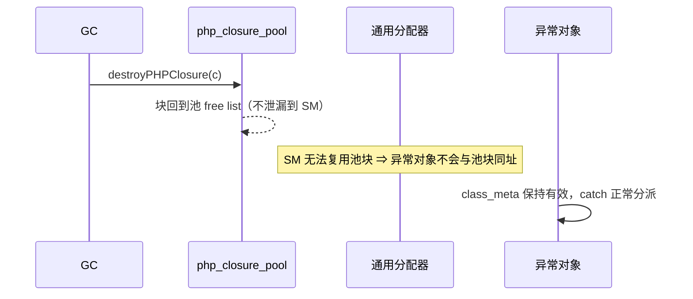

# AOT-CODEGEN-012 F-138 GC 池闭包释放归属修复（R-202）

- 日期：2026-10-21
- 代次锚：`tpl 28a07ae5bd02833ce333496a93b5c0fe`（唯一变化源，+5/−1）／`nlk c0842725…`／`irg 8bf9aad6…`／`opt 745e4bd4…`／`ir 1fb6b01f…`／`parser 70e80f18…`；`bin 86c4fb88…`（模板不进编译器二进制，只登记）
- 提交态：**未提交**（工作区模板；HEAD=`8edfc85`）
- 关联：**F-138 闭环**；**F-136c 的调用面残余（v6 64 B/iter）随本批关闭**；新登记 **F-138b**

## 1. 高层摘要（TL;DR）

GC 回收闭包时用了**通用分配器**（`c.allocator.destroy(c)`），而闭包是按 `php_closure_pool` 池分配的。池块被退回通用分配器后又被复用为 PHPObject；池侧随后对同一地址执行 `MemoryPool.destroy`（Zig 0.16 实现为 `ptr.* = undefined`），在 Debug 档把**存活异常对象的 class_meta 写成 0xaa**，`catch (Throwable)` 分派时 `php_instanceof` 解引用崩溃（v0/v1/v2 `rc=134`）。修法是一行归属修正：`gcDestroyClosure` 改走 `destroyPHPClosure`。

## 2. 影响范围

| 维度 | 影响 |
|---|---|
| 语义 | 修复 debug 档 catch 分派的崩溃；GC 回收闭包改走池，池块不再泄漏到通用分配器 |
| 生成码 | **零变化**（纯模板，默认档影子硬中性） |
| 内存 | debug：v0/v1/v2 `rc=134`→`0`；release-safe：v6（捕获闭包+调用）64→0 B/iter |
| 关闭/新增 | F-138 关闭；F-136c 调用面残余关闭；新登记 F-138b（debug 未调用闭包 151 B/iter） |
| 门 | 新增永久门 **c262**（4 臂 debug 守卫） |

## 3. 核心变更

| # | 文件 | 位置 | 变更 |
|---|---|---|---|
| T1 | `src/aot/runtime_lib_template.zig` | `gcDestroyClosure` | `c.allocator.destroy(c)` → `destroyPHPClosure(c, c.allocator)`（+ 归属注释） |
| T2 | `fuzzy_scripts_720/tmp/c262_f138_debug_exception_gate_tmp.sh` | 新文件 | 4 臂 debug 守卫：d0/d1/d2（闭包+throw，rc=0 且斜率 ≤8）、g1（未调用闭包＝KNOWN_LEAK F-138b）；`AOT_BIN=/bin/false` 自证 |
| — | 发射器/优化器/模板其他部分 | — | 未改 |

## 4. 可视化概览

### 4.1 Code & Logic Map（归属分裂 → 写坏存活对象）

### 4.2 修复后

## 5. 详细变更分析

### 5.1 为什么只有闭包坏
GC 侧三处销毁：
- `gcDestroyArray` → `destroyPHPArray(a, runtime_allocator)`（**正确**，池归属）；
- `gcDestroyObject` → `o.allocator.destroy(o)`（**正确**，对象不走池）；
- `gcDestroyClosure` → `c.allocator.destroy(c)`（**错误**，闭包走 `php_closure_pool`）。

### 5.2 为什么 Debug 崩、ReleaseFast 不崩
`MemoryPool.destroy` 的 `ptr.* = undefined` 在 Debug 被物化为 `0xaa` 填充；ReleaseFast 下该写被优化掉（或值不可观测），于是同一缺陷表现为静默的归属分裂/泄漏，而不是崩溃。**这正是"回归没红 ≠ 没弄坏"的又一例**：主回归/门都跑非 debug 档时对 F-138 失明。

### 5.3 新门 c262 的设计
- 覆盖：debug 档（此前无任何永久门跑 debug）；
- 崩溃判据：d0/d1/d2 `rc=0/0` 且斜率 ≤8 B/iter（修后实测 0/0/0）；
- 已知泄漏：g1（创建闭包不调用）151 B/iter，登记 F-138b；转 FLAT 时门判红促请摘登记；
- 自证：`AOT_BIN=/bin/false` ⇒ 4 臂 compile_fail + `SELFTEST_ALIVE`。

## 6. 影响与风险评估

| 项 | 结论 |
|---|---|
| 是否破坏式变更 | 否 |
| 生成码 | 零变化（纯模板） |
| 影子 | **`drift=0`，列 md5 `b286c535…` 与 R-201 列逐字同（纯模板硬中性）** |
| 邻门 | **594 臂（385+209）逐门 `pre=post=inter`，`verdict_chg=0`** |
| 回归 | `SELF_CHECK_OK 68/68/68`，PASS=68 FAIL=0 |
| 编译/测试 | `zig build` rc=0；`zig build test` rc=0 |
| 特别风险 | 池对象释放必须与分配同归属；后续新增池类型时需同样检查 GC 销毁路径 |

**复测路径**：`c262`（debug 守卫）→ `c249` → 主回归 → 影子（pre＝R-201 列）→ 十邻门 → `zig build test`。

## 7. 遗留问题 / 潜在问题

1. **F-138b（新，P1）**：debug 档未调用闭包 151 B/iter（release-safe 为 FLAT），已挂 c262 KNOWN_LEAK。
2. **F-136c 残余**：`array_map` 自身 ≈390 B/iter、v7 捕获数组 170 B/iter；v6 的 64 B/iter 已随本批关闭。
3. 归属分裂的"静默面"（ReleaseFast）没有直接门；c249 的 13 臂泄漏读数可部分兜底，但建议后续给"池对象跨分配器释放"加内部断言（Debug 档）。

## 8. 后续开发 / 优化建议

| 优先级 | 项 | 影响面 | 落地成本 |
|---|---|---|---|
| P1 | F-138b debug 未调用闭包 151 B/iter | debug 档内存 | 中（先定位是闭包对象还是 captures 切片） |
| P1 | F-136c array_map + v7 残余 | 全档位内存 | 中 |
| P2 | Debug 档断言：池对象释放路径必须匹配归属（如 `php_closure_pool` 非空时禁止 `allocator.destroy(closure)`） | 防同类回归 | 低 |
| P2 | 把 c262 挂进母版链 | debug 档不再失明 | 低（约 2 分钟/轮，需老铁裁） |
