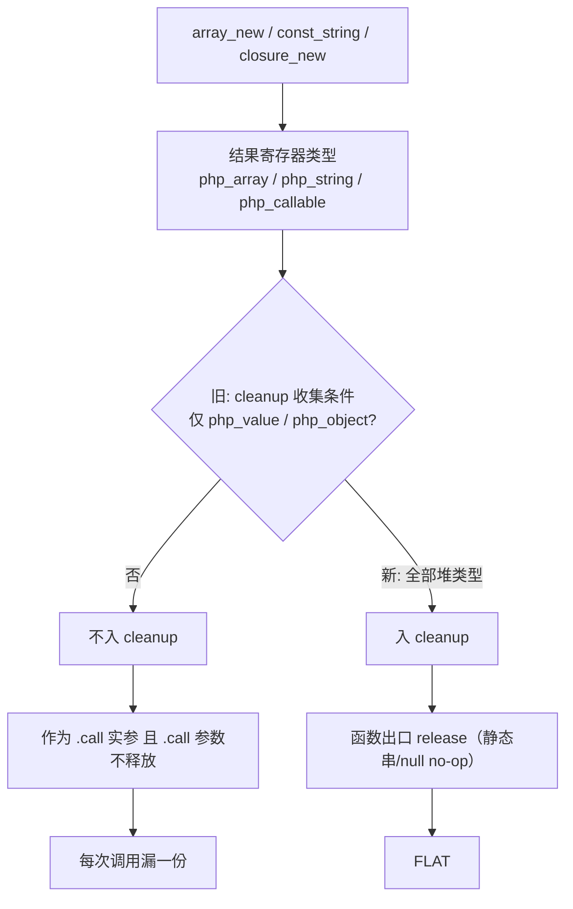
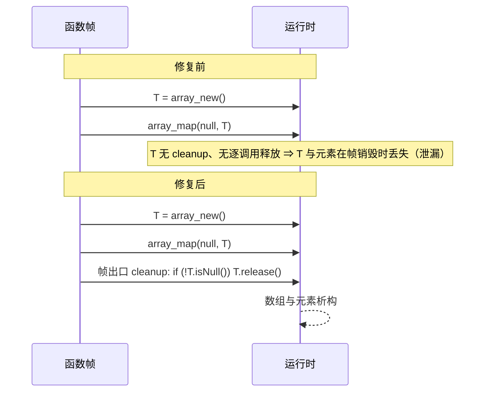

# AOT-CODEGEN-012 F-139b 调用实参临时量修复（R-204，cleanup 类型集合补齐）

- 日期：2026-10-21
- 代次锚：`nlk 8a8b1c4dba0ba488f6fb1356b5e6b293`（唯一变化源，cleanup 条件扩展）／`tpl 28a07ae5…`／其余源不变
- 提交态：**未提交**
- 关联：**F-139b 关闭**；F-139c（残余）保留

## 1. 高层摘要（TL;DR）

函数级 cleanup 只收集 `php_value` / `php_object` 类型的结果，漏掉 `php_array`（array_new）、`php_string`（常量/拼接）、`php_callable`（闭包）、`php_resource`。这些临时量作为 `.call` 实参时既不在 cleanup，`.call` 的死操作数释放又未接线 ⇒ 每次调用漏一份。修法是把 cleanup 条件扩成**全部堆类型**，一行条件；`array_map(null, literal)` 由 304 降到 1 B/iter，函数内循环同形也 FLAT。

## 2. 影响范围

| 维度 | 影响 |
|---|---|
| 语义 | 无行为变化；仅在函数出口多释放此前漏账的堆临时量（静态串/null 的 release 为 no-op） |
| 生成码 | 含 `array_new`/`const_string`/`php_callable` 等结果的函数新增 cleanup 行 ⇒ **影子漂移**，须逐文件归因 |
| 内存 | m0 304→1、m1 391→88、m2/m5 706→468、m3 644→405 B/iter；m10/m11 函数内循环 304→1 |
| 关闭/新增 | F-139b 关闭；F-139c 残余保留 |

## 3. 核心变更

| # | 文件 | 位置 | 变更 |
|---|---|---|---|
| T1 | `src/aot/native_linker.zig` | cleanup 收集条件（约 `:5159`） | `php_value/php_object` → 增加 `php_array/php_string/php_callable/php_resource` |
| — | 发射器其他部分/模板/优化器 | — | 未改 |

## 4. 可视化概览

### 4.1 Code & Logic Map

### 4.2 修复前后（实参临时量）

## 5. 详细变更分析

### 5.1 为什么"类型集合"是根因而不是"逐调用释放缺失"
两种机制本可任选其一：逐调用释放（需 liveness，当前未接线）或函数级 cleanup（已有）。旧 cleanup 的类型集合恰好漏掉一半堆类型，使"仅作实参"的临时量两头落空。补齐类型集合即恢复"每个堆值至少有一个所有者负责释放"的不变式。

### 5.2 常量与静态串的 release 成本
`const_string` 结果指向静态字符串表（`is_static=true`），`Value.release` 对静态串是 no-op；因此把它们纳入 cleanup 不产生实际释放成本，只保证口径完整。

### 5.3 与 R-203 的分工
- R-203：`store` 把临时量存入局部槽时，归还临时量自身那份（**提前释放**，单次 store 守卫）。
- R-204：只作实参/中间值、从不入槽的堆临时量，由函数出口 cleanup 释放。
两者叠加后，m7/m9 仍 2/1 B/iter，m10/m11 也 FLAT。

## 6. 影响与风险评估

| 项 | 结论 |
|---|---|
| 是否破坏式变更 | 否（回归 68/68；f175 仅时间戳不同） |
| 生成码漂移 | 有且必须；只允许新增 cleanup 释放行 |
| 影子 | **changed=68，removed_files=0，UNEXPECTED=0**；新增 633,530 行全为清理族（`release` 318,055 / `init_null` 312,894 / 守卫式 2,515 / 注释 42 / 空行 24）。判据用多重集：cleanup 集合是哈希表，扩集合会重排异常清理块，逐行 diff 把重排误报成 179 万行差异（详见工单 §113.3.1） |
| 邻门 | **10 门 / 569 臂零判定转移**（`SAME→DIFF=0`、`DIFF→SAME=0`）；仅 3 枚同判定非语义载荷差：`c146 a10` mktemp 目录名、`c062 b3` 生成码行号 90→96、`c047 b192` bcrypt 随机盐（登记红臂）。10 门 DONE 质量字段逐字同 |
| 回归 | PASS=68 FAIL=0（`rows=68 uniq=68`） |
| 生成码体积 | **+25.50% B（118.1 MB → 148.3 MB）/ +26.69% 行**；最大单文件 +44.8%（f119）。这是本批的直接成本，须老铁裁是否接受或改走 liveness 限制 |
| 编译/耗时代价（实测） | f119：编译 13.57/12.91 s → **15.87/15.96 s（+20%）**，产物 1,522,040 B → **1,817,528 B（+19.4%）**；f095：15.88/15.93 s → **18.69/18.89 s（+18%）**，1,702,544 B → **1,948,784 B（+14.5%）**（交替各两轮，产物即删） |
| 编译/测试 | **`zig build test` 21/21 steps、326/326 tests 通过，rc=0**（末行 `failed command …--listen=-` 是 Zig listen 模式既有噪声，R-203 同日志逐字相同） |
| 特别风险 | 若某内置函数**长期持有**实参的裸指针且不 retain，cleanup 提前释放会成 UAF；本轮回归/门未发现（若出现，需改为逐调用白名单） |

**复测路径**：`c249` → `c262` → 主回归 → 影子（逐文件归因）→ 十邻门 → `zig build test`。

## 7. 遗留问题 / 潜在问题

1. **F-139c（P2）**：残余 88（字符串回调面）、468（foreach+push 的 COW 临时量）、405（闭包实参残余）B/iter。
2. `releaseDeadOperands` 仍未在主路径接线；逐指令 liveness 释放是后续独立议题。
3. 内置函数持有实参裸指针的假设未逐函数普查；当前由全链回归兜底。

## 8. 后续开发 / 优化建议

| 优先级 | 项 | 影响面 | 落地成本 |
|---|---|---|---|
| P2 | F-139c 逐项归因（先查 `php_invoke_callable` 与 `foreach`/push 的临时量） | 全档位内存 | 中 |
| P2 | 把 `releaseDeadOperands` 接入主路径（真正的逐指令释放） | 全局 | 高 |
| P2 | 内置函数实参所有权普查（是否有长期持有裸指针的实现） | 内存安全 | 中 |
