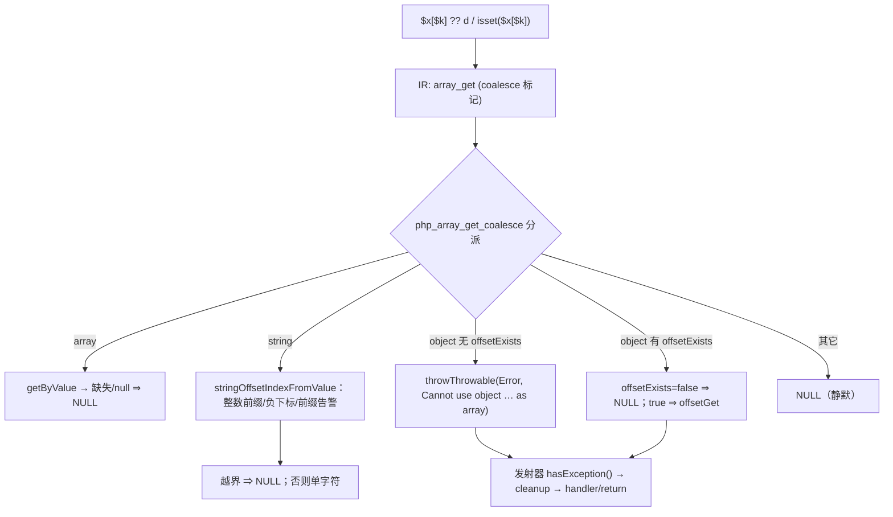
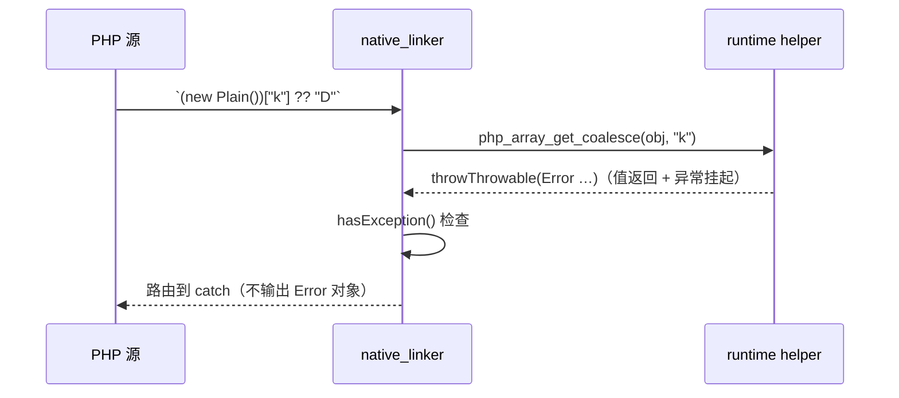

# AOT-CODEGEN-012 R-213：F-86-b coalesce 语境元素读（`isset($x[$k])` / `$x[$k] ?? d`）

- 日期：2026-10-21（R-213，F-86-b 闭环；F-86-c / F-86-d 新登记）
- 代次锚：`nlk 2057bd8899fe962961c47f1010042fbb`／`tpl e4f8ffec89b246996542ce92a6738a64`／`irg f260626e8ef50e9c249e70d488ef6c58`（未动）／`opt 745e4bd4…`／`parser 70e80f18…`／`ir 1fb6b01f…`
- 状态：全部**未提交**

## 1. 高层摘要（TL;DR）

`$x[$k] ?? 默认` 与 `isset($x[$k])` 的元素读现在按 PHP 的 BP_VAR_IS 语义执行：数组缺失键/值为 null → 默认值；string offset 支持负下标与整数前缀规则（含 `Illegal string offset` 告警）；ArrayAccess 先 `offsetExists`；普通对象抛同款 `Error`；非数组基静默。并补上发射器的 `hasException()` 路由（否则 helper 抛出的 Error 对象会被当作值输出）。

- 模板：`php_array_get_coalesce` ＋ `stringOffsetIndexFromValue`。
- 发射器：coalesce 分支的「null 守卫 + `php_array_get`」→ 单次 `php_array_get_coalesce` ＋异常路由。
- 新永久门 C267（14 臂，40+ 断言）。
- 验收：C267 14/14、C266 19/19、九邻门零转移、回归 68/68、影子 44 枚且**逐文件归因 44/44 OK（146 处调用点）**、`zig build test` 326/326。

## 2. 影响范围

| 维度 | 影响 |
|---|---|
| 语义面 | coalesce 语境的元素读：值（string 负下标/非数字键）、诊断（offset 告警消失、Illegal string offset 出现）、异常（普通对象 Error、offsetGet 抛出可路由） |
| 生成码 | 44/68 语料形状变化：`array_get` 的 coalesce 分支由 5 行守卫块变 1 行 helper 调用＋6 行异常路由；共 146 处 |
| 编译期 | 每次 element-read 发射路径少一层嵌套判断，无可测差异 |
| 运行期 | helper 内多一次类型分派；String offset 前缀解析仅在 string 基时走；无全局性能断言 |
| 未覆盖 | 普通读（非 coalesce）四形 → F-86-d；`isset($plainObj['k'])` 文案 → F-86-c |

## 3. 核心变更

| # | 位置 | 变更 |
|---|---|---|
| 1 | `tpl`（`php_array_get` 之后） | 新增 `php_array_get_coalesce(arr,key,allocator)`：array/string/ArrayAccess/普通对象/其它 五路分派 |
| 2 | `tpl` | 新增 `stringOffsetIndexFromValue(key) ?i64`：int/float/bool/null 转换；string 整数前缀（前导空白/符号/尾随空白）、`'1abc'/'0x10'/'1 2'` 前缀值＋告警、浮点前缀/溢出/无数字→null |
| 3 | `nlk` array_get 发射 | coalesce 分支改单次 helper 调用；新增 `hasException()` 路由块（cleanup＋handler 跳转） |
| 4 | `c267_elem_coalesce_gate_tmp.sh` | 新永久门 14 臂（值/诊断/异常/handler/@/ArrayAccess/边界/反向守卫） |

## 4. 可视化概览（Code & Logic Map）

## 5. 详细变更分析

| 层 | 文件/位置 | 说明 |
|---|---|---|
| 模板 | `src/aot/runtime_lib_template.zig` | 两个函数；`php_array_get_coalesce` 返回所有权与 `php_array_get` 一致（数组 retain / string 新建 / offsetGet 直接返回） |
| 发射器 | `src/aot/native_linker.zig`（array_get 的 `is_coalesce_ag` 分支） | 守卫块 → helper；新增异常路由（与 property_get 同款） |
| 门 | `fuzzy_scripts_720/tmp/c267_elem_coalesce_gate_tmp.sh` | 14 臂，字节级 stdout/stderr 对比；`AOT_BIN=/bin/false` 自证 |
| 证据 | `/tmp/f134/attr213.py` | R-212 等价二进制逐文件归因（本轮一次性） |

**关键约束**
- `??` 把 **null 值**视为缺失（`['n'=>null] ?? 'D'` → `'D'`），helper 必须返回 null 而非元素本身。
- string offset 的“浮点前缀”必须**无效且不告警**（`'1.0'`），而“整数前缀+垃圾”必须**有效且告警**（`'1abc'`）——两者都靠 is_numeric_string 的类型区分。
- 普通对象抛 Error 是**表达式内**异常：发射器不检查 `hasException()` 就会先把 Error 对象当值输出（C267 e6 首跑即抓到）。

## 6. 影响与风险评估

| 项 | 结论 |
|---|---|
| 是否破坏式变更 | 否（回归 68/68；邻门 9 门逐臂同基线） |
| 生成码漂移 | 44/68；146 处「守卫块→helper」；**逐文件归因 44/44 OK**（R-212 等价二进制 diff，允许族＝守卫脚手架/异常路由脚手架/cleanup/名字替换） |
| 影子 | R-212 列 `27c90db6…` → R-213 列 `2664fa34…`；changed_rows=44 |
| 邻门 | c121 `9/1+3oa`（逐臂一致）／c123 `7/7`／c249 `12/0/1`／c254 `27/2`／c262 `4`／c264 `19/0/1(CF)`（逐臂一致）／c265 `7/7`／c062 `49/1/1`／c073 `17/2`；residue=0 |
| 回归 | **PASS=68 FAIL=0**，`SELF_CHECK_OK` |
| 编译/测试 | 21/21 steps、326/326、rc=0 |
| 风险 | 异常路由新增一行 `hasException()`：coalesce 元素读所在块必须能访问 `current_exception_handler`（与 property_get 同环境，已由 e6 验证） |
| 性能 | 本批不做全局断言（helper 分派与旧守卫块同量级；146 处均为 coalesce 站点） |

**复测路径**：C267（自证 14 CF）→ C266 → 九邻门 → 主回归 → 影子 → 归因 → `zig build test`。

## 7. 遗留问题 / 潜在问题

1. **F-86-c（P2）**：`isset($plainObj['k'])` 的 Error 文案（AOT `Call to undefined method Plain3::offsetExists()` vs PHP `Cannot use object of type Plain3 as array`）。`php_array_get_coalesce` 已有同款文案，`php_array_isset` 加同一前置判定即可。
2. **F-86-d（P2）**：普通读四形——①`$arr['k']` 缺失键 PHP 告警/AOT 静默；②`$s['1abc']` PHP 告警/AOT 静默；③`$s[-1]` PHP 末字符/AOT null；④`$s['k']` PHP 8.5 TypeError/AOT `'a'`（静默错值）。修法＝`php_array_get` 复用 `stringOffsetIndexFromValue` 并补缺失键/非法 offset 诊断，需独立真值表。
3. 影子列注意：R-212 列（`r212c`）已被本批取代，后续 join 用 `r213`；R-212 等价二进制只服务本轮归因。

## 8. 后续开发 / 优化建议

| 优先级 | 建议 | 影响面 | 落地成本 |
|---|---|---|---|
| P1 | F-86-d：普通读元素面（值+诊断+TypeError 三型） | 所有非 coalesce 的 `$a[$k]` 读 | 中（`php_array_get` 单点＋门 12 臂） |
| P2 | F-86-c：`php_array_isset` 的普通对象前置判定与文案 | isset 对象面 | 低（1 处判定＋2 臂） |
| P2 | 把 C267 挂进母链 `c070`，与 C264/C265/C266 同批 | 验收链完整性 | 低 |
