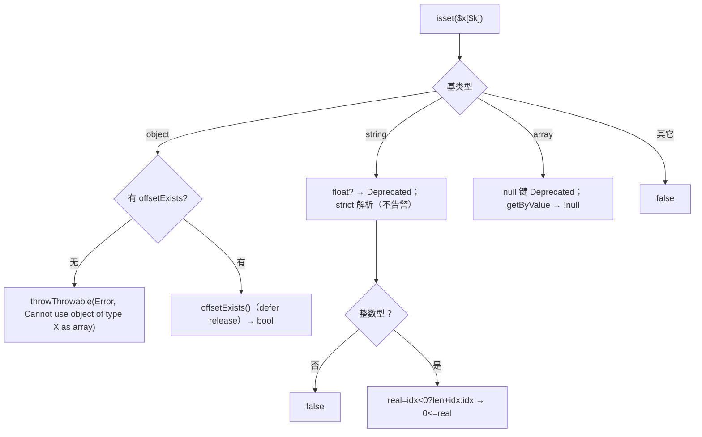
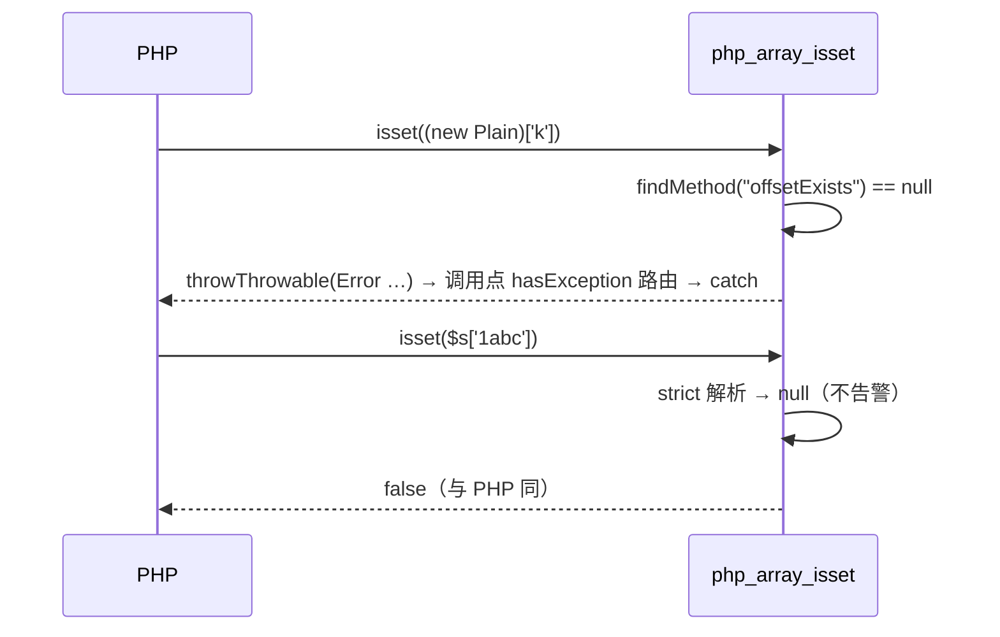

# AOT-CODEGEN-012 R-217：F-86-c（isset 对象文案＋string 严格键；纯模板轮）

- 日期：2026-10-21（R-217，F-86-c 闭环；F-86 族全部关闭）
- 代次锚：`nlk e091cb278e5129bce82ab3826d1f14c5`（未动）／`tpl 35b8f9393d0f6246aede9a540a26812d`／`irg f260626e…`／`opt 745e4bd4…`／`parser 70e80f18…`／`ir 1fb6b01f…`
- 状态：全部**未提交**

## 1. 高层摘要（TL;DR）

`isset()` 的元素面补齐：普通对象作数组抛 PHP 同款 `Error` 文案；string offset 支持负下标、严格整数型键（垃圾串→false 且不告警）、float 键补 Deprecated。顺带修掉 `php_array_isset` 对 ArrayAccess `offsetExists` 返回值**从不释放**的每次调用泄漏。纯模板轮：`nlk` 未动，影子 `changed_rows=0 ∧ col_identical=yes`。

- C268 16→20 臂全绿；C266/C267 全绿；九邻门零转移；回归 68/68；`zig build test` 326/326。
- F-86 族（属性读 R-212／coalesce 元素读 R-213／普通读值诊断 R-214／普通读异常 R-216／isset 面 R-217）全部关闭。

## 2. 影响范围

| 维度 | 影响 |
|---|---|
| 语义面 | `isset($plainObj['k'])` 文案；`isset($s[-1])` 等负下标；`isset($s['1abc'])` 由 true+告警 → false 且静默；`isset($s[1.9])` 补 Deprecated |
| 诊断面 | float 键 → `warnFloatToIntNotRepresentable`＋`emitDeprecatedFloatToInt`（与 normalize 同口径） |
| 生成码 | **零漂移**（发射器未动）；模板函数有变 |
| 内存 | 修掉 ArrayAccess isset 的 `offsetExists` 返回值泄漏（每次一份） |
| 未覆盖 | —（F-86 族已全闭） |

## 3. 核心变更

| # | 位置 | 变更 |
|---|---|---|
| 1 | `tpl php_array_isset` | 对象分支加 `findMethod("offsetExists")` 前置，缺失 → `throwThrowable("Error", "Cannot use object of type {s} as array")` |
| 2 | `tpl php_array_isset` | 对象分支 `defer result.release(runtime_allocator)`（原为泄漏） |
| 3 | `tpl php_array_isset` | string 分支：float 键诊断；`stringOffsetIndexFromValue(key, false)` 严格解析；负下标 `-len..-1` |
| 4 | `tpl stringOffsetIndexFromValue` | 增加 `emit_illegal: bool`：普通读/coalesce 传 true（告警＋前缀），isset 传 false（返回 null） |
| 5 | `c268_plain_elem_gate_tmp.sh` | 16→20 臂（p17 对象 Error、p18 ArrayAccess 守卫、p19 string isset、p20 null 键/真假） |

## 4. 可视化概览（Code & Logic Map）

## 5. 详细变更分析

| 层 | 文件/位置 | 说明 |
|---|---|---|
| 模板 | `src/aot/runtime_lib_template.zig`（`php_array_isset`、`stringOffsetIndexFromValue`） | 见 §3；isset 调用点原本就有 post-call 异常路由（无需改发射器） |
| 门 | `c268`（20 臂） | 新增 4 臂 |
| 文档 | 工单 §125 | 含 F-86 族收口清单 |

**关键约束**
- isset 与普通读的 string 键语义**相反**：普通读对 `'1abc'` 是“前缀值＋Illegal 告警”，isset 是“false＋静默”；共享解析器必须带 `emit_illegal` 开关。
- isset 的 float 键仍发 Deprecated（与普通读一致），但 bool/null 静默。
- `php_array_isset` 的调用点已有 `hasException()` 后置检查（call 发射统一处理），因此对象 Error 无需新增发射器路由。

## 6. 影响与风险评估

| 项 | 结论 |
|---|---|
| 是否破坏式变更 | 否（回归 68/68；邻门 9 门逐臂同基线；C266/C267/C268 全绿） |
| 生成码 | **零漂移**（`nlk` 未动；影子 `col_identical=yes`） |
| 影子 | R-216 列 `9337b17b…` → R-217 列 `9337b17b…`（逐字相同）；changed_rows=0 |
| 泄漏修复 | ArrayAccess isset 的 `offsetExists` 返回值原先不释放；本轮 `defer release`（c249 未覆盖该形，新增语义由 C268 p18 守卫） |
| 回归 | PASS=68 FAIL=0；`SELF_CHECK_OK` |
| 编译/测试 | 21/21、326/326、rc=0 |
| 风险 | isset 的字符串严格化会改变 `isset($s['1abc'])` 的结果（true→false）；该形在语料中未出现（回归 68/68 佐证），门 p19 固化 |

**复测路径**：C268（自证 20 CF）→ C266/C267 → 九邻门 → 主回归 → 影子（须 `col_identical=yes`）→ `zig build test`。

## 7. 遗留问题 / 潜在问题

1. F-86 族已全部关闭；剩余的“元素读”相关待办只有 R-216 §7 的**代价待裁**（per-site 异常路由的 +1.3~6.2% 体积）。
2. `isset($s[1.9])` 的 Deprecated 与普通读同口径（`warnFloatToIntNotRepresentable`＋`emitDeprecatedFloatToInt`），但 PHP 对 `isset($s[NAN])` 的行为未测（极端形）。
3. c264 的 ±5 s 容差仍是工程折中（§124.5）。

## 8. 后续开发 / 优化建议

| 优先级 | 建议 | 影响面 | 落地成本 |
|---|---|---|---|
| P1 | 块级异常 epilogue：每块一份 cleanup＋label，替换 per-site 路由（回收 176k 行与 +1~6% 体积） | 全部抛点 | 中高 |
| P2 | C264–C268 挂进母链 `c070` | 验收链完整性 | 低 |
| P2 | 键语义普查收尾：其余接受数组键的内置（array_search/in_array 的 key 参数等）是否补 null-key Deprecated | 键诊断一致性 | 低 |
| P2 | `isset($s[NAN])` / `isset($s[INF])` 真值补测 | 极端输入 | 低 |
