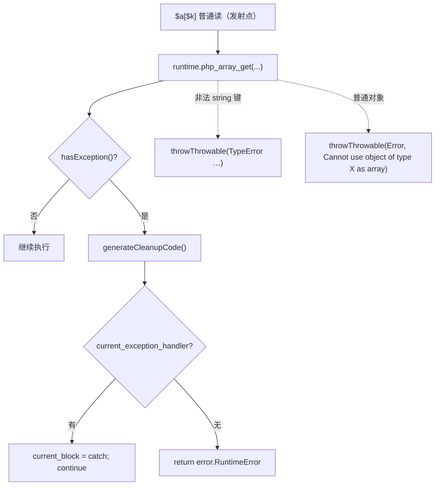
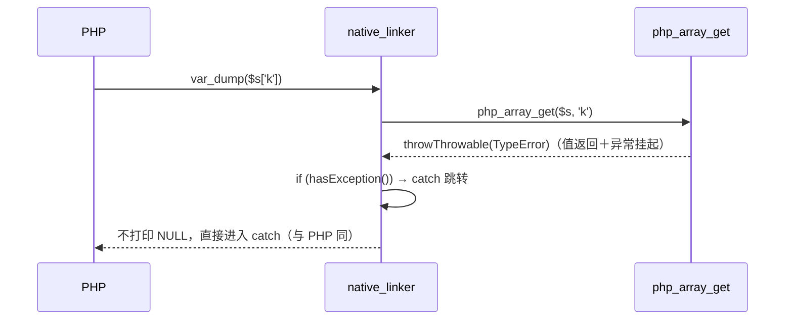

# AOT-CODEGEN-012 R-216：F-86-d2（普通元素读的 TypeError / 对象 Error；误判更正）

- 日期：2026-10-21（R-216，F-86-d2 闭环；R-214 误判更正；c264 硬化）
- 代次锚：`nlk e091cb278e5129bce82ab3826d1f14c5`／`tpl 1d2e004107a2bcbb656a5c1615940e8a`／`irg f260626e…`／`opt 745e4bd4…`／`parser 70e80f18…`／`ir 1fb6b01f…`
- 状态：全部**未提交**

## 1. 高层摘要（TL;DR）

普通元素读的最后两面补齐：非法 string 键抛 PHP 同款 `TypeError`；普通对象作数组抛 PHP 同款 `Error` 文案。实现为「模板抛 + 普通 `array_get` 后加 `hasException()` 路由」。R-214 曾把该路由误判为“引发非局部发射抖动”而回退——本轮受控复现证明**那是测量污染**（归因与重建并发），多重集判据下为纯新增（多 5,780 行、少 0 行、UNEXPECTED=0）。同时修正 c264 的时间抖动。

- 探针 `plain_truth`/`skey3` 由 DIFF → **SAME**（全形 6/6）。
- C268 恢复 16 臂并全绿；九邻门零转移；回归 68/68；影子 60 文件、多重集归因 60/60 `missing=0`。
- 代价实测：二进制 +1.29/2.95/6.22%、编译 +1.3/2.8/8.1%、运行期 +0~5%（3 文件抽测）。

## 2. 影响范围

| 维度 | 影响 |
|---|---|
| 语义面 | `$s['k']` 等 → TypeError；普通对象 `['k']` → Error（均与 PHP 同文案、可被 try/catch 捕获） |
| 生成码 | 60/68 文件；每处普通 `array_get`（非 get_ref）后新增 8 行路由＋该点 cleanup（纯新增，176,001 行） |
| 编译期 | +1.3~8.1%（随 array_get 站点数增长） |
| 运行期 | 每次普通元素读多一次 `hasException()` 分支（unlikely hint）；抽测 +0~5% |
| 未覆盖 | `isset($plainObj['k'])` 文案（F-86-c） |

## 3. 核心变更

| # | 位置 | 变更 |
|---|---|---|
| 1 | `tpl php_array_get` | 非法 string 键 → `throwThrowable("TypeError", "Cannot access offset of type string on string")` |
| 2 | `tpl php_array_get` | 对象无 `offsetGet` 方法 → `throwThrowable("Error", "Cannot use object of type {s} as array")`；有则维持直接 `offsetGet`（PHP 普通读不调 offsetExists） |
| 3 | `nlk` array_get 发射 | `if (!op.get_ref)` 时在调用后追加 `hasException()` 路由（cleanup＋`current_block`/`return error.RuntimeError`） |
| 4 | `c268_plain_elem_gate_tmp.sh` | 恢复 p5/p7/p10 → **16 臂** |
| 5 | `c264_mktime_gate_tmp.sh` | a1–a7 容差 ±2 s → **±5 s**（PHP/AOT 两次运行间夹一次编译），新冻结基线 `c264_mktime_R216_snapshot_tmp.tsv` |

## 4. 可视化概览（Code & Logic Map）

## 5. 详细变更分析

| 层 | 文件/位置 | 说明 |
|---|---|---|
| 模板 | `src/aot/runtime_lib_template.zig`（`php_array_get`） | 两处 `throwThrowable`；拒绝路径不分配 |
| 发射器 | `src/aot/native_linker.zig`（array_get 普通分支） | 8 行路由；`get_ref` 分支不加（取引用不产生异常） |
| 门 | `c268`（16 臂）／`c264`（容差硬化） | 见 §3 |
| 证据 | `/tmp/f134/attr_ms.py` | 多重集归因（本轮一次性） |

**关键约束**
- `php_array_get` 对数组/字符串/非数组基保持不抛；只有“非法 string 键”和“普通对象”两条路径抛。
- 抛出的值仍需由调用点 `hasException()` 路由；缺了它会把 Error 对象当值输出（C268 p10 首跑即抓到）。
- `get_ref` 分支必须跳过路由：取引用语义不走值读，且 `php_array_get_ref` 不抛 PHP 异常。

## 6. 影响与风险评估

| 项 | 结论 |
|---|---|
| 是否破坏式变更 | 否（回归 68/68；邻门 9 门逐臂同基线；C266/C267/C268 全绿） |
| 生成码 | 60/68；多重集：`missing=0`、`UNEXPECTED=0`、纯新增 176,001 行 |
| 影子 | R-215 `2664fa34…` → R-216 `9337b17b…`（与上次实验列逐字相同 ⇒ 确定性） |
| 代价（实测） | 二进制 f048 +1.29%／f105 +2.95%／f110 +6.22%；编译 +1.3/2.8/8.1%；运行中位 +0.1~0.3 ms（+0~5%） |
| 回归 | PASS=68 FAIL=0；`SELF_CHECK_OK` |
| 编译/测试 | 21/21、326/326、rc=0 |
| 风险 | 每站点 cleanup 造成代码膨胀（大站点文件 +6% 二进制）；压回需“块级异常尾段共享”，属独立结构批，**代价待裁** |
| 测量纪律 | ★归因运行期间严禁改源码/重建（R-214 的假抖动即此）；发射器批判据用多重集 |

**复测路径**：C268（自证 16 CF）→ C266/C267 → 九邻门（quiesce 后）→ 主回归 → 影子 → 多重集归因 → `zig build test`。

## 7. 遗留问题 / 潜在问题

1. **F-86-c**：`isset($plainObj['k'])` 的 Error 文案（`Call to undefined method …::offsetExists()` vs `Cannot use object of type X as array`）。修法＝`php_array_isset` 加同款 `findMethod("offsetExists")` 前置；但 isset 的发射点同样需要 `hasException()` 路由（目前 `php_array_isset` 调用点无路由），必须按同一结构性批处理。
2. **代价待裁**：per-site cleanup 的二进制/编译期代价（+1.3~6.2%／+1.3~8.1%）。若老铁要求压回，正解是把异常路由改为**每块共享 epilogue**（一次 cleanup＋label），可把 176k 行降到很小；这是发射器结构改造。
3. c264 的 a1–a7 本质仍依赖“当前时间”，容差只是工程折中；更彻底的做法是让门注入固定 `TZ`/伪造时钟（AOT 侧需可注入 now），未做。

## 8. 后续开发 / 优化建议

| 优先级 | 建议 | 影响面 | 落地成本 |
|---|---|---|---|
| P1 | 块级异常 epilogue：每块只发一份 cleanup＋label，替换 per-site 路由 | 全部抛点；可回收 176k 行与 +1~6% 体积 | 中高（发射器结构批） |
| P2 | F-86-c：`php_array_isset` 普通对象前置判定＋文案（同批加路由） | isset 对象面 | 中 |
| P2 | c264 时钟注入/固定 TZ，替换 ±5 s 容差 | 门确定性 | 低 |
| P2 | C264–C268 挂进母链 `c070` | 验收链完整性 | 低 |
