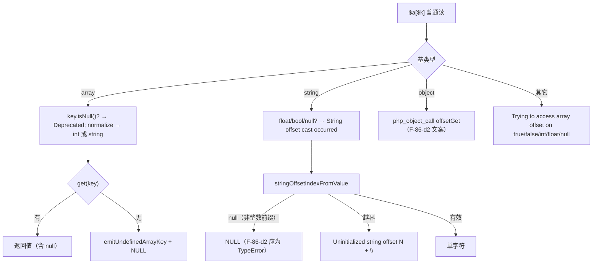
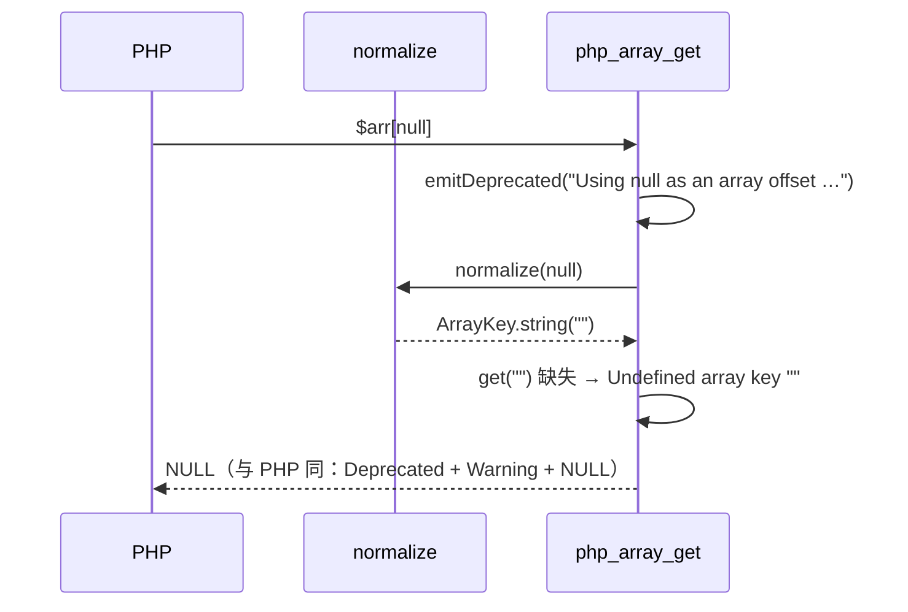

# AOT-CODEGEN-012 R-214：F-86-d 普通元素读（值/诊断面；纯模板轮）

- 日期：2026-10-21（R-214，F-86-d 值/诊断面闭环；F-86-d2 新登记）
- 代次锚：`nlk 2057bd8899fe962961c47f1010042fbb`（与 R-213 相同 ⇒ 发射器零改动）／`tpl c0fed0b6667a9f1428d50b3871018055`／`irg f260626e…`／`opt 745e4bd4…`／`parser 70e80f18…`／`ir 1fb6b01f…`
- 状态：全部**未提交**

## 1. 高层摘要（TL;DR）

普通读（`$a[$k]`，非 isset/`??` 语境）此前是“静默 + 少数错值”：缺失数组键不告警、null 键落到 `0` 键、string 负下标/越界返回 null、非数字前缀不告警、bool 基文案写成 `bool`。R-214 把这些全部对齐 PHP 8.5.8：缺失键 `Undefined array key …`、null 键归一 `""` 并 Deprecated、`Uninitialized string offset`＋空串、`Illegal string offset` 告警、`String offset cast occurred`、`true/false` 文案、`array_key_exists(null)` 专用措辞。

- **纯模板轮**：`nlk` md5 与 R-213 完全相同，影子 `changed_rows=0 ∧ col_identical=yes`。
- 首版曾尝试把 TypeError/对象 Error 真正抛出（需给普通 array_get 加异常路由），归因发现该路由造成**非局部代码生成抖动**，整段回退，另立 F-86-d2。
- 验收：C268 13/13（新门）、C266 19/19、C267 14/14、九邻门零转移、回归 68/68、`zig build test` 326/326。

## 2. 影响范围

| 维度 | 影响 |
|---|---|
| 语义面 | 普通元素读的**值**：null 键写读都落 `""`；string 负下标返回字符；越界返回空串（不是 null） |
| 诊断面 | 缺失键 Warning、null 键 Deprecated×4 站点、`Illegal string offset`、`String offset cast occurred`、`Uninitialized string offset`、bool 基文案、array_key_exists 措辞 |
| 生成码 | **零漂移**（发射器未动） |
| 运行期 | 每次数组读多一次 `isNull` 键判断与 `get` 的 optional 判定；string 读走键解析器（原为 `toInt`）；量级同阶 |
| 未覆盖 | 非法 string 键 TypeError、普通对象 Error 文案（F-86-d2） |

## 3. 核心变更

| # | 位置 | 变更 |
|---|---|---|
| 1 | `tpl` ArrayKey | 新增静态空串单例 `empty_array_key_string`；`normalizeArrayKeyFromValue` 对 null 返回 `""` 键 |
| 2 | `tpl` 键告警 | `emitUndefinedArrayKey(key)`（int 裸写 / string 带引号）、`emitNullArrayOffsetDeprecated()` |
| 3 | `tpl php_array_get` | 数组分支：null 键 Deprecated＋缺失键 Warning；string 分支：cast 告警＋`stringOffsetIndexFromValue`＋越界空串；其它基：`phpArgTypeWord` |
| 4 | `tpl stringOffsetIndexFromValue` | `.` 一律浮点前缀；`e/E` 仅后随合法指数才算浮点（`'1e'`＝前缀+垃圾） |
| 5 | `tpl` isset/coalesce/setByValue/array_key_exists | null 键 Deprecated（前三个用通用措辞，array_key_exists 用专用措辞） |
| 6 | 新门 C268 | 13 臂：数组缺失/null 值、float/bool 键、null 键读写、string 合法/负/越界、前缀告警、cast 告警、非数组基、ArrayAccess 普通读、`@`、handler、isset/`??` 反向守卫、嵌套链、array_key_exists |

## 4. 可视化概览（Code & Logic Map）

## 5. 详细变更分析

| 层 | 文件/位置 | 说明 |
|---|---|---|
| 模板 | `src/aot/runtime_lib_template.zig`（ArrayKey 区、normalize、php_array_get、stringOffsetIndexFromValue、isset/coalesce/setByValue/array_key_exists） | 见 §3；无新增分配（空串为静态单例） |
| 发射器 | 无 | `nlk` md5 与 R-213 相同 |
| 门 | `fuzzy_scripts_720/tmp/c268_plain_elem_gate_tmp.sh` | 13 臂字节级对比；`AOT_BIN=/bin/false` 自证 |
| 文档 | 工单 §123 | 含被回退实验与验收陷阱留痕 |

**关键约束**
- `ArrayKey.string` 是 `*PHPString`：空串必须用 `is_static=true` 的单例（`@constCast("")`），否则每个 null 键都会分配/释放。
- `get()` 的 optional 语义必须区分“缺失”和“值就是 null”：前者发 Warning，后者静默返回 null。
- string offset 的越界返回值是 **空字符串**（不是 null）；负下标的告警文本用原始负索引。

## 6. 影响与风险评估

| 项 | 结论 |
|---|---|
| 是否破坏式变更 | 否（回归 68/68；邻门 9 门逐臂同基线） |
| 生成码 | **零漂移**（`nlk` 未动；影子 `col_identical=yes`） |
| 影子 | R-213 列 `2664fa34…` → R-215 列 `2664fa34…`（逐字相同）；changed_rows=0 |
| 邻门 | c121 `9/1+3oa`／c123 `7/7`／c249 `12/0/1`／c254 `27/2`／c262 `4`／c264 `19/0/1(CF)`／c265 `7/7`／c062 `49/1/1`／c073 `17/2`；residue=0（静默单跑） |
| 回归 | **PASS=68 FAIL=0**，`SELF_CHECK_OK` |
| 编译/测试 | 21/21、326/326、rc=0 |
| 风险 | null 键归一改为 `""` 是**全局键语义**变化：若某内置仍假设 null→0，会出现新分歧。本轮覆盖读/写/isset/coalesce/array_key_exists 五处并给出门臂；其余键路径（如 in_array 的 strict 键比较）不经过 normalize，不受影响 |
| 回退实验 | 普通 array_get 的异常路由造成非局部发射抖动 ⇒ 已回退，`nlk` 回到 `2057bd88…`（与 R-213 逐字节相同） |

**复测路径**：C268（自证 13 CF）→ C266/C267 → 九邻门 → 主回归 → 影子（须 `col_identical=yes`）→ `zig build test`。

## 7. 遗留问题 / 潜在问题

1. **F-86-d2（P1）**：非法 string 键 TypeError（`'k'/'1.0'/'1e1'/''/'  '`）与普通对象 Error 文案（`Cannot use object of type X as array`）。前置＝普通 array_get 的异常路由；实测该路由会改变后续发射（setSourceLocation/PHI/调用行非局部增删），必须按结构性发射器批处理并逐文件归因，不能按“模板轮”验收。
2. 验收陷阱：同批内若有并发编译（如上一轮归因残留），`repo_build_residue` 瞬时为 1、c262 rc=10；本轮已废弃两次带噪批读数，静默后单跑取干净记录。
3. `isset($plainObj['k'])` 文案仍属 F-86-c（与 F-86-d2 共享同一前置判定思路）。

## 8. 后续开发 / 优化建议

| 优先级 | 建议 | 影响面 | 落地成本 |
|---|---|---|---|
| P1 | F-86-d2＋F-86-c：普通 array_get/isset 的异常路由与文案（一个结构性发射器批） | 元素读异常面 | 中高（需解释并归因发射抖动） |
| P2 | 键语义普查：其余接受数组键的内置（array_search/in_array 的 key 参数、array_column 等）是否也应发 null-key Deprecated | 键诊断一致性 | 低 |
| P2 | C268/C267/C266/C265/C264 一起挂进母链 `c070` | 验收链完整性 | 低 |
