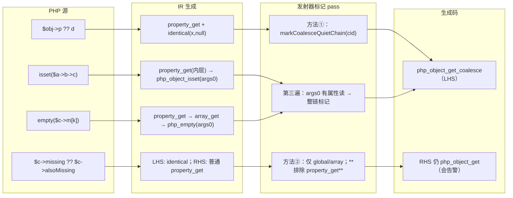

# AOT-CODEGEN-012 R-212：F-86 isset/`??`/empty 属性读静默

- 日期：2026-10-21（R-212，F-86 闭环；F-86-b 新登记）
- 代次锚：`nlk 9fff171a4146d0a8e3da286abbb16cfe`／`tpl 867cbe687848e763e6c3a22c60d78e25`／`irg f260626e8ef50e9c249e70d488ef6c58`（未动）／`opt 745e4bd4bbb77258fbd5de58629d8684`／`parser 70e80f18a2c6ef6787b4c5d817c31773`／`ir 1fb6b01f9b0bdff318de496538e7620e`
- 状态：全部**未提交**

## 1. 高层摘要（TL;DR）

`isset()`、`??`、`empty()` 三种“静默语境”下，AOT 对属性读的诊断与 PHP 8.5.8 对齐：未声明属性、不可访问的 private/protected、typed 未初始化、null 接收者、以及**链式读的内层属性**全部不告警；同时**没有**把 `??` 右侧默认值里的普通读误静默。

- 模板：新增 `php_object_get_coalesce`（静默变体，借用引用契约同 `php_object_get`）。
- 发射器：把 coalesce 标记从“被检值单点”扩到**整条读链闭包**（沿对象操作数/数组基回溯），并对 isset/empty 的调用实参反标（仅当链上有属性读）。
- 两次自我否证：method-2 扩 `property_get` 会让 RHS 太安静（已撤回）；第三遍无条件标记纯元素读造成 38 枚无收益形状漂移（已收窄到 37 枚且全部可归因）。
- 验收：C266 19/19、九邻门零转移（residue=0）、回归 68/68、影子 37 枚漂移**逐文件归一后与 R-211 等价**、`zig build test` 326/326。
- 残余：**F-86-b**（元素读：string 基非数字键静默错值；非数组基 offset 告警），独立批处理。

## 2. 影响范围

| 维度 | 影响 |
|---|---|
| 语义面 | 仅诊断（Warning 的有/无）；读值路径除“null 基提前返回 null”外不变 |
| 生成码 | 37/68 语料形状变化：153 处 `php_object_get`→`php_object_get_coalesce`、11 处 `array_get` null 守卫 |
| 编译期 | 每次函数发射多两遍轻量扫描（O(指令数)），无可测差异 |
| 运行期 | 名称替换同复杂度；11 处 null 守卫为单分支。f160 抽测 6.1→5.9 ms（噪声内） |
| 未覆盖 | `??`/isset 的**元素读**（F-86-b）；跨流交错顺序不作契约 |

## 3. 核心变更

| # | 位置 | 变更 | 说明 |
|---|---|---|---|
| 1 | `tpl:21723` | 新增 `php_object_get_coalesce` | 非对象→null；不可访问→`__get` 后 null；未声明→动态属性/`__get`→null；typed 未初始化→null；**返回借用** |
| 2 | `nlk:162` | `markCoalesceQuietChain` | 沿 `property_get_origins.object_reg_id` ∪ `array_get_base` 回溯 ≤8 跳，整链入 `coalesce_nowarn_regs` |
| 3 | `nlk:193` | `markCoalesceQuietChainIfProperty` | 先探链上是否有属性读；否则不标（避免纯 `isset($arr['k'])` 形状漂移） |
| 4 | `nlk:6302` | 方法① 被检值闭包 | `identical(x, null)` 的 `x` 走 2 |
| 5 | `nlk:6317` | 方法② 边界 | `coalesce_rhs` **不纳入** `property_get`：RHS 默认值是普通读 |
| 6 | `nlk:6329` | 第三遍调用点反标 | `php_object_isset`/`php_array_isset`/`php_object_empty`/`php_empty`/通用 `isset`/`empty` 的 `args[0]` 走 3 |
| 7 | `nlk:24598` | 发射选择 | 命中标记 → `runtime.php_object_get_coalesce`，否则原样 |

## 4. 可视化概览（Code & Logic Map）



```mermaid
sequenceDiagram
  participant U as PHP 源
  participant P as parser/ir_generator
  participant L as native_linker
  participant G as 生成 main.zig
  U->>P: `$a->missing->x ?? "d"`
  P->>L: property_get(missing); property_get(x); identical(x,null)
  L->>L: 方法①标记 x（identical 被检值）
  L->>L: 沿 object_reg_id 回溯 → 标记 missing
  L->>G: 两级都发 php_object_get_coalesce
  G-->>U: 静默返回 "d"（与 PHP 同）
  Note over L: RHS 的独立读不回溯 ⇒ 保持 php_object_get（PHP 会告警）
```

## 5. 详细变更分析

| 层 | 文件 | 变更点 |
|---|---|---|
| 运行期模板 | `src/aot/runtime_lib_template.zig` | `php_object_get_coalesce`（1 函数，~18 行）；与 `php_object_get` 的差异仅在“不告警、不可访问不抛 Error、typed 未初始化不抛 Error” |
| 发射器 | `src/aot/native_linker.zig` | 2 个闭包 helper；方法①换成闭包标记；方法②写入边界注释；第三遍新增；`property_get` 发射按标记选函数名（4 个 print 站点统一走 `get_fn`） |
| 侧门 | `fuzzy_scripts_720/tmp/c266_diag_bytes_gate_tmp.sh` | 16→19 臂：g5（RHS 反向守卫）、g6（链静默）、g7（isset/empty 数组基） |
| 证据脚本 | `/tmp/f134/attr212.sh`（本轮一次性） | 造 R-211 等价发射器，逐文件归一比对，见 §6 |

**关键实现约束**

- `php_object_get_coalesce` 必须返回**借用**（与 `php_object_get` 相同），否则发射点的 `retain`/`release` 配对会变成重复释放。
- 闭包回溯只走“值的基”：`property_get.object` 与 `array_get.array`；**绝不**走 `array_get.key`（`isset($arr[$this->key])` 里 key 是普通读，PHP 会告警）。
- 标记深度上限 8 跳（与既有 array_get 回溯 5 跳同量级，防环）。

## 6. 影响与风险评估

| 项 | 结论 |
|---|---|
| 是否破坏式变更 | 否（回归 68/68；邻门 9 门逐臂同基线） |
| 生成码漂移 | 有且必须：37/68 文件；153 处名称替换 + 11 处 null 守卫 |
| 漂移归因（硬证） | 构建 R-211 等价发射器（回退 5 个 hunks，`nlk 94d20d80…`），37 文件双版本 main.zig 归一后 **37/37 逐字节相等**，UNEXPECTED=0 |
| 影子 | 基线列 `86b5c1d0…`；R-212 列 `27c90db6…`；changed_rows=37（分母 68） |
| 邻门 | c121 `9/1+3oa`（与 R-183 快照逐臂一致）／c123 `7/7`／c249 `12/0/1`／c254 `27/2`／c262 `4`／c264 `19/0/1(CF)`（逐臂一致）／c265 `7/7`／c062 `49/1/1`（`b3(CF)`+`b8`）／c073 `17/2`（`p12/p13`）；**residue=0** |
| 回归 | **PASS=68 FAIL=0**，`SELF_CHECK_OK rows=68 uniq=68` |
| 编译/测试 | 21/21 steps、**326/326 tests**、rc=0 |
| 性能 | 仅抽测 f160（13 站点+1 守卫）7 次中位 6.1→5.9 ms；**不做全局性能断言** |
| 特别风险 | 标记过宽会让 PHP 会给的告警消失（RHS 案已实测挡回）；标记过窄会让链内层继续多说话（g6 常驻守卫） |

**复测路径**：`c266`（自证 19 CF）→ 九邻门 → 主回归 → 影子（new 侧整列 + R-211 等价二进制逐文件归一）→ `zig build test`。

## 7. 遗留问题 / 潜在问题

1. **F-86-b（P2，新立）**：coalesce 语境的**元素读**两类残面
   - `$s='abc'; $s['k'] ?? 'e'` ⇒ PHP `'e'`，AOT `'a'`（**静默错值**）；
   - `$c->a['k'] ?? 'e'`（int 基）⇒ PHP 静默，AOT 多一条 `Trying to access array offset on int`（太吵）。
   修法：模板新增 `php_array_get_coalesce`（isset 语义：ArrayAccess 走 `offsetExists`；string 数字键保留；非数组基 null）＋发射侧换名；需独立真值表（含 string 数字键/负键、ArrayAccess）。
2. 影子证据链注意：`fuzzy_scripts_720/tmp/c121_supa_tmp.tsv`（2026-10-22 00:13）为**无效基线**（zsh 把 `TSV_OUT=…` 吞进 `AOT_BIN`，rc=127）；SUPA 只能引用 `c121_supa_R183_tmp.tsv`。
3. `r212`/`r212b` 两列影子均属**被取代代次**（第三遍未收窄），不得作为后续 join 基线；有效列是 `r212c`。

## 8. 后续开发 / 优化建议

| 优先级 | 建议 | 影响面 | 落地成本 |
|---|---|---|---|
| P1 | 落 F-86-b 的 `php_array_get_coalesce`（先建 12 臂真值表：array/string 数字键/string 非数字键/int/null/ArrayAccess/负键/缺失键，正向与 `isset` 反向） | 元素读诊断与值面 | 中（模板 1 函数＋发射 1 处＋门 12 臂） |
| P2 | 把 C264/C265/C266 挂进母链 `c070`，避免每批手跑 | 验收链完整性 | 低 |
| P2 | 影子归因脚本产品化：`attr212.sh` 的“回退-构建-归一比对”可固化为永久工具（输入 = 变更 hunk 列表） | 后续发射器批次的归因成本 | 中 |
