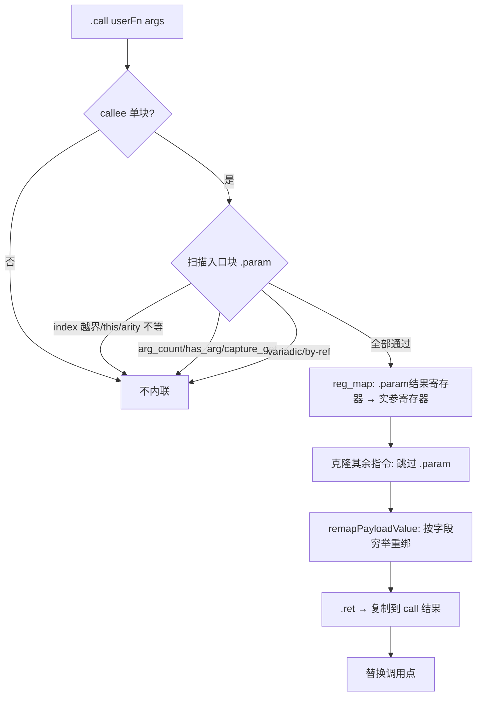
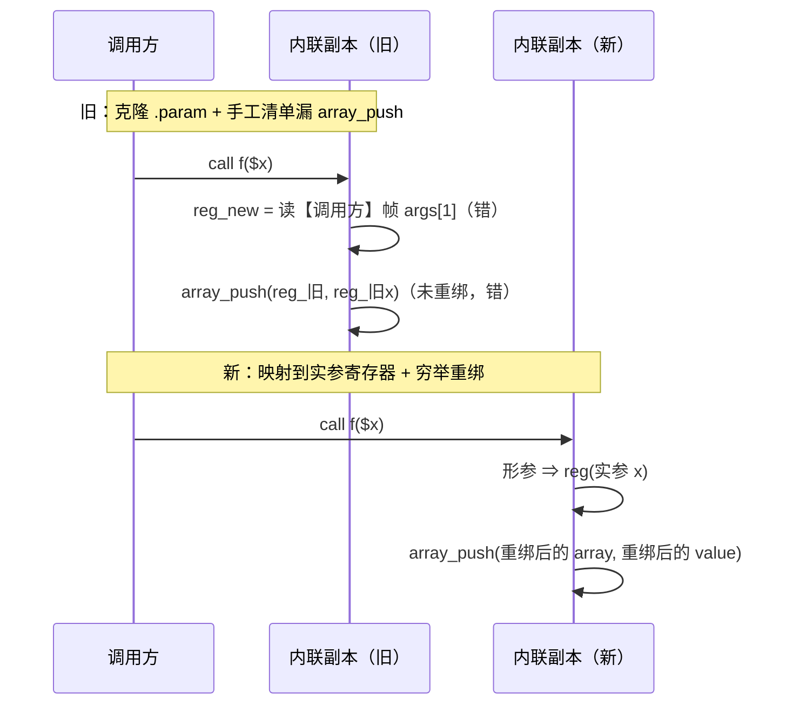

# AOT-CODEGEN-012 F-93 内联器重绑穷举修复（R-201，含 F-136a 闭环）

- 日期：2026-10-21
- 代次锚：`opt 745e4bd4bbb77258fbd5de58629d8684`（唯一变化源）／`nlk c08427256b8069120bd54c6e1764229f`／`irg 8bf9aad68f2a02a63833dd693617ef0e`／`tpl df9cf8e164cbeab59ec3cdefa90125fe`／`ir 1fb6b01f9b0bdff318de496538e7620e`／`parser 70e80f18a2c6ef6787b4c5d817c31773`；`bin 86c4fb8844b5c041a1edad32f18b7d51`（只登记，`zig build` 非字节可复现）
- 提交态：老铁把本批优化器改动并进 **`8edfc85`**（提交信息只描述 R-200 闭包泄漏，未提内联器）
- 关联：**F-93 闭环**、**F-136a 闭环**；F-136c／F-138 不受影响

## 1. 高层摘要（TL;DR）

内联器一直是 safe/fast 两档的"静默错值 + 崩溃"来源：它把被调方的 `.param` 原样克隆（内联副本重读**调用方**帧）、用形参下标当绑定键（随后被克隆覆盖）、只重绑 25 个手工列出的 op（`array_push`/`.release` 等漏网），并且允许 2–6 块的被调方却**只克隆入口块**（丢掉分支与后续块）。本批把重绑改成**按 payload 字段 comptime 穷举**、把形参绑定改成**以 `.param` 结果寄存器为键**、并加**单块 + 帧依赖 + arity/by-ref/variadic/this** 五道守卫。INL 20/20、inline-only 67 语料全 PASS、f152 阈值阶梯 8/8 PASS、F-136a 的 release-fast 崩溃臂 `rc=139→0`。

## 2. 影响范围

| 维度 | 影响 |
|---|---|
| 语义 | 修复 safe/fast 两档的内联错值/崩溃；默认档（`function_inlining=false`）生成码**逐字节不变** |
| 生成码 | 默认档：0 漂移（影子 `drift=0`）；safe/fast：内联面随修复变化（f152 T≥35 md5 改变为预期） |
| 性能 | 内联覆盖**收窄**（多块/变参/by-ref/缺省值不再内联）——旧行为在这些形上是错的，属正确性修复而非性能取舍 |
| 关闭/新增 | F-93 关闭、F-136a 关闭；无新缺陷登记 |

## 3. 核心变更（全部在 `src/aot/optimizer.zig`）

| # | 位置 | 变更 |
|---|---|---|
| T1 | `inlineFunction` 开头 | 单块守卫：`blocks.len != 1` 直接拒绝（旧：≤3 块但只克隆入口块） |
| T2 | `inlineFunction` 形参绑定 | 以 `.param` 的**结果寄存器**为键映射 `args[op.index]`；`index>=args.len` / `name=="this"` / `bound_params!=args.len` / `is_variadic` / `is_reference` 任一成立即拒绝 |
| T3 | `inlineFunction` 指令扫描 | `.arg_count`/`.has_arg`/`.capture_get`（依赖当前帧）出现即拒绝 |
| T4 | `cloneAndRemapInstruction` | `.param` 返回 `null`（形参已预映射，不得克隆） |
| T5 | `remapInstructionOp` | 改为 comptime 穷举 union payload；新增 `payloadContainsRegister` + `remapPayloadValue`（Register／?Register／[]Register／嵌套 struct 与切片；切片重建） |

## 4. 可视化概览

### 4.1 Code & Logic Map

### 4.2 修复前后（形参 + 数组 push 的内联副本）

## 5. 详细变更分析

### 5.1 为什么必须"穷举"而不是补清单
旧 `remapInstructionOp` 手工列了 25 个 op，其余 `else => op`。IR 有 100+ op，且新增 op 时不会有人记得同步这张表（本轮就漏了 `.array_push`/`.release`）。改为按 `@typeInfo(Instruction.Op).@"union".fields` 的 payload 字段 comptime 递归后，**新增 op 自动被覆盖**。

### 5.2 实现陷阱（探针实测）
`Register` 自身是 `struct`；若 `T == Register` 的判定放在 `@typeInfo` 的 `struct` 分支之后，则 `Register` 会进入 struct 分支、被当作"无寄存器字段的 struct"原样返回 ⇒ 整个重绑静默失效。探针（用同名类型复刻）实测：错误顺序输出 `a: 1 2`，正确顺序输出 `a: 2 3`。

### 5.3 单块守卫的取舍
`can_inline` 原先允许 `block_count <= 6`，但 `inlineFunction` 只遍历 `callee_entry.instructions` 且只处理 `.ret` 终结符。多块被调方内联会把分支/后续块整段丢掉——语料 f152 之外，这属于"随时可炸"的静默错值。完整多块内联需块克隆、phi 重写与块映射，未实现前一律拒绝是唯一正确选择。

## 6. 影响与风险评估

| 项 | 结论 |
|---|---|
| 是否破坏式变更 | 否（无 API/语法变化；默认档产物不变） |
| 默认档影子 | **`drift=0`，列 md5 `b286c535…` 与 R-200 列逐字同** |
| safe/fast 语义 | INL 20/20；inline-only 67 PASS / 0 DIFF / 0 RF；f152 阶梯 8/8 PASS |
| 邻门 | 594 臂（385+209）逐门 `pre=post=inter`，`verdict_chg=0` |
| 回归 | `SELF_CHECK_OK rows=68 uniq=68`，PASS=68 FAIL=0 |
| 编译/测试 | `zig build` rc=0；`zig build test` rc=0 |
| 特别风险 | 若有人放宽单块守卫而未实现块克隆，会立即回到"丢分支"的静默错值；INL 门 c109 应挂进母版链 |

**复测路径**：`c109_inl_gate_tmp.sh` → `c007_inline_only_face_tmp.sh` → `c007_f152_thresh_bisect_tmp.sh "15 20 25 30 34 35 45 50"` → c249 → 主回归 → 影子（pre 须用代次相符编译器重编）→ 十邻门 → `zig build test`。

## 7. 遗留问题 / 潜在问题

1. **多块内联未实现**：现一律拒绝；如需覆盖，须独立实现块克隆 + phi 重写 + 块映射。
2. **F-136c**（`array_map` 自身 ≈390 B/iter + 闭包调用面残余）仍待修。
3. **F-138**（debug 档异常对象/`class_meta` 悬垂，`rc=134`）仍待修，本批不涉及。
4. 内联面在母版链上仍是盲区：建议把 c109 与 inline-only 面挂进链。

## 8. 后续开发 / 优化建议

| 优先级 | 项 | 影响面 | 落地成本 |
|---|---|---|---|
| P0 | F-138 debug 档异常对象 UAF | 异常密集脚本 | 中高 |
| P1 | F-136c array_map 所有权 + 闭包调用面残余 | 全档位内存 | 中 |
| P1 | 把 INL c109 与 inline-only 面挂进母版链 | 内联面不再失明 | 低（+2 分钟/轮，需老铁裁） |
| P2 | 多块内联（块克隆＋phi 重写） | 内联覆盖率 | 高 |
| P2 | 内联后对实参寄存器的类型一致性做断言（`Register.type_` 仍取被调方类型） | 编译器内部一致性 | 低 |
