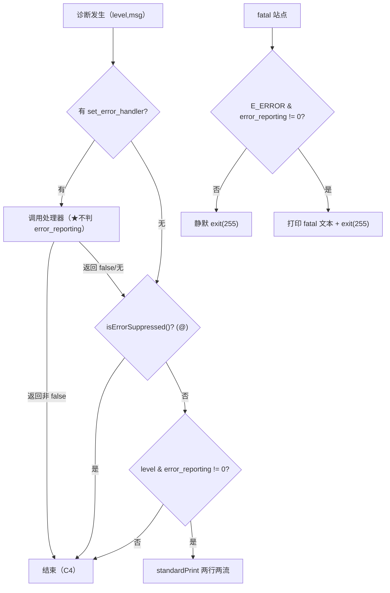
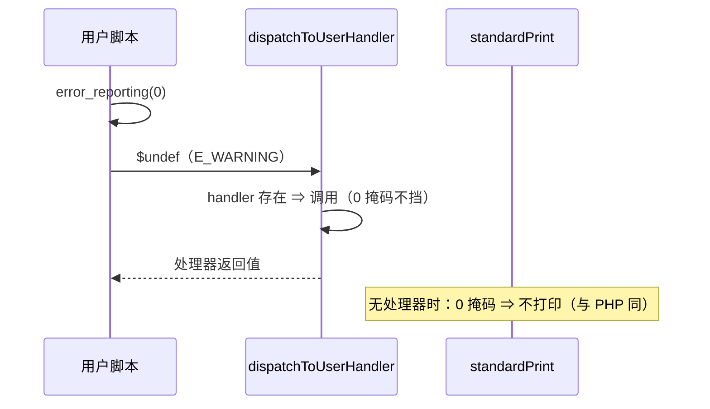

# AOT-CODEGEN-012 R-218：F-95 error_reporting()（含 C5 更正与 fatal 显示门控）

- 日期：2026-10-21（R-218，F-95 闭环；F-95-b / F-95-c 新立）
- 代次锚：`nlk efecdc9d3aa2da0e43f94ff6e270b049`／`tpl ab620b6e84c00fcbb0e2b95f3d313848`／`irg f260626e…`／`opt 745e4bd4…`／`parser 70e80f18…`／`ir 1fb6b01f…`
- 状态：全部**未提交**

## 1. 高层摘要（TL;DR）

`error_reporting()` 此前在模板里有函数、却**没进发射器内置表** ⇒ 任何调用都 fatal「Call to undefined function」。R-218 完成注册，并把语义对齐 PHP 8.5.8：默认值/设置返回值/掩码只静默标准显示/处理器不受掩码影响（更正旧 C5）/fatal 文本按 E_ERROR 位门控（掩掉时零输出、rc 仍 255）/`E_ALL=30719`。

- 新永久门 C269（14 臂，rc 也逐臂比对）全绿。
- 九邻门零转移、主回归 68/68、`zig build test` 326/326。
- 影子 68/68 漂移，归因＝生成码内嵌内置名注册表恰多 1 行（哈希序重排不计），逐文件多重集 68/68 OK。

## 2. 影响范围

| 维度 | 影响 |
|---|---|
| 语义面 | `error_reporting()` 可用；掩码控制 warning/notice/deprecated/user_error 与未捕获 fatal 的显示；处理器调用不再受掩码影响 |
| 常量/ini | `E_ALL` 32767→30719（常量、`defined()`、`ini_get` 三处） |
| 生成码 | 全部 68 文件 +1 行（内置名注册表）；哈希序重排（多重集等价） |
| 运行期 | `standardPrint` 增加一次位与；直写诊断各一次位与；fatal 路径一次位与 |
| 未覆盖 | 其余 fatal 站点（F-95-b）、E_STRICT 常量使用告警（F-95-c）、error_get_last（F-97）、handler 内异常传播（F-98） |

## 3. 核心变更

| # | 位置 | 变更 |
|---|---|---|
| 1 | `nlk` 内置表 | 新增 `error_reporting` → `php_error_reporting`（1 个可选参，默认 `initNull`） |
| 2 | `tpl` 常量/ini | `E_ALL` 30719（const/defined 表/ini_get 三处） |
| 3 | `tpl dispatchToUserHandler` | **删除** `level & global_error_types == 0` 的处理器跳过（C5 更正）；注释改写 |
| 4 | `tpl standardPrint` | 增加 `level` 参数并在抑制位后判掩码；7 个调用点传各自级别 |
| 5 | `tpl` 三处直写诊断 | `emitDeprecatedStrGetcsvEscape` / `emitUndefinedVariableWarning` / `emitDeprecatedFloatToInt` 补掩码门控 |
| 6 | `tpl` 五处 fatal | 未捕获异常 / 未定义函数 / 内部 TypeError / Class not found / 函数重复声明：`fatalDisplayEnabled()` 为假则直接 `exit(255)` |
| 7 | 门 C269 | 14 臂（值/设置/掩码/handler/@/fatal 静默/trigger_error/ini_get/常量/Deprecated） |

## 4. 可视化概览（Code & Logic Map）

## 5. 详细变更分析

| 层 | 文件/位置 | 说明 |
|---|---|---|
| 发射器注册表 | `src/aot/native_linker.zig` 内置表 | 单条登记；`writeBuiltinArgs` 既有的可选参补齐直接复用 |
| 模板 | `src/aot/runtime_lib_template.zig` | 见 §3；三处 `E_ALL` 字面量统一 |
| 门 | `fuzzy_scripts_720/tmp/c269_error_reporting_gate_tmp.sh` | 14 臂，stdout/stderr/rc 三者比对；`/bin/false` 自证 |
| 证据 | `/tmp/f134/attr219.py` | 内置名注册表新增行的多重集归因 |

**关键约束**
- 处理器调用必须在掩码判断**之前**（PHP 契约，旧 C5 实现相反）。
- `standardPrint` 是唯一标准打印口；直写站点必须各自补掩码，否则掩码只对一半诊断生效。
- fatal 掩码只挡**显示**，绝不影响 `exit(255)`。
- 生成码内嵌内置名注册表：新增任何内置都会让**全部文件**漂移，且哈希序会重排 ⇒ 判据必须用多重集。

## 6. 影响与风险评估

| 项 | 结论 |
|---|---|
| 是否破坏式变更 | 否（回归 68/68；邻门 9 门逐臂同基线；C266/C267/C268/C269 全绿） |
| 生成码 | 68/68 +1 行；多重集归因 `missing=0 ∧ extra=该 1 行` 逐文件成立 |
| 影子 | R-217 `9337b17b…` → R-218 `df072557…`（预期漂移，已归因） |
| 回归 | PASS=68 FAIL=0；`SELF_CHECK_OK` |
| 编译/测试 | 21/21、326/326、rc=0 |
| 风险 | `E_ALL` 由 32767 改 30719：凡依赖旧值的脚本/门会看到差异；已核对 C269 与全部邻门（默认掩码下行为不变） |
| 风险2 | fatal 门控只覆盖五处主站点；其余见 F-95-b |

**复测路径**：C269（自证 14 CF）→ C266/C267/C268 → 九邻门 → 主回归 → 影子（多重集归因）→ `zig build test`。

## 7. 遗留问题 / 潜在问题

1. **F-95-b（P2）**：类重复声明、final 继承冲突等 fatal 站点尚未接 E_ERROR 门控；未定义常量走 `std.debug.print` 直写，掩码下仍会输出。
2. **F-95-c（P2）**：`E_STRICT` 常量**使用**在 PHP 8.4+ 发 Deprecated；AOT 常量访问无此告警（同探针撞出）。
3. F-97（`error_get_last()` 未实现）与 F-98（handler 内异常传播被 `catch` 后按“已接管”处理）保持既知缺口。
4. `error_reporting()` 的字符串/数组参数强制转换未逐形实测（本轮覆盖 int/null；异常形未入 C269）。

## 8. 后续开发 / 优化建议

| 优先级 | 建议 | 影响面 | 落地成本 |
|---|---|---|---|
| P2 | F-96：`register_shutdown_function()`（需在正常/exit/fatal 三类出口统一调用，顺序与参数绑定） | AOT 生命周期 | 中高 |
| P2 | F-95-b：其余 fatal 站点接 E_ERROR 门控＋未定义常量改走统一 fatal 出口 | 诊断一致性 | 低中 |
| P2 | F-97：`error_get_last()`（与 E2/E3 的 last-error 轴同批） | 错误处理 API | 中 |
| P2 | C269 与 C264–C268 挂进母链 `c070` | 验收链完整性 | 低 |
