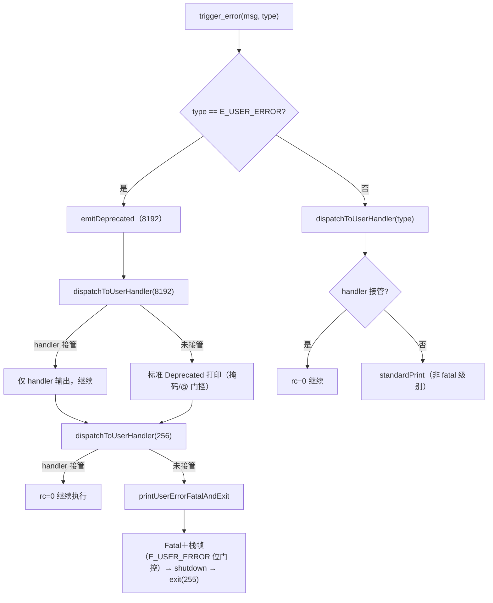
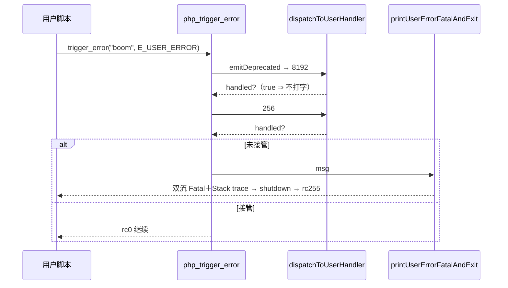
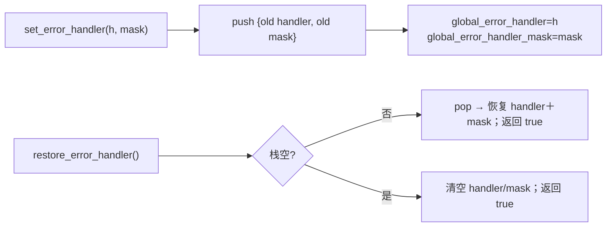

# AOT-CODEGEN-012 R-223：trigger_error(E_USER_ERROR) 弃用＋致命终止、error_get_last 记账口径、set_error_handler 掩码

- 日期：2026-10-22（R-223；F-105＋F-106＋F-97-b＋F-140 同批闭环；模板-only）
- 代次锚：`tpl 7132f27576478422cbe632e1a2857eb0`／`nlk f987285cf7cda1cb34c4d03540b6e082`／`irg f260626e…`／`opt 745e4bd4…`／`parser 70e80f18…`／`ir 1fb6b01f…`
- 状态：全部**未提交**

## 1. 高层摘要（TL;DR）

`trigger_error(..., E_USER_ERROR)` 在 PHP 8.4+ 是“先弃用、后致命”的两段式：先发 `E_DEPRECATED(8192)`，无处理器接管时再发 Fatal、打印栈帧、执行 shutdown 并以 255 退出。AOT 之前缺弃用句、Fatal 后还继续执行且 rc=0。同批修正 `error_get_last` 的记账口径（处理器接管时不应记录）与 `set_error_handler` 第二形参（处理器掩码，与 `error_reporting` 无关）。全部落在模板，生成码零变化。

- ERRH 18 臂 17 SAME／0 DIFF（唯一 CF＝`strlen()` arity，既知）；C271 11/11、C273 10/10、C269 14/14。
- 探针 `t1–t5`、`last2`、`f97b`、`m/n` 全部逐字节 SAME；`zig build test` 326/326。

## 2. 影响范围

| 维度 | 影响 |
|---|---|
| 语义面 | E_USER_ERROR 的弃用/致命/终止/栈帧；error_get_last 只记未接管诊断；set_error_handler 掩码与嵌套恢复 |
| 生成码 | 无（模板-only，main.zig 不变） |
| 运行期 | 诊断分发多一次掩码比较；E_USER_ERROR 路径多一条弃用句与 fatal 出口 |
| 未覆盖 | 用户函数内 trigger_error 的中间栈帧；handler 抛异常（F-98）；处理器 Value 所有权约定（F-140-b） |

## 3. 核心变更

| # | 位置（tpl） | 变更 |
|---|---|---|
| 1 | `dispatchToUserHandler` | `recordLastError` 移到“无处理器／不可调用／return false”三支（F-97-b）；新增 `(level & global_error_handler_mask)==0` 判定（F-140） |
| 2 | `php_set_error_handler` / `php_restore_error_handler` | 掩码独立存储；`ErrorHandlerFrame` 嵌套栈；restore 恢复 handler＋mask 并返回 `true`；不再改 `error_reporting` |
| 3 | `php_trigger_error` | `E_USER_ERROR` 先 `emitDeprecated(...)`；未接管时走新 fatal 出口 |
| 4 | `printUserErrorFatalAndExit` | 掩码位门控（`@` 不抑制）、双流 Fatal＋栈帧（反斜杠/换行转义）、shutdown、`exit(255)` |

## 4. 可视化概览（Code & Logic Map）

## 5. 详细变更分析

| 层 | 位置 | 说明 |
|---|---|---|
| 模板 | `runtime_lib_template.zig` `dispatchToUserHandler` | 记账时机＝“标准处理将要发生”时才记；处理器掩码比较 |
| 模板 | `php_set_error_handler` / `php_restore_error_handler` | 掩码与 error_reporting 解耦；嵌套栈 |
| 模板 | `php_trigger_error` / `printUserErrorFatalAndExit` | 两段式弃用＋致命；栈帧渲染与终止 |
| 门 | `c108_errh_gate_tmp.sh` | h7（handler 掩码）、h10（handler true）、h11（无处理器 fatal）由红转绿；其余零转移 |
| 门 | `c271_error_get_last_gate_tmp.sh` | e5 的臂体已改为真正触发诊断的形（避免 DCE 假绿） |

**关键约束**
- Fatal 显示受 `E_USER_ERROR` 位门控，**不受 `@` 抑制**（实测）；Deprecated 受 `@` 与 8192 位双重门控。
- 栈帧必须双流各打一份；单引号不转义、反斜杠加倍、换行写 `\n`（实测）。
- 记账（error_get_last）与显示/掩码无关，但与**是否被处理器接管**有关。

## 6. 影响与风险评估

| 项 | 结论 |
|---|---|
| 是否破坏式变更 | 否（四门全绿 + 六探针逐字节 + 主回归结果见下） |
| 生成码 | 不变 |
| 影子 | 纯模板 ⇒ 不适用；按加速策略跳过 |
| 回归 | 首跑 32 枚 `FAIL_COMPILE: NoSpaceLeft`（`.zig-cache` 74 GB／剩 134 MiB）⇒ **整轮作废**；清缓存并全量重建后重跑 **PASS=68 FAIL=0**、`SELF_CHECK_OK` |
| 编译/测试 | `zig build` rc=0；`zig build test` 21/21、326/326 |
| 风险 | 既有脚本若依赖“set_error_handler 第二形参改 error_reporting”或“fatal 后继续执行”，行为会改变——两者都是 PHP 语义本身，回归用于确认语料无此依赖 |

**复测路径**：ERRH（18 臂）→ C271 → C273 → C269 → 六探针 → `zig build test` → 主回归（本批一次）。

## 7. 遗留问题 / 潜在问题

1. **F-106-b（P2）**：用户函数内触发 `E_USER_ERROR` 的中间栈帧未渲染（宪法允许栈帧差异）。
2. **F-140-b（P2）**：处理器 Value 沿用“永不释放”的借用约定；栈借存安全，但引用计数归口另案。
3. F-98（handler 内异常传播）仍开；handler 抛异常时 error_get_last 口径未实测。
4. `trigger_error` 非字符串消息、非法 level 的 else 分支未改（旧口径未实测）。
5. `restore_error_handler()` 返回值由旧“前一个 handler”改为 PHP 实测的 `bool(true)`；所有权语义待统一。

## 8. 后续开发 / 优化建议

| 优先级 | 建议 | 影响面 | 落地成本 |
|---|---|---|---|
| P1 | F-95-c-b：类常量非折叠初始化器（`const A = E_ALL` 现 rc=255） | 类常量语义 | 中 |
| P2 | F-140-b＋F-98：handler 所有权与异常传播一并收口 | 诊断健壮性 | 中 |
| P2 | 里程碑批：C264–C273 挂母链 ＋ 全量影子归因 | 验收链 | 低 |
| P2 | F-106-b：中间栈帧（如可低成本取得调用链） | 诊断一致性 | 中 |
