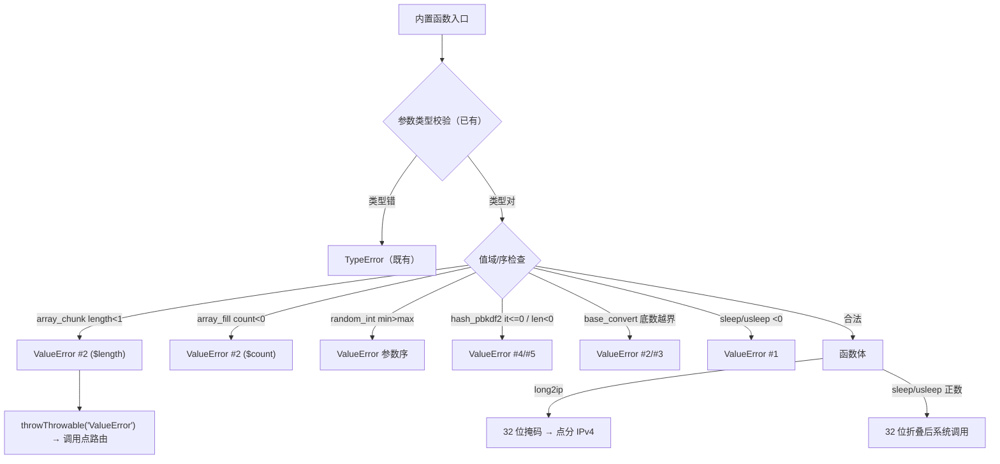
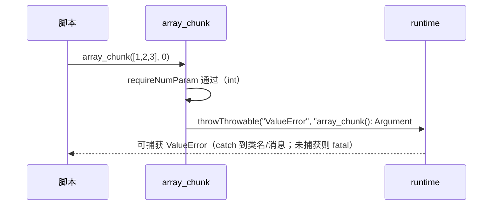

# AOT-CODEGEN-012 R-229：ValueError 族与 32 位值域（F-126＋F-127 闭环）

- 日期：2026-10-22（R-229；F-126＋F-127 同批闭环；纯模板）
- 代次锚：`tpl ef1ede18994758ae1482cded91a387a2`／`nlk 73355c86…`／`irg 0d3d260e…`／`opt 745e4bd4…`／`parser 70e80f18…`／`ir 1fb6b01f…`
- 状态：全部**未提交**

## 1. 高层摘要（TL;DR）

PHP 8 对 9 个参数错误返回**可捕获 ValueError**（参数域/参数序比较措辞），AOT 之前是静默夹取或 Zig error 外逸（PHP 侧不可见）。本批在 7 个模板函数中补齐：`array_chunk` length、`array_fill` count、`random_int` min>max、`hash_pbkdf2` iterations/length、`base_convert` 底数、`sleep`/`usleep` 负数；同时把 `long2ip` 改为纯 32 位掩码、`sleep/usleep` 正数按 32 位折叠。全部 ValueError 可被 `try/catch (Throwable)` 捕获，类名与消息逐字节同 PHP。

- BLT H/I/J 51 臂：J 段 9 枚 `DIFF→SAME`，`SAME→DIFF=0`，`zig_escape=0`。
- 15 形探针逐字节 SAME；`zig build test` 326/326。

## 2. 影响范围

| 维度 | 影响 |
|---|---|
| 语义面 | ValueError 抛点 9 形；long2ip 值域；sleep/usleep 负数与 32 位折叠 |
| 生成码 | 无（纯模板）；调用点异常路由沿用注册表 `may_raise=true` |
| 运行期 | 失败路径由“静默错误值/外逸”变为可捕获 ValueError |
| 未覆盖 | `array_chunk` 非数组形参的 error.InvalidArgument（F-62f 数组参数面）；F-128 checkdate |

## 3. 核心变更

| # | 函数 | 变更 |
|---|---|---|
| 1 | `php_array_chunk` | `length<1` ⇒ ValueError（原 `error.InvalidArgument`） |
| 2 | `php_array_fill` | 负 count ⇒ ValueError（原 `@max(0,…)`） |
| 3 | `php_random_int` | `min>max` ⇒ ValueError（原 `error.InvalidRange`） |
| 4 | `php_hash_pbkdf2` | iterations≤0／length<0 ⇒ ValueError；length=0 哨兵保留 |
| 5 | `php_base_convert` | 底数 <2 或 >36 ⇒ ValueError（原夹取） |
| 6 | `php_long2ip` | `@truncate(@bitCast(i64))` 32 位掩码 |
| 7 | `php_sleep`／`php_usleep` | 负数 ValueError；正数 32 位折叠 |

## 4. 可视化概览（Code & Logic Map）

## 5. 详细变更分析

| 层 | 位置 | 说明 |
|---|---|---|
| 模板 | `php_array_chunk` | 值域检查在数组检查之后；`zig_escape` 归零 |
| 模板 | `php_array_fill` | 负 count 抛；负 start_index 仍合法（b176 守卫） |
| 模板 | `php_random_int` | 参数序比较措辞 |
| 模板 | `php_hash_pbkdf2` | iterations/length 检查在字符串早退之上；length=0 仍为整摘要 |
| 模板 | `php_base_convert` | 底数检查在 `!number.isString()` 早退之上 |
| 模板 | `php_long2ip` | `u64 = @bitCast(i64)` → `u32 = @truncate`（负数/超界掩码） |
| 模板 | `php_sleep/usleep` | 负数抛；`@truncate` 32 位折叠（sleep(2^32)=0） |
| 门 | BLT `ONLY=b159…b209` | 51 臂含 9 枚 J 正面＋3 守卫＋H/I 邻域 |

**关键约束**
- ValueError 必须可捕获：统一 `throwThrowable("ValueError", …)`，不复用 `throwThrowableDiscardCatch`（后者用于无错误并集路径）。
- 值域检查位于函数体早退**之前**，但类型检查仍最前（TypeError 优先）。
- `length=0` 是合法哨兵，禁止当越界夹掉。

## 6. 影响与风险评估

| 项 | 结论 |
|---|---|
| 是否破坏式变更 | 语义收紧：原先静默错误值/外逸现在按 PHP 抛 ValueError |
| 生成码 | 无（纯模板） |
| 影子 | 纯模板 ⇒ 生成码不变，按加速策略跳过 |
| 回归 | 全量 **PASS=68 FAIL=0**、`SELF_CHECK_OK` |
| 编译/测试 | `zig build` rc=0；`zig build test` 21/21、326/326 |
| 风险 | 语料大量使用 `array_fill/array_chunk/hash_pbkdf2` 合法形；回归用于确认无越界依赖 |

**复测路径**：BLT `ONLY=H/I/J`（自证 51 CF）→ 实跑 + 逐臂 join → 15 形探针 → `zig build test` → 主回归（本批一次）。

## 7. 遗留问题 / 潜在问题

1. **F-128**：`checkdate` 的 `.may_raise=false` 与错误并集签名不配套，b170–b172 仍红；需批准动发射器注册表。
2. `array_chunk` 非数组形参仍 `error.InvalidArgument`（数组参数面，F-62f 余量）。
3. `hash_pbkdf2` iterations 超出 u32 的折叠属值域边界（PHP 实际不可测）。
4. F-62f 余量 31 函数／45 行仍待逐枚真值定档。

## 8. 后续开发 / 优化建议

| 优先级 | 建议 | 影响面 | 落地成本 |
|---|---|---|---|
| P1 | F-128：checkdate 签名＋`may_raise` 旗（需裁） | 异常路由 | 低（两处） |
| P2 | F-62f 余量普查（31 函数／45 行） | 参数类型/域 | 中 |
| P1 | F-95-c-b：类常量非折叠初始化器 | 类常量 | 中 |
| P2 | 里程碑批：C264–C278＋BLT 挂母链 | 验收链 | 低 |
