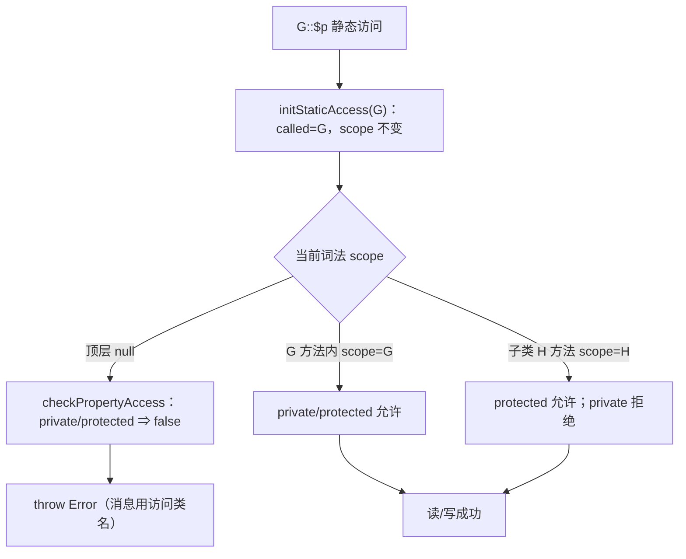
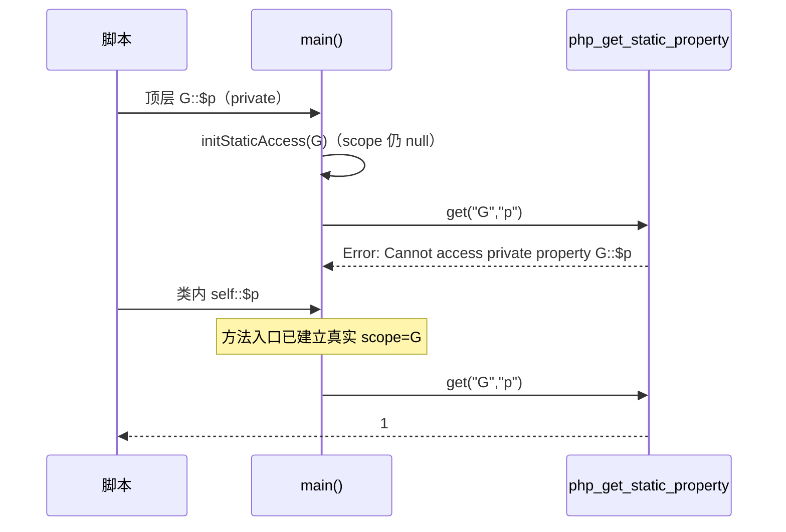

# AOT-CODEGEN-012 R-228：静态属性可见性（F-141 闭环）

- 日期：2026-10-22（R-228；F-141 闭环；发射器＋模板）
- 代次锚：`nlk 73355c86ab98b50bd4b739d6b38b85d5`／`tpl d575314e6b12714895fbf34e45a1eb9c`／`irg 0d3d260e831d4be6e74a80025edb81f1`／`opt 745e4bd4…`／`parser 70e80f18…`／`ir 1fb6b01f…`
- 状态：全部**未提交**

## 1. 高层摘要（TL;DR）

AOT 之前对**每次显式类名静态属性访问**都套 `ClassContext.init(meta, meta)`，把词法作用域强设成目标类 ⇒ 外部访问 private/protected 静态属性被误判为“类内访问”而放行（返回属性值）。本批新增 `ClassContext.initStaticAccess(meta)`：只切换 called class、**保留词法作用域**；外部访问 scope 仍为空 ⇒ 按 PHP 报 `Cannot access private/protected property …`；类内访问保留方法入口的真实 scope ⇒ same-class private、子类 protected 仍可用。可见性错误消息改用**访问类名**（`H::$p`，与 PHP 对齐）。

- 新门 C278（11 臂）自证 11 CF，实跑 **11/11 SAME**。
- C275/C276/C277 复跑全绿；`zig build test` 326/326。

## 2. 影响范围

| 维度 | 影响 |
|---|---|
| 语义面 | 显式类名静态属性的读/写/自增可见性；同/子类可访问性；错误消息类名 |
| 生成码 | 静态 get/set 的 ClassContext 初始化由 `init(m,m)` 改为 `initStaticAccess(m)` |
| 运行期 | 新增一个 ClassContext 构造器；不改变方法调用的真实作用域 |
| 未覆盖 | 类方法内错误栈帧（AOT 无中间帧，宪法允许）；多实参 isset（F-142-c） |

## 3. 核心变更

| # | 位置 | 变更 |
|---|---|---|
| 1 | `runtime_lib_template.zig` `ClassContext` | 新增 `initStaticAccess(called)`：只 `setCurrentCalledClass`，不动 scope |
| 2 | `native_linker.zig` 静态 get 发射 | wrapper 改用 `ClassContext.initStaticAccess(m)` |
| 3 | `native_linker.zig` 静态 set 发射 | 同上 |
| 4 | 模板可见性消息（get/set） | `decl.class.name` → `meta.name`（访问类名，对齐 `H::$p`） |
| 5 | 门 C278 | 11 臂覆盖外部/类内/子类/异类/isset 守卫 |

## 4. 可视化概览（Code & Logic Map）

## 5. 详细变更分析

| 层 | 位置 | 说明 |
|---|---|---|
| 模板 | `ClassContext.initStaticAccess` | 保存/恢复 called+scope，但只设置 called；deinit 原样恢复 |
| 发射器 | `static_property_get` 包装 | 显式类名走新构造器；`static/self/parent` 保持不变 |
| 发射器 | `static_property_set` 包装 | 同上 |
| 模板 | 可见性错误文案 | 访问类名 vs 声明类名（`H::$p` 实测） |
| 门 | `c278_static_visibility_gate_tmp.sh` | 11 臂；`/bin/false` 自证；TSV 逐臂 |

**关键约束**
- 方法入口的 `ClassContext.init(owner...)` 必须保留：它是类内 private/protected 的唯一合法来源。
- `initStaticAccess` 只用于静态属性 get/set；静态方法调用的 wrapper 不在此批范围。
- 错误消息类名必须取“访问类名”，否则子类访问继承 private 的文案不合 PHP。

## 6. 影响与风险评估

| 项 | 结论 |
|---|---|
| 是否破坏式变更 | 是**语义收紧**（原先被过接受的外部私有访问现在按 PHP 报 Error），属修复而非兼容性破坏 |
| 生成码 | 所有显式类名静态属性 get/set 文件的 wrapper 行变化 |
| 影子 | 本批触及发射器 ⇒ 跑全量回归；影子按加速策略跳过（漂移面由回归覆盖） |
| 回归 | 全量 **PASS=68 FAIL=0**、`SELF_CHECK_OK` |
| 编译/测试 | `zig build` rc=0；`zig build test` 21/21、326/326 |
| 风险 | 若语料存在“外部访问 private/protected 静态属性”的脚本，会由静默值变 Error（PHP 本就应报错）；回归用于确认语料无此依赖 |

**复测路径**：C278（自证 11 CF）→ 11/11 → C275/C276/C277 → `zig build test` → 主回归（本批一次）。

## 7. 遗留问题 / 潜在问题

1. 类方法内“无权访问”的 fatal 栈帧 AOT 只印 `{main}`（PHP 带调用帧）——宪法允许忽略，未入字节门。
2. **F-142-c**：多实参 `isset` 的缺失静态属性/未定义变量仍走通用路径（可能 fatal/告警）。
3. 静态属性**初始化**（类注册时的 `setStaticProperty`）不经 wrapper，不受影响；已核对生成码。

## 8. 后续开发 / 优化建议

| 优先级 | 建议 | 影响面 | 落地成本 |
|---|---|---|---|
| P1 | F-95-c-b：类常量非折叠初始化器 | 类常量语义 | 中 |
| P2 | F-142-c：多实参 isset 的静默求值（BP_VAR_IS 抽象） | isset | 中高 |
| P2 | 里程碑批：C264–C278 挂母链＋全量影子 | 验收链 | 低 |
| P2 | 可见性错误栈帧补齐（如需与 PHP 完全一致） | 诊断一致性 | 中 |
