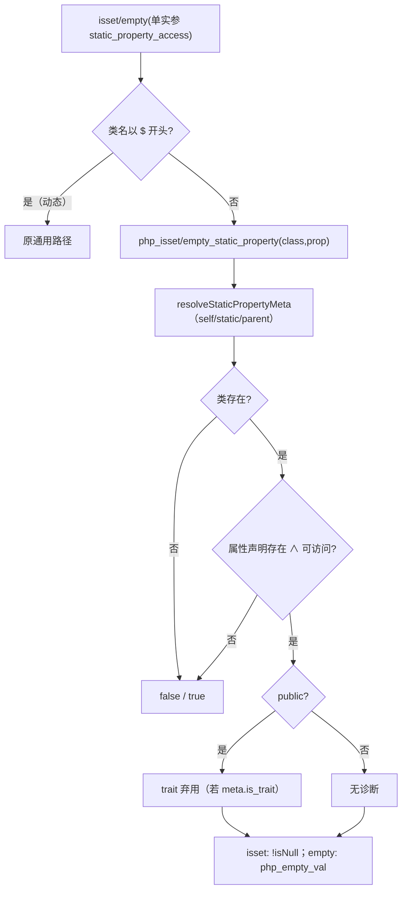
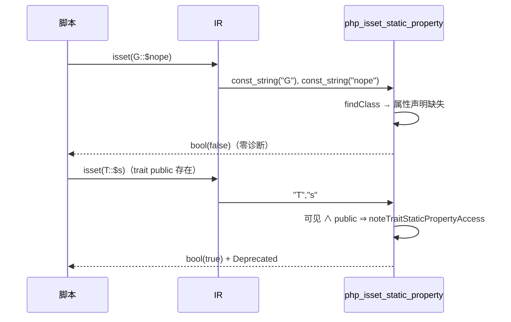

# AOT-CODEGEN-012 R-226：静态属性 isset/empty 的静默语义（F-142 闭环）

- 日期：2026-10-22（R-226；F-142 闭环；F-142-b 新立；IR＋模板）
- 代次锚：`irg 63353194eafa69d7d28fefca5d9876d7`／`tpl 690b52a5f0dfec723aa2354c35725087`／`nlk 7764578cc3282ac23685964a1e5d05a9`／`opt 745e4bd4…`／`parser 70e80f18…`／`ir 1fb6b01f…`
- 状态：全部**未提交**

## 1. 高层摘要（TL;DR）

`isset(G::$p)` / `empty(G::$p)` 对**缺失**或**不可见**的静态属性，PHP 返回 false/true 且零诊断；AOT 之前复用会 throw 的 `php_get_static_property`，直接未捕获 fatal（普通类与 trait 都中）。本批为单实参静态属性生成静默 helper：解析类（self/static/parent）、检查可见性、缺失即返回、public 存在时仍发 trait Deprecated，最后按值判 isset/empty。

- 新门 C276（11 臂）自证 11 CF，实跑 **11/11 SAME**。
- 探针 `p/in/e/cisset` 全字节 SAME；`zig build test` 326/326。

## 2. 影响范围

| 维度 | 影响 |
|---|---|
| 语义面 | 静态属性的 isset/empty：缺失/不可见/null/typed 未初始化/类内/子类/动态类名/多实参 |
| 生成码 | 单实参 `isset/empty(G::$x)` 改发 `php_isset_static_property` / `php_empty_static_property` |
| 运行期 | 新增两条 helper（不抛、无分配）；trait public 仍复用 R-225 的弃用钩子 |
| 未覆盖 | `empty($undef)`/`empty($arr[missing])` 的 Warning（F-142-b）；多实参缺失静态属性；普通读取的可见性（F-141） |

## 3. 核心变更

| # | 位置 | 变更 |
|---|---|---|
| 1 | `ir_generator.zig` isset/empty 特判 | 单实参 + `.static_property_access` + 类名非 `$` ⇒ 调静默 helper；多实参/动态保持通用路径 |
| 2 | `runtime_lib_template.zig` | 新增 `resolveStaticPropertyMeta`、`php_isset_static_property`、`php_empty_static_property` |
| 3 | `native_linker.zig` 内置表 | 登记两条 helper（`needs_allocator=false`, `may_raise=false`） |
| 4 | 门 C276 | 11 臂覆盖正反两面与守卫 |

## 4. 可视化概览（Code & Logic Map）

## 5. 详细变更分析

| 层 | 位置 | 说明 |
|---|---|---|
| IR | `generateCall` 的 isset/empty 特判 | 只对单实参静态属性分流；用 `emitPropertyNameValue` 传类名/属性名 Value |
| 模板 | `resolveStaticPropertyMeta` | 与 get/set 的 self/static/parent 语义一致（trait 中 self 解析到 called class） |
| 模板 | `php_isset_static_property` | 缺失/不可见/null ⇒ false；public+trait ⇒ 弃用；不抛 |
| 模板 | `php_empty_static_property` | 缺失/不可见 ⇒ true；存在 ⇒ `php_empty_val` |
| 发射器 | `builtin_map` | 两条 helper 标 `may_raise=false`，生成码直接赋值（无 `try`） |
| 门 | `c276_static_isset_gate_tmp.sh` | 11 臂；`/bin/false` 自证；TSV 逐臂 |

**关键约束**
- 只分流**单实参**：`isset($a,$b)` 需要全部求值，交给通用 `php_isset`。
- 缺失/不可见返回前**不发** trait 弃用（PHP 实测只报 Error 或不报）。
- 多实参/动态类名保持原路径（缺失静态属性仍可能 fatal，登记 F-142-b 同族）。

## 6. 影响与风险评估

| 项 | 结论 |
|---|---|
| 是否破坏式变更 | 否（C276 11/11；探针全 SAME；326/326 单测） |
| 生成码 | 仅单实参静态 isset/empty 文件变化；语料该形 **0 枚** |
| 影子 | 语料零暴露；IR 改动本应跑影子，按加速策略以零暴露普查替代并记录 |
| 回归 | 本批触及 IR ⇒ 全量回归 **PASS=68 FAIL=0**、`SELF_CHECK_OK` |
| 编译/测试 | `zig build` rc=0；`zig build test` 21/21、326/326 |
| 风险 | 多实参/动态类名的缺失静态属性未静默（既存）；`empty` 变量/数组键仍告警（F-142-b） |

**复测路径**：C276（自证 11 CF）→ 11/11 → `p/in/e/cisset` 探针 → `zig build test` → 主回归（本批一次）。

## 7. 遗留问题 / 潜在问题

1. **F-142-b（P2）**：`empty($undef)` / `empty($arr[missing])` 仍发 Warning；`isset(G::$q, G::$missing)` 多实参缺失仍 fatal。
2. **F-141（P1）**：普通读取外部 private/protected 静态属性仍过接受（ClassContext(target) 伪造作用域）。
3. `isset($c::$missing)`（动态类名 + 缺失属性）未静默，属 F-142-b 同族。
4. trait 弃用去重的同文件同行边界（R-225 已登记）。

## 8. 后续开发 / 优化建议

| 优先级 | 建议 | 影响面 | 落地成本 |
|---|---|---|---|
| P1 | F-141：静态访问的 ClassContext 只在合法作用域套用 | 访问控制 | 中（动发射器） |
| P2 | F-142-b：empty 变量/数组键的静默读取＋多实参/动态静态缺失 | isset/empty 语义 | 低中 |
| P1 | F-95-c-b：类常量非折叠初始化器 | 类常量语义 | 中 |
| P2 | 里程碑批：C264–C276 挂母链＋全量影子 | 验收链 | 低 |
