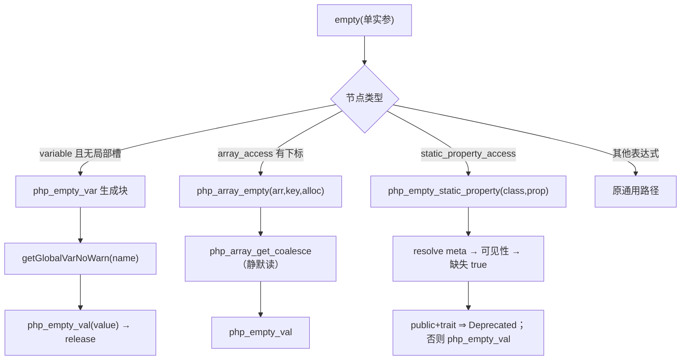
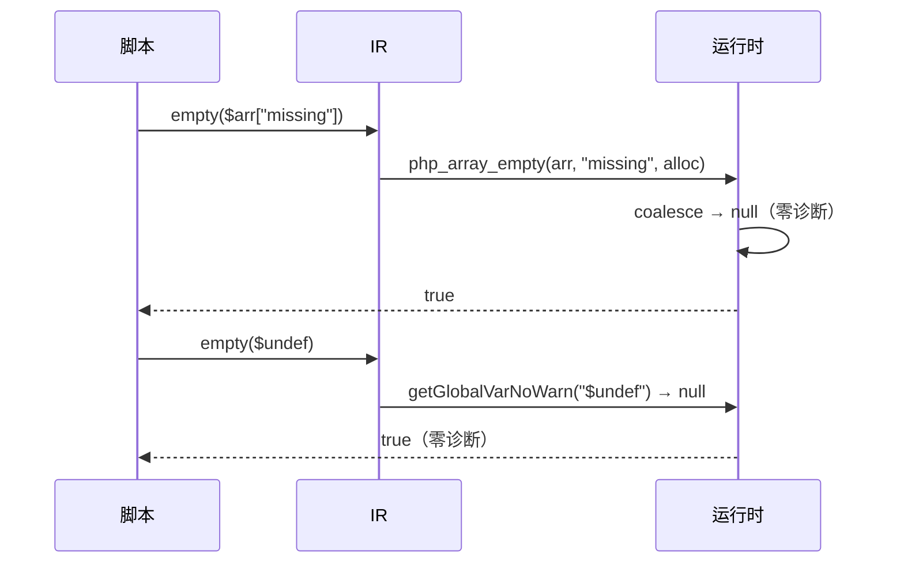

# AOT-CODEGEN-012 R-227：empty() 静默语义扩展（F-142-b 闭环）

- 日期：2026-10-22（R-227；F-142-b 闭环；IR＋发射器＋模板）
- 代次锚：`irg 0d3d260e831d4be6e74a80025edb81f1`／`tpl 57315972ae3a62b99b9c6158d4336b47`／`nlk 16906dc020aaed28aadf55f50daee18d`／`opt 745e4bd4…`／`parser 70e80f18…`／`ir 1fb6b01f…`
- 状态：全部**未提交**

## 1. 高层摘要（TL;DR）

`empty($undef)` / `empty($arr[missing])` 在 PHP 中是静默的（true，零诊断）；AOT 之前走普通读取路径，会发 `Undefined variable` / `Undefined array key`。本批为单实参 `empty` 增加三条静默分流：全局变量（`getGlobalVarNoWarn` + `php_empty_val`）、数组键（复用 `php_array_get_coalesce`）、静态属性（复用 R-226 helper，并支持 `$c::$x` 动态类名）。反向守卫确认普通读取仍然告警。

- 新门 C277（12 臂）自证 12 CF，实跑 **12/12 SAME**；C276 11/11、C275 13/13。
- 探针 `e/g/dyn` 全字节 SAME；`zig build test` 326/326。

## 2. 影响范围

| 维度 | 影响 |
|---|---|
| 语义面 | `empty` 变量/数组键/静态属性（含动态类名）的静默与判空；ArrayAccess 顺序；非 ArrayAccess 对象 Error |
| 生成码 | 单实参 `empty($var)` 生成带局部临时量的块；`empty($arr[$k])` 调 `php_array_empty`；静态走 quiet helper |
| 运行期 | 新增 `php_array_empty`；`php_empty_val` 公开；变量路径复用 `getGlobalVarNoWarn` |
| 未覆盖 | 多实参 isset 的缺失静态属性；`empty(非变量表达式)` 通用路径；coalesce 的 null 键/非法字符串键既有诊断 |

## 3. 核心变更

| # | 位置 | 变更 |
|---|---|---|
| 1 | 模板 `php_array_empty` | `coalesce → php_empty_val`；缺失/非数组静默，ArrayAccess 走 EX/GET |
| 2 | 模板 `php_empty_val` | 改为 `pub`（生成码直接调用） |
| 3 | 发射器 `php_empty_var` | 专用生成：`const __empty_v_N = getGlobalVarNoWarn(name); reg = php_empty_val(...); release` |
| 4 | IR `empty` 单实参 | 新增 `.variable`（无局部槽）与 `.array_access` 分流；静态统一 `emitStaticPropertyQuietCall`（支持动态类名） |
| 5 | 内置表 | `php_empty_var`（不抛/无分配）、`php_array_empty`（allocator/可抛） |

## 4. 可视化概览（Code & Logic Map）

## 5. 详细变更分析

| 层 | 位置 | 说明 |
|---|---|---|
| 模板 | `php_array_empty` | 复用 coalesce 的数组/字符串/ArrayAccess/对象 Error 语义；结果 release |
| 模板 | `php_empty_val` | 公开供生成码使用；判空规则不变 |
| 发射器 | `php_empty_var` 专用支 | 局部临时量名含 reg id 防嵌套冲突；retain 后 release |
| IR | `empty` 分支 | 只接单实参；静态动态类名先求值再调 helper |
| IR | `emitStaticPropertyQuietCall` | isset/empty 共用，消除重复 |
| 门 | `c277_empty_quiet_gate_tmp.sh` | 12 臂；`/bin/false` 自证；含 e8/e9 反向守卫 |

**关键约束**
- 静默只作用于 `empty`/`isset` 语境；普通读取的告警必须保留（e8/e9 反向守卫）。
- `php_empty_var` 只对“无局部槽的全局变量”分流；有局部槽的变量仍读寄存器。
- `php_array_empty` 的缺失/非数组返回 true，非 ArrayAccess 对象仍按 PHP 抛 Error。

## 6. 影响与风险评估

| 项 | 结论 |
|---|---|
| 是否破坏式变更 | 否（C277 12/12、C276 11/11、C275 13/13、326/326 单测） |
| 生成码 | 单实参 empty 变量/数组键/静态属性文件变化；语料 empty 49 处（21 变量＋3 数组键） |
| 影子 | 本批触及 IR/发射器 ⇒ 跑全量回归；影子按加速策略跳过（生成码漂移面已由回归覆盖） |
| 回归 | 全量 **PASS=68 FAIL=0**、`SELF_CHECK_OK`（语料 empty 49 处） |
| 编译/测试 | `zig build` rc=0；`zig build test` 21/21、326/326 |
| 风险 | `php_array_empty` 复用 coalesce：`null` 数组键的 Deprecated/`'1abc'` 非法偏移告警沿用其既有口径（未在本门覆盖） |

**复测路径**：C277（自证 12 CF）→ 12/12 → C276/C275 → `e/g/dyn` 探针 → `zig build test` → 主回归（本批一次）。

## 7. 遗留问题 / 潜在问题

1. 多实参 isset 的缺失静态属性仍走通用路径（可能 fatal）；多实参 isset 的未定义变量亦为既有面。
2. `empty(<非变量表达式>)` 未特殊化（语义与改前一致）。
3. **F-141** 仍开：普通读取外部 private/protected 静态属性过接受。
4. coalesce 的 null 键 Deprecated / 非法字符串偏移告警与 PHP empty 的精确对齐未逐形实测。

## 8. 后续开发 / 优化建议

| 优先级 | 建议 | 影响面 | 落地成本 |
|---|---|---|---|
| P1 | F-141：静态访问 ClassContext 只在合法作用域套用 | 访问控制 | 中（动发射器） |
| P2 | 多实参 isset 的静默求值（统一 BP_VAR_IS 抽象） | isset | 中高 |
| P1 | F-95-c-b：类常量非折叠初始化器 | 类常量 | 中 |
| P2 | 里程碑批：C264–C277 挂母链＋全量影子 | 验收链 | 低 |
