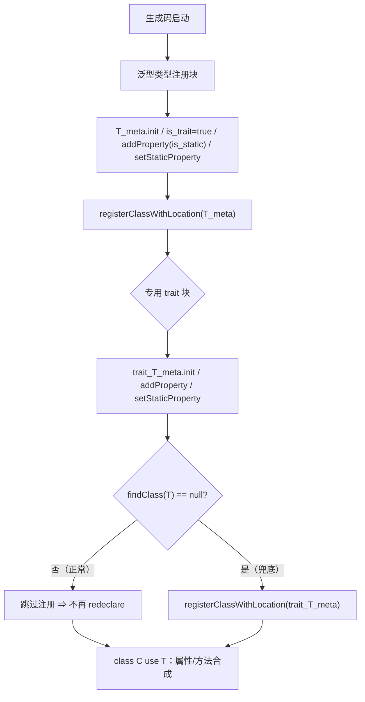
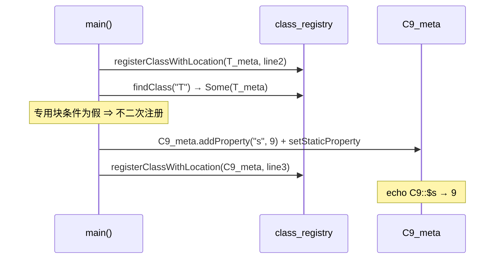

# AOT-CODEGEN-012 R-224：带静态属性的 trait 二次注册（F-74 主面闭环）

- 日期：2026-10-22（R-224；F-74 主面闭环；F-74-b 新立；发射器一处）
- 代次锚：`nlk 5e7d0cc46139a4ffc30f2201e2a5da1a`／`tpl 7132f27576478422cbe632e1a2857eb0`／`irg f260626e…`／`opt 745e4bd4…`／`parser 70e80f18…`／`ir 1fb6b01f…`
- 状态：全部**未提交**

## 1. 高层摘要（TL;DR）

`trait T { public static $s = 9; } class C { use T; }` 在 AOT 运行期报 `Cannot redeclare trait T`（PHP 正常返回 9）。根因不是 types 重复，而是“含静态属性的 trait”专用注册块把**泛型 meta** 又注册了一次（且没有注册它自己构建的 `trait_T_meta`）。修法：专用块末行改为 `findClass(T) == null` 时才注册——保留兜底意图，消除二次注册。语料 trait 声明 0 枚，故以新门 C275 常驻保护。

- C275 10 臂：9 SAME，唯一 DIFF＝`t7`（直接 `T::$s` 缺 Deprecated，注册为 F-74-b）。
- `zig build test` 326/326；主回归按零暴露策略跳过并记录。

## 2. 影响范围

| 维度 | 影响 |
|---|---|
| 语义面 | 带静态属性的 trait 从“运行期 redeclare fatal”恢复为 PHP 行为；类侧读写/self/static/两类独立均对齐 |
| 生成码 | 仅“trait + 静态属性”文件：专用块注册行加 `findClass(...) == null` 条件 |
| 运行期 | 无新增 hot-path（仅启动期一次 findClass） |
| 未覆盖 | 直接 `T::$s` 的 E_DEPRECATED（F-74-b）；trait 静态属性与类同名冲突的报错阶段/文案（既存差异） |

## 3. 核心变更

| # | 位置 | 变更 |
|---|---|---|
| 1 | `native_linker.zig` 专用 trait 注册块 | `registerClassWithLocation(T_meta, …)` ⇒ `if (findClass("T") == null) registerClassWithLocation(trait_T_meta, …)` |
| 2 | 门 C275 | 10 臂：t1–t6/t8–t10 正向与守卫；t7＝注册红 F-74-b |

## 4. 可视化概览（Code & Logic Map）

## 5. 详细变更分析

| 层 | 文件/位置 | 说明 |
|---|---|---|
| 发射器 | `src/aot/native_linker.zig` `emitted_trait_names` 块（约 :3930） | 修正注册对象与条件；泛型块已完整覆盖 trait 属性/方法 |
| 门 | `fuzzy_scripts_720/tmp/c275_trait_static_gate_tmp.sh` | 10 臂；`/bin/false` 自证 10 CF；TSV 逐臂 |
| 探针 | `/tmp/f74m/m1,m2,m3,d` | 值面全对；仅直接 `T::$s` 缺诊断 |

**关键约束**
- 不删除专用块（删除代码须审批）；改为条件注册，保留“泛型块缺失时”的兜底。
- 泛型块本身已注册 is_trait＋静态属性 ⇒ 正常路径无需专用块再注册。
- 直接 `T::$s` 的弃用诊断属独立面（F-74-b），不与本修复混批。

## 6. 影响与风险评估

| 项 | 结论 |
|---|---|
| 是否破坏式变更 | 否（C275 9/10，唯一红为注册的 F-74-b；`zig build test` 326/326） |
| 生成码 | 仅 trait+静态属性文件变化；语料 0 枚 |
| 影子 | 跳过（零暴露；`grep -rlE 'trait [A-Za-z_]' fuzzy_scripts_720/pass/*.php` = 0） |
| 回归 | 按加速策略跳过，理由：受影响面语料零暴露 |
| 编译/测试 | `zig build` rc=0；`zig build test` 21/21、326/326 |
| 风险 | 若未来出现“泛型块未注册 trait”的新路径，兜底会注册 trait_T_meta；当前无此路径 |

**复测路径**：C275（自证 10 CF）→ 实跑 9/10（t7 已知）→ `zig build test`。

## 7. 遗留问题 / 潜在问题

1. **F-74-b（P2）**：直接 `T::$s` 的 E_DEPRECATED（read/write/`++`/isset/empty/`??` 每访问一条）；AOT 值全对、零诊断。`T::$s++` 在 AOT 落成 get+set 两次调用，修时须保证只发一条。
2. 属性定义冲突（类覆盖 trait 同名静态属性）：AOT 编译期失败 vs PHP 组合期 Fatal，阶段/文案不同（既存差异，不入字节门）。
3. 专用块在正常路径仍会构造未注册的 `trait_T_meta`（一次分配）；彻底删块需老铁批准。

## 8. 后续开发 / 优化建议

| 优先级 | 建议 | 影响面 | 落地成本 |
|---|---|---|---|
| P2 | F-74-b：trait 静态属性直接访问的弃用（get/set 入口识别 `meta.is_trait`，get+set 去重） | 诊断一致性 | 低中 |
| P2 | 里程碑批：C264–C275 挂母链 ＋ 全量影子归因 | 验收链 | 低 |
| P2 | 审批后删除专用 trait 块（现仅兜底） | 生成码体积/分配 | 低 |
| P1 | F-95-c-b：类常量非折叠初始化器 | 类常量语义 | 中 |
