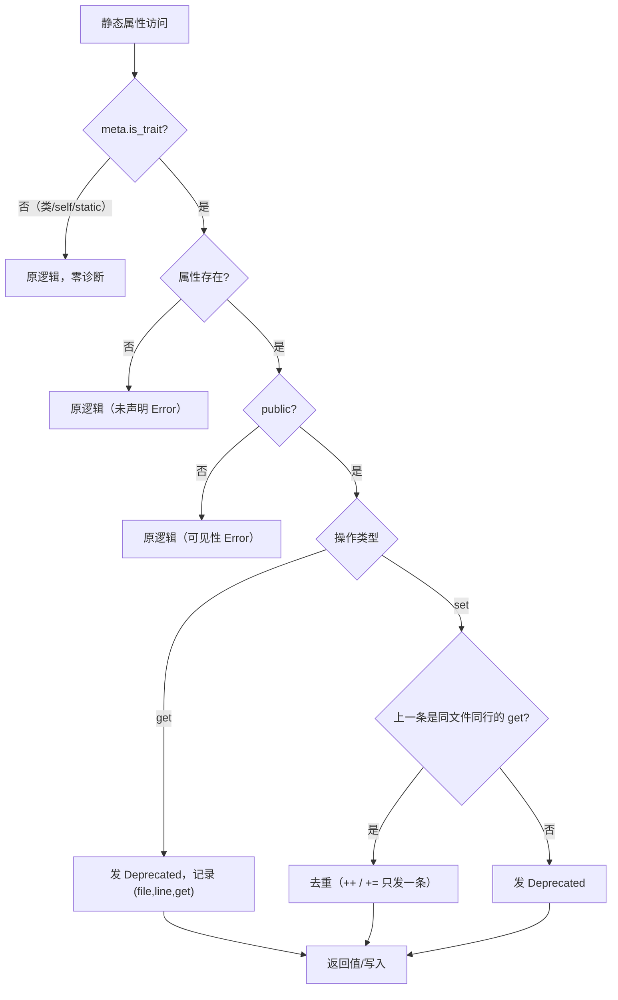
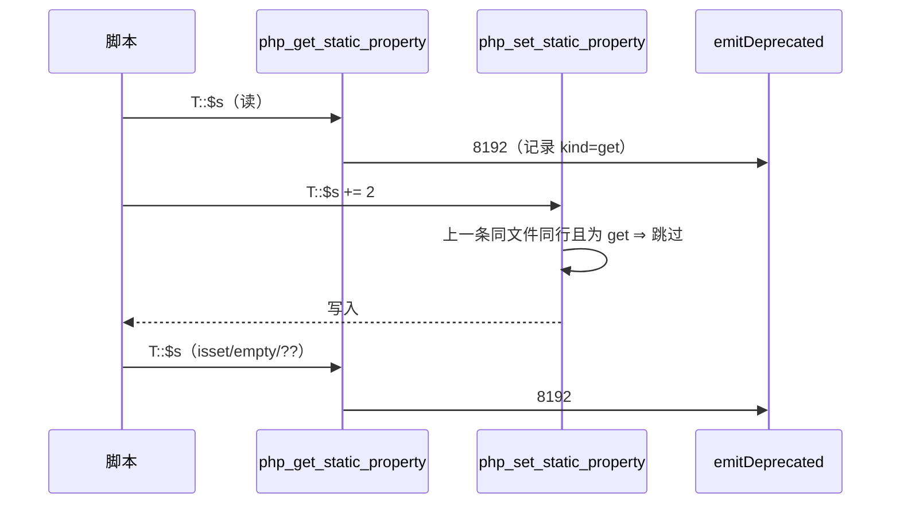

# AOT-CODEGEN-012 R-225：直接以 trait 名访问静态属性的弃用（F-74-b 闭环）

- 日期：2026-10-22（R-225；F-74-b 闭环；F-141/F-142 新立；纯模板）
- 代次锚：`tpl b53381a63d4b993c738d674a21abe58e`／`nlk 5e7d0cc46139a4ffc30f2201e2a5da1a`／`irg f260626e…`／`opt 745e4bd4…`／`parser 70e80f18…`／`ir 1fb6b01f…`
- 状态：全部**未提交**

## 1. 高层摘要（TL;DR）

PHP 8.x 中直接以 trait 名访问静态属性（`T::$s`）每次访问都会发一条 E_DEPRECATED；AOT 之前值正确但零诊断。本批在运行期静态属性 get/set 入口识别 `meta.is_trait`，仅在“属性存在且 public”时发同款弃用，并对 `T::$s++`/`+=` 的 get+set 双调用按同文件同行去重。纯模板改动，生成码零变化。

- C275 扩至 13 臂：自证 13 CF，实跑 **13/13 SAME**。
- 探针 `d`（八形）/`m1`/`h`/`undef` 全字节 SAME；`zig build test` 326/326。

## 2. 影响范围

| 维度 | 影响 |
|---|---|
| 语义面 | 直接 trait 静态属性访问的 Deprecated（读/写/`++`/`+=`/isset/empty/`??`/动态类名）；类侧与 self/static 不受影响 |
| 生成码 | 无（纯模板） |
| 运行期 | 仅在 `meta.is_trait` 时多做一次属性查找；普通类静态访问立即返回 |
| 未覆盖 | private/protected 从外部访问的过接受（F-141）；未声明静态属性的 isset/empty fatal（F-142） |

## 3. 核心变更

| # | 位置（tpl） | 变更 |
|---|---|---|
| 1 | `noteTraitStaticPropertyAccess`（新增） | `meta.is_trait` ∧ 属性存在 ∧ public 才发；消息与 PHP 同款 |
| 2 | `php_get_static_property` | 在“存在且可见”分支调用（from_get=true） |
| 3 | `php_set_static_property` | 属性存在时调用（from_get=false）；同文件同行的紧邻 get 已发则去重 |
| 4 | 门 C275 | 10→13 臂：t11 handler、t12 `@`、t13 直接 `+=`/isset/empty/`??` |

## 4. 可视化概览（Code & Logic Map）

## 5. 详细变更分析

| 层 | 位置 | 说明 |
|---|---|---|
| 模板 | `php_get_static_property` | 属性存在后、retain 前发弃用 |
| 模板 | `php_set_static_property` | 属性存在时发；同位置 get 去重 |
| 模板 | `noteTraitStaticPropertyAccess` | public 门控 + 去重状态（threadlocal） |
| 门 | `c275_trait_static_gate_tmp.sh` | 13 臂；`/bin/false` 自证；TSV 逐臂 |
| 探针 | `/tmp/f74b/d,e,h,priv,undef,scope,prot,cpriv` | 正向全 SAME；private/protected 暴露 F-141；未声明 isset 暴露 F-142 |

**关键约束**
- 仅 public：PHP 对 private/protected 的 `T::` 访问只报 Error、不发弃用（trait 方法内亦然）。
- 去重只在 set 侧、且紧邻上一条为同文件同行的 get ⇒ 循环内纯读不受影响；`++`/`+=` 恰好一条。
- 未声明属性路径不进入弃用分支（PHP 同样不发）。

## 6. 影响与风险评估

| 项 | 结论 |
|---|---|
| 是否破坏式变更 | 否（C275 13/13；探针正向全 SAME；326/326 单测） |
| 生成码 | 无变化 |
| 影子 | 纯模板、非 trait 立即返回 ⇒ 按加速策略跳过 |
| 回归 | 跳过（同上；F-74 面语料 0 枚） |
| 编译/测试 | `zig build` rc=0；`zig build test` 21/21、326/326 |
| 风险 | 去重按 (file,line) 且只抑制 set；同行“先读后写两条独立语句”会少发一条（极窄，登记边界） |

**复测路径**：C275（自证 13 CF）→ 13/13 → `zig build test`。

## 7. 遗留问题 / 潜在问题

1. **F-141（P1，既存）**：外部访问 private/protected 静态属性被过接受（trait 与普通类），根因＝每次静态访问都套 `ClassContext(target)`。
2. **F-142（P1，既存）**：`isset()/empty()` 未声明静态属性 ⇒ AOT 未捕获 fatal，PHP false/true；isset 路径复用了会 throw 的 get。
3. 去重的同文件同行边界（见 §6 风险）。
4. 未声明静态属性的**赋值**（`T::$nope = 1`）行为未测/未改（可能同样过接受），归入 F-142 同族后续取证。

## 8. 后续开发 / 优化建议

| 优先级 | 建议 | 影响面 | 落地成本 |
|---|---|---|---|
| P1 | F-141：静态访问的 ClassContext 只在合法类作用域内套用（可见性恢复） | 访问控制语义 | 中（动发射器） |
| P1 | F-142：isset/empty 的静默静态读取变体（缺失返回 false，不 throw） | isset 语义 | 中 |
| P1 | F-95-c-b：类常量非折叠初始化器 | 类常量语义 | 中 |
| P2 | 里程碑批：C264–C275 挂母链 ＋ 全量影子归因 | 验收链 | 低 |
