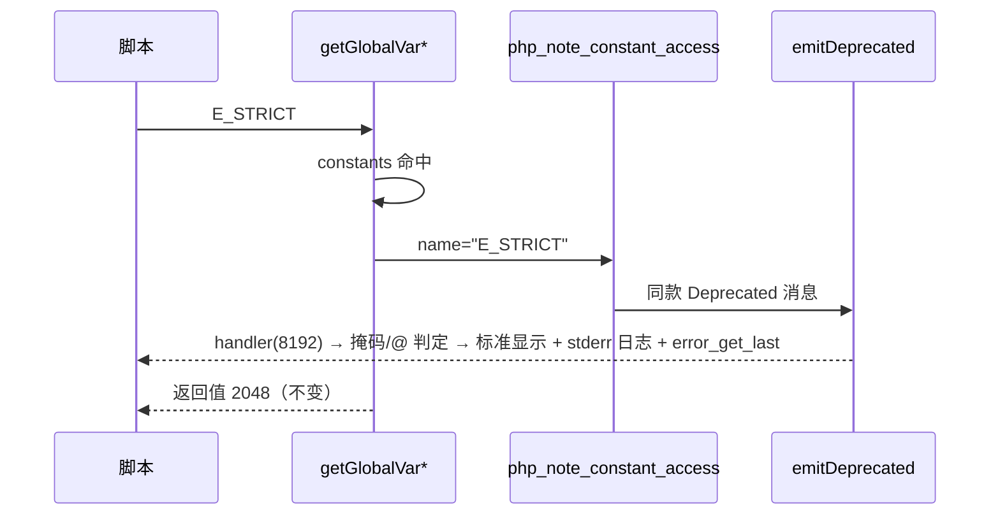

# AOT-CODEGEN-012 R-222：F-95-c E_STRICT 使用弃用告警

- 日期：2026-10-22（R-222，F-95-c 闭环；按加速策略验证）
- 代次锚：`nlk f987285cf7cda1cb34c4d03540b6e082`／`tpl cb5389167696669cefdaa8a2aeb93426`／`irg f260626e…`／`opt 745e4bd4…`／`parser 70e80f18…`／`ir 1fb6b01f…`
- 状态：全部**未提交**

## 1. 高层摘要（TL;DR）

PHP 8.4 移除 `E_STRICT` 错误级别后，**使用该常量本身**会在每次读取时发一条 `E_DEPRECATED`。AOT 之前静默返回 `2048`。本批在模板与生成码的常量命中点接入 `php_note_constant_access`，覆盖裸读取、`constant()`、拼接（`getGlobalVarNoWarn`）三条路径，同时保持 `defined()` 静默与常量值不变。

- 新门 C273（10 臂）补点前 9/10（e9 漏拼接路径），补齐后 **10/10 SAME（stdout/stderr/rc 逐字节）**。
- 主回归按策略跑一次全量（本批触及生成码）；`zig build test` 326/326。

## 2. 影响范围

| 维度 | 影响 |
|---|---|
| 语义面 | `E_STRICT` 的每次实际读取多一条 Deprecated；值、掩码、handler、`@`、`error_get_last` 均与 PHP 一致 |
| 生成码 | `getGlobalVar`＋`getGlobalVarNoWarn` 的常量命中分支各 +1 行调用 |
| 运行期 | 每次常量命中多一次长度比较的小函数调用（无分配）；`E_STRICT` 之外零输出 |
| 未覆盖 | 常量表达式语境（默认参数/`const` 初始化）待补测；`defined()` 刻意不告警 |

## 3. 核心变更

| # | 位置 | 变更 |
|---|---|---|
| 1 | `tpl` | 新增 `php_note_constant_access(name)`：`name=="E_STRICT"` ⇒ `emitDeprecated("Constant E_STRICT is deprecated since 8.4, the error level was removed")` |
| 2 | `tpl` `php_constant_get` | 常量命中分支调用上述 helper（覆盖 `constant("E_STRICT")`） |
| 3 | `nlk` 生成 `getGlobalVar` | 常量命中分支调用 helper（裸读取） |
| 4 | `nlk` 生成 `getGlobalVarNoWarn` | 常量命中分支调用 helper（拼接路径；e9 暴露的漏点） |
| 5 | 门 C273 | 10 臂：单读/双读/`constant`+`defined`/掩码/`handler`/`@`/小写守卫/多行行号/表达式/掩码恢复 |

## 4. 可视化概览（Code & Logic Map）

```mermaid
flowchart TD
  A["表达式中的 E_STRICT"] --> B{"读取形态"}
  B -->|裸读取| C["getGlobalVar"]
  B -->|constant()| D["php_constant_get"]
  B -->|参与 . 拼接| E["getGlobalVarNoWarn"]
  C --> F{"constants 命中?"}
  D --> F
  E --> F
  F -->|是| G["php_note_constant_access(name)"]
  G --> H{"name == E_STRICT?"}
  H -->|是| I["emitDeprecated（路由 handler → 掩码/@ 门控显示 → 记录 last_error）"]
  H -->|否| J["静默"]
  F -->|否| K["原逻辑（未定义常量 fatal / 变量查找）"]
  L["defined() / globalVarIsDefined / getGlobalVarPtrRaw"] --> M["刻意不告警"]
```



## 5. 详细变更分析

| 层 | 文件/位置 | 说明 |
|---|---|---|
| 模板 | `src/aot/runtime_lib_template.zig:9222` | `php_note_constant_access`（长度比较优先，仅 E_STRICT 走诊断） |
| 模板 | `src/aot/runtime_lib_template.zig:9234` | `php_constant_get` 常量命中分支接线 |
| 生成码模板 | `src/aot/native_linker.zig:2096` | `getGlobalVar` 常量命中分支接线 |
| 生成码模板 | `src/aot/native_linker.zig:2146` | `getGlobalVarNoWarn` 常量命中分支接线 |
| 门 | `fuzzy_scripts_720/tmp/c273_estrict_gate_tmp.sh` | 10 臂；`/bin/false` 自证；TSV 逐臂 stdout/stderr/rc |

**关键约束**
- 诊断必须在**实际读取**时发：`defined()` 不触发，`constant()` 触发；掩码/`@`/handler 三态由既有 `emitDeprecated` 管线天然保证。
- 常量值不变（2048），`E_STRICT | E_ALL`＝32767 等表达式由门 e9 守卫。
- `getGlobalVarNoWarn` 是拼接降级路径（R-177/F-73）的入口，任何常量读取钩子必须**两个 helper 都接**。

## 6. 影响与风险评估

| 项 | 结论 |
|---|---|
| 是否破坏式变更 | 否（C273 10/10；探针逐字节；326/326 单测） |
| 生成码 | 两个生成 helper 各 +1 行；常量命中行为除诊断外不变 |
| 影子 | 按加速策略跳过；漂移成因明确（helper 单点新增调用行） |
| 回归 | **PASS=68 FAIL=0**，`SELF_CHECK_OK rows=68 uniq=68`（本批触及生成码，按策略跑一次全量） |
| 编译/测试 | `zig build` rc=0；`zig build test` 21/21、326/326 |
| 风险 | 常量表达式语境（默认参数/`const` 初始化）尚未覆盖，可能仍静默；登记待测 |

**复测路径（加速版）**：C273（自证 10 CF）→ 实跑 10/10 → `zig build test` → 主回归（本批一次）。

## 7. 遗留问题 / 潜在问题

1. **F-95-c-b（P1，既存缺陷，非本批引入）**：类常量初始化器含不可编译期折叠值（`const A = E_ALL;`／`const A = E_STRICT;`）⇒ 类常量未注册，使用点报 `Access to undeclared static property K1::$A`（PHP rc=0、AOT rc=255）。`p3`/`cc` 探针实测；默认参数与全局 `const` 两形已 SAME。修复时还须补“类常量使用点发 E_STRICT Deprecated”（行号＝使用行）。
2. 每次常量命中的 helper 调用可微优化（`pub inline fn` 或只在字面量 `"E_STRICT"` 调用点发射），需实测热路径后定，避免凭感觉改发射器。
3. `E_STRICT` 作为类常量名/属性名（如 `Foo::E_STRICT`）不属于本面，不告警（PHP 亦不告警）。

## 8. 后续开发 / 优化建议

| 优先级 | 建议 | 影响面 | 落地成本 |
|---|---|---|---|
| P1 | F-95-c-b：类常量非折叠初始化器注册（＋类常量使用点 E_STRICT 告警） | 类常量语义、诊断一致性 | 中（需运行期注册或使用点求值） |
| P2 | 里程碑批：C264–C273 挂母链 ＋ 全量影子归因 | 验收链 | 低 |
| P2 | 常量命中热路径微优化（先测再改） | 性能 | 低 |
| P1 | F-95-d2＋F-98：`global_get`/handler 异常路由结构批 | 可捕获性 | 中高 |
