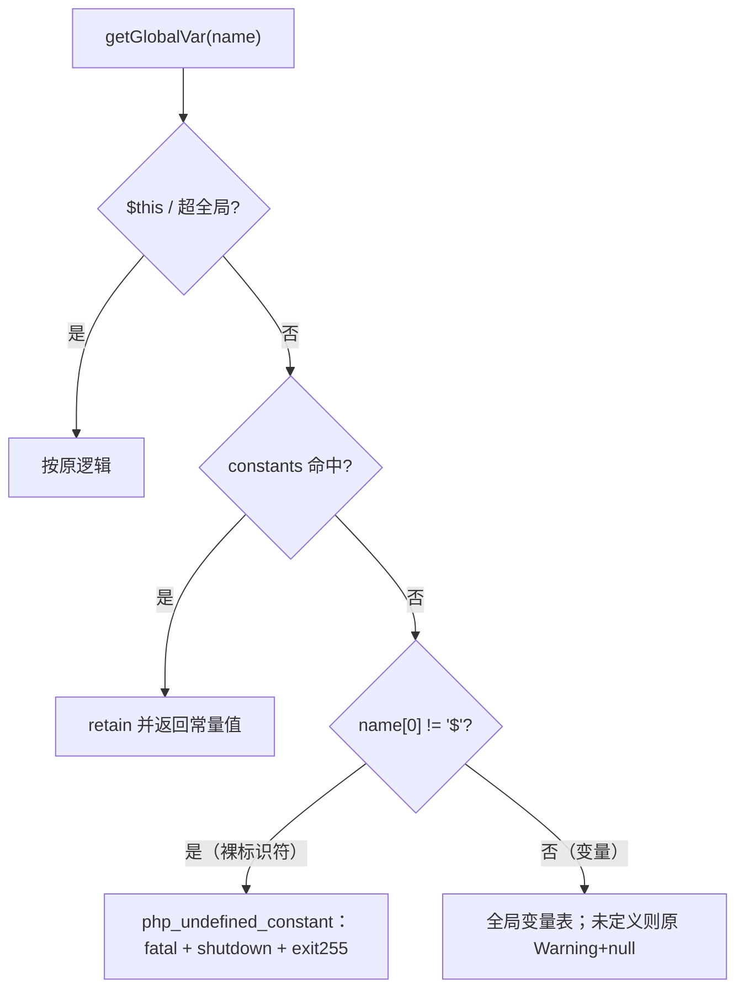
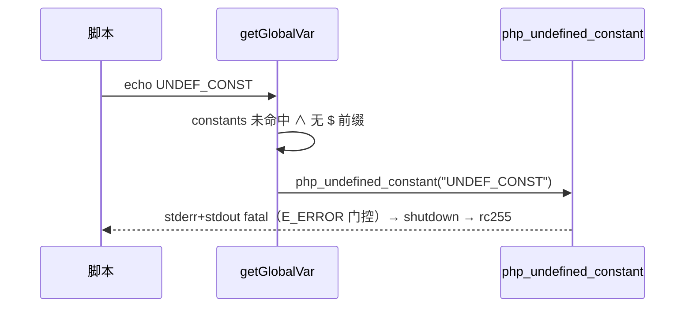

# AOT-CODEGEN-012 R-221：F-95-d 未定义常量 fatal（生成码单点）

- 日期：2026-10-22（R-221，F-95-d 主面闭环；F-95-d2 新立）
- 代次锚：`nlk 500d7ea7bb11a5834ff5727a3e3ea038`／`tpl e46c11f7f10d2f7699bf2f0b838557fa`／`irg f260626e…`／`opt 745e4bd4…`／`parser 70e80f18…`／`ir 1fb6b01f…`
- 状态：全部**未提交**

## 1. 高层摘要（TL;DR）

裸标识符 `UNDEF_CONST` 读此前被当成未定义变量（Warning + null），而 PHP 是 `Error: Undefined constant`（未捕获即 fatal）。根因在生成的 `getGlobalVar`：常量表未命中后直接走全局变量。修法是在“常量表未命中且名字不以 `$` 开头”时分流到新模板函数 `php_undefined_constant`，按 PHP 文案输出双流 fatal、执行 shutdown、rc=255。

- 新门 C272（10 臂）全绿；`uc`/`const1` 探针逐字节 SAME；主回归 68/68；build test 326/326。
- 遗留：可捕获性（`try/catch(Error)`）需 `global_get` 调用点异常路由，另立 F-95-d2。

## 2. 影响范围

| 维度 | 影响 |
|---|---|
| 语义面 | 未定义裸常量从“Warning+null”变“Error fatal”（未捕获形） |
| 生成码 | 每文件 `getGlobalVar` 内 +1 行常量判定（变量路径不变） |
| 运行期 | 每次全局/常量读多一次 `name[0] != '$'` 判定（常量表命中前不额外分配） |
| 未覆盖 | try/catch 捕获 Error；函数内 fatal 的栈帧格式（宪法允许忽略） |

## 3. 核心变更

| # | 位置 | 变更 |
|---|---|---|
| 1 | `tpl` | 新增 `php_undefined_constant(name) noreturn`：E_ERROR 门控双流 fatal（PHP 同款文案）＋shutdown＋exit(255) |
| 2 | `nlk` 生成的 `getGlobalVar` | 常量表未命中且 `name[0] != '$'` ⇒ 调用上述函数（在全局变量查找之前） |
| 3 | 门 C272 | 10 臂（未定义/define/const/内置/函数作用域/掩码/fatal 后 shutdown/关键字/运算/`@`） |

## 4. 可视化概览（Code & Logic Map）

## 5. 详细变更分析

| 层 | 文件/位置 | 说明 |
|---|---|---|
| 模板 | `src/aot/runtime_lib_template.zig` | 新 fatal helper（复用 fatalDisplayEnabled/php_run_shutdown_functions） |
| 生成码模板 | `src/aot/native_linker.zig` `getGlobalVar` 字符串 | 常量未命中后分流；变量语义完全不变 |
| 门 | `fuzzy_scripts_720/tmp/c272_undefined_const_gate_tmp.sh` | 10 臂 stdout/stderr/rc 比对；`/bin/false` 自证 |

**关键约束**
- 判定依据是“名字是否以 `$` 开头”：AOT parser 给变量加 `$`，裸标识符只可能是常量/关键字。
- 必须放在常量表查询**之后**、全局变量查询**之前**，已定义常量的行为不变。
- fatal 文案与 R-218 的五处一致（E_ERROR 门控），shutdown 语义与 R-219 一致。

## 6. 影响与风险评估

| 项 | 结论 |
|---|---|
| 是否破坏式变更 | 否（主回归 68/68；C271/C269/C270/C272 全绿；const1 已定义常量 SAME） |
| 生成码 | `getGlobalVar` 内 +1 行；单文件核对 |
| 影子 | 按加速策略跳过；漂移成因明确（生成函数单点新增一行） |
| 回归 | PASS=68 FAIL=0；`SELF_CHECK_OK`（本批触及生成码，跑一次全量） |
| 编译/测试 | 21/21、326/326、rc=0 |
| 风险 | 若存在“裸标识符本意是变量”的 AOT 特例会被改成 fatal；但 PHP 语义本就不允许，回归 68/68 佐证语料无此形 |

**复测路径（加速版）**：C272（自证 10 CF）→ C271/C269/C270 → 主回归（本批一次）→ `zig build test`。

## 7. 遗留问题 / 潜在问题

1. **F-95-d2（P2）**：`try { echo UNDEF; } catch (Error $e)` 可捕获性未实现——需要 `global_get` 调用点异常路由（与 F-86-d2 同型结构批），当前只给未捕获等价形。
2. 函数内未定义常量的 fatal 栈帧与 PHP 不同（缺调用帧），属宪法允许忽略项；C272 u5 因此改为函数作用域常量解析。
3. 加速策略下本批未跑影子；里程碑批补全量影子/归因。

## 8. 后续开发 / 优化建议

| 优先级 | 建议 | 影响面 | 落地成本 |
|---|---|---|---|
| P2 | F-95-d2＋F-98：`global_get`/handler 异常路由结构批 | 常量可捕获性、handler 异常传播 | 中高 |
| P2 | 里程碑批：C264–C272 挂母链 + 全量回归/影子 | 验收链 | 低 |
| P2 | 其余 P2 缺口按门覆盖率排序（F-95-c E_STRICT 使用告警等） | 诊断一致性 | 低 |
