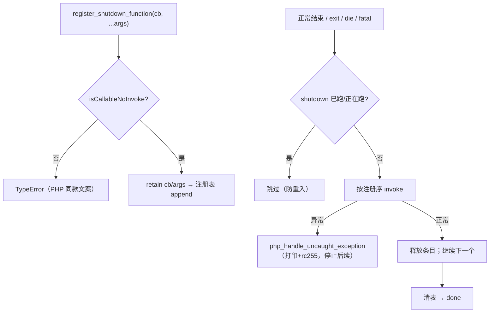
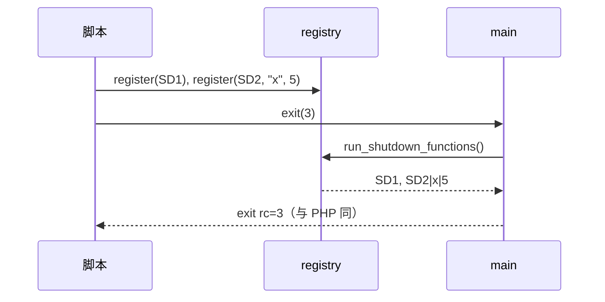

# AOT-CODEGEN-012 R-219：F-96 register_shutdown_function（加速策略首轮）

- 日期：2026-10-22（R-219，F-96 闭环；F-96-b / F-96-c 新立）
- 代次锚：`nlk 8e96c0409a345da725dfb760cd73a71c`／`tpl 5679e418a6477121ff67243859c0a35b`／`irg f260626e…`／`opt 745e4bd4…`／`parser 70e80f18…`／`ir 1fb6b01f…`
- 状态：全部**未提交**

## 1. 高层摘要（TL;DR）

`register_shutdown_function()` 在 AOT 从“未定义函数”变为完整实现：注册表按序保存可调用值与参数；正常结束、`exit`/`die`、五类 fatal（显示态与静默态）统一触发；回调抛异常时停止后续并按未捕获 fatal 收场。顺带修正 `die("msg")` 不打印消息、以及注册期复用 `is_callable` 会**执行**可调用体的副作用。

- 新永久门 C270（12 臂）全绿；C266–C269 全绿；按老铁加速策略，本批**只跑定向门 + 末次全量回归**，未跑整批影子归因，生成码变化用单文件核对（每文件 +2 行）。
- 主回归 68/68（本批末次全量）、`zig build test` 326/326。

## 2. 影响范围

| 维度 | 影响 |
|---|---|
| 语义面 | shutdown 注册/执行/顺序/参数/嵌套注册/数组与静态可调用；exit/die 保 rc；fatal 后仍执行 |
| 诊断面 | 非可调用注册 → PHP 同款 TypeError 文案；die 字符串消息补打印 |
| 生成码 | 每文件 +1 行内置名注册表项 +1 行 main 尾 `runtime.php_run_shutdown_functions();`（哈希序重排属等价） |
| 运行期 | 注册表惰性分配；无注册时正常退出仅一次布尔判断 |
| 未覆盖 | 回调抛异常的栈帧格式（F-96-b）、`is_callable` 副作用（F-96-c）、零实参 ArgumentCountError |

## 3. 核心变更

| # | 位置 | 变更 |
|---|---|---|
| 1 | `tpl` | `ShutdownEntry` + `shutdown_entries`/`shutdown_done`/`shutdown_running`；`php_register_shutdown_function(callable, rest, allocator)` |
| 2 | `tpl` | `isCallableNoInvoke`：无副作用校验（函数名/Class::method/数组/闭包对象），规避 `php_is_callable` 的 AOT hook 执行副作用 |
| 3 | `tpl` | `php_run_shutdown_functions`：按序 invoke、异常即走 `php_handle_uncaught_exception`、结束后释放并清表；防重入 |
| 4 | `tpl` | 出口挂钩：生成 main 尾、`php_exit`（含 die 字符串打印）、五处 fatal 的显示/静默两态 |
| 5 | `nlk` | 内置表登记（变参 slice 包装复用 `php_sprintf` 分支）；main 模板尾部新增调用行 |
| 6 | 门 C270 | 12 臂（正常/exit/die/fatal/TypeError/嵌套/闭包/数组/静态/重复/未捕获/无注册守卫） |

## 4. 可视化概览（Code & Logic Map）

## 5. 详细变更分析

| 层 | 文件/位置 | 说明 |
|---|---|---|
| 模板 | `src/aot/runtime_lib_template.zig` | 注册表/运行器/无副作用判定/出口挂钩 |
| 发射器 | `src/aot/native_linker.zig` | 内置表 1 条 + 两处变参 OR + main 尾 1 行 |
| 门 | `fuzzy_scripts_720/tmp/c270_shutdown_gate_tmp.sh` | 12 臂 stdout/stderr/rc 比对；`/bin/false` 自证 |

**关键约束**
- 注册期不能调用 `php_is_callable`（其 hook 会执行目标）；用 `isCallableNoInvoke`。
- `exit`/`die` 的字符串状态要先写 stdout，再跑 shutdown，再以 0 退出；整数状态保 rc。
- fatal 的**显示**可能被 error_reporting 掩掉，但 shutdown 必须照跑；回调内异常时不再递归执行。

## 6. 影响与风险评估

| 项 | 结论 |
|---|---|
| 是否破坏式变更 | 否（定向门 C266–C270 全绿；主回归 68/68） |
| 生成码 | +2 行/文件（注册表项 + main 调用）；单文件核对通过 |
| 影子 | **按加速策略跳过**；漂移成因已由生成码核对确定（与 R-218 同族：内嵌注册表 + 哈希序） |
| 回归 | PASS=68 FAIL=0；`SELF_CHECK_OK`（本批末次全量） |
| 编译/测试 | 21/21、326/326、rc=0 |
| 风险 | shutdown 在 fatal 路径执行可能受 error_reporting/异常状态影响；已在显示/静默两态挂钩并用 C270 s4/s11 覆盖 |

**复测路径（加速版）**：C270（自证 12 CF）→ C266–C269 → `zig build test`；全量回归留待里程碑批。

## 7. 遗留问题 / 潜在问题

1. **F-96-b（P2）**：shutdown 回调抛异常的栈帧格式与 PHP 不同（多 `[internal function]` 帧）；语义/rc 一致，属宪法允许忽略项。
2. **F-96-c（P2，既有）**：`php_is_callable` 对字符串可调用的 AOT hook 会**执行**目标（实测 `is_callable("K2::m")` 跑了一次方法）；注册路径已绕开，`is_callable()` 本身仍带副作用。
3. 零实参 `register_shutdown_function()` 的 ArgumentCountError 未实现。
4. 加速策略下的验证缺口：本批未跑整批影子；里程碑批需补一次全量影子 + 多重集归因。

## 8. 后续开发 / 优化建议

| 优先级 | 建议 | 影响面 | 落地成本 |
|---|---|---|---|
| P2 | F-95-b：其余 fatal 站点统一 E_ERROR 门控 | 诊断一致性 | 低中 |
| P2 | F-97 `error_get_last()` | 错误处理 API | 中 |
| P2 | 里程碑批：C264–C270 挂进母链 + 全量影子/回归 | 验收链 | 低 |
