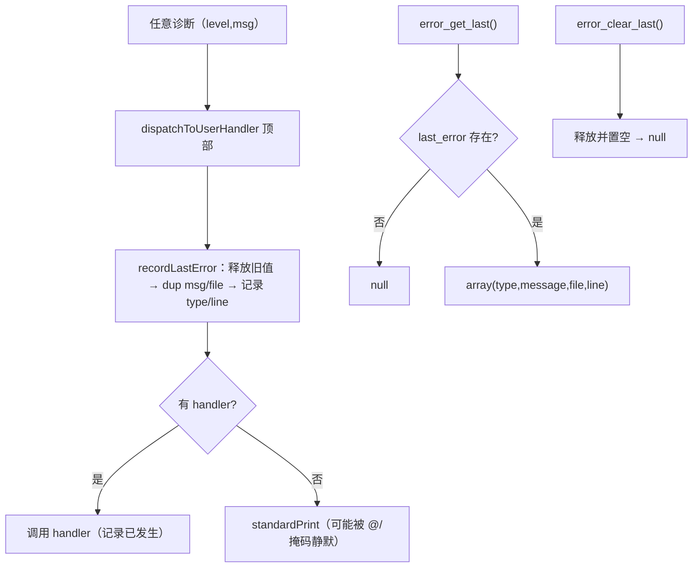
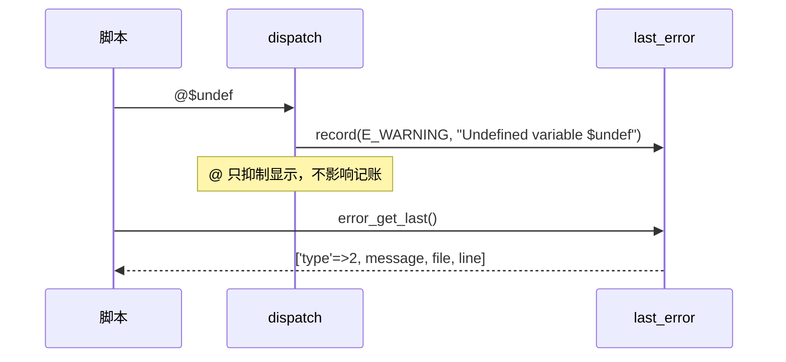

# AOT-CODEGEN-012 R-220：F-97 error_get_last／error_clear_last（加速档）

- 日期：2026-10-22（R-220，F-97 闭环）
- 代次锚：`nlk e02f4b797479d34b4aa3f0cf2dfcc3f4`／`tpl 98659caee374cb13ba2132e04a730445`／`irg f260626e…`／`opt 745e4bd4…`／`parser 70e80f18…`／`ir 1fb6b01f…`
- 状态：全部**未提交**

## 1. 高层摘要（TL;DR）

`error_get_last()` 从“恒 null 的 stub”变为真实账本：所有诊断（含 `@` 抑制、handler 接管、error_reporting 掩码静默）都记录 `type/message/file/line`；`error_clear_last()` 清空。实现点选在 `dispatchToUserHandler` 顶部，一次覆盖全部诊断路径。原同名 stub 已删除（否则 duplicate symbol）。

- 新门 C271（11 臂）全绿；关联门 C269/C270 全绿；`zig build test` 326/326。
- 按加速策略：未跑全量回归/影子（模板＋内置表 2 行），留待里程碑批。

## 2. 影响范围

| 维度 | 影响 |
|---|---|
| 语义面 | `error_get_last` 四键返回值；`error_clear_last` 清空；记录与显示/处理器/掩码解耦 |
| 生成码 | 每文件 +2 行内置名注册表项（哈希序重排属等价） |
| 运行期 | 每次诊断 dup message/file（覆盖时释放）；无诊断时零开销 |
| 未覆盖 | E_ERROR/fatal 是否入账、F-98 handler 内异常传播 |

## 3. 核心变更

| # | 位置 | 变更 |
|---|---|---|
| 1 | `tpl` | `LastError` 账本＋`recordLastError`（先释放旧值再 dup 新值） |
| 2 | `tpl dispatchToUserHandler` | 顶部无条件 `recordLastError(level,msg)`（所有诊断路径的必经点） |
| 3 | `tpl` | `php_error_get_last(allocator)` 组装四键数组；`php_error_clear_last()` 释放并置空 |
| 4 | `tpl` | 删除“返回 null”的同名 stub |
| 5 | `nlk` | 内置表登记 `error_get_last`（needs_allocator）/`error_clear_last` |
| 6 | 门 C271 | 11 臂（初始/字段/clear/`@`/handler/掩码/notice/deprecated/trigger_error/覆盖/重复 clear） |

## 4. 可视化概览（Code & Logic Map）

## 5. 详细变更分析

| 层 | 文件/位置 | 说明 |
|---|---|---|
| 模板 | `src/aot/runtime_lib_template.zig` | 账本/两个 API/stub 删除/dispatch 记账 |
| 发射器 | `src/aot/native_linker.zig` | 内置表 2 条 |
| 门 | `fuzzy_scripts_720/tmp/c271_error_get_last_gate_tmp.sh` | 11 臂 stdout/stderr/rc 比对；`/bin/false` 自证 |

**关键约束**
- 记账必须发生在 `@`/掩码/handler 判定**之前**（PHP 实测三态都记录）。
- message 是**裸消息**，不带 `PHP Warning:` 前缀。
- 覆盖旧错误时先释放旧 message/file，避免每次诊断泄漏。

## 6. 影响与风险评估

| 项 | 结论 |
|---|---|
| 是否破坏式变更 | 否（C271/C269/C270 全绿；build test 326/326） |
| 生成码 | +2 行/文件（内置名注册表；哈希序重排属等价） |
| 影子/回归 | 按加速策略跳过，留待里程碑批 |
| 编译/测试 | 21/21、326/326、rc=0 |
| 风险 | 记账分配失败时静默丢弃（PHP 不会因记账失败改变诊断显示）；fatal 入账未接 |

**复测路径（加速版）**：C271（自证 11 CF）→ C269/C270 → `zig build test`。

## 7. 遗留问题 / 潜在问题

1. **F-98（P2）**：handler 内抛异常在 PHP 会向上传播；AOT 仍 `catch` 后按“已接管”处理。
2. fatal（E_ERROR）是否在 shutdown 内可经 `error_get_last()` 读出——PHP 行为未逐形实测，本批未接。
3. 加速策略下本批未跑全量回归/影子；里程碑批需补一次。

## 8. 后续开发 / 优化建议

| 优先级 | 建议 | 影响面 | 落地成本 |
|---|---|---|---|
| P2 | F-95-d：裸常量标识符常量解析（可捕获 Error） | 常量语义 | 中 |
| P2 | fatal 入账 `error_get_last`（与 shutdown 联测） | 错误处理 | 低 |
| P2 | 里程碑批：C264–C271 挂母链 + 全量回归/影子 | 验收链 | 低 |
