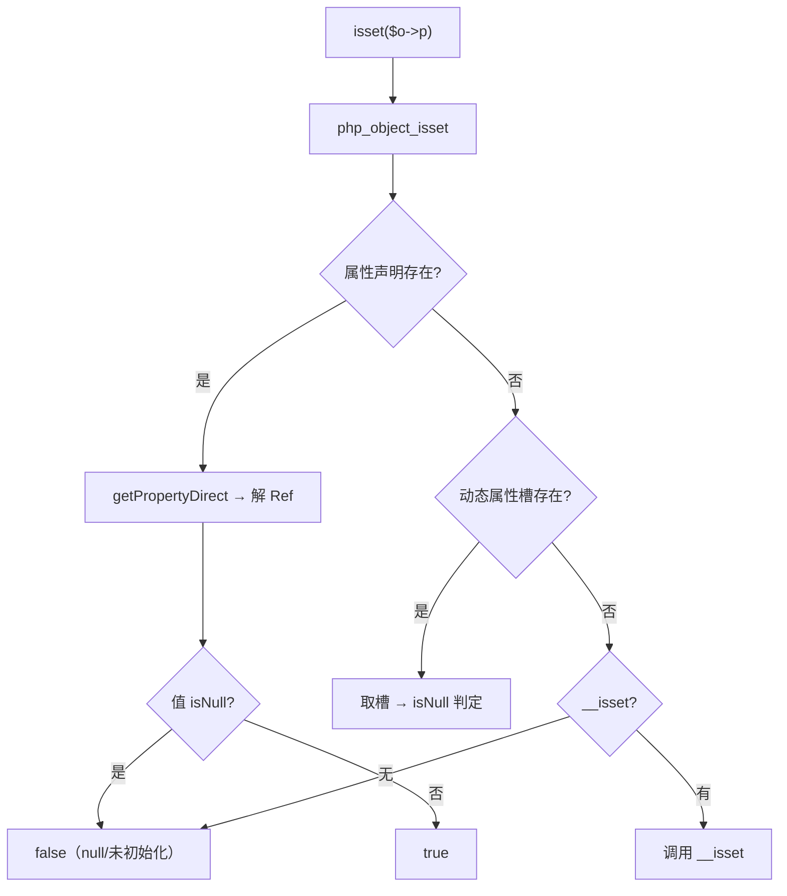
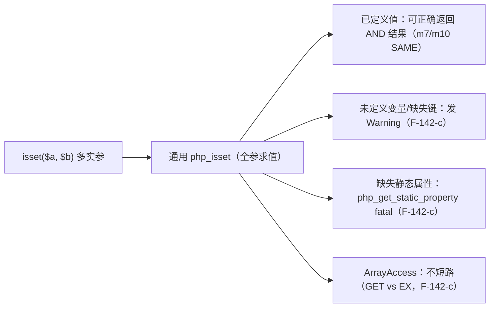

# AOT-CODEGEN-012 R-230：对象属性 isset 判值（F-143 闭环）＋多实参 isset 尝试与撤回（F-142-c 维持开放）

- 日期：2026-10-23（R-230；F-143 闭环；F-142-c 尝试后撤回；模板＋IR 守卫）
- 代次锚：`nlk 73355c86ab98b50bd4b739d6b38b85d5`／`tpl e5950a197064fcd9eccfcd2e3e0f32d5`／`irg fa9be7d9a6c45eaefd39b54e3d0d65ce`／`opt 745e4bd4…`／`parser 70e80f18…`／`ir 1fb6b01f…`
- 状态：全部**未提交**

## 1. 高层摘要（TL;DR）

`isset($o->n)` 对**显式 null** 或 **typed 未初始化**属性应返回 false；AOT 的 `php_object_isset` 只要属性存在（声明或动态槽）就返回 true。本批改为取属性值、解 Ref、判 `!isNull()`（F-143）。同批尝试实现多实参 isset 的静默+短路（F-142-c）：2 实参可对齐，但 3+ 实参及赋值/if 上下文触发 AST-direct 发射器 `unprocessed blocks` ⇒ 撤回控制流实现，仅保留 `args.len == 1` 守卫（多实参不再只判首参），F-142-c 维持开放并以 C279 登记。

- C276 扩 12 臂全绿；C275/C277 复跑全绿；f143 探针逐字节 SAME。
- C279（F-142-c 取证门）4 SAME / 7 DIFF / **0 CF**。

## 2. 影响范围

| 维度 | 影响 |
|---|---|
| 语义面 | 对象属性 isset 的 null/未初始化判定；多实参 isset 不再只评估首参 |
| 生成码 | 对象 isset 无生成码变化（模板）；多实参 isset 的 property/variable/array 单实参特判加 len 守卫 |
| 运行期 | `php_object_isset` 取槽判空；`__isset` 路径不变 |
| 未覆盖 | 多实参 isset 的静默/短路（F-142-c）；缺失静态属性的多实参 fatal |

## 3. 核心变更

| # | 位置 | 变更 |
|---|---|---|
| 1 | 模板 `php_object_isset` | 已声明属性 `getPropertyDirect` → 解 Ref → `!isNull()`；动态属性槽同样判空 |
| 2 | IR isset 特判 | property/variable/array 三支加 `call_data.args.len == 1` 守卫（多实参交给通用 `php_isset`） |
| 3 | 门 C276 | 11→12 臂，新增 s12 对象属性 null/未初始化矩阵 |
| 4 | 门 C279 | 新建 F-142-c 取证门（11 臂，头部登记 7 枚已知红） |

## 4. 可视化概览（Code & Logic Map）

## 5. 详细变更分析

| 层 | 位置 | 说明 |
|---|---|---|
| 模板 | `php_object_isset` 声明属性分支 | 原“见声明即 true” → 取槽判空；typed 未初始化无槽 ⇒ false |
| 模板 | 动态属性分支 | 原 `contains` 即 true → 取槽判空 |
| IR | isset 单实参三支 | 仅单实参走特判；多实参走通用路径（修复“只判首参”） |
| 门 | C276 s12 | 对象动态/声明/typed 未初始化 null 矩阵 |
| 门 | C279 | 多实参 isset 取证（含 ArrayAccess 短路顺序） |

**关键约束**
- `__isset` 返回值仍直接作为 isset 结果（PHP 语义），本批只改普通属性取值判空。
- 多实参控制流需要 AST-direct 支持表达式位嵌套条件/phi；本轮实证不可行，已撤回，禁止在未改造发射器前重试。

## 6. 影响与风险评估

| 项 | 结论 |
|---|---|
| 是否破坏式变更 | 否（F-143 是语义纠正；多实参从“只判首参”改为全参求值，属纠正） |
| 生成码 | 对象 isset 无变化；多实参 isset 走通用路径（原样） |
| 影子 | 本轮触及模板＋IR 守卫 ⇒ 跑全量回归 |
| 回归 | 全量 **PASS=68 FAIL=0**、`SELF_CHECK_OK` |
| 编译/测试 | `zig build` rc=0；`zig build test` 21/21、326/326 |
| 风险 | 多实参缺失变量/键会多出 Warning（PHP 静默）；缺失静态属性仍 fatal（F-142-c） |

**复测路径**：C276（自证 12 CF）→ 12/12 → C275/C277 → C279（登记红）→ f143 探针 → `zig build test` → 主回归。

## 7. 遗留问题 / 潜在问题

1. **F-142-c（P2，开放）**：多实参 isset 的静默与短路；C279 已知红 `m1 m2 m3 m4 m5 m6 m9`。
2. AST-direct 发射器对“表达式位多分支合并”的支持不足（`unprocessed blocks`），与 F-117 同族，需独立发射器改造。
3. 缺失静态属性的多实参 isset 仍走会 throw 的 get（单实参已静默）。
4. `__isset` 返回 true 时值是否参与判空未在本批改动（PHP 以 `__isset` 结果为准）。

## 8. 后续开发 / 优化建议

| 优先级 | 建议 | 影响面 | 落地成本 |
|---|---|---|---|
| P2 | F-142-c：改为运行期短路 helper（传 thunk/描述符）或先修 AST-direct 多分支合并 | isset | 中高 |
| P1 | F-95-c-b：类常量非折叠初始化器 | 类常量 | 中 |
| P1 | F-128：checkdate 签名＋旗（需裁） | 异常路由 | 低 |
| P2 | 里程碑批：C264–C279 挂母链＋全量影子 | 验收链 | 低 |
