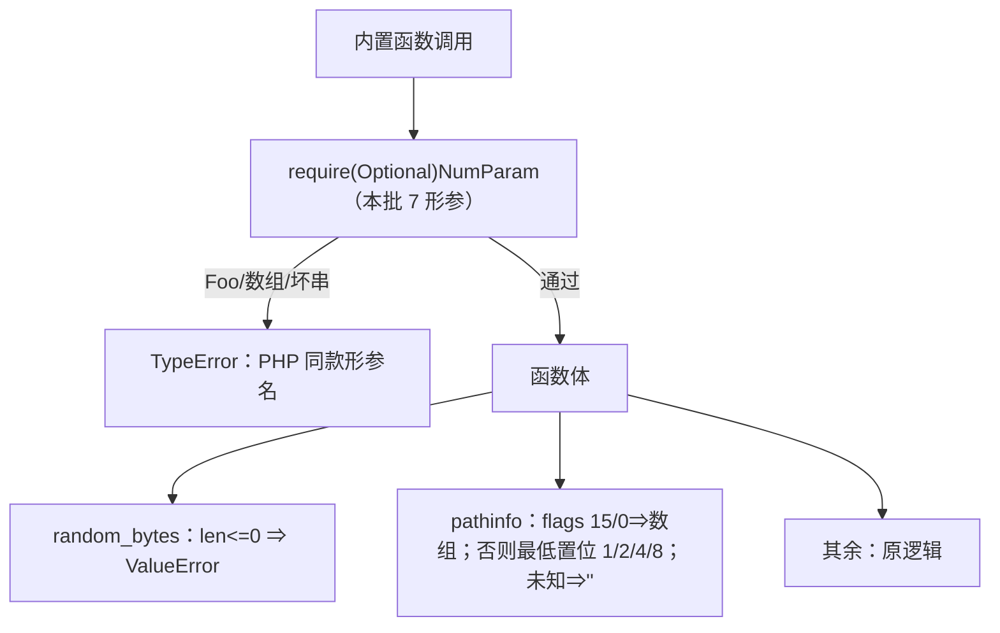
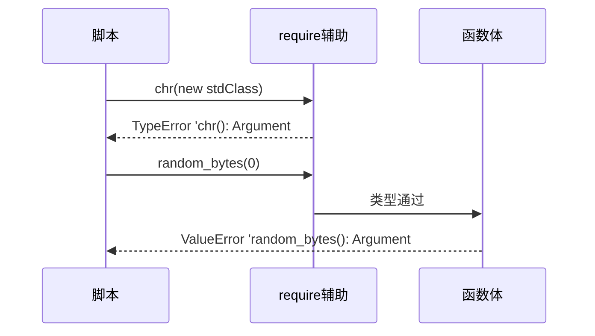

# AOT-CODEGEN-012 R-231：F-62f 第三批参数接线（chr/count_chars/json_decode/mb_strpos/pathinfo/random_bytes）

- 日期：2026-10-23（R-231；F-62f 第三批；F-144 新立；纯模板）
- 代次锚：`tpl e159a2c18d141602403badc82a33050c`／`nlk 73355c86…`／`irg fa9be7d9…`／`opt 745e4bd4…`／`parser 70e80f18…`／`ir 1fb6b01f…`
- 状态：全部**未提交**

## 1. 高层摘要（TL;DR）

按已备好的 `c210` 真值矩阵，为 6 个函数的 7 个形参接入类型拒绝（TypeError）：`chr #1`、`count_chars #2`、`json_decode #3/#4`、`mb_strpos #3`、`pathinfo #2`、`random_bytes #1`；并把 `random_bytes ≤0` 改为可捕获 ValueError、修正 `pathinfo` flags 的值语义（最低置位，15/0 ⇒ 数组）。新增 C280 门（8 臂，唯一红是已登记的“省略 vs 显式 null/0”折衷）。

- C280 自证 8 CF，实跑 **7/8 SAME**；`zig build test` 326/326。

## 2. 影响范围

| 维度 | 影响 |
|---|---|
| 语义面 | 6 函数参数类型；random_bytes 值域；pathinfo flags 值域 |
| 生成码 | 无（纯模板） |
| 运行期 | 失败路径从静默错值/外逸变为 PHP 同款 TypeError/ValueError |
| 未覆盖 | chr 越界 Deprecated（F-144）；显式 null/0 的可选参 Deprecated（F-62f-opt）；preg/srand 余量（#148） |

## 3. 核心变更

| # | 函数 | 变更 |
|---|---|---|
| 1 | `php_chr` | #1 codepoint 类型校验 |
| 2 | `php_count_chars` | #2 mode 可选校验；null/省略 ⇒ 0 |
| 3 | `php_json_decode` | #3 depth／#4 flags 可选校验；null 回落 512/0 |
| 4 | `php_mb_strpos` | #3 offset 可选校验（早退之前） |
| 5 | `php_pathinfo` | #2 flags 可选校验＋值语义（15/0 数组；最低置位；未知位 ""） |
| 6 | `php_random_bytes` | #1 类型；≤0 ⇒ ValueError |

## 4. 可视化概览（Code & Logic Map）

## 5. 详细变更分析

| 层 | 位置 | 说明 |
|---|---|---|
| 模板 | `php_chr` | 校验在 `& 0xFF` 之前 |
| 模板 | `php_count_chars` | 可选 #2；`null ⇒ 0`（与 helper 的 null 折衷一致） |
| 模板 | `php_json_decode` | 仅当 args.len 足够时校验；null 回落默认 |
| 模板 | `php_mb_strpos` | 校验在 `!isString` 早退之上（PHP 类型检查先于函数体） |
| 模板 | `php_pathinfo` | 可选 #2；flags 语义按 c210 的 0/1/2/4/8/15/16/3/7/-1 实测重写 |
| 模板 | `php_random_bytes` | 类型校验＋≤0 ValueError（复用 `throwThrowable`） |
| 门 | `c280_f62f_third_gate_tmp.sh` | 8 臂：6 函数正面＋默认形守卫＋已知红 t8 |

**关键约束**
- 所有校验置于函数体早退之前（PHP 先做形参类型检查）。
- 可选形参只做类型拒；null/省略由 helper 统一当“未提供”（显式 null 的 Deprecated 是既有折衷）。
- `pathinfo` 的 0 归 array 是发射器填 0 的调用约定折衷；显式 0 的 `""` 已登记。

## 6. 影响与风险评估

| 项 | 结论 |
|---|---|
| 是否破坏式变更 | 语义收紧：坏参从静默值/外逸变为 TypeError/ValueError |
| 生成码 | 无 |
| 影子 | 纯模板 ⇒ 生成码不变，按加速策略跳过 |
| 回归 | 全量 **PASS=68 FAIL=0**、`SELF_CHECK_OK` |
| 编译/测试 | `zig build` rc=0；`zig build test` 21/21、326/326 |
| 风险 | 合法调用不变（t7 默认形守卫）；显式 null/0 的差异已登记 |

**复测路径**：C280（自证 8 CF）→ 7/8 → `pi/p` 探针 → `zig build test` → 主回归（本批一次）。

## 7. 遗留问题 / 潜在问题

1. **F-144**：chr 越界（<0/>255）的值正确但缺 Deprecated。
2. **F-62f-opt**：省略 vs 显式 null/0 不可区分（pathinfo 0 归 array；null Deprecated 未发）。
3. **#148 余量**：preg_match/preg_match_all #4 flags／#5 offset、srand #2 mode。
4. F-62f 其余字符串类形参（mb_substr/strrchr/substr_count 等）仍需逐枚接线。

## 8. 后续开发 / 优化建议

| 优先级 | 建议 | 影响面 | 落地成本 |
|---|---|---|---|
| P2 | #148 余量：preg flags/offset＋srand mode | 正则/随机形参 | 低中 |
| P2 | F-144：chr 越界 Deprecated | 诊断一致性 | 低 |
| P1 | F-95-c-b：类常量非折叠初始化器 | 类常量 | 中 |
| P2 | 里程碑批：C264–C280 挂母链＋全量影子 | 验收链 | 低 |
