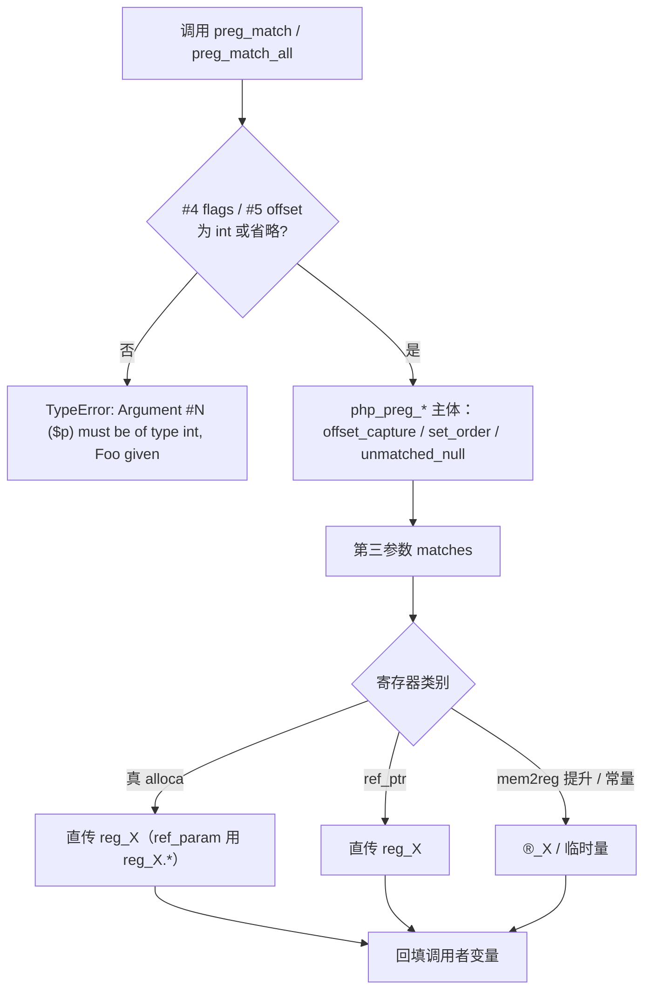
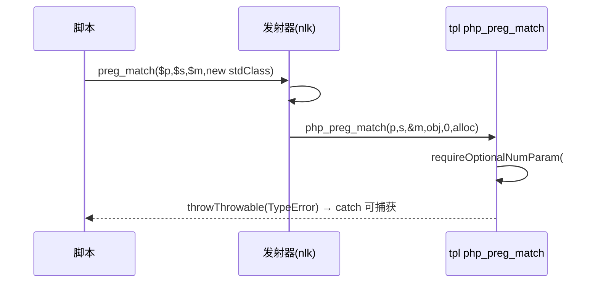

# AOT-CODEGEN-012 R-232：F-62f 第四批 —— preg flags/offset、srand/mt_srand 参数契约，及闭包内 byref 回填

- 日期：2026-10-23（R-232；F-62f 第四批；新立 F-145）
- 代次锚：`nlk 4700b644a42ffb5bd494da06681b0b0f`／`tpl 7320db321a0b631e73ee293be7b1b081`／`irg fa9be7d9a6c45eaefd39b54e3d0d65ce`／`opt 745e4bd4bbb77258fbd5de58629d8684`／`parser 70e80f18a2c6ef6787b4c5d817c31773`／`ir 1fb6b01f9b0bdff318de496538e7620e`
- 状态：**分段**——preg #4/#5 的模板校验已随 `5fbbd7c`（2026-10-23 08:56）入库；本批余下（builtin_map 对齐、闭包 byref 发射、srand/mt_srand 统一）**未提交**

## 1. 高层摘要（TL;DR）

`preg_match`／`preg_match_all` 的 `#4 $flags`、`#5 $offset` 与 `srand`／`mt_srand` 的 `#1 ?int $seed`、`#2 int $mode` 此前被当裸 int 直读（对象静默转 0）。本批按 PHP 8.5.8 真值接线：坏类型 ⇒ 同文案 TypeError；被忽略的 offset 与 `PREG_OFFSET_CAPTURE`／`PREG_SET_ORDER` 由维护版 `php_preg_*` 正确出值。附带两处结构修复：

1. **F-102 局部收口**：`builtin_map` 里 `preg_match`／`preg_match_all` 的重复键此前**胜者不确定**（实测 `preg_match_all` 落到旧实现，所有契约修改被静默旁路）⇒ 两条重复条目的 `runtime_name` 对齐到 `php_preg_*`，胜者不再影响语义。
2. **闭包内 byref 回填**：`preg_match(...,$m,0)` 位于 arrow/闭包体内时，`$m` 的 alloca 被 mem2reg 提升，发射器把第三参数按“指针型寄存器”直传 ⇒ 生成码 `expected *Value, found Value` 编译失败。改为只在真 alloca/ref_ptr 时直传，提升形取 `&reg_X`。

另新立 **F-145**：`srand(seed, 1)`（`MT_RAND_PHP`）的序列与 Deprecated 未实现，AOT 一律 MT19937（门 C281 的注册红）。

- 新门 C281（7 臂）实跑 **6 SAME / 1 DIFF（仅 a7＝F-145）**；自证 **7 CF**；探针除 F-145 外逐字节 SAME。
- `zig build test`：21/21 steps、326/326 tests、rc=0。

## 2. 影响范围

| 维度 | 影响 |
|---|---|
| 语义面 | preg #4/#5 坏类型 ⇒ TypeError；preg_match_all 改走维护版实现（offset/捕获 flags 生效） |
| 生成码 | `preg_match_all(...)` 调用名变 `php_preg_match_all(...)`；`srand(1)` 补第二实参；闭包内 byref 第三参数取 `&reg_X` |
| 运行期 | 每次 preg 调用多两次可选形参类型检查；srand/mt_srand 多一次 mode 检查 |
| 未覆盖 | `MT_RAND_PHP` 序列与 Deprecated（F-145）；显式 null 的 Passing-null Deprecated（F-62f-opt 同族） |
| 语料暴露 | 68 语料中仅 `f161` 使用 `preg_match_all`；无 `srand`／`mt_srand` |

## 3. 核心变更

| # | 位置 | 变更 |
|---|---|---|
| 1 | `tpl php_preg_match`／`php_preg_match_all` | 入口 `requireOptionalNumParam` #4 flags／#5 offset（int）；offset 经 `pcreSearchOffset(offset_ok,…)` |
| 2 | `tpl php_srand`／`php_mt_srand` | 抽 `applySrandArgs(fn_name, seed, mode)`；`?int seed`／`int mode`；`mt_srand` 补齐两形参 |
| 3 | `nlk` builtin_map | `srand`/`mt_srand` 声明 `handler_params=2`＋`optional_defaults`；`preg_match(_all)` 两条重复键统一到 `php_*` |
| 4 | `nlk` preg 专用发射 | 第三参数：真 alloca（含 ref_param→`reg.*`）／ref_ptr 直传，其余（mem2reg 提升/常量）取 `&reg_X` 或临时量 |
| 5 | 门 C281 | 7 臂：preg 两函数的坏参/合法 flags+offset、闭包形、srand 组、mode 接受性、省略参守卫、F-145 注册红 |

## 4. 可视化概览（Code & Logic Map）

## 5. 详细变更分析

| 层 | 文件/位置 | 说明 |
|---|---|---|
| 模板 | `runtime_lib_template.zig` `php_preg_match`／`php_preg_match_all` | 仅新增两行可选参校验；PCRE 主体与 F-90/F-116 记点不变 |
| 模板 | `runtime_lib_template.zig` `applySrandArgs` | srand/mt_srand 共用；消息里的函数名由调用方传入（各自正确） |
| 发射器 | `native_linker.zig` builtin_map | `srand`/`mt_srand` 可选参缺省：`initNull()`／`initInt(0)`；preg 重复键对齐 |
| 发射器 | `native_linker.zig` preg 专用支 | `isPointerReg` 口径替换旧的 `type==ptr or alloca`（后者把 mem2reg 提升的 ptr-typed Value 当指针） |
| 门 | `c281_preg_srand_gate_tmp.sh` | 行首空白折叠（宪法 §7.4.5）；stdout/stderr/rc 三维比对；`AOT_BIN=/bin/false` 自证 |

**关键约束**
- `php_preg_match_all` 出参结构（PATTERN_ORDER/SET_ORDER/OFFSET_CAPTURE）只在维护版实现里正确 ⇒ 必须切断重复键对旧实现的随机回落。
- 闭包内 `$m` 的 alloca 被 mem2reg 后 IR 类型仍是 `ptr`，但生成码是 `Value`；判“是否真指针”只能查 `alloca_regs`／`ref_ptr_regs`，不能看 IR 类型。
- `srand` 的 mode 只在 `MT_RAND_PHP(1)` 有语义，其余值 PHP 接受并等价 0（实测 2/3/-1/99 全为 MT19937 序列）。

## 6. 影响与风险评估

| 项 | 结论 |
|---|---|
| 是否破坏式变更 | 否：preg 合法形全 SAME；主回归 PASS=68 FAIL=0；`zig build test` 326/326 |
| 生成码 | 仅 preg_match_all 调用名、srand 省略参补位、闭包内 byref 取址三类；语料中只有 f161 命中 preg_match_all |
| 影子 | 本批为 name-table 改动 ⇒ 预期漂移；按语料普查**仅 f161 一枚**会命中（`preg_match_all`），其余 67 枚无相关符号 |
| 回归 | PASS=68 FAIL=0（c283）；PERR 邻门 **31/32**（唯一红＝既存 e4），与修前快照零转移 |
| 风险 | 旧 `preg_match_all` 运行时实现仍在文件内（不可达），不删除（需老铁批准）；F-102 其余重复键仍待裁 |

**复测路径（加速版）**：C281（自证 7 CF → 6 SAME/1 注册红）→ PERR 邻门 → 主回归（name-table 改动，跑一次）→ `zig build test`。

## 7. 遗留问题 / 潜在问题

1. **F-145（P2，新立）**：`srand`/`mt_srand` 的 `MT_RAND_PHP` 模式未实现——序列应为旧 rand（seed=1 首值 580 vs MT19937 846），且每次调用发 Deprecated（双流各一条）。
2. **F-146（P2，新立；★R-233 已闭主面）**：闭包/arrow 体内把**外层未声明**变量作为 `preg_match(_all)` 第三实参时，IR 生成器在 `ir_generator.zig`（R-232 时行号 `:7701`／`:7754`）建临时 alloca 后按 `var_registers` 缺失走 `global_set`（R-232 时 `:8125`）⇒ 写穿到全局；PHP 视其为函数局部，外层读取应为 `Undefined variable` Warning＋NULL。实测 b3/b4 两形：AOT 外层读到 `array(1){"a"}` 且无 Warning，PHP 为两流 Warning＋NULL。普通闭包局部赋值无此问题（`leak.php` 对照 SAME），仅 byref 回填路径。R-233 已把三处 byref 写回统一修好；残余 F-146-c（顶层多一条 Warning）与 F-147（函数名 `g`/`out` 与生成码局部冲突）另立，见工单 §141。
3. **F-62f-opt（沿用）**：省略 vs 显式 null 的可选形参不可区分；`preg_match` 的 #4/#5 显式 null 会补 0（与 PHP 的 Deprecated 差异）。
4. **F-102（仍待裁）**：`split` 等其余重复键胜者仍不确定；本批只对齐了 `preg_match`/`preg_match_all` 两枚。
5. **旧实现留存**：`preg_match`/`preg_match_all`（无 `php_` 前缀）两个运行时函数已无 AOT 调用点，删除需批准。
6. `srand(null)` 的随机种子路径不可逐字节比对（门只断言返回类型）。

## 8. 后续开发 / 优化建议

| 优先级 | 建议 | 影响面 | 落地成本 |
|---|---|---|---|
| P2 | F-145：实现 MT_RAND_PHP 序列＋Deprecated（双流） | srand/mt_srand mode=1 | 中 |
| P2 | F-102 甲/乙裁决：全表去重或成对编辑＋comptime 断言 | 33 行重复键、3 枚危险 | 低 |
| P2 | F-62f 余量：mb_substr/strrchr/substr_count 等字符串族形参 | 参数契约 | 低-中 |
| P2 | F-62f-opt：省略 vs 显式 null 的可区分表示（发射器哨兵） | 全可选参族 | 中 |
| P3 | 清理不可达旧 `preg_match*` 实现（需批准） | 模板体积 | 低 |
