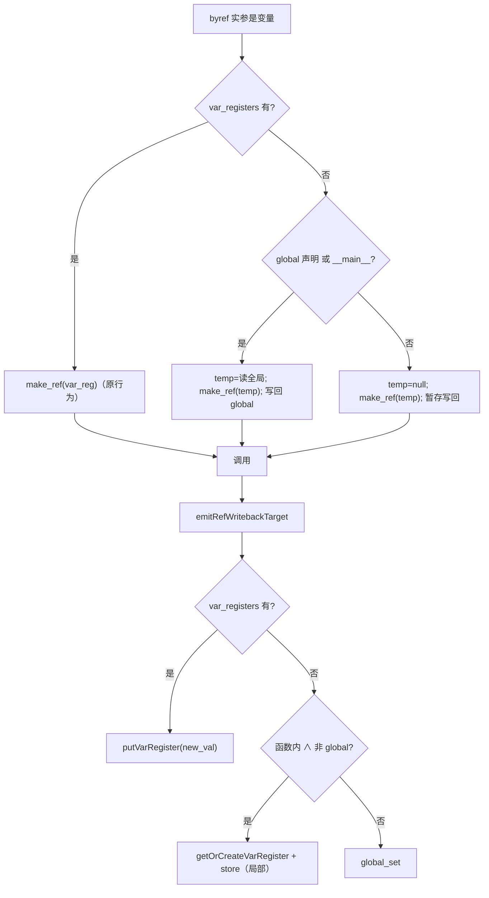

# AOT-CODEGEN-012 R-233：F-146 闭包/函数内 byref 写回归属（用户函数＋方法＋静态方法）

- 日期：2026-10-23（R-233；F-146 主面；F-146-c / F-147 新立）
- 代次锚：`irg 6bc59d18026e5a070349aeafb0a2f646`／`nlk 4700b644a42ffb5bd494da06681b0b0f`／`tpl 7320db321a0b631e73ee293be7b1b081`／`opt 745e4bd4…`／`parser 70e80f18…`／`ir 1fb6b01f…`
- 状态：全部**未提交**（R-232 的 map/byref 部分也仍在工作区）

## 1. 高层摘要（TL;DR）

函数/闭包内把**未声明变量**按引用传给用户函数、对象方法或静态方法时，AOT 生成的是**按值传参**，且写回无条件走 `global_set`。PHP 的语义是“引用传参创建局部变量（null 起始，不发 Warning）”，因此典型形 `function f(){ h($q); return $q; }` 在 AOT 返回 NULL 并多发 `Undefined variable`。本批在 IR 生成器三处（普通调用/方法调用/静态方法调用）补齐“未声明 ⇒ 临时 alloca(null)＋make_ref＋局部写回”，并把三处写回统一到 `emitRefWritebackTarget`。

同一修复顺带让 R-232 登记的 **preg 第三参数闭包形**完全对齐 PHP（`preg_match(...,$m,0)` 在 arrow 内不再写穿全局）。

- 新门 C282（7 臂）：**6 SAME / 1 DIFF**（c7＝F-146-c 注册红）＋自证 7 CF。
- `zig build test`：21/21 steps、326/326、rc=0。

## 2. 影响范围

| 维度 | 影响 |
|---|---|
| 语义面 | 函数/闭包内 byref 未声明变量：按值→按引用；写回全局→写回局部；不再发多余 Warning |
| 生成码 | 三处 byref 调用点新增分支；写回统一 helper；仅命中“非 local、非 global、非 __main__”的形 |
| 运行期 | 无新增热路径开销（分支在编译期判定） |
| 语料暴露 | 68 语料无“闭包内 byref 未声明变量”形（回归全绿佐证）；主回归仍需全量 |
| 未覆盖 | `__main__` 顶层 byref 未声明变量的多余 Warning（F-146-c）；函数名与生成码局部同名（F-147） |

## 3. 核心变更

| # | 位置 | 变更 |
|---|---|---|
| 1 | `irg generateFunctionCall`（未命名实参 byref 支） | 非 global/非 main/无 var_register ⇒ 建 `no_optimize` alloca，存 `const_null`，`make_ref` 传参，登记写回 |
| 2 | `irg generateMethodCall` / `generateStaticMethodCall` | 同上（此前直接落到按值传参）；方法 ref 索引含 `$this` 的偏移不变 |
| 3 | `irg emitRefWritebackTarget`（新 helper） | 局部⇒`putVarRegister`；函数内未声明非 global⇒`getOrCreateVarRegister`＋store；其余⇒`global_set` |
| 4 | 门 C282 | 7 臂：用户函数/方法/静态方法/preg/global 守卫/引用参数透传/顶层注册红 |

## 4. 可视化概览（Code & Logic Map）



```mermaid
sequenceDiagram
  participant S as 脚本
  participant IR as ir_generator
  participant R as 生成码
  S->>IR: function f(){ h($q); return $q; }
  IR->>IR: $q 非 local/global/main ⇒ alloca(null)+make_ref
  IR->>R: call h(ref); 写回目标=局部 var
  R-->>S: f() = 9（不泄漏全局、无 Warning）
```

## 5. 详细变更分析

| 层 | 文件/位置 | 说明 |
|---|---|---|
| IR 生成 | `src/aot/ir_generator.zig`（generateFunctionCall 未命名实参支） | 新增“未声明局部 byref”分支；不读同名全局，避免误导出的旧值 |
| IR 生成 | `generateMethodCall` / `generateStaticMethodCall` | 同型补齐；方法 ref 索引 `i+1`、静态 `i` 保持 |
| IR 写回 | `emitRefWritebackTarget` | 三处调用点统一；决定 SSA 更新／新局部／全局 |
| 门 | `c282_f146_gate_tmp.sh` | 行首空白折叠；stdout/stderr/rc 三维比对；`AOT_BIN=/bin/false` 自证 |

**关键约束**
- “未声明变量”只在**函数体**里意味着局部；`__main__` 顶层仍是全局 ⇒ 判定必须同时看 `current_function.name` 与 `global_vars`。
- 临时 alloca 必须 `no_optimize` 且初值 `const_null`：不能读同名全局（PHP 不可见），也不能依赖未初始化内存。
- 方法/静态方法的 ref 参数索引偏移不同（`$this`），本批不改索引，只补缺省分派。

## 6. 影响与风险评估

| 项 | 结论 |
|---|---|
| 是否破坏式变更 | 否；主回归 PASS=68 FAIL=0（c284）；C281/C282 全绿（除注册红） |
| 生成码 | 仅“函数内 byref 未声明变量”形改变；其余调用点字节不变 |
| 影子 | IR 级改动 ⇒ 预期仅命中相关形的语料行；本轮无旧二进制备份，按 r110 降级为“语料符号普查＋回归点名” |
| 回归 | PASS=68 FAIL=0、SELF_CHECK_OK |
| 风险 | 引用参数透传（`out(&$v)`）走的是 `reference_params` 透传支，不受新增分支影响（C282 c6 守卫） |

**复测路径**：C282（自证 7 CF → 6 SAME/1 注册红）→ C281（preg 回归）→ 主回归 → `zig build test`。

## 7. 遗留问题 / 潜在问题

1. **F-146-c（P2，新立）**：`__main__` 顶层 `h($q)`（未声明）PHP 不发 Warning，AOT 多一条 `Undefined variable`（源自 `global_get`；值正确）。门 C282 c7 注册红。
2. **F-147（P2，新立）**：用户函数名与生成码局部变量同名 ⇒ 编译失败：`g`（`defer if (guard) |*g|`）、`out`（profiler `const out = …flamegraph.txt`）。需给生成码局部统一加前缀或按名转义；修法涉及模板/发射器命名空间，暂未动。
3. 未对 `__main__` 顶层 byref 未声明变量走 no-warn 全局读（缺 IR 机制）。

## 8. 后续开发 / 优化建议

| 优先级 | 建议 | 影响面 | 落地成本 |
|---|---|---|---|
| P2 | F-146-c：给 `global_get` 加 no-warn 变体（或专用 IR op），仅用于 byref 初始化 | 全部顶层 byref | 低-中 |
| P2 | F-147：生成码局部变量统一前缀（`__aot_`）并全量扫描冲突 | 任意用户函数名 | 中 |
| P2 | F-145：MT_RAND_PHP 序列＋Deprecated | srand mode=1 | 中 |
| P3 | 把 byref 实参构造三处重复代码收敛为 helper | 可维护性 | 低 |
