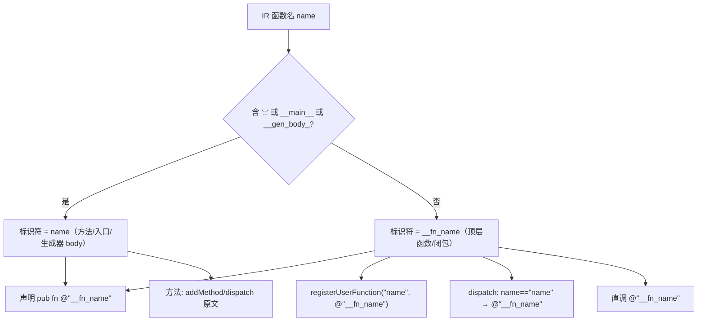
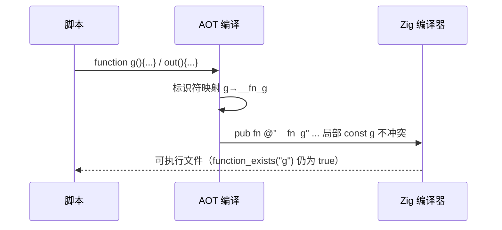

# AOT-CODEGEN-012 R-234：F-147 用户函数名与生成码标识符冲突（统一 `__fn_` 前缀）

- 日期：2026-10-23（R-234；F-147 闭环）
- 代次锚：`nlk 56c22ccc241ec8469f1930c221167c1e`／`irg 6bc59d18026e5a070349aeafb0a2f646`／`tpl 7320db321a0b631e73ee293be7b1b081`／`opt 745e4bd4…`／`parser 70e80f18…`／`ir 1fb6b01f…`
- 状态：全部**未提交**

## 1. 高层摘要（TL;DR）

PHP 允许任意合法函数名，而生成码里的局部变量取短名（`g`/`out`/`name`/`value`…）；Zig 禁止局部变量遮蔽容器级声明，也禁止与 `main`/`select`/`go` 等生成码顶层函数重名 ⇒ `function g(){}`、`function out(){}` 等合法脚本直接编译失败。本批把**用户顶层函数与闭包**的 Zig 标识符统一加 `__fn_` 前缀（方法含 `::`、`__main__`/`__gen_body_*` 保持原样），并在声明、注册指针、dispatch、直调、`__declare_function__` 五类引用点用同一 helper 生成标识符；PHP 名字串（注册键、反射、`function_exists`、字符串调用）保持不变。

- 新门 C283（6 臂）**6/6 SAME**；自证 6 CF。
- `zig build test` 326/326；主回归 **PASS=68 FAIL=0**；C281/C282 邻门仅各自注册红。

## 2. 影响范围

| 维度 | 影响 |
|---|---|
| 编译面 | 任意用户函数名都可编译（不再受生成码局部/顶层名限制） |
| 生成码 | 每个顶层函数/闭包的 Zig 标识符加 `__fn_` 前缀；注册键与反射名不变 |
| 运行期 | 无额外开销（纯标识符改写） |
| 未覆盖 | 命名空间函数（`A\b`）支持仍按原状；方法名路径不变 |

## 3. 核心变更

| # | 位置 | 变更 |
|---|---|---|
| 1 | `nlk isPlainUserFuncName` / `fnIdentName` | 无 `::`、非 `__main__`、非 `__gen_body_` ⇒ `__fn_` 前缀（未转义） |
| 2 | `generateFunction` | 声明/生成器 wrapper 的标识符基名走 `fnIdentName`（原 `escapeBackslashes(func.name)`） |
| 3 | `registerAllFunctions` / `aot_dispatch_user_function` | 注册指针与 dispatch 返回指针走同一 helper；PHP 名字串不变 |
| 4 | 直调（有/无返回值、表达式/语句）与 `__declare_function__` 注册 | 标识符统一走 helper；无返回值支同时补 canonical 名解析 |
| 5 | 门 C283 | 短名族/动态反射/闭包方法/递归/与生成码顶层同名/普通守卫 六臂 |

## 4. 可视化概览（Code & Logic Map）

## 5. 详细变更分析

| 层 | 文件/位置 | 说明 |
|---|---|---|
| 命名 | `src/aot/native_linker.zig` `isPlainUserFuncName` | 判定“可前缀”的 IR 名 |
| 声明 | `generateFunction` | 声明、生成器 wrapper 同源；生成器 body 由同名派生 |
| 注册/分发 | `registerAllFunctions`、`aot_dispatch_user_function` | 指针用前缀标识符，键仍是 PHP 名 |
| 调用 | 直调四形（有/无返回 × try/非 try）、无返回值语句支、`__declare_function__` | 统一 helper；`__declare_function__` 的键/标识符分离 |
| 门 | `c283_f147_gate_tmp.sh` | 6 臂三维比对；`AOT_BIN=/bin/false` 自证 |

**关键约束**
- 只有“无 `::` 且非内部生成名”的函数才加前缀；方法的 `C::m` 与 `__main__`/`__gen_body_*` 必须保持原样，否则声明、注册、dispatch、调用四者会走散。
- 注册键（PHP 名）与标识符（Zig 名）必须分离：前者决定 `function_exists`/反射/字符串调用，后者只是编译期符号。

## 6. 影响与风险评估

| 项 | 结论 |
|---|---|
| 是否破坏式变更 | 否；行为回归 PASS=68 FAIL=0（c285），C283 6/6 |
| 生成码 | 所有含用户函数的脚本 main.zig 都会漂移（标识符前缀），属**预期且机械可归因** |
| 影子 | 无法做双代 md5（旧二进制未备份，r110 降级）；漂移面＝“用户函数标识符加 `__fn_`”，无其它结构变化 |
| 回归 | **PASS=68 FAIL=0**、`SELF_CHECK_OK rows=68 uniq=68`（c285） |
| 风险 | 若遗漏某个 `@"name"` 调用点 ⇒ 链接期未定义符号（回归 68 枚覆盖大量函数形，可强证）；方法/静态方法路径未改 |

**复测路径**：C283（自证 6 CF → 6/6）→ C281/C282 邻门 → 主回归 → `zig build test`。

## 7. 遗留问题 / 潜在问题

1. 命名空间函数未纳入本批（若 AOT 支持 `A\b`，其标识符同样需要前缀；当前实现按名直出）。
2. 生成器 wrapper/body 的标识符随 `__fn_` 变化，但生成器属 AOT 排除项，未做运行期验证。
3. 方法名（`C::m`）仍可能和生成码里的 `@"C::m"` 冲突？不会——局部变量不可能含 `::`。
4. 若用户函数名本身以 `__fn_` 开头（`function __fn_x(){}`），前缀后为 `__fn___fn_x`，仍唯一。

## 8. 后续开发 / 优化建议

| 优先级 | 建议 | 影响面 | 落地成本 |
|---|---|---|---|
| P2 | 命名空间函数（`A\b`）标识符前缀与注册键一致性核查 | 命名空间支持 | 低-中 |
| P2 | F-146-c：`global_get` no-warn 变体 | 顶层 byref | 低-中 |
| P2 | F-145：MT_RAND_PHP | srand mode=1 | 中 |
| P3 | 生成器形在 F-147 前缀下的编译冒烟（若恢复生成器支持） | 生成器 | 低 |
