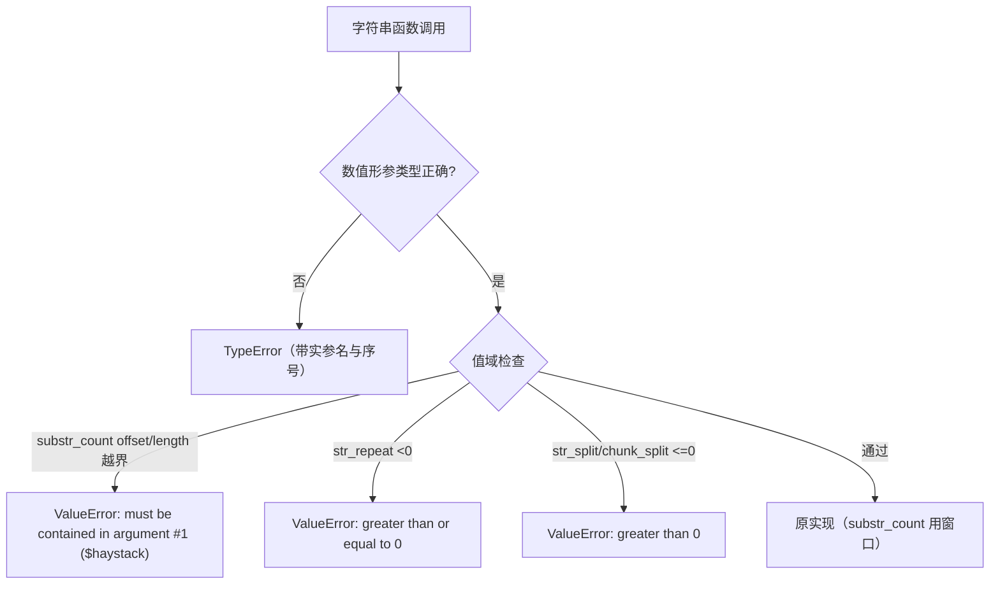
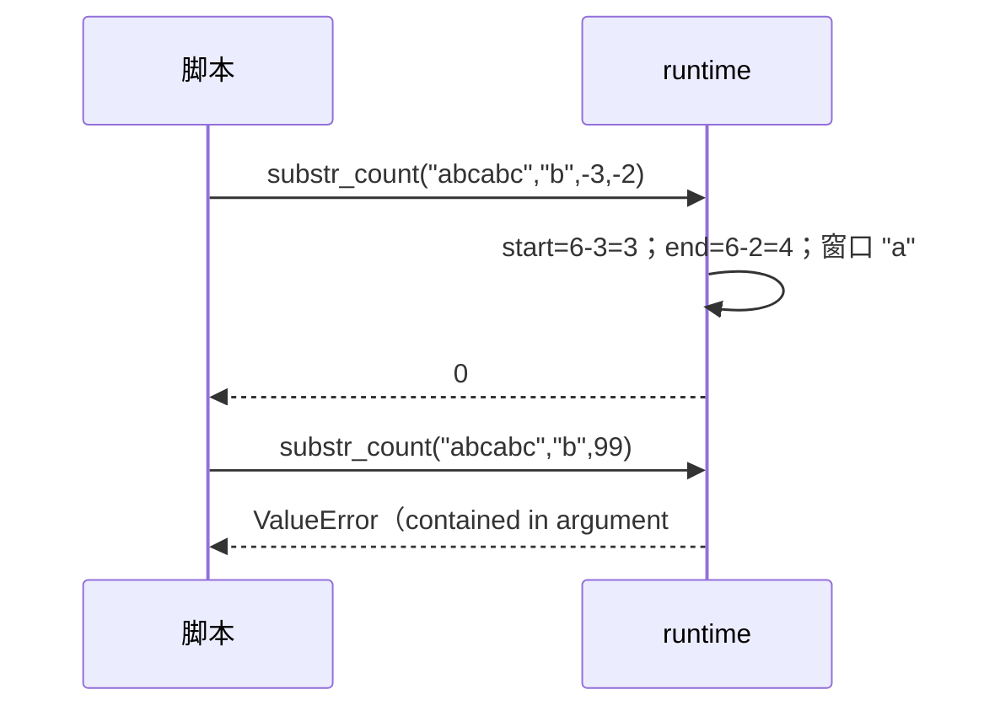

# AOT-CODEGEN-012 R-237：F-62f 第五批 —— 字符串族形参契约与值域

- 日期：2026-10-23（R-237；F-62f 第五批）
- 代次锚：`tpl e0aeb61c120982bf162e9045b314c2eb`／`nlk 5a6e13f8…`／`irg 3d04a693…`／`ir 5b99795…`／`opt 745e4bd4…`／`parser 70e80f18…`（未提交）
- 状态：全部**未提交**

## 1. 高层摘要（TL;DR）

七个字符串函数的数值形参此前缺类型校验或把“值域错误”静默夹掉：

1. `substr #3 ?int length`：因旧 helper 只能产 `int` 措辞而搁置；R-232 已加 `nullable_int_param`（`?int`），本批接线。
2. `mb_substr #2 int $start／#3 ?int $length`：此前完全无校验（对象静默转 0）。
3. `substr_count #3 int $offset／#4 ?int $length`：**此前两参被 `_ =` 丢弃**，offset/length 语义完全未实现；空针返回 0。本批按 PHP 复刻窗口截取、负数归一、越界 ValueError、空针 ValueError。
4. `str_repeat #2`：`<0` 曾被夹成 `""`，PHP 为 ValueError。
5. `str_split #2`：`<=0` 曾被 `@max(1,…)` 夹掉，PHP 为 ValueError。
6. `chunk_split #2`：同上。
7. `str_pad #4 int $pad_type`：此前直接 `toInt()`（对象静默转 0）。

门 C284（8 臂）**8/8 SAME**；自证 **8 CF**。

## 2. 影响范围

| 维度 | 影响 |
|---|---|
| 语义面 | 7 个函数的坏类型 ⇒ TypeError；4 处值域 ⇒ 可捕获 ValueError；`substr_count` offset/length 从“忽略”变为真实语义 |
| 运行期 | 每次调用多 1–2 次数值检查；`substr_count` 由整串扫描改为窗口扫描（更省） |
| 回归面 | 语料中 `substr_count(...,offset)` 形态若有，输出可能由“全串计数”变为 PHP 语义（修的是错值） |
| 未覆盖 | `wordwrap #4 bool $cut`（需 bool 形参族）、`mb_substr #4 ?string $encoding`（字符串形参族） |

## 3. 核心变更

| # | 位置 | 变更 |
|---|---|---|
| 1 | `tpl php_substr` | `#3 length` 用 `.nullable_int_param`（`?int`）校验；null 合法 |
| 2 | `tpl php_mb_substr` | `#2 start` `.int_param`、`#3 length` `.nullable_int_param`；改用 `start_ok/length_ok` |
| 3 | `tpl php_substr_count` | `#3 offset` `.int_param`、`#4 length` `.nullable_int_param`；实现负数归一/窗口/非重叠计数；越界与空针抛 ValueError（PHP 同文案） |
| 4 | `tpl php_str_repeat` | `times<0` ⇒ ValueError `must be greater than or equal to 0`（0 仍空串） |
| 5 | `tpl php_str_split` / `php_chunk_split` | `length<=0` ⇒ ValueError `must be greater than 0`（去掉 `@max(1,…)` 夹取） |
| 6 | `tpl php_str_pad` | `#4 pad_type` `.int_param` 校验 |
| 7 | 门 C284 | 7 函数 × 类型/值域/省略参守卫 8 臂 |

## 4. 可视化概览（Code & Logic Map）

## 5. 详细变更分析

| 层 | 文件/位置 | 说明 |
|---|---|---|
| 模板 | `runtime_lib_template.zig` 七个函数 | 校验放在字符串类型早退之后，保持既有“非字符串返回空值”的路径不变 |
| 模板 | `php_substr_count` | 空针改为 ValueError（原返回 0）；窗口计数复用非重叠步进 |
| 门 | `c284_f62f_fifth_gate_tmp.sh` | 8 臂；每臂 stdout/stderr/rc 三维；`AOT_BIN=/bin/false` 自证 |

**关键约束**
- `requireOptionalNumParam` 对“省略（null）”与“坏类型（已抛异常并返回 null）”都回 null；调用方按既有惯例继续执行也无害，异常由调用点检查兜底。
- `substr_count` 无 `allocator` 形参，ValueError 走全局 `runtime_allocator`（与 `random_int` 同型）。

## 6. 影响与风险评估

| 项 | 结论 |
|---|---|
| 是否破坏式变更 | 修的是错值/错误处理：坏类型从静默值变 TypeError，值域从夹取变 ValueError |
| 回归 | PASS=68 FAIL=0（c288） |
| 邻居 | C281 7/8（a8=F-145-b）、C282 12/12、C283 6/6 |
| 风险 | 语料若有 `substr_count` 带 offset 的旧形，输出会变（正确方向）；主回归全绿 |

**复测路径**：C284（自证 8 CF → 8/8）→ C281/C282/C283 → 主回归 → `zig build test`。

## 7. 遗留问题 / 潜在问题

1. `wordwrap #4 bool $cut`：需新增 `bool_param` 形参族（本轮未做，避免与数值族混批）。
2. `mb_substr #4 ?string $encoding`：字符串形参校验族未接。
3. `substr_count` 空针从“返回 0”变 ValueError 属**行为修正**，需在语料/文档留意。

## 8. 后续开发 / 优化建议

| 优先级 | 建议 | 影响面 | 落地成本 |
|---|---|---|---|
| P2 | bool 形参族（wordwrap cut、array_filter 等）统一 helper＋真值矩阵 | 布尔形参 | 低-中 |
| P2 | 字符串形参族（mb_substr encoding、str_replace 等） | 字符串形参 | 中 |
| P2 | F-145-b legacy MT 序列（源码复刻） | srand mode=1 | 中 |
| P3 | F-62f 余量继续按门覆盖率排序 | 参数契约 | 低 |
