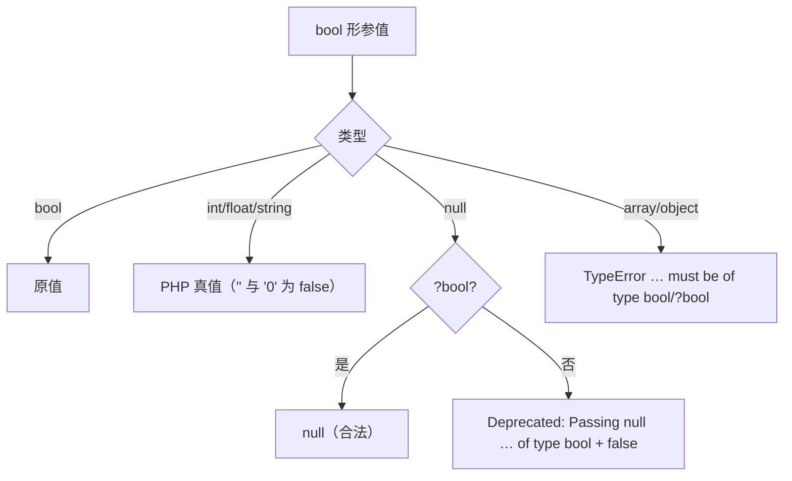
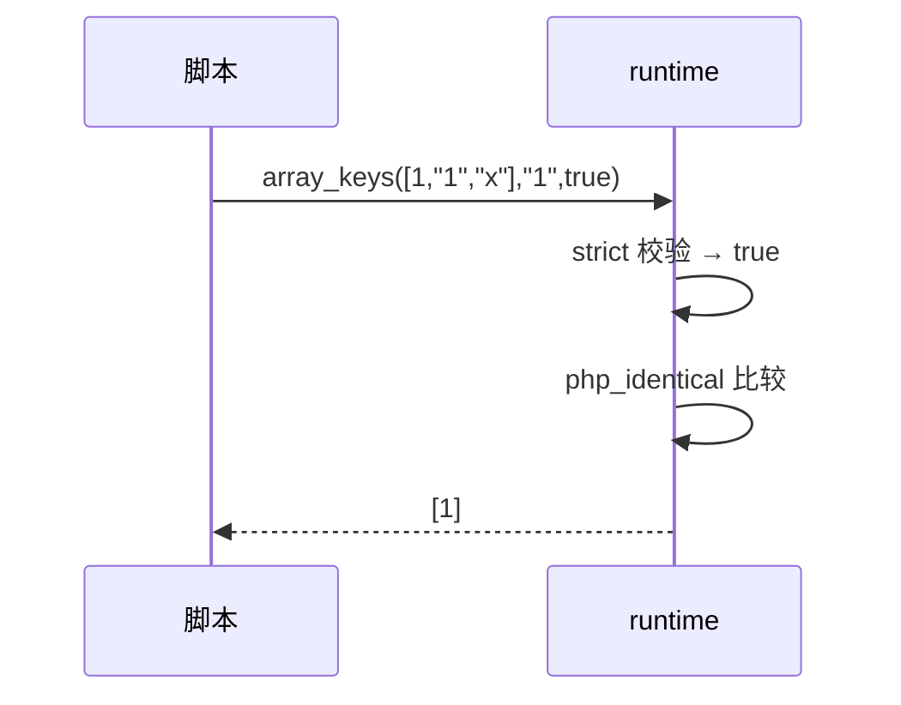

# AOT-CODEGEN-012 R-238：F-149 bool 形参族（wordwrap/in_array/array_search/array_reverse/array_slice/json_decode/array_keys）

- 日期：2026-10-23（R-238；F-149 首批；F-150 新立）
- 代次锚：`tpl 106a8f5de2e2bfc320d1653d46092fd6`／`nlk d58543cd5e64efc9dc25ef00d35bcdb0`／`irg 3d04a693…`／`ir 5b99795…`（未提交）
- 状态：全部**未提交**

## 1. 高层摘要（TL;DR）

bool 形参此前一律 `asBool()/toBool()`：对象/数组静默变 false，显式 null 不发 Deprecated，字符串 `"0"` 的真值口径不明。本批新增 bool 形参 helper 并接线 7 个函数；同时补上 `array_keys #3 $strict`（**此前 3 实参直接编译失败**）与 `array_slice #3 ?int $length`（此前因 `?int` 措辞搁置）。

- 新门 C285（8 臂）**8/8 SAME**；自证 **8 CF**。
- 额外实测并登记 **F-150**：`wordwrap` 的 `cut=true` 与多空格保留算法本身有缺口（参数校验已修，算法另立）。

## 2. 影响范围

| 维度 | 影响 |
|---|---|
| 语义面 | 7 函数 bool／?bool 形参：标量按 PHP 真值，array/object ⇒ TypeError，null ⇒ Passing-null Deprecated（`?bool` 合法）；`array_keys` 支持严格比较 |
| 编译面 | `array_keys($a,$v,$strict)` 三实参从此可编译（原 runtime 形参只有两个 + allocator） |
| 运行期 | 每次调用多一次轻量类型分派 |
| 未覆盖 | `wordwrap` 的 cut/空格算法（F-150）；`array_keys` 显式 null 过滤与省略的哨兵区分（F-62f-opt） |

## 3. 核心变更

| # | 位置 | 变更 |
|---|---|---|
| 1 | `tpl requireBoolParamAs/requireBoolParam/requireNullableBoolParam` | bool/int/float/string 按 PHP 真值；array/object TypeError；null 的两种口径 |
| 2 | `php_wordwrap` | `#4 $cut_long_words` 校验（形参名按 PHP，不是 `$cut`） |
| 3 | `php_in_array` / `php_array_search` | `#3 $strict` 校验 |
| 4 | `php_array_reverse` | `#2 $preserve_keys` 校验 |
| 5 | `php_array_slice` | `#3 ?int $length`（nullable_int_param）＋ `#4 $preserve_keys` 校验 |
| 6 | `php_json_decode` | `#2 ?bool $associative`（null 合法；标量弱转） |
| 7 | `php_array_keys` | 形参扩为 `(arr, search, strict, allocator)`；严格比较用 `php_identical`；发射器补 1/2 实参的 `strict=false` 缺省 |
| 8 | 门 C285 | 7 函数 8 臂；对象句柄与行首空白归一 |

## 4. 可视化概览（Code & Logic Map）

## 5. 详细变更分析

| 层 | 文件/位置 | 说明 |
|---|---|---|
| 模板 | `runtime_lib_template.zig` | 3 个 bool helper；7 个入口接线；`array_keys` 严格比较 |
| 发射器 | `native_linker.zig` `php_array_keys` 支 | 1 参补 `null`＋`false`，2 参补 `false`，3 参直传 |
| 测试 | `test_runtime_comprehensive.zig` | 适配 `array_keys` 新签名 |
| 门 | `c285_f149_bool_gate_tmp.sh` | 8 臂三维比对＋`AOT_BIN=/bin/false` 自证 |

**关键约束**
- `?bool` 的 null 不得发 Deprecated（json_decode #2），非 nullable bool 的 null 必须发——两个 helper 分开。
- `array_keys` 的“省略 search”与“显式 null search”在 PHP 里语义不同（过滤 null），本仓发射器用 null 当哨兵 ⇒ 显式 null 过滤仍不成立（F-62f-opt）。
- 校验放在数组类型早退之后，避免改变“非数组首参返回空值”的既有路径。

## 6. 影响与风险评估

| 项 | 结论 |
|---|---|
| 是否破坏式变更 | 否；坏类型由静默 false 变 TypeError，属修正 |
| 回归 | PASS=68 FAIL=0（c289） |
| 邻居 | C281 7/8（a8=F-145-b）、C282 12/12、C283 6/6、C284 8/8 |
| 风险 | `array_keys` 三实参形此前不可编译，无旧行为可破坏 |

**复测路径**：C285（自证 8 CF → 8/8）→ C281/C282/C283/C284 → 主回归 → `zig build test`。

## 7. 遗留问题 / 潜在问题

1. **F-150（P2，新立）**：`wordwrap` 的算法缺口——`cut=true` 时未真正按宽度切长词（`"abcdefgh",3,"|",true` PHP=`abc|def|gh`，AOT=`abcdefgh`）；多空格被折叠（PHP `"a  b"` 原样保留，AOT `"a b"`）；混合词形 `"abc defgh"` 亦不同。本批只修参数校验，未改算法。
2. **F-62f-opt（沿用）**：`array_keys` 显式 `null` 过滤与省略 search 不可区分。
3. `json_decode` 的 `?bool` 仅覆盖 #2；其余 bool 形参（`sort` 族 flags 是 int，不属本族）后续按门覆盖率补。

## 8. 后续开发 / 优化建议

| 优先级 | 建议 | 影响面 | 落地成本 |
|---|---|---|---|
| P2 | F-150：wordwrap 全算法重写（空格保留、cut、单词边界）＋独立门 | 单函数语义 | 低-中 |
| P2 | bool 形参余量普查（`array_filter`、`array_unique` 等） | 布尔形参 | 低 |
| P2 | F-145-b legacy MT 序列 | srand mode=1 | 中 |
| P3 | F-62f-opt 哨兵方案（省略 vs 显式 null） | 全可选参族 | 中 |
