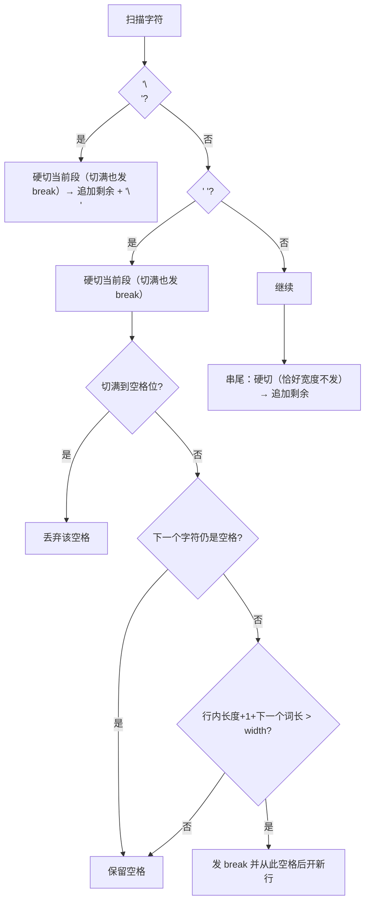
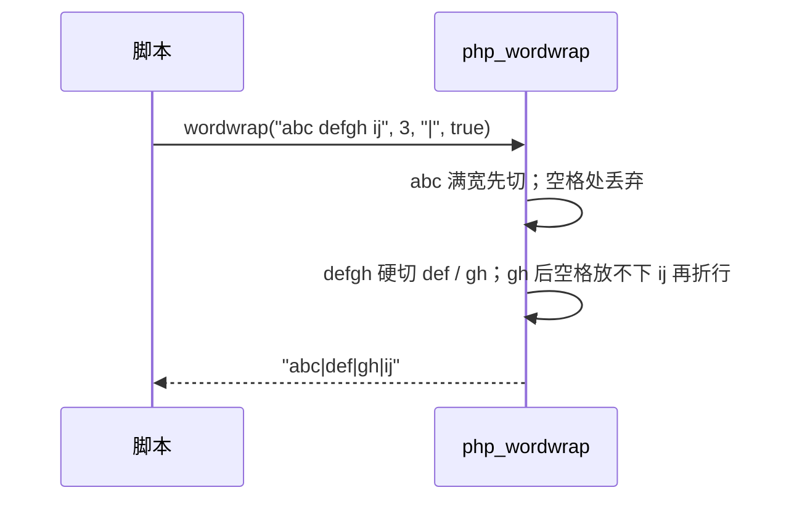

# AOT-CODEGEN-012 R-239：F-150 `wordwrap` 全算法（PHP 8.5.8 对齐）

- 日期：2026-10-23（R-239；F-150 闭环）
- 代次锚：`tpl 8535900fe408f476ce974568f143f9d7`／`nlk d58543cd…`／`irg 3d04a693…`／`ir 5b99795…`（未提交）
- 状态：全部**未提交**

## 1. 高层摘要（TL;DR）

R-238 修复了 `wordwrap` 的 bool 形参校验后，暴露出算法本身的三个缺口：`cut=true` 时**长词不切/丢字符**、多空格被折叠成单空格、已有 `\n` 被替换成 `$break`。本批按 PHP 8.5.8 实测矩阵（51 形）重写 `php_wordwrap`：保留原有空格与空行、按“下一个词放不下才换行”折行、`cut` 时按宽度硬切、已有换行恒输出 `\n`。

- 新门 C286（8 臂，覆盖 51 形）**8/8 SAME**；自证 **8 CF**。

## 2. 影响范围

| 维度 | 影响 |
|---|---|
| 语义面 | `wordwrap` 输出与 PHP 对齐（空格/空行/长词/自定义 break/宽 0/负宽） |
| 运行期 | 单次线性扫描；`wordwrapNextWordLen` 会跳过连续空格（最坏 O(n) 上下文，但每段只前瞻一次） |
| 未覆盖 | 多字节字符按字节计宽（PHP 也按字节）；`$break` 为空串的行为未单独验证 |

## 3. 核心变更

| # | 位置 | 变更 |
|---|---|---|
| 1 | `tpl wordwrapNextWordLen` | 新 helper：从某个空格后计算“下一个词”的字节长度（跳过连续空格，遇到空格/`\n` 停止） |
| 2 | `tpl wordwrapCutFlush` | 新 helper：按宽度硬切 `[line_start,end)`；`inclusive=true` 用于空格/换行处（切满也发 break），`false` 用于串尾（恰好宽度不发） |
| 3 | `tpl php_wordwrap` | 全函数重写：新行分支恒发 `'\n'`；空格分支“切满丢空格 / 非行尾才判折行”；串尾 flush 后原样追加 |
| 4 | 门 C286 | 8 臂 × 51 形（json_encode 逐字节） |

## 4. 可视化概览（Code & Logic Map）

## 5. 详细变更分析

| 层 | 文件/位置 | 说明 |
|---|---|---|
| 模板 | `runtime_lib_template.zig` | 两个 helper ＋ `php_wordwrap` 重写；宽 ≤0 视作 1；缺省 width 由发射器补 75 |
| 门 | `c286_f150_wordwrap_gate_tmp.sh` | 逐臂多形 json_encode；`AOT_BIN=/bin/false` 自证 |

**关键约束**
- 空白语义：**折行处只丢弃当前那一个空格**；连续空格中靠前者保留（`"aaa   bbb",5` ⇒ `"aaa  \nbbb"`）。
- 已有 `\n` 始终原样输出，`$break` 只用于**算法产生的**折行与硬切。
- 硬切边界：空格/换行处用 `>=`（切满也补 break，产生 PHP 的 `"abc|\n"` 形），串尾用 `>`（`"abc",3,cut` 不补 break）。
- 行首连续空格：行内长度为 0 时不折行（避免前置空行）。

## 6. 影响与风险评估

| 项 | 结论 |
|---|---|
| 是否破坏式变更 | `wordwrap` 输出改变（修的是与 PHP 不符的错值）；无 API 变化 |
| 回归 | PASS=68 FAIL=0（c290） |
| 邻居 | **C285 复跑 8/8**（含 wordwrap 形参臂）；C281–C284 本批未重跑（仅单函数模板改动） |
| 风险 | 语料若有依赖旧折叠/不切行为的输出会变化，方向为 PHP 对齐 |

**复测路径**：C286（自证 8 CF → 8/8）→ C281–C285 → 主回归 → `zig build test`。

## 7. 遗留问题 / 潜在问题

1. 多字节字符按字节计宽（与 PHP 一致，但用户可能期望字符宽——非缺陷）。
2. 空 `$break` 串（`wordwrap($s,3,"")`）未在矩阵中单列；实现会正常附加空串。
3. `wordwrap` 的形参校验（R-238）与本算法同门覆盖。

## 8. 后续开发 / 优化建议

| 优先级 | 建议 | 影响面 | 落地成本 |
|---|---|---|---|
| P2 | 若后续支持多字节宽度，另立 `mb_wordwrap`（PHP 无此函数） | — | — |
| P2 | F-145-b legacy MT 序列 | srand mode=1 | 中 |
| P3 | F-62f-opt 哨兵（省略 vs 显式 null） | 全可选参族 | 中 |
| P3 | 其余 bool 形参族按门覆盖率普查 | 布尔形参 | 低 |
