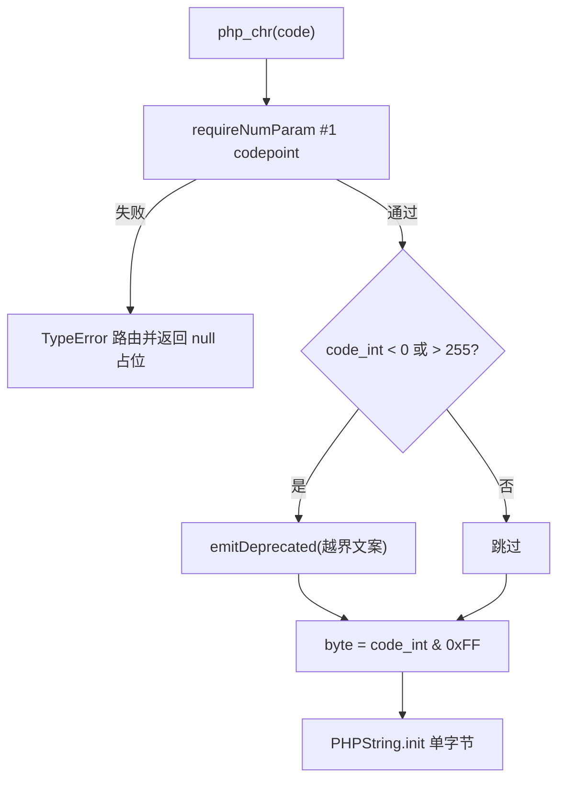
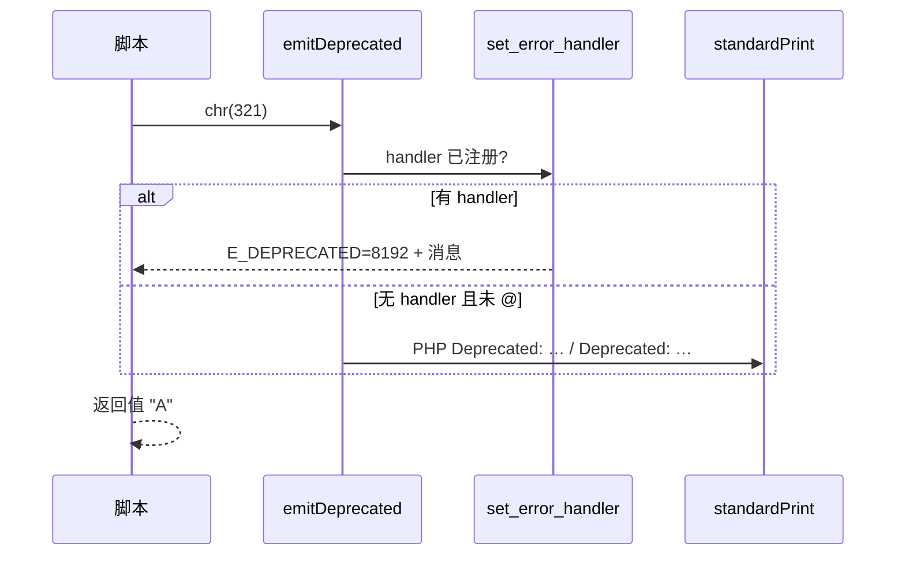

# AOT-CODEGEN-012 R-240：F-144 `chr` 越界 Deprecated（PHP 8.5.8 对齐）

- 日期：2026-10-23（R-240；F-144 闭环）
- 代次锚：`tpl 2286fe876d38501baa87516a1b1c56bb`／`nlk d58543cd…`／`irg 3d04a693…`／`ir 5b99795…`／`parser 70e80f18…`／`opt 745e4bd4…`（未提交）
- 状态：全部**未提交**

## 1. 高层摘要（TL;DR）

`chr()` 的越界值此前已经按 `%256` 得到正确字节，但缺少 PHP 8.5.8 在每次越界调用时发出的 `Deprecated`。本批在 `php_chr` 的单点值域判断处补一条同文案诊断，复用既有 `emitDeprecated`（自动参与 `@` 抑制与 `set_error_handler` 路由）。

- 新门 C287（7 臂）**7/7 SAME**；自证 **7 CF**。
- 主回归 **PASS=68 FAIL=0**。

## 2. 影响范围

| 维度 | 影响 |
|---|---|
| 语义面 | `chr(<0 或 >255>)` 增加一条 Deprecated；0–255 完全不变 |
| 运行期 | 每次调用多一次两次整数比较；无分配、无异常路径变化 |
| 抑制/路由 | 走既有 `emitDeprecated`：`@` 双流静默；用户 handler 收到 `E_DEPRECATED=8192` |
| 未覆盖 | `chr` 的其它参数形态（已由 R-231 的 `requireNumParam` 承担） |

## 3. 核心变更

| # | 位置 | 变更 |
|---|---|---|
| 1 | [runtime_lib_template.zig:26155](file:///Users/wangjianjun/products/parser/src/aot/runtime_lib_template.zig#L26155) | `php_chr` 在 `requireNumParam` 之后、取值之前插入 `if (code_int < 0 or code_int > 255) emitDeprecated("chr(): …constrained using % 256")` |
| 2 | `fuzzy_scripts_720/tmp/c287_f144_chr_gate_tmp.sh` | 新永久侧门：合法域／正越界／负越界／`@`／连续两次／类型守卫／handler 路由，stdout＋stderr＋rc 三流逐字节 |

## 4. 可视化概览（Code & Logic Map）

## 5. 详细变更分析

| 层 | 文件/位置 | 说明 |
|---|---|---|
| 模板 | `runtime_lib_template.zig:26151-26163` | 仅 `php_chr` 一处；值路径与内存路径未改 |
| 门 | `c287_f144_chr_gate_tmp.sh` | 7 臂；行首空白折叠、文件路径与行号归一；`AOT_BIN=/bin/false` 自证 |

**关键约束**
- 文案中的 `% 256` 是**字面文本**，不得进入 `std.fmt` 格式化（否则会被当作占位符）。
- 判断必须在类型校验之后：`chr(new stdClass)` 只允许 TypeError，不得先发 Deprecated（C287 `c6` 守卫）。
- 每次调用一条：不得缓存/去重（C287 `c5` 两连调用断言两条）。

## 6. 影响与风险评估

| 项 | 结论 |
|---|---|
| 是否破坏式变更 | 无 API 变化；仅新增一条与 PHP 对齐的诊断 |
| 主回归 | **PASS=68 FAIL=0**、`SELF_CHECK_OK rows=68 uniq=68`（`c291_regression_R240_tmp.log`） |
| `zig build test` | 21/21 steps、326/326、rc=0（`/tmp/zigtest_R240.log`） |
| 邻居门 | C287 自身 7/7；本批为单函数模板改动，C281–C286 未重跑（按加速档） |
| 风险 | 低；`chr` 高频调用路径只多两次整数比较 |

**复测路径**：C287（自证 7 CF → 7/7）→ 主回归 → `zig build test`。

## 7. 遗留问题 / 潜在问题

1. `chr(PHP_INT_MIN)` 落 `%256` 的值路径未单列臂（PHP 同形，判断用 i64 无溢出）。
2. F-62f 余量仍在（可选参“省略 vs 显式 null/0”的哨兵缺失，F-62f-opt）。

## 8. 后续开发 / 优化建议

| 优先级 | 建议 | 影响面 | 落地成本 |
|---|---|---|---|
| P2 | F-142-c 多实参 `isset` 的静默＋短路（C279 现为 7 红取证门） | isset 表达式语义 | 中（发射器表达式位短路链） |
| P2 | F-118b 不可折叠默认值形参（`new` in initializer） | Reflection/默认值 | 中 |
| P3 | F-62f-opt 可选参哨兵（省略 vs 显式 null） | 全可选参族 | 中 |
| P3 | F-145-b legacy MT 序列（缺 PHP 源可比对） | `srand(MT_RAND_PHP)` | 高（外部依赖） |
