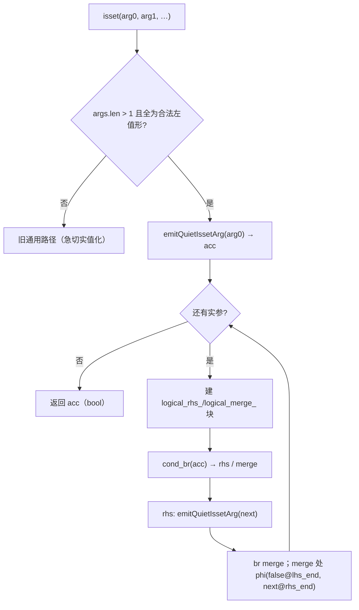
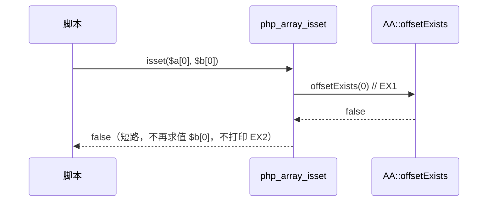

# AOT-CODEGEN-012 R-241：F-142-c 多实参 `isset` 静默求值＋左到右短路

- 日期：2026-10-23（R-241；F-142-c 闭环，F-151 新立）
- 代次锚：`irg 09b2e6aa8d886a1ac0c695f5ef0b9911`／`tpl 2286fe87…`／`nlk d58543cd…`／`ir 5b99795…`／`parser 70e80f18…`／`opt 745e4bd4…`（源已提交 `e56f569`）
- 状态：源已随 `e56f569` 提交；本文档未跟踪（后补）

## 1. 高层摘要（TL;DR）

R-230 取证时发现多实参 `isset($a,$b,…)` 走通用路径：所有实参被**急切实值化**，未定义变量/缺失键会告警、缺失静态属性会 fatal、ArrayAccess 不短路。本批在 IR 生成器按四种左值形逐参走静默 helper，并用 `&&` 的左结合块形合并，实现 PHP 的“全参静默＋从左到右短路”。

- C279 由 **4 SAME / 7 DIFF** 变为 **11/11 SAME**；自证 11 CF。
- 邻门 C276／C277／C267／C268 逐臂零转移；主回归 **PASS=68 FAIL=0**。

## 2. 影响范围

| 维度 | 影响 |
|---|---|
| 语义面 | 多实参 `isset` 的值、诊断、短路副作用均对齐 PHP 8.5.8 |
| 控制流 | 每个额外实参新增一对 `logical_rhs_/logical_merge_` 块＋phi（左结合链） |
| 未接管面 | 非常规左值形（含 `?->`）回落旧通用路径；单实参路径完全未改 |
| 已知残留 | **F-151**：`isset($undef->p)`／`isset($undef['k'])` 的基座读取仍告警（R-241 前后一致） |

## 3. 核心变更

| # | 位置 | 变更 |
|---|---|---|
| 1 | [ir_generator.zig:6730](file:///Users/wangjianjun/products/parser/src/aot/ir_generator.zig#L6730) | 新增 `generateMultiArgIsset`：左结合 `&&` 链，复用 `logical_rhs_`／`logical_merge_` 标签＋phi |
| 2 | [ir_generator.zig:6758](file:///Users/wangjianjun/products/parser/src/aot/ir_generator.zig#L6758) | 新增 `emitQuietIssetArg`：变量→`php_isset_var` 或 `php_is_null`+`eq(false)`；元素→`php_array_isset`；属性→`php_object_isset`；静态属性→`php_isset_static_property` |
| 3 | [ir_generator.zig:7119](file:///Users/wangjianjun/products/parser/src/aot/ir_generator.zig#L7119) | `isset` 分支多实参预筛分流（四 tag，`.array_access` 必须有 key） |
| 4 | `fuzzy_scripts_720/tmp/c279_multi_isset_gate_tmp.sh` | 门状态由“7 红取证门”改为全绿判据（11 臂） |

## 4. 可视化概览（Code & Logic Map）

## 5. 详细变更分析

| 层 | 文件/位置 | 说明 |
|---|---|---|
| IR 生成 | `ir_generator.zig` | 两个新 helper＋多实参分流；单实参特判与 `php_isset` 通用路径未改 |
| 门 | C279 | 11 臂；`AOT_BIN=/bin/false` 自证 |

**关键约束**
- **块标签必须复用 `logical_rhs_`／`logical_merge_`**：AST-direct 标签发射器按前缀识别短路链；R-230 的自定义 `isset_multi_*` 名字导致 `[AST-DIRECT-FAIL] unprocessed blocks`。
- **局部变量必须显式转 bool**：直接返回 `load` 值会让末个实参的原始值漏进 phi（首轮 m8 实测 `int(5)`，PHP 为 `bool(true)`）。
- 预筛保证 `.array_access` 有 key；无 key 的 `$a[]` 不接管。
- 短路语义可观测（ArrayAccess `offsetExists` 调用次数/顺序）：必须左结合逐参进入 rhs 块，不能先求全部再合。

## 6. 影响与风险评估

| 项 | 结论 |
|---|---|
| 是否破坏式变更 | 多实参 `isset` 行为向 PHP 对齐；单实参与其他函数无变化 |
| 门 | C279 **11/11**（修前 4 SAME/7 DIFF）；C276 12/12、C277 12/12、C267 14/14、C268 20/20 |
| 主回归 | **PASS=68 FAIL=0**、`SELF_CHECK_OK rows=68 uniq=68`（`c292_regression_R241_tmp.log`） |
| `zig build test` | 21/21 steps、326/326、rc=0（`/tmp/zigtest_R241.log`） |
| 影子 | 本轮未跑（按加速档；改动仅命中多实参 isset 发射，语料暴露面待查） |
| 风险 | 低；非常规形回落旧路径，不新增崩溃面 |

**复测路径**：C279（自证 11 CF → 11/11）→ C276/C277/C267/C268 → 主回归 → `zig build test`。

## 7. 遗留问题 / 潜在问题

1. **F-151（新立，P2）**：`isset` 链基座为未定义变量时 AOT 仍告警（`isset($undef->p)`／`isset($undef['k'])`），PHP 全静默；单/多实参同形，R-241 前后一致。
2. 嵌套元素链 `isset($a['x']['y'], …)` 内层缺失键告警（与 F-151 同族）。
3. `.safe_property_access`（`?->`）未纳入静默接管面；C279 未覆盖，实测 null 基座两形与 PHP 一致。
4. 多实参命中范围依赖解析器 tag；若后续新增左值 tag，需要同步预筛表。

## 8. 后续开发 / 优化建议

| 优先级 | 建议 | 影响面 | 落地成本 |
|---|---|---|---|
| P2 | F-151：isset 链基座（未定义变量/嵌套缺失键）静默读取 | isset/属性/元素族 | 中（需新增静默基座读取变体） |
| P2 | F-118b 不可折叠默认值形参 | Reflection/默认值 | 中 |
| P3 | F-62f-opt 可选参哨兵（省略 vs 显式 null） | 全可选参族 | 中 |
| P3 | F-145-b legacy MT 序列 | `srand(MT_RAND_PHP)` | 高（缺 PHP 源） |
