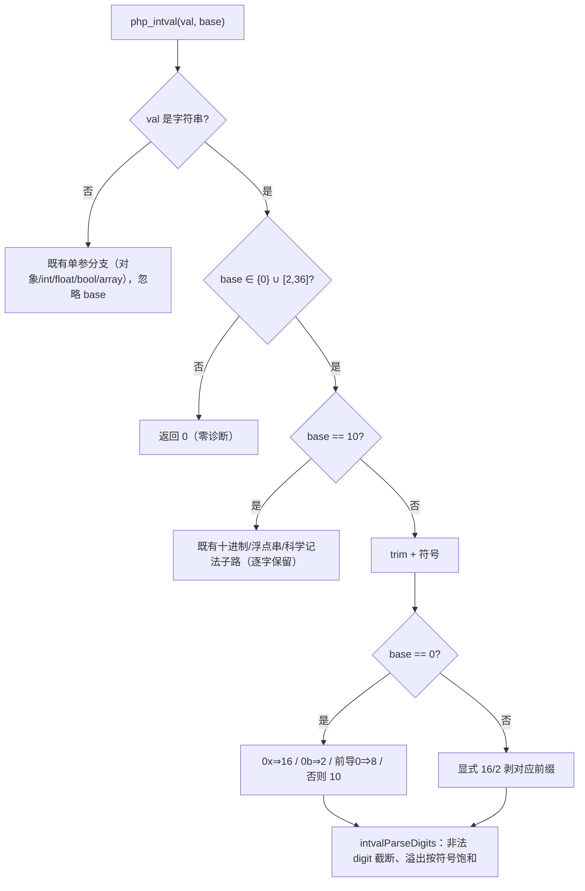
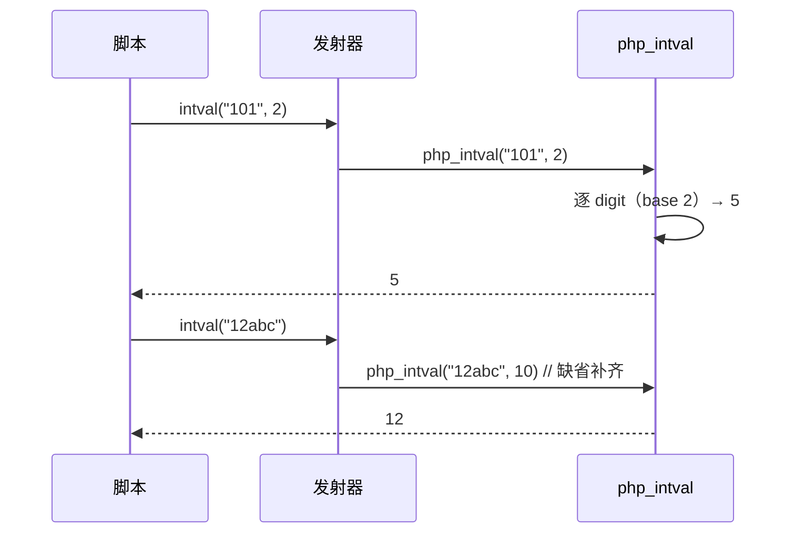

# AOT-CODEGEN-012 R-242：F-152 `intval($value, $base)` 真实现（F2I 门转全绿）

- 日期：2026-10-23（R-242；F-152 闭环）
- 代次锚：`nlk 5010edc48ce55ed0a86f3803c0c17ac5`／`tpl 03ed0f1a9d03f4daeb69cfc85fa5fada`／`irg 09b2e6aa…`／`ir 5b99795…`／`parser 70e80f18…`／`opt 745e4bd4…`（提交 `4bbc641`）
- 状态：源与本文档已随 `4bbc641` 提交

## 1. 高层摘要（TL;DR）

`intval($v, $base)` 的第二实参此前只存在于调用点：发射器把两个实参都传给模板，而 `php_intval` 只收一个 ⇒ 合法 PHP 直接 `main.zig: expected 1 argument(s), found 2`（F2I 门 `b3` 长期红）。本批把 base 做成**真实现**（进制 digit 解析／base=0 前缀识别／非法 base 归 0／溢出按符号饱和），并用发射器的声明式可选参机制为单实参调用补 `base=10`。

- 新门 C288（11 臂）**11/11 SAME**；C062 **51/51**（首次全绿，`b3` 转绿）。
- 主回归 **PASS=68 FAIL=0**；`zig build test` **326/326**。

## 2. 影响范围

| 维度 | 影响 |
|---|---|
| 语义面 | `intval` 第二形参从“编译失败”变为 PHP 8.5.8 对齐；单实参语义逐字保留 |
| 发射面 | `intval` 每次调用都多传一个 `base` 实参（缺省 `initInt(10)`）⇒ 生成码漂移，行为不变 |
| 测试 | `test_runtime_comprehensive.zig` 的 `intval` 用例同步两实参 |
| 未覆盖 | 显式 `null` base 的 Deprecated（F-62f-opt 同族）；base 的 float/string/object zpp 口径 |

## 3. 核心变更

| # | 位置 | 变更 |
|---|---|---|
| 1 | [runtime_lib_template.zig:14811](file:///Users/wangjianjun/products/parser/src/aot/runtime_lib_template.zig#L14811) | `php_intval(val, base)`：base 只作用于字符串；非法 base ⇒ 0；显式 10 走原路径 |
| 2 | [runtime_lib_template.zig:14923](file:///Users/wangjianjun/products/parser/src/aot/runtime_lib_template.zig#L14923) | `intvalDigitValue`：0-9/a-z/A-Z digit 值 |
| 3 | [runtime_lib_template.zig:14931](file:///Users/wangjianjun/products/parser/src/aot/runtime_lib_template.zig#L14931) | `intvalParseDigits`：截断/无 digit⇒0/按符号饱和；base=0/16/2 前缀剥离 |
| 4 | [native_linker.zig:4588](file:///Users/wangjianjun/products/parser/src/aot/native_linker.zig#L4588) | `intval` 注册 `handler_params=2`＋`optional_defaults=initInt(10)` |
| 5 | `test_runtime_comprehensive.zig` | `intval` 测试改两实参，新增 `"101",2==5` 断言 |
| 6 | `fuzzy_scripts_720/tmp/c288_intval_base_gate_tmp.sh` | 新永久侧门 11 臂 |

## 4. 可视化概览（Code & Logic Map）

## 5. 详细变更分析

| 层 | 文件/位置 | 说明 |
|---|---|---|
| 模板 | `runtime_lib_template.zig` | 两 helper＋主函数；非字符串分支未改（保持 F-69/F-77 既有口径） |
| 发射器 | `native_linker.zig` | 仅 `intval` 一条注册；补齐走 F-75 的声明式机制 |
| 测试 | `test_runtime_comprehensive.zig` | 签名变更的配套调用点 |
| 门 | C288 | 11 臂、`AOT_BIN=/bin/false` 自证 |

**关键约束**
- 非法 base（1/37/-1）在 PHP 是 **0 而非异常**，禁写成 throw。
- **base=0 ≠ base=10**：base=0 不识别指数与小数点（`"1e3"=1`），base=10 保留浮点串子路（`"1e3"=1000`）。
- 前缀只在 base=0（自动）或显式 base=16/2 时剥离；`intval("0x1A",10)=0` 不能“顺手”识别。
- 溢出必须**按符号饱和**，与既有十进制结果保持一致。
- 单实参调用必须显式补 `initInt(10)`；补 null 会改变行为（与 R-172 的“省略形参到达 null”同族教训）。

## 6. 影响与风险评估

| 项 | 结论 |
|---|---|
| 是否破坏式变更 | 无 API 变化；新增对合法 2 实参调用的支持，单实参行为不变 |
| 门 | C288 **11/11**（自证 11 CF）；C062 **51/51**（修前 49/1/1） |
| 主回归 | **PASS=68 FAIL=0**、`SELF_CHECK_OK rows=68 uniq=68`（`c293_regression_R242_tmp.log`） |
| `zig build test` | 21/21 steps、326/326、rc=0（`/tmp/zigtest_R242b.log`） |
| 影子 | 未跑（按加速档；模板＋发射器改动但行为面由 C062/C288＋主回归覆盖） |
| 风险 | 低；非字符串路径零改动 |

**复测路径**：C288（自证 11 CF → 11/11）→ C062（51/51）→ 主回归 → `zig build test`。

## 7. 遗留问题 / 潜在问题

1. 显式 `null` base：当前按 0（自动识别）走，PHP 会发 Passing-null Deprecated —— 属 F-62f-opt（省略 vs 显式 null）同族未修面。
2. base 传 float/string/object 的 zpp 口径未纳入（用 `toInt()` 语义）；语料零暴露。
3. `intval` 之外的“发射器多传一参”类缺陷仍可能有同类条目，建议按 `handler_params` 未声明但 PHP 有可选参的清单继续普查（F-75 余量）。

## 8. 后续开发 / 优化建议

| 优先级 | 建议 | 影响面 | 落地成本 |
|---|---|---|---|
| P1 | F-151：`isset` 链基座未定义变量/嵌套缺失键静默 | isset/属性/元素族 | 中 |
| P2 | F-62f-opt：可选参“省略 vs 显式 null”哨兵（含 intval base） | 全可选参族 | 中 |
| P2 | F-118b 不可折叠默认值形参 | Reflection/默认值 | 中 |
| P3 | F-145-b legacy MT 序列 | `srand(MT_RAND_PHP)` | 高（缺 PHP 源） |
