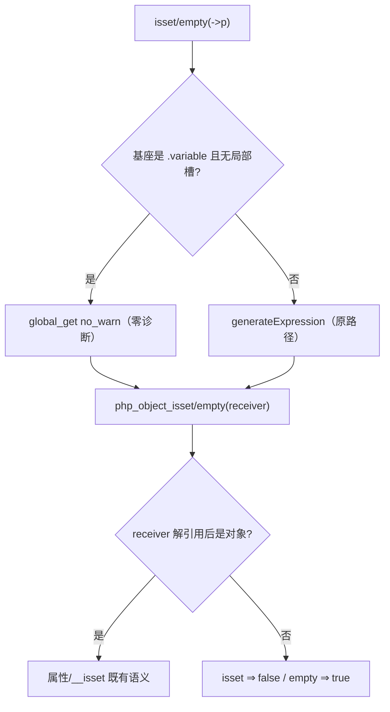
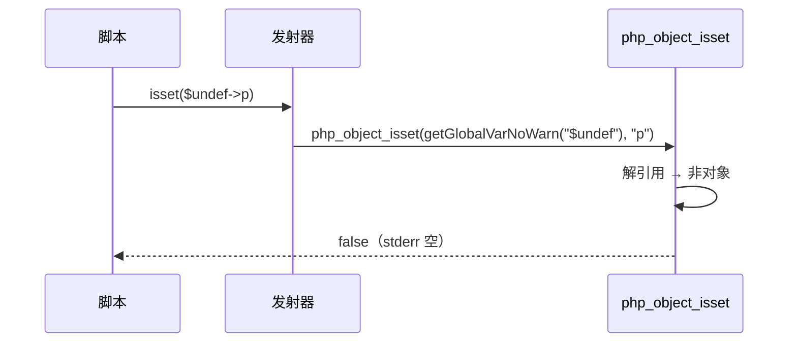

# AOT-CODEGEN-012 R-243：F-151 isset/empty 基座静默 ＋ F-153 非对象接收者语义

- 日期：2026-10-23（R-243；F-151、F-153 闭环，F-151-b 新立）
- 代次锚：`irg 570e1731946cc5275f512a385e481be8`／`tpl 7166338ad4fbfe493c7125a098e6fc1e`／`nlk 5010edc4…`／`ir 5b99795…`／`parser 70e80f18…`／`opt 745e4bd4…`（未提交）
- 状态：全部**未提交**

## 1. 高层摘要（TL;DR）

`isset($undef->p)`／`isset($undef['k'])` 在 AOT 会打 `Undefined variable` 告警（PHP 零诊断）；进一步探针发现更严重的一层：`isset(<非对象>->p)` 对 int/float/bool/string/array 返回 **true**（PHP 恒 false），`empty(<非对象>->p)` 多数返回 **false**（PHP 恒 true）。本批同时修复：基座变量读取走静默变体；`php_object_isset/empty` 先解引用、非对象按 PHP 恒值返回。

- 新门 C289（8 臂）**8/8 SAME**；五枚 isset/empty 邻居门零转移；主回归 **68/68**。

## 2. 影响范围

| 维度 | 影响 |
|---|---|
| 语义面 | isset/empty 的基座与接收者诊断/取值对齐 PHP；对象/ArrayAccess 正常路径不变 |
| 发射面 | 6 处基座生成改走 `generateQuietBaseExpr`（仅未声明变量基座触发 no_warn） |
| 未覆盖 | 嵌套缺失链与 `__isset` 中继（F-151-b）；非 ArrayAccess 对象的元素访问（抛 Error，已与 PHP 一致） |

## 3. 核心变更

| # | 位置 | 变更 |
|---|---|---|
| 1 | [ir_generator.zig:6823](file:///Users/wangjianjun/products/parser/src/aot/ir_generator.zig#L6823) | 新 helper `generateQuietBaseExpr`：无局部槽的变量基座 ⇒ `global_get{no_warn=true}` |
| 2 | `ir_generator.zig` 6 处 | 单/多实参 isset 的属性/元素基座＋empty 的属性/元素基座 |
| 3 | [runtime_lib_template.zig:3358](file:///Users/wangjianjun/products/parser/src/aot/runtime_lib_template.zig#L3358) | `php_object_isset`：解引用；非对象 ⇒ false；方法调用用 resolved |
| 4 | [runtime_lib_template.zig:3419](file:///Users/wangjianjun/products/parser/src/aot/runtime_lib_template.zig#L3419) | `php_object_empty`：解引用；非对象 ⇒ true；方法调用用 resolved |
| 5 | `fuzzy_scripts_720/tmp/c289_quiet_base_gate_tmp.sh` | 新永久侧门 8 臂 |

## 4. 可视化概览（Code & Logic Map）

## 5. 详细变更分析

| 层 | 文件/位置 | 说明 |
|---|---|---|
| IR 生成 | `ir_generator.zig` | 单点 helper＋6 个调用点；不改变表达式求值顺序 |
| 模板 | `runtime_lib_template.zig` | 两个 helper 的入口判定；ref→object 仍按对象处理 |
| 门 | C289 | 8 臂：基座变量（isset/empty/多实参）、非对象 8 型、引用、正常对象/数组守卫、函数内局部、`@`、静态属性守卫 |

**关键约束**
- 非对象接收者：isset **恒 false**、empty **恒 true**（含 null/bool false/空数组），禁按“接收者真值”推导。
- 必须先解引用再判类型；否则 `$r = &$obj` 会被误判非对象。
- 基座静默只作用于 `.variable`；数组/属性中间节点仍属 F-151-b，不得假装已闭。

## 6. 影响与风险评估

| 项 | 结论 |
|---|---|
| 是否破坏式变更 | 修正与 PHP 不符的错值；对象/ArrayAccess 路径不变 |
| 门 | C289 **8/8**（自证 8 CF）；C276 12/12、C277 12/12、C279 11/11、C267 14/14、C268 20/20 |
| 主回归 | **PASS=68 FAIL=0**、`SELF_CHECK_OK rows=68 uniq=68`（`c294_regression_R243_tmp.log`） |
| `zig build test` | 21/21 steps、326/326、rc=0（`/tmp/zigtest_R243.log`） |
| 风险 | 低；非对象分支此前行为本身即错值 |

**复测路径**：C289（自证 8 CF → 8/8）→ C276/C277/C279/C267/C268 → 主回归 → `zig build test`。

## 7. 遗留问题 / 潜在问题

1. **F-151-b（新立，P2）**：`isset($undef['k']['j'])` 内层读取仍打 2 条 Warning、`isset($undef->p->q)` 打 1 条；`isset($m->p->q)` 的魔术方法中继 PHP 调 `__isset`、AOT 调 `__get`。修法需表达式位静默链读取＋`__isset` 短路。
2. `empty($undef->p->q)` 同属 F-151-b。
3. 非 ArrayAccess 对象的 `isset($o['k'])` 抛 Error 与 PHP 一致，保持现状。

## 8. 后续开发 / 优化建议

| 优先级 | 建议 | 影响面 | 落地成本 |
|---|---|---|---|
| P2 | F-151-b：嵌套 isset/empty 链的静默读取＋`__isset` 中继 | isset/empty 深链 | 中高（表达式位多级短路） |
| P2 | F-118b 不可折叠默认值形参 | Reflection/默认值 | 中 |
| P3 | F-62f-opt 可选参哨兵（含 intval 的 null base） | 全可选参族 | 中 |
| P3 | F-145-b legacy MT 序列 | `srand(MT_RAND_PHP)` | 高（缺 PHP 源） |
