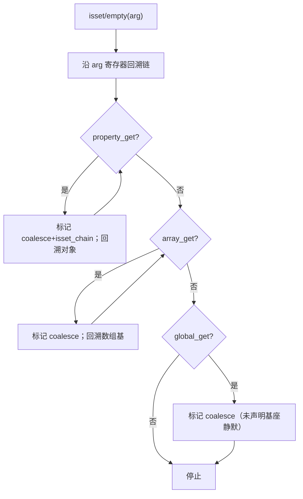
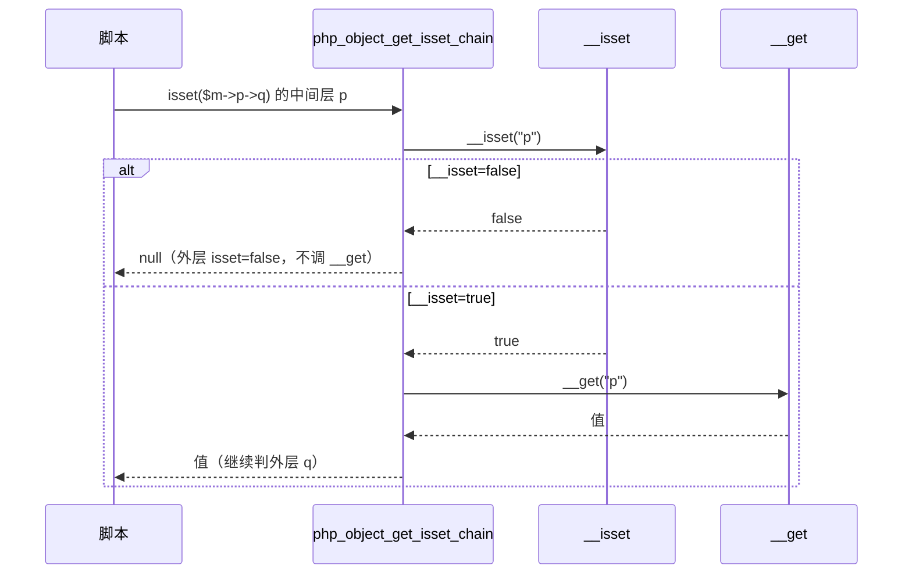

# AOT-CODEGEN-012 R-244：F-151-b 嵌套 isset/empty 链静默与 `__isset` 中继

- 日期：2026-10-24（R-244；F-151-b 闭环）
- 代次锚：`nlk fa56d9210fdad6597656e801924f79a5`／`tpl f03b46d4b0c364f026cc29e29e5384eb`／`irg 570e1731…`／`ir 5b99795…`／`parser 70e80f18…`／`opt 745e4bd4…`（提交 `ed878b2`）
- 状态：源与本文档已随 `ed878b2` 提交

## 1. 高层摘要（TL;DR）

R-243 只收敛了「单层 isset/empty 的基座变量」；更深的链仍有三个缺口：纯元素链中间层照常告警、属性中继用 `__get` 而非 `__isset`、`php_array_empty` 未进静默名单。本批复用发射器既有的 coalesce 链路标记机制，新增 isset 链专用标记与 `php_object_get_isset_chain`，把整条实参读链按 BP_VAR_IS 求值。

- 新门 C290（10 臂）**10/10 SAME**；六枚 isset/empty/coalesce 邻居门零转移；主回归 **68/68**。

## 2. 影响范围

| 维度 | 影响 |
|---|---|
| 语义面 | 嵌套 isset/empty 的值、诊断、魔术方法调用顺序、ArrayAccess 调用顺序均对齐 PHP 8.5.8 |
| 发射面 | isset/empty 实参链内的 `property_get` 改用新 helper；纯元素链的 `array_get` 改走 coalesce 变体 |
| 普通读 | 非 isset/empty/`??` 语境完全不变（n8 守卫） |
| 边界 | 链回溯深度上限 8；更深链第 9 级起不再标记 |

## 3. 核心变更

| # | 位置 | 变更 |
|---|---|---|
| 1 | [native_linker.zig:219](file:///Users/wangjianjun/products/parser/src/aot/native_linker.zig#L219) | 新 `markIssetQuietChain`：沿属性/元素基回溯整条链；属性读入 `isset_chain_regs`，全部入 `coalesce_nowarn_regs` |
| 2 | [native_linker.zig:337](file:///Users/wangjianjun/products/parser/src/aot/native_linker.zig#L337) | 新字段 `current_isset_chain_regs`（区分 `??` 与 isset 链） |
| 3 | [native_linker.zig:6456](file:///Users/wangjianjun/products/parser/src/aot/native_linker.zig#L6456) | 会话期设置/清理该集合 |
| 4 | [native_linker.zig:24768](file:///Users/wangjianjun/products/parser/src/aot/native_linker.zig#L24768) | `property_get` 选择 helper：isset 链 → `php_object_get_isset_chain`；`??` → `php_object_get_coalesce` |
| 5 | [runtime_lib_template.zig:22237](file:///Users/wangjianjun/products/parser/src/aot/runtime_lib_template.zig#L22237) | 新 helper：`objectIssetByName` 为真才 `php_object_get_coalesce`（`__isset` → 按需 `__get`） |
| 6 | `runtime_lib_template.zig` `php_object_isset` | 重构为薄壳＋`objectIssetByName`；`__isset` 结果 `toBool()` 并释放 |
| 7 | `native_linker.zig` quiet_call 名单 | 补 `php_array_empty` |
| 8 | `fuzzy_scripts_720/tmp/c290_nested_chain_gate_tmp.sh` | 新永久侧门 10 臂 |

## 4. 可视化概览（Code & Logic Map）

## 5. 详细变更分析

| 层 | 文件/位置 | 说明 |
|---|---|---|
| 发射器 | `native_linker.zig` | 标记集合＋一处 helper 选择；`generateInstructionSimple` 路径同享该状态 |
| 模板 | `runtime_lib_template.zig` | 两个 helper 共用 `objectIssetByName`；所有权仍为“借用返回＋发射器 retain” |
| 门 | C290 | 10 臂覆盖未定义基座、魔术方法、ArrayAccess、混合链、值面、多实参、`??`/单层/普通读守卫、静态属性、空数组/字符串 |

**关键约束**
- 中间层属性必须先 `__isset`；直接 `__get` 会改变魔术类的可观测副作用（n3）。
- 中间层元素对 ArrayAccess 必须 `offsetExists → offsetGet` 且缺失时短路（n4）。
- **`php_array_empty` 必须在 quiet_call 名单里**：否则嵌套 empty 的中间层仍按普通读求值（n1/n4/n7 的红根因）。
- 普通读不得被标记：`@$u['k']['j']` 与 `$a['k']['j'] ?? d` 只应返回默认值、不得改变诊断归属（n8）。

## 6. 影响与风险评估

| 项 | 结论 |
|---|---|
| 是否破坏式变更 | 修正与 PHP 不符的诊断/调用顺序；普通读零变化 |
| 门 | C290 **10/10**（自证 10 CF）；C289 8/8、C279 11/11、C276 12/12、C277 12/12、C267 14/14、C268 20/20 |
| 主回归 | **PASS=68 FAIL=0**、`SELF_CHECK_OK rows=68 uniq=68`（`c295_regression_R244_tmp.log`） |
| `zig build test` | 21/21 steps、326/326、rc=0（`/tmp/zigtest_R244.log`） |
| 风险 | 低；标记仅作用于 isset/empty 实参链，且 helper 返回借用由既有 retain 机制处理 |

**复测路径**：C290（自证 10 CF → 10/10）→ C289/C279/C276/C277/C267/C268 → 主回归 → `zig build test`。

## 7. 遗留问题 / 潜在问题

1. 链回溯深度上限 8（既有 coalesce 同口径）；更深的 isset 链第 9 级起不再标记。
2. `php_object_get_coalesce` 的“借用返回”契约依赖调用点 retain；若未来有新的发射路径直接消费该 helper，需保持同一所有权约定。
3. `isset($o?->p->q)`（nullsafe 中继）未纳入本门；属既有 `?->` 面，另案验证。

## 8. 后续开发 / 优化建议

| 优先级 | 建议 | 影响面 | 落地成本 |
|---|---|---|---|
| P1 | F-118b 不可折叠默认值（lazy factory） | Reflection/默认值 | 中高 |
| P1 | F-73b 属性默认值的全局常量（PD2 p12/p13，需构造期求值） | 类属性默认值 | 中高（工单 §71 已留方案） |
| P2 | F-62f-opt 可选参哨兵（含 intval null base） | 全可选参族 | 中 |
| P3 | F-145-b legacy MT 序列 | `srand(MT_RAND_PHP)` | 高（缺 PHP 源） |
